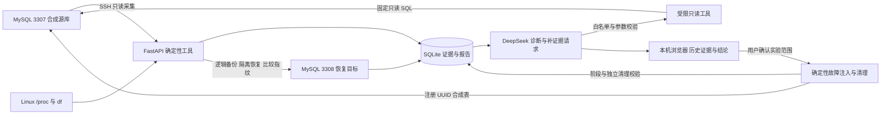
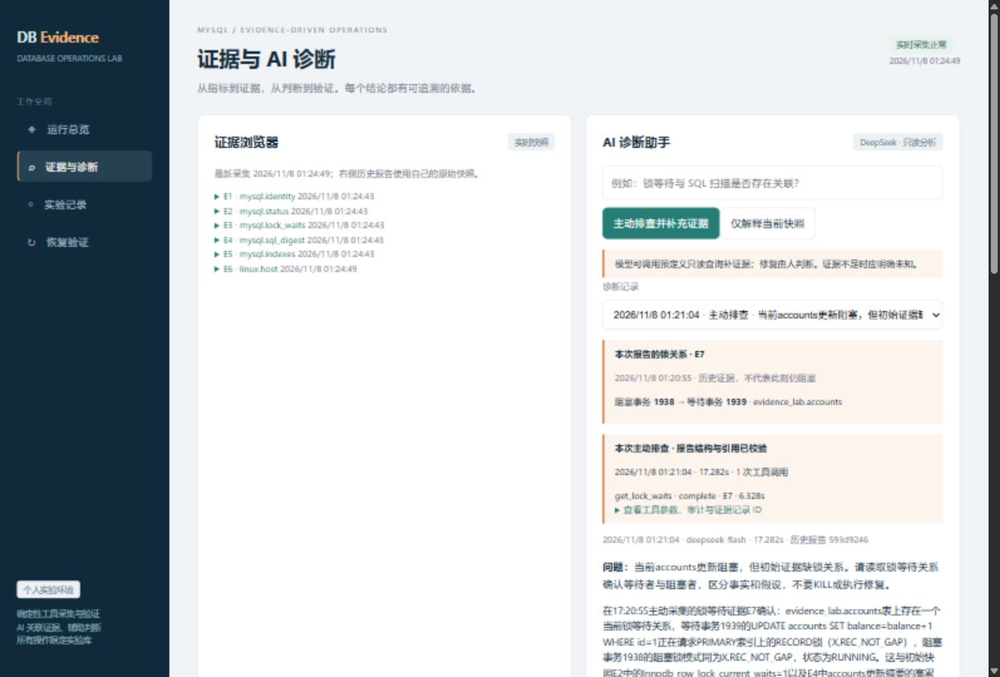

# 内部 AI 数据库运维平台

当前正在按平台目标重新设计：多实例接入、持续多源采集、后端范围授权、事件、AI调查和处置复验。先看 [设计图和页面流程](docs/platform/index.html)、[功能需求](docs/platform/01-requirements.md)、[系统架构](docs/platform/02-architecture.md)及[实施计划](docs/platform/04-delivery-plan.md)。这些平台能力仍处于设计与实施准备阶段，不能视为已完成。

下面记录的是先前已实现的 **DB Evidence Lab 受控实验模块**，其固定实例和单用户范围不等于当前平台目标。

个人 MySQL 运维实践：真实采集证据 → 模型选择受限只读工具 → 引用证据诊断 → 故障实验复核。

这是一套可以运行的实验作品。数据为生成的 30,000 行订单和 2 行账户，未接入任何生产系统。私密资料、个人信息和 API 密钥均不在本仓库。

## 已实现

- MySQL 8.4 状态、SQL 累计摘要、索引、事务等待关系，以及 Linux 负载、内存、文件系统采集。
- SQLite 留存带 UTC 时间和唯一 ID 的快照、演练、模型回答、恢复报告；页面按浏览器本地时区显示。
- 真实事务阻塞演练，捕获等待者与阻塞者，回滚阻塞事务后再次采集。
- 缺失索引演练：保存全表扫描 EXPLAIN，添加实验索引后重新验证执行计划。客户端循环耗时包含 SSH 和网络，不等于服务端耗时。
- DeepSeek 实时 JSON 分析，强制引用有效证据 ID、列出未知；模型无数据库凭据、任意SQL或Shell能力。
- 主动排查：模型可选择四类受限只读工具补充证据（锁关系、状态、实验表结构、固定查询 EXPLAIN），保存参数、时间、结果与报告引用。限制4轮模型响应、6次工具执行，重复调用拒绝执行；不提供任意SQL或Shell。
- 一致性逻辑备份、独立实例恢复、表结构/索引/行数/有序数据 SHA256 比较；包括损坏 SQL 的负向测试。
- 恢复报告的 AI 解释，成功判定仍由确定性比较完成。
- 页面完整案例：缺失索引或事务阻塞 → 故障保持期间 AI 补证 → 程序清理 → 清理后验证。模型完成、故障工具证据和清理分别记录；异常不伪装成功，阶段进度可见。
- 新采集连接不选择业务默认库，旧累计摘要中的已知采集 SQL 模板单列并保留。不会清空历史统计，也不把模板匹配当作账号归因。

## 本机启动

已准备好的环境在 `D:\Codex_WS\TDX_DBA\db-evidence-lab`。

```powershell
cd D:\Codex_WS\TDX_DBA\db-evidence-lab
.\start.ps1
```

打开 <http://127.0.0.1:8765>。启动脚本会恢复已配置 VM 的次要 IP、启动两套已注册 MySQL，核对 UUID，然后以前台方式启动服务；关闭终端可结束 Web 服务。

```powershell
.\stop.ps1                    # 只停止本项目 Web 监听，保留数据库和 VM
.\.venv\Scripts\python.exe -m pytest -q
.\.venv\Scripts\python.exe verify_lab.py
.\.venv\Scripts\python.exe verify_diagnosis.py
.\.venv\Scripts\python.exe verify_controls.py
.\.venv\Scripts\python.exe verify_incidents.py
```

`verify_lab.py` 运行基础演练、付费模型与恢复目标重建。`verify_diagnosis.py` 实际注入缺失索引和事务等待，调用模型只读工具，再恢复索引、回滚事务并校验；`verify_controls.py` 在后者导出完成后验证健康/缺证据反例与固定快照分析对照。均适用于本专用实验环境，不要与页面写任务同时运行。

`verify_incidents.py` 需要 Web 服务运行。它通过真实 HTTP 运行完整案例并检查 409 互斥，再在真实实验库中注入模型函数超时，验证索引恢复、双事务回滚、余额与等待清理。超时是受控测试替身，不代表服务商实际故障；负向案例记录保留为失败。

## 软件与配置

Windows / Python 3.12 / VMware Workstation；Linux 内 MySQL 8.4.5 官方 glibc2.17 minimal 二进制。前端为无需构建的 HTML/CSS/JS，后端为 FastAPI。没有 Docker、Node 构建或云服务的启动依赖。

```powershell
python -m venv .venv
.\.venv\Scripts\python.exe -m pip install -r requirements-lock.txt
New-Item -ItemType Directory runtime -Force
Copy-Item config.example.json runtime/config.json
```

在本机填好 `runtime/config.json`，SSH host key 预先核验并保存为 `runtime/known_hosts`。程序使用 RejectPolicy，未知主机不会自动接受。DeepSeek 密钥仅通过 `key_path` 读取；依赖锁文件记录本次实际运行版本。

VM 初始化步骤见 [SETUP.md](SETUP.md)。`resume_environment.py` 只用于恢复已初始化的这台 VMware 实验机；换环境应先修改配置与脚本中的固定网络、目录约定，不能直接指向其他数据库。

## 结构

| 文件 | 用途 |
|---|---|
| `lab.py` | 采集、证据库、AI、故障演练、恢复校验 |
| `app.py` | 本机 HTTP API、周期采集与写任务互斥 |
| `investigation.py` | 有预算的只读工具编排、证据和调用审计 |
| `incidents.py` | 故障保持期间诊断、独立清理与完整案例验收 |
| `metrics.py` | 两个同实例采样的累计计数窗口差分 |
| `web/` | 总览、历史诊断、演练、附属恢复页面 |
| `verify_lab.py` | 实际端到端验证与 JSON 导出 |
| `tests/` | 保护边界和异常行为测试 |
| `reports/` | 合成数据的实测证据与界面截图 |
| `runtime/` | 忽略提交的私密配置、数据库、备份、日志 |

## 设计与限制

需求与设计见 `docs/01-requirements.txt`、`docs/02-architecture.txt`、`docs/03-feasibility-and-iteration.txt`，交付验收见 `docs/04-acceptance.txt`。主动排查只支持专用实验库和四类工具，不覆盖任意业务SQL。



MySQL 仅绑定 VM 的 127.0.0.1，控制端通过核验主机密钥的 SSH 通道访问。采集使用只读账号，演练写账号限制在实验库；恢复使用 VM 本地 root client 配置文件。Web 仅监听宿主 127.0.0.1，并校验 Host 与 POST Origin。它没有多用户认证或生产权限体系，不应改为公网监听。

恢复前核对注册 UUID、源目标 UUID 不同及固定端口 3307/3308，只重建目标 `evidence_lab`。源指纹先于备份计算，因此要求演练期间源数据静止；未实现与备份同一事务的一致性指纹。并发生产写入、DDL、物理备份、增量/binlog恢复、RTO/RPO SLA 均不在当前验证范围。

SHA256 在 Python 中对有序行和结构元数据计算，适用于此小数据集；不是可扩展的 TB 级校验方案。结构指纹覆盖列属性和索引，不涵盖触发器、事件、存储程序、全部约束/表选项。不能据此保证任意业务库的完整恢复。

采集完成后等待 20 秒再采集；实际周期包含采集耗时，页面 10 秒刷新。超过 90 秒的快照显示过期；部分失败不会显示健康。SQL 摘要是实例累计值，不能当作当前执行语句或用单个快照推断趋势。AI 仍可能推测错误，必须对照原始证据。

没有 Prometheus/Zabbix 接入、复制延迟、网络/存储根因适配、告警通知、自动修复或多轮会话记忆。模型可以调用预定义只读查询，不能执行任意 SQL 或写操作。单次调查最多4轮响应、6次调用，180秒预算在调用前检查；不是硬实时取消。引用校验只证明引用存在，不证明模型推理正确。

固定快照分析遇到不合格格式/引用时最多请求一次纠正，原始回答、校验错误和每次用量均留存，再次失败仍拒绝。窗口差分目前覆盖 Questions、Slow_queries 和两个缓冲池读计数；SQL 摘要仍展示累计值，尚未做摘要淘汰/重置后的窗口匹配。系统自身查询也会计入统计。

完整案例清理通过依赖程序仍在运行且数据库可达；进程被强杀或网络彻底断开时不能保证索引已恢复。下次索引案例会检查基线，异常时拒绝继续注入。阶段事件持久化，页面进度并非可跨进程恢复的任务队列。

## 验收与展示

见 [DEMO.md](DEMO.md) 的 10 分钟路线、[历史模块概览](docs/legacy-lab/project-summary.md) 与 [技术演示说明](docs/legacy-lab/technical-walkthrough.txt)。`reports/incident-verification.json` 保存完整案例、互斥与超时清理实测，`reports/browser-verification.json` 保存实际页面操作依据；`reports/diagnosis-verification.json` 保存早期两种主动诊断；`reports/control-verification.json` 保存反例与同输入对照；基础与恢复证据见 `reports/verification.json`。重复运行覆盖导出文件，SQLite 保留历史记录。


