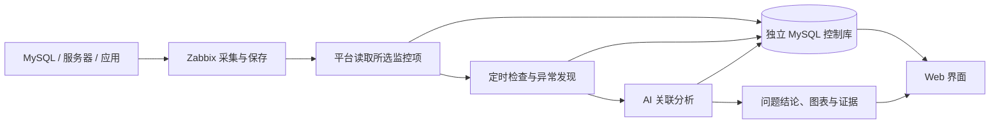

# DB Evidence Platform

**让 AI 帮 DBA 读监控、找问题、解释原因。**

数据库变慢时，运维人员往往需要在服务器曲线、数据库状态和日志之间来回核对。DB Evidence Platform 把同一业务的监控数据集中起来，自动检查异常，结合 AI 给出**发生了什么、可能为什么、建议怎么处理**，并提供图表和分析依据供人核对。

已有数据由 **Zabbix 负责采集**，本项目重点完成**数据聚合、持续巡检和问题分析**。这是一个面向内部 DBA / 运维人员的个人作品，当前以 MySQL 场景为主。

## 在线体验

**[快速演示：免登录体验一次故障](https://premium-prozac-barbara-develop.trycloudflare.com)** · **[完整平台：查看分析、监控与报告](https://genesis-bomb-lessons-compiler.trycloudflare.com)**

完整平台只读账号：`demo` / `EvidenceDemo-2026!`。两个入口使用临时网址，依赖演示电脑在线。

<details>
<summary>展开演示操作说明</summary>

1. 打开快速演示，开启固定的 MySQL 锁等待开关。
2. 同页观察平台自动检查、分析和生成报告，也可进入完整平台查看图表与证据。
3. 关闭开关，查看后续采样是否恢复。开关操作影响共享测试环境。

快速演示只制造隔离测试故障并临时加快检查；报告由完整平台根据 Zabbix 数据自行发现和分析。等待时间、历史报告和失败状态的解释见[演示指南](docs/quick-showcase.md)。

</details>

## 能做什么

| 能力 | 使用效果 |
| --- | --- |
| **聚合已有监控** | 按主机、监控项和标签，把同一业务的数据库、服务器指标及已采集日志放到一起 |
| **自动检查问题** | 后台持续取数，按周期检查锁等待、SQL 耗时、资源与可用性等信号 |
| **AI 联合分析** | 结合不同主机与监控项的线索，解释现象、候选原因和建议；证据不足时说明缺什么 |
| **结论与依据一起看** | 先读问题摘要，再查看趋势图、关系图、日志或 SQL 摘要及原始引用 |

**问题报告：先看结论，再按需核对分析过程。**


**数据查看：在同一时间范围对照数据库与主机监控。**


截图来自个人隔离实验环境。日志、锁关系和 SQL 摘要需要先由 Zabbix 实际采集；平台不会自动补出上游没有的数据。

## 系统怎么工作



平台通过 **Zabbix API** 读取数据，不需要业务数据库口令。配置好分析范围和周期后，采集与分析在后台独立运行；关闭浏览器也会继续检查。AI 分析使用当次保存的数据窗口，旧报告不会随着新采样被改写。

| 组成 | 技术与职责 |
| --- | --- |
| Web 界面 | React、TypeScript、Ant Design、ECharts；查看问题、数据和配置 |
| API 服务 | Python、FastAPI、SQLAlchemy；处理登录、权限、接入与查询 |
| 采集与分析后台 | 独立采集 worker / AI worker；定时取数、检查异常、排队分析 |
| 控制数据库 | MySQL + Alembic；保存对象、任务、采样、报告与证据 |
| AI 模型 | 已使用 DeepSeek API 分析脱敏证据；也可采用不调用模型的规则模式 |

更详细的[技术架构、数据与开发说明](docs/project-overview.md)。

## 怎么使用

1. **接入 Zabbix**：填写只读 API 凭据，选择允许使用的主机组。
2. **组合分析范围**：勾选同一业务的数据库、服务器监控项，保存为一个“联合分析对象”。
3. **配置巡检**：设置检查周期、模型模式和调用预算；启用外部模型还需授权数据外发。
4. **阅读结果**：在“问题分析”看结论和建议，在“数据查看”核对曲线与依据，再由人员决定处理和复验。

界面围绕 **问题分析、Zabbix 接入、数据查看、配置** 四个入口组织。完整操作见[使用指南](docs/user-guide.md)，监控项选择见[联合对象指南](docs/analysis-groups-guide.md)。

## 怎么部署和运行

当前提供 **Windows / PowerShell 本地部署工具**。需要 Python 3.12、Node 22.12+ 的 Vite 8 兼容版本、独立 MySQL 8.4 控制库，以及已有的 Zabbix 和只读 API 权限。

**先下载源码、安装依赖并构建前端：**

```powershell
git clone https://github.com/catdogrennie-gt/db-evidence-platform.git
Set-Location db-evidence-platform
python -m venv .venv
.\.venv\Scripts\python.exe -m pip install -r requirements-platform-lock.txt
npm --prefix frontend ci
npm --prefix frontend run build
```

**首次部署再完成配置和初始化：** 用 `scripts/platform/prepare_local.py` 在仓库外生成私密配置及随机账号，初始化独立控制 MySQL，执行迁移和账号授权。生成器只准备文件，不自动安装或启动数据库。完整命令按[部署指南](docs/platform/07-operations.md)执行。

**初始化完成后，启动平台：** 将下方路径换成自己的私密配置。

```powershell
$platformConfig = 'D:\Private\DBEvidence\config.json'
.\scripts\platform\manage.ps1 -Action Start -Services mysql,api,worker,ai -ConfigPath $platformConfig
.\scripts\platform\manage.ps1 -Action Status -Services mysql,api,worker,ai -ConfigPath $platformConfig
```

新部署默认访问 `http://127.0.0.1:18080`，实际地址以配置为准。新安装使用本机生成的账号，在线演示账号仅用于上面的演示站点。

## 数据与安全

- **只读取授权数据**：Zabbix 使用独立只读凭据；平台按角色及部门、系统、对象范围控制访问，日志等敏感原文需要额外权限。
- **凭据留在服务端**：Zabbix 凭据加密保存，配置和主密钥位于源码仓库外；登录使用服务端会话和 CSRF 防护。
- **模型访问受限**：AI 通过只读工具获取获准、脱敏的分析证据；查看数据和允许外发给模型分别授权，并限制调用次数、输入量与超时。
- **操作由人控制**：AI 提供原因解释与处理建议，不执行任意 SQL、Shell 或数据库变更。

## 项目开发说明

- **性质**：个人项目，由本人主导需求、数据库运维场景、方案取舍与验收。
- **开发助手**：使用 Codex 辅助设计、前后端编码、调试、测试和文档；参考 Superpowers 与 OpenAI Skills 的工程方法。
- **开发与验证工具**：pytest、前端测试、浏览器验收、Git / GitHub；用 VMware、Docker 和隔离 MySQL 验证真实采集及故障场景。DeepSeek 是平台运行时的分析模型。
- **时间**：2026 年 11 月 7 日开始规划，迭代至 11 月 12 日，约一周；这是日历跨度，未记录精确净工时。

当前已在个人隔离环境跑通“Zabbix 采集 → 自动发现 → AI 报告 → 人工处理后观察恢复”的流程。项目用于展示工程实现和运维思路，生产容量、长期稳定性和高可用仍需进一步验证。实际采样、规则判断和模型解释分别保留，缺数或未知不会被写成正常。

## 更多文档

- [技术架构与开发过程](docs/project-overview.md) · [部署与运维](docs/platform/07-operations.md) · [使用指南](docs/user-guide.md)
- [官方 Zabbix 模板与诊断扩展](docs/zabbix-official-setup.md) · [真实实验验收](docs/acceptance-quick-showcase.md)
- [独立故障实验系统 SignalLens Lab](https://github.com/catdogrennie-gt/SignalLens-Lab) · [历史版本](docs/releases/README.md)
