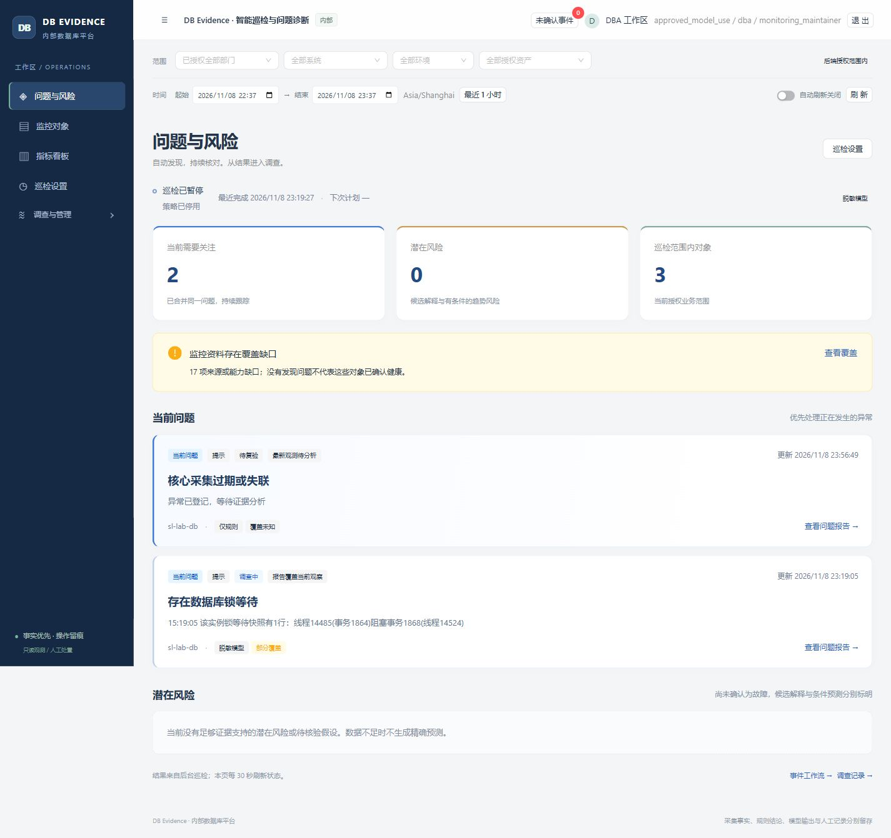
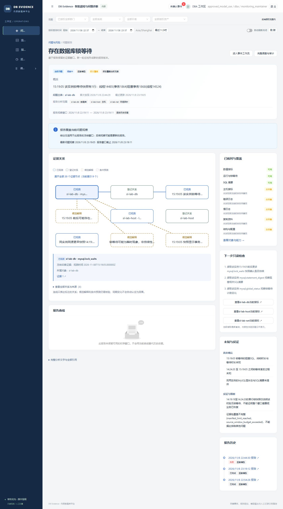
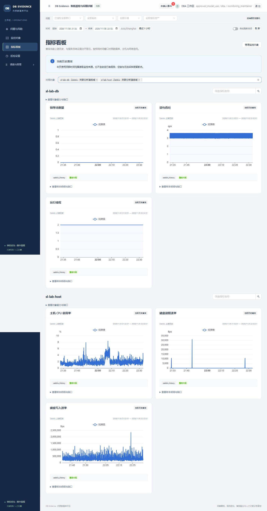
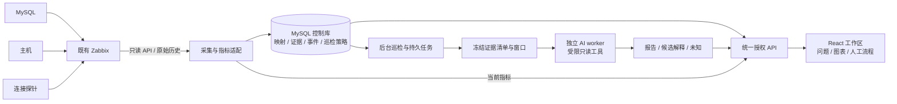

# DB Evidence Platform

**让已有监控持续产出可追溯的问题分析。**

An evidence-driven MySQL inspection and investigation platform.

面向内部 DBA 与运维团队，复用 Zabbix 已有的数据库、主机与连接探针数据，自动巡检、发现异常和条件风险，把问题摘要、证据关系、指标曲线与后续检查放进同一份报告。

[操作指南](docs/user-guide.md) · [安装与运行](docs/platform/07-operations.md) · [验证范围](#验证与复现) · [历史版本](docs/releases/README.md)



本机隔离环境的实际产品界面。数据库业务负载为合成数据；对象、问题数量按当前账号的业务授权范围计算，规则结果与真实模型输出分别标识。

## 先看结果，再沿证据调查

日常打开“问题与风险”，先看**发生了什么、影响哪个对象、依据是否充分**。点击问题进入报告，核对关系图和冻结曲线，再查看原始证据或当前指标。配置一次巡检策略后，后台按周期运行；浏览器无需一直打开。

```text
连接已有 Zabbix → 选择监控对象 → 启用巡检
                                 ↓
问题与风险 → 分析报告 → 证据关系 / 冻结曲线 → 下一步检查
                                 ↓
                          人工处置 → 新样本复验
```

| 能力 | 使用时能看到什么 |
| --- | --- |
| **自主巡检** | 轻量规则检查、周期综合分析和新异常紧急通道；显示最近完成、下次到期、预算与停止原因，正常巡检也保留历史 |
| **三层证据关联** | 同一分析范围内的数据库、主机与连接探针资料；每条曲线带对象、来源、单位、窗口和覆盖状态 |
| **可追溯报告** | 事实、候选解释、反证、未知和下一步检查；引用可回到对应冻结证据，旧报告不会随上游新数据改写 |
| **复用已有监控** | 只读连接 Zabbix，发现并选择已有对象，查看实际能力；缺锁、SQL、日志或计划时直接呈现缺口 |
| **按业务范围协作** | 后端按部门、系统、环境及实例范围控制资料；来源管理权限与业务数据读取权限分开 |

确定性工具负责采集、计算与验证；AI 辅助关联和解释；重要处置由人员明确控制。

## 一份报告，讲清依据和下一步



图示为已核对的实际锁报告。该历史报告未保留曲线：8 条来源曲线合计 10,116 点，触发当前 10,000 点预算后被整组省略。此缺口保留显示；较小窗口的冻结曲线及下方当前指标看板可用，不能拿新查询补写旧报告。

关系图区分**已观测、已登记、候选解释、条件预测**。报告中的问题主体与完整分析范围分别展示，数据库异常不会把主机或探针指标误标成数据库自身的测量。连线和同时变化的曲线用于解释已有关系，不自动证明因果。

报告绑定不可变证据清单与时间窗。点击证据引用可回查原始快照或精确的冻结指标窗口；新一轮分析生成新版本。人工复核、处置记录、后续复验和知识条目沿用原平台流程。

### 实际案例：后台周期分析一条锁等待链

在独立 Lab 的 45 秒锁实验中，后台 **periodic 自动巡检**完成了 **2 次真实 DeepSeek 调用与 2 次白名单只读工具调用**。冻结窗口包含实际锁快照；报告中的阻塞事务 `1864` / 线程 `14485` → 等待事务 `1868` / 线程 `14524`，已与原始归一化快照逐项核对。

报告保留 4 条事实、2 条候选解释和 1 条显式待核验 finding。另核对了引用清单、数据库 / 主机 / 探针三对象范围及提供商审计；早期引用失败与窗口不覆盖异常的记录仍保留。该结果证明这次受控等待链的分析已运行，不代表业务根因已经证明或平台自动恢复。过程和剩余边界见[实际验收](docs/acceptance-zabbix.md#已核对的自动周期锁案例)。

## 指标看板保留数值含义



需要了解现在的情况时，从报告进入“当前指标”或直接打开指标看板，选择授权对象与窗口。当前查询与历史报告分开，缺数保持缺口，不补成零或健康状态。

数据库模板并不自动包含完整诊断资料。SQL 摘要的累计计数、窗口差分和生命周期最大值有不同含义；连接探针耗时也可能包含认证和查询。平台保留这些语义，再让规则与模型使用。

## 开始使用

### 已有部署：四步启用巡检

1. **连接来源**：在“监控对象”中点击“连接 Zabbix 来源”，填写所属系统、只读 API 与受限主机组。Token 加密保存在服务端，不返回浏览器。
2. **选择对象**：发现已有数据库、主机与探针，选择需要巡检的对象，核对能力和最近观察。此路径无需目标数据库口令。
3. **保存策略**：在“巡检设置”指定负责人、对象、模式、周期、冷却与每日运行上限。真实模型模式还需要供应商配置、当前授权及明确外发许可。
4. **查看结果**：回到“问题与风险”，等待后台完成。没有合格异常的周期留在巡检历史，不为增加问题数量制造告警。

默认轻量检查周期为 300 秒、综合分析周期为 1800 秒；可在策略内调整。单次调查最多五个资源，每位用户最多三个在途调查，较大范围分组调度。顶部浏览范围不会悄悄改写已保存策略。完整步骤与异常排查见[操作指南](docs/user-guide.md)。

### 新部署：从空平台初始化

当前部署工具面向 **Windows + PowerShell、Python 3.12、Node 22.12+ 或支持 Vite 8 的兼容版本**。使用独立 MySQL 控制库；现有部署工具同时准备原直采路径使用的 Prometheus。Zabbix 服务及只读权限由操作者提供。

```powershell
git clone https://github.com/catdogrennie-gt/db-evidence-platform.git
Set-Location db-evidence-platform
python -m venv .venv
.\.venv\Scripts\python.exe -m pip install -r requirements-platform-lock.txt
npm --prefix frontend ci
npm --prefix frontend run build
```

随后按[安装指南](docs/platform/07-operations.md)完成**仓库外私密目录 → 控制库初始化 → Alembic 迁移 → 账号与业务授权 → 服务启动**。API 不自动建库或迁移。新部署从零业务数据开始，默认是 `rules_only`，无需模型账号即可启动；没有仓库通用密码。

安装完成后，在仓库根目录使用实际平台管理入口：

```powershell
$platformConfig = Join-Path $env:LOCALAPPDATA 'DBEvidencePlatform-private\config.json'
.\scripts\platform\manage.ps1 -Action Start -Services mysql,prometheus,api,worker,ai -ConfigPath $platformConfig
.\scripts\platform\manage.ps1 -Action Status -Services mysql,prometheus,api,worker,ai -ConfigPath $platformConfig
```

默认入口为 [http://127.0.0.1:18080](http://127.0.0.1:18080)，以自己的私密配置 `public_origin` 为准。根目录 `start.ps1` 属于更早的实验应用；本平台使用 `scripts/platform/manage.ps1`。原 MySQL 直连接入与处置页面保留在“调查与管理”中。

## 系统如何组成



| 组件 | 责任 |
| --- | --- |
| React / TypeScript、Ant Design、ECharts | 结果首页、证据关系、曲线、接入与原人工工作流 |
| FastAPI、SQLAlchemy / Alembic、MySQL | 统一身份及业务授权、来源映射、证据、事件、报告、策略和任务记录 |
| 采集与巡检 worker | 只读来源采集、信号计算、周期与紧急调度；租约、fence、唯一派发和预算约束并发 |
| 独立 AI worker | 读取已授权冻结资料，执行白名单只读工具，检查引用并保存报告；与采集队列分离 |
| Zabbix / 原 Prometheus 路径 | 保留各自原始时序；调查按窗口物化有限副本，旧 `prometheus_window` 与新 `time_series_window` 共存 |

这是独立 Web 平台。Grafana 可作为后续外链看板，当前不作为运行依赖；Zabbix 不被另一个时序存储替代。设计、数据与接口细节见[本轮架构说明](docs/superpowers/specs/2026-11-08-zabbix-intelligence-design.md)。

## 验证与复现

当前改造在个人隔离环境验证。实际目标测量、确定性规则、模拟提供商与真实外部模型分别记录；一次模型完成不代表所有表述都正确。

| 本轮检查 | 当前结果 |
| --- | --- |
| 实际 Zabbix 来源与对象接口 | 3 个映射对象、14 项 HTTP 检查通过，覆盖来源、选择、能力与实际历史读取 |
| 后台正常周期 | `rules_only` 自主巡检完成；该窗口无合格问题，正常结果留在巡检历史 |
| 服务重启 | 已核对策略、映射及记录持久化；不是长期稳定性或高可用测试 |
| 真实模型与锁案例 | 正常模型周期及一次自动周期锁分析完成；锁链四个编号、方向、冻结引用与三对象范围已逐项核对 |
| 权限、冻结与并发 | 8 项报告范围 HTTP 对照通过；843 个冻结清单项含 8 个窗口保持不变；限定真实 MySQL 多进程派发与预算检查通过 |
| 最终源码回归 | Python 546 通过、10 跳过、6 个子检查通过；前端 18 通过，类型检查、构建、16 项 workflow / 7 项 connection 契约及依赖检查通过 |
| SQL 压力与剩余检查 | 实际负载和清理已有记录；缺少真实 counter epoch，SQL 窗口差分及根因诊断未验证；大窗口曲线预算的整体省略问题尚未修复 |

逐项方法、阶段回归、保留失败和未覆盖范围见[本轮验收矩阵](docs/acceptance-zabbix.md)。以上是隔离环境的限定结果，不把某次完成或历史测试数外推为全系统验收。

在已安装依赖的仓库根目录可运行：

```powershell
.\.venv\Scripts\python.exe -m pytest tests/platform -q
.\.venv\Scripts\python.exe -m pip check
npm --prefix frontend test
npm --prefix frontend run typecheck
node frontend/scripts/check-workflow-contracts.cjs
node frontend/scripts/check-connection-contracts.cjs
npm --prefix frontend run build
```

真实 MySQL / TLS 连接用例需显式环境配置，跳过不计通过；真实模型调用需另配供应商、权限与外发许可。公开源码不携带本机账号、控制库或原始运行记录。

<details>
<summary>历史案例：事务阻塞、无效处置对照与 SQL 索引复验</summary>

改造前版本保留了三个独立 MySQL 合成目标的真实采集与两类受控案例：锁等待中先执行无效动作，确定性复验为 `not_improved`，外部受控释放阻塞后新样本为 `improved`；SQL 索引案例比较固定负载的前后窗口，并保留 `inconclusive` 及无效动作对照。

它们说明原平台的调查、人工记录、复验与知识链路，不能证明新版 Zabbix 接入或新模型案例已经通过。固定源码、测量口径与边界见[历史 Release](https://github.com/catdogrennie-gt/db-evidence-platform/releases/tag/legacy-platform-2026.11.08)及[回溯说明](docs/releases/legacy-platform-2026.11.08.md)。

</details>

## 当前范围

当前重点是 **MySQL、Zabbix 已有数据、Windows 单机内部部署**。一个上游 host 对应一个可辨识的逻辑对象，无法区分的多数据库映射会被拒绝。锁、SQL、日志或计划的深度取决于来源实际提供的资料，不靠模板名补全。

模型输出是待核验解释。平台不自动执行数据库变更、任意 SQL、Shell 或邮件发送；权限撤销、来源离线、缺少外发许可、预算耗尽和模型失败应保留可见状态。PostgreSQL、企业 SSO、完整保留清理、十实例容量、长期稳定性、高可用与公网部署仍未完成验证。

本次按当前版本收尾，不将尚未完成的曲线预算修复计入发布。本机演示的自动模型策略保持暂停，既有报告和当前指标仍可查看，可在巡检设置中重新启用。

## 文档与历史

- [操作指南](docs/user-guide.md)：接入、策略、报告、指标和异常处理。
- [安装与运行](docs/platform/07-operations.md)：私密目录、初始化、迁移、启停与升级。
- [实际验收矩阵](docs/acceptance-zabbix.md)：真实来源、权限、冻结、并发、受控锁案例、最终回归及当前边界。
- [本轮设计](docs/superpowers/specs/2026-11-08-zabbix-intelligence-design.md) · [变更记录](CHANGELOG.md) · [README 素材与参考规范](docs/readme-guidelines.md)。
- [历史 Release](https://github.com/catdogrennie-gt/db-evidence-platform/releases/tag/legacy-platform-2026.11.08)：保留改造前公开源码；[版本索引](docs/releases/README.md)提供精确提交与恢复路径。
- [原平台设计与案例](docs/platform/README.md) · [更早的独立实验模块](README-legacy-lab.md)。

源码目录：`platform_app/` 后端与 worker，`frontend/` 界面，`migrations/` 控制库迁移，`tests/platform/` 回归，`scripts/platform/` 部署与验收工具。
