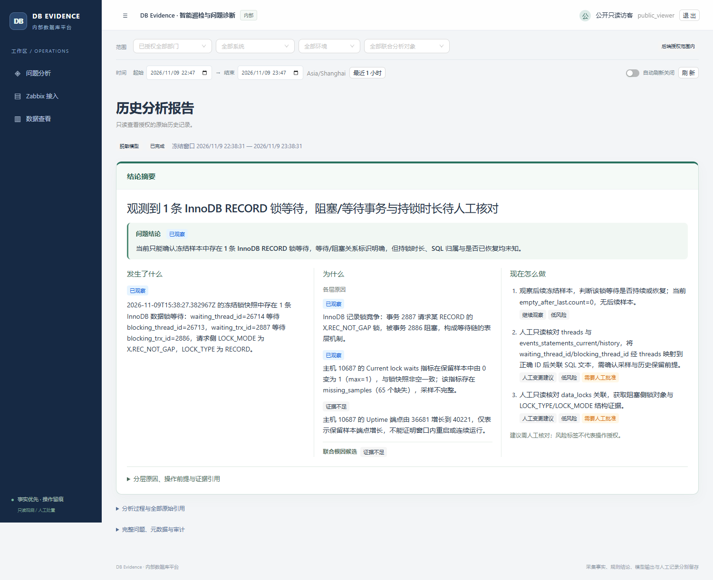
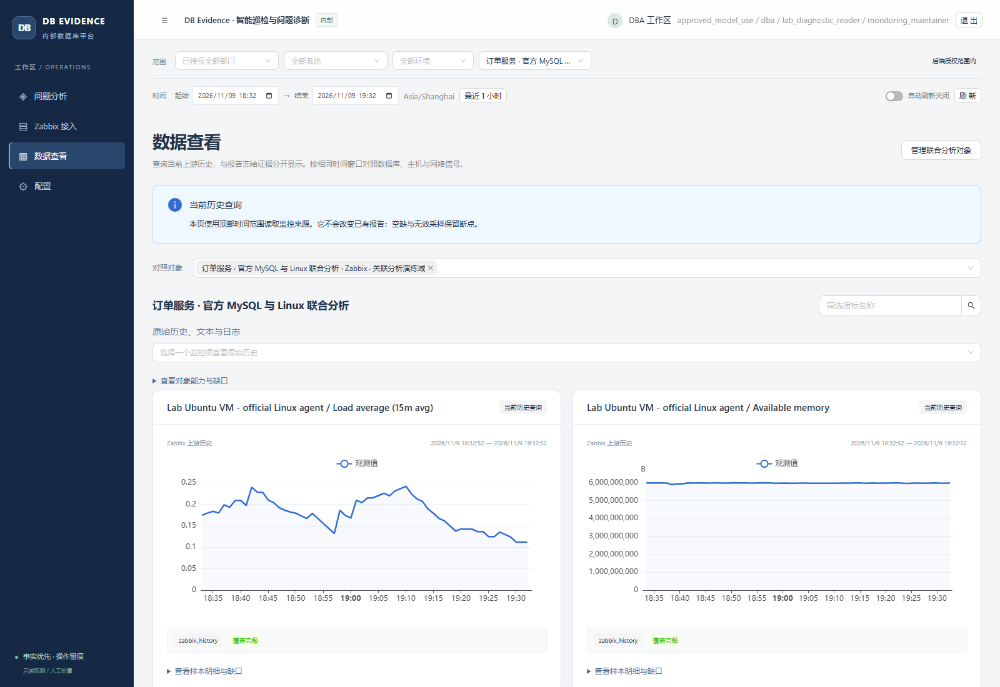
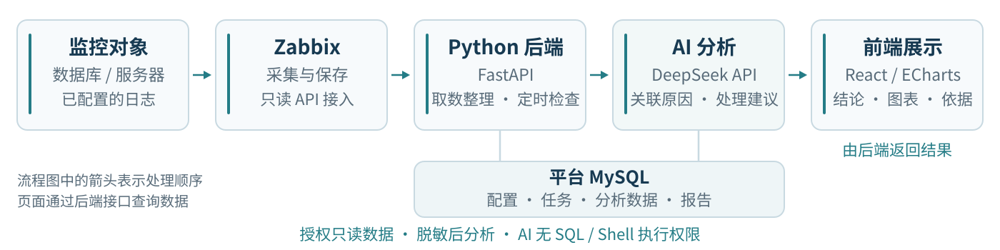

# DB Evidence Platform

**让已有监控数据，进一步回答数据库是否健康、哪里存在风险。**

DB Evidence Platform 是一个基于已有监控数据的 **AI 数据库运维分析平台**，面向内部 DBA 和运维人员，当前以 MySQL 场景为主。

核心目标是：**复用 Zabbix 已采集的数据，通过跨指标联合分析，补充现有告警规则未覆盖的异常与潜在风险，弥补从监控数据到数据库健康判断的分析缺口。**

有数据、没有告警，并不一定意味着数据库没有问题。有些问题尚未达到当前配置的告警阈值，有些需要把数据库指标、服务器资源和诊断信息放在一起才能看出线索。本项目把原本依靠人工查找、比对的工作，做成**汇总数据 → 定时检查 → AI 关联分析 → 输出结论与依据**的持续流程，既辅助排查已发生的问题，也探索在告警触发前识别风险。

用户先看到**发生了什么、可能为什么、建议怎么处理**，需要确认时，再查看趋势图、关系图和具体数据。项目重点是让已有数据更有用，减少人工在多个页面之间查找、比对和拼接线索。

## 在线体验

**[打开完整平台，查看监控、问题与分析报告](https://screens-sponsor-kijiji-julie.trycloudflare.com)**

只读账号：`demo` / `EvidenceDemo-2026!`。当前使用临时网址，依赖演示电脑在线。

公开故障演示暂不开放，场景仍在内部验证；待发现、分析和恢复流程跑通后，再逐项开放。平台默认关闭自动刷新，点击“刷新数据”查看新结果。

## 能看到什么

| 能力 | 使用效果 |
| --- | --- |
| **聚合已有监控** | 选择相关主机、监控项和标签，把同一业务的数据库与服务器数据放在一起 |
| **后台持续检查** | 配好范围和周期后自动取数、检查异常、安排分析，无需一直打开网页 |
| **AI 联合分析** | 关联数据库与主机等数据，分析当前告警规则之外的问题线索，解释现象、比较可能原因并提出建议；信息不足时说明缺什么 |
| **结论与依据一起看** | 先看问题摘要，再查看指标曲线、关联关系和支持结论的数据 |

### 如何看出联合分析的价值

先从容易核对的普通问题开始：[锁等待记录](https://screens-sponsor-kijiji-julie.trycloudflare.com/issues/5d52a1d9-8b3e-4c66-9776-c8f7d95d5314)和[连接容量风险记录](https://screens-sponsor-kijiji-julie.trycloudflare.com/issues/c9608395-38b9-412d-83d6-4e895d496820)保留了实际数据与后续恢复观测，也可从首页“最近已恢复的问题”查看。当前已验证基础发现与恢复，AI 对原因和处理建议的解释仍在完善，不把这些记录当作已完成的根因诊断。

<details>
<summary>开发验证记录与当前不足</summary>

| 实际验证场景 | 当时的 Zabbix 配置为何没有对应告警 | 平台发现什么、还缺什么 |
| --- | --- | --- |
| **SQL 效率退化**：扫描行数从约 20 增至 4,799，请求与 SQL 耗时一起变化 | 本次窗口官方慢查询速率实际为 0，未触发已启用的阈值规则 | 自动发现持续基线变化，关联扫描代价与耗时；尚未确认具体 SQL 或执行计划根因 |
| **应用连接池紧张**：池占用达 6、获取等待约 600ms，请求出现失败 | 数据库仅约 9/40 个连接，没有数据库连接耗尽事件；应用池限制与数据库总连接限制是两回事 | 已关联池占用、等待与错误；模型输入遗漏池容量与 DB 上限，9/40 余量是另行实测，诊断仍待完善 |
| **临时表查询代价上升**：磁盘临时表约 4 张/秒，请求耗时约 44ms | 当前官方规则要求速率超过 10 张/秒并持续 5 分钟，本次未触发 | 已发现跨层变化与恢复；本轮 AI 解释仍过于通用，**尚未分析到临时表机制，继续改进** |

以上为 **2026-11-12 隔离环境的单次实测**，不是准确率或生产效果。Zabbix 可以配置更细的规则；这里验证的是在当时真实配置下，平台能否补充发现、关联解释，并如实暴露分析缺口。完整的三段说明、测量口径与改进记录见[验证与改进](docs/platform-evolution.md)。

</details>

**问题报告：先看结论，再按需核对分析过程。**



**数据查看：在同一时间范围对照数据库与主机监控。**



截图来自个人隔离实验环境。日志和诊断信息需要先由 Zabbix 实际采集；平台不会补出上游没有的数据。

## 系统架构与分工



**数据路径：数据库与服务器 → Zabbix 采集 → 平台只读取数、整理和检查 → DeepSeek 辅助分析 → Web 展示结论与依据。**

| 组成 | 技术与职责 |
| --- | --- |
| 上游采集 | **Zabbix**：沿用已有模板，采集数据库、服务器及已配置的日志，保存上游监控历史 |
| 接口后端 | **Python / FastAPI**：处理登录、权限、数据接入、查询和前端请求；SQLAlchemy 负责访问平台数据库 |
| 取数与检查后台 | **Python 独立后台进程**：定时读取所选数据，检查异常、保存分析数据并安排任务 |
| AI 分析后台 | **Python 独立后台进程 + DeepSeek API**：整理获准的脱敏数据，调用模型分析，校验并保存报告 |
| 平台数据库 | **独立 MySQL**：保存配置、权限、任务、异常、分析所需的数据片段和报告；Alembic 管理表结构变更 |
| Web 界面 | **React / TypeScript / Ant Design / ECharts**：展示问题结论、指标趋势、分析依据和配置页面 |

这里的 MySQL 是平台自己的存储，与被监控的业务数据库用途不同。当前采用独立 Web 界面，图表由 ECharts 实现，主流程不依赖 Grafana 或 Prometheus。更详细的实现见[技术架构与开发说明](docs/project-overview.md)。

### 数据如何进入平台

1. **复用 Zabbix 采集。** 基础信息尽量使用官方 MySQL / Linux 模板；模板没有覆盖的诊断信息，通过 Zabbix 扩展采集后进入同一流程。平台主流程只需要 Zabbix API 凭据，不需要业务数据库连接密码。
2. **由用户选择分析范围。** 按主机、监控项和标签查找数据，把同一业务相关的数据库与服务器监控项组合起来，保存为一个“联合分析对象”，也就是一组需要一起检查的数据。
3. **由程序整理数据。** 后端读取名称、类型、单位和采样时间，区分数值、文本与日志，检查缺失、过期和截断情况，按相同时间范围组织数据，便于对照变化。

基础指标使用官方 Linux / MySQL 模板；配置、性能视图、慢/错误日志及应用诊断事件通过 Zabbix 扩展汇总。首页默认最近 7 天，新增数据从实际接入时开始积累。接入内容和边界见[诊断数据准备](docs/collection-foundation.md)。

平台不需要为每种数据库重新编写一套基础采集器，但仍需要理解数据类型和含义。数值可以画趋势图，文本按内容展示，受支持的数据库诊断扩展由专门逻辑解析。上游监控历史继续留在 Zabbix；平台保存配置、任务和分析需要的数据，无需再复制一整套监控历史库。

### 如何自动发现和分析问题

**程序执行稳定流程，AI 辅助关联和解释。** 后台按计划取数、检查异常、去重并安排分析，也支持按周期进行综合分析。取数和 AI 分析使用独立后台进程与任务队列，任务状态保存在 MySQL；模型响应较慢或调用失败时，取数仍可继续。

DeepSeek 分析当次获准、保存下来的数据，在同一时间范围中比较不同监控项的线索，生成报告：

| 报告内容 | 回答的问题 |
| --- | --- |
| 现象 | 发生了什么，涉及哪些对象？ |
| 原因分析 | 能确认的直接原因是什么，有哪些有依据的关联原因？ |
| 结论与未知 | 目前能判断什么，还缺哪些信息？ |
| 处理建议 | 下一步应怎样排查或处理？ |
| 图表与依据 | 哪些曲线、关系和数据支持这个判断？ |

报告先展示结论，再按需展开分析过程，并不要求每个问题都有所有图表。实际测量、规则判断与模型解释分别保留；同时变化只是关联线索，不能直接当作已经证明的根因。缺少数据会明确提示，不当作零值或健康。

AI 使用分析当时保存的数据，旧报告不会随新采样改写。外部模型可选：可以仅运行规则检查；启用 DeepSeek 需要配置模型凭据、授权数据外发，并设置调用预算和超时。

## 怎么使用

1. **接入 Zabbix**：填写只读 API 凭据，选择允许使用的主机组。
2. **组合分析范围**：勾选同一业务的数据库、服务器监控项，保存为一个“联合分析对象”。
3. **配置巡检**：设置检查周期、模型模式和调用预算；启用外部模型还需授权数据外发。
4. **阅读结果**：在“问题分析”看结论和建议，在“数据查看”核对曲线与依据，再由人员决定处理和复验。

界面围绕 **问题分析、Zabbix 接入、数据查看、配置** 四个入口组织。完整操作见[使用指南](docs/user-guide.md)，监控项选择见[联合对象指南](docs/analysis-groups-guide.md)。

## 怎么部署和运行

当前提供 **Windows / PowerShell 本地部署工具**。需要 Python 3.12、Node 22.12+ 的 Vite 8 兼容版本、独立 MySQL 8.4 控制库，以及已有的 Zabbix 和只读 API 权限。

**先下载源码、安装依赖并构建前端：**

```powershell
git clone https://github.com/catdogrennie-gt/db-evidence-platform.git
Set-Location db-evidence-platform
python -m venv .venv
.\.venv\Scripts\python.exe -m pip install -r requirements-platform-lock.txt
npm --prefix frontend ci
npm --prefix frontend run build
```

**首次部署再完成配置和初始化：** 用 `scripts/platform/prepare_local.py` 在仓库外生成私密配置及随机账号，初始化独立控制 MySQL，执行迁移和账号授权。生成器只准备文件，不自动安装或启动数据库。完整命令按[部署指南](docs/platform/07-operations.md)执行。

**初始化完成后，启动平台：** 将下方路径换成自己的私密配置。

```powershell
$platformConfig = 'D:\Private\DBEvidence\config.json'
.\scripts\platform\manage.ps1 -Action Start -Services mysql,api,worker,ai -ConfigPath $platformConfig
.\scripts\platform\manage.ps1 -Action Status -Services mysql,api,worker,ai -ConfigPath $platformConfig
```

新部署默认访问 `http://127.0.0.1:18080`，实际地址以配置为准。新安装使用本机生成的账号，在线演示账号仅用于上面的演示站点。

## 数据访问与安全

- **上游只读**：在 Zabbix 侧配置独立只读账号及允许访问的主机组，平台使用对应 API Token；代码也限制为读取接口，不能用它修改 Zabbix 配置。
- **按角色和范围授权**：角色决定可以做什么，部门、业务系统和对象范围决定可以看哪些数据。权限在服务端检查，日志等敏感原文需要额外授权。
- **凭据留在服务端**：Zabbix 凭据加密保存，不向前端返回；配置与主密钥位于公开源码之外。登录使用服务端会话与 CSRF 防护。
- **查看权与模型外发权分开**：AI 只能读取获准、脱敏的数据，每次工具调用也检查权限，并限制调用次数、输入量与超时。
- **AI 没有自主执行权限**：模型没有业务数据库连接、任意 SQL 或 Shell 执行工具。它提供分析和建议，处理操作由人员判断、实施与验证。

**当前日志分析的范围：** 普通 Zabbix 文本、日志原文可以接入、保存并按权限查看，但不会直接全部发送给外部模型。AI 当前使用数值指标及受支持诊断扩展提供的脱敏结构信息或摘要。项目所说的安全隔离，主要是数据访问与执行能力的分离。

## 项目开发说明

### 方案如何演进

项目经历了 **自定义独立平台 → Grafana 插件探索 → Zabbix + 原独立平台** 的调整：

- 最初自行实现采集、接入和分析，发现重复建设成熟监控能力带来较多配置与维护工作，结果也不够直观。
- 随后尝试 Grafana 插件，复用图表能力，但当时的流程偏向用户手动选择数据再分析，未充分满足后台主动检查、先看问题结论的需要。
- 最终复用 Zabbix 采集，保留原平台的权限、任务、分析和报告能力，采用独立 Web 界面集中展示结果，把开发重点放在聚合与分析上。


每阶段遇到的问题、改造依据和后续验证见[项目演化记录](docs/project-evolution.md)。

### 开发方式与时间

- **性质与职责**：个人主导、采用 AI 辅助开发；本人负责需求定义、数据库运维场景、方案取舍、功能验收与迭代。
- **开发助手**：使用 Codex 辅助方案拆解、前后端编码、调试、测试和文档；参考 Superpowers 与 OpenAI Skills 的工程方法。
- **开发与验证工具**：pytest、前端测试、浏览器验收、Git / GitHub；用 VMware、Docker 和隔离 MySQL 验证真实采集及故障场景。
- **时间**：2026 年 11 月 7 日开始规划，迭代至 11 月 12 日，约一周；这是日历跨度，未记录精确净工时。

**Codex 是开发助手，DeepSeek 是平台运行时的分析模型。** 后端的数据提取、处理、检查、调度与权限由程序执行，模型只参与获准范围内的分析。

当前已在个人隔离环境跑通“Zabbix 采集 → 自动发现 → AI 报告 → 人工处理后观察恢复”的流程。提前识别潜在风险是设计目标，尚未量化相较现有告警的提前发现效果。项目用于展示工程实现和运维思路，生产容量、长期稳定性和高可用仍需进一步验证。实际采样、规则判断和模型解释分别保留，缺数或未知不会被写成正常。

## 更多文档

- [操作手册](docs/operator-manual.md) · [场景验证清单](docs/validation-scenarios.md) · [验证与改进记录](docs/platform-evolution.md)
- [项目演化与取舍](docs/project-evolution.md) · [技术架构与开发过程](docs/project-overview.md)
- [部署与运维](docs/platform/07-operations.md) · [使用指南](docs/user-guide.md)
- [官方 Zabbix 模板与诊断扩展](docs/zabbix-official-setup.md) · [真实实验验收](docs/acceptance-quick-showcase.md)
- [独立故障实验系统 SignalLens Lab](https://github.com/catdogrennie-gt/SignalLens-Lab) · [历史版本](docs/releases/README.md)
