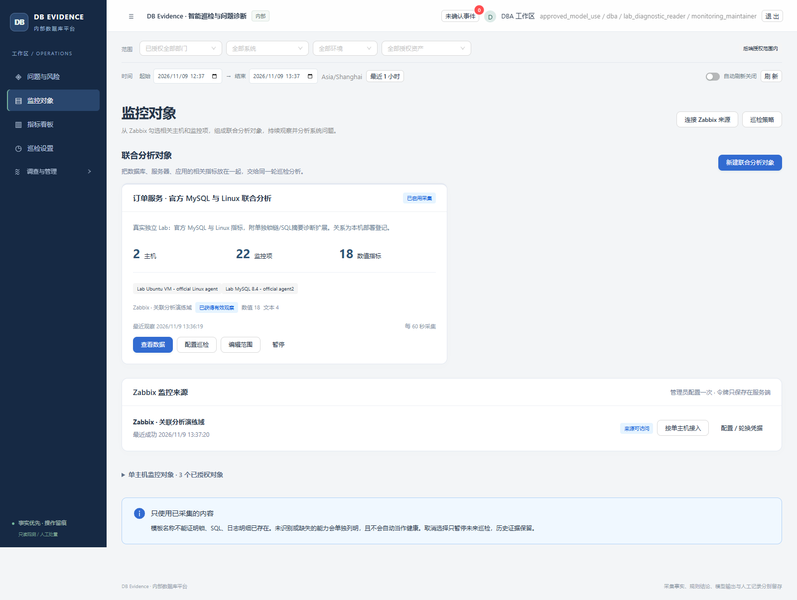
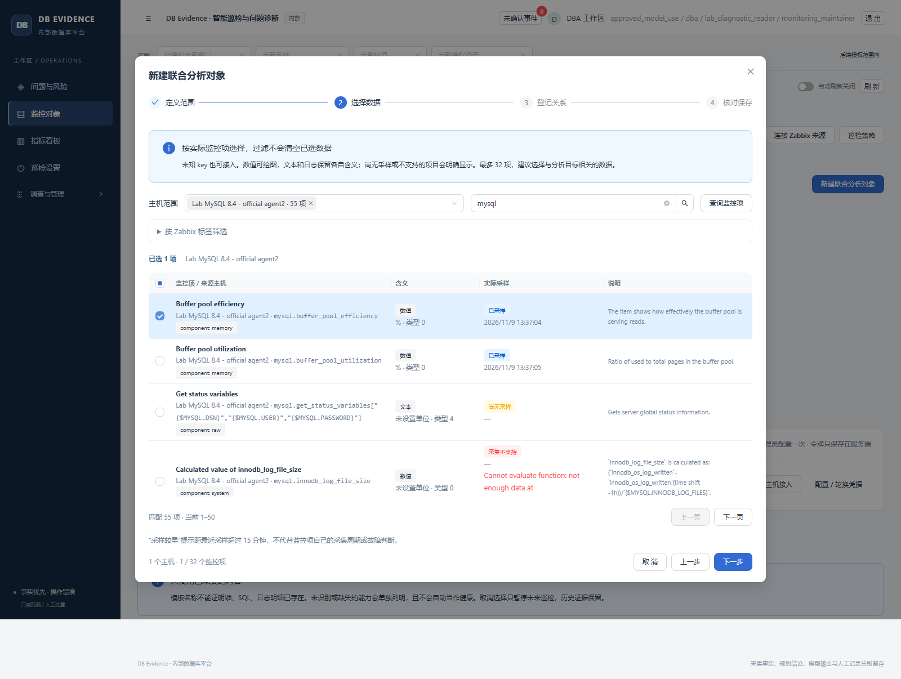
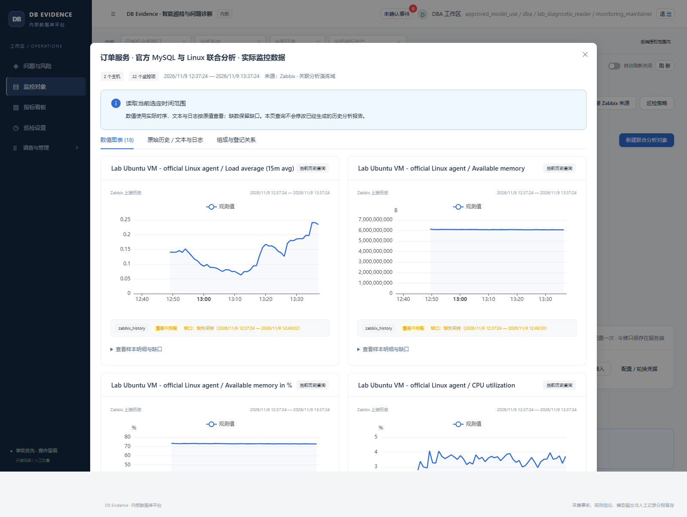
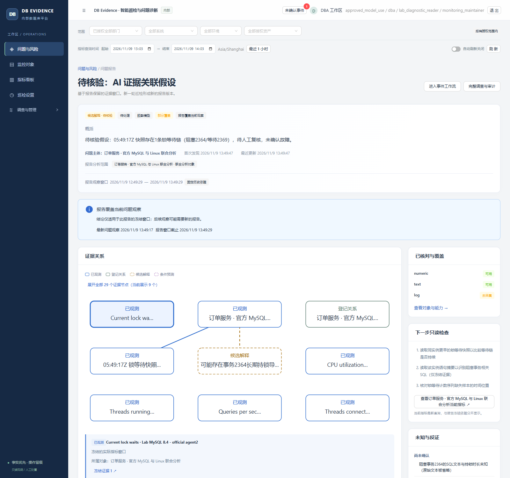
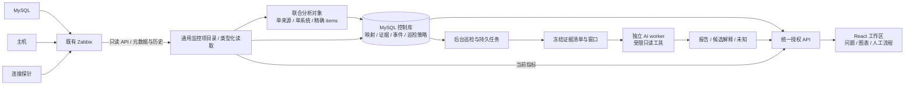

# DB Evidence Platform

**把已有监控项组成联合对象，持续产出可追溯的问题分析。**

An evidence-driven MySQL inspection and investigation platform.

面向内部 DBA 与运维团队，复用 Zabbix 已有的 Linux、MySQL 及其他监控数据。按主机、监控项和标签选择确切范围，组成联合分析对象，由后台持续采集、周期巡检和有界 AI 分析，把问题摘要、证据关系、指标曲线与后续检查放进同一份报告。

[联合对象上手](docs/analysis-groups-guide.md) · [操作指南](docs/user-guide.md) · [安装与运行](docs/platform/07-operations.md) · [验证范围](#验证与复现) · [历史版本](docs/releases/README.md)

**2026-11-09 更新：**官方 Linux / MySQL 数据、通用联合对象、权限与冻结、后台真实模型和受控锁链路已完成本轮限定验收。锁链编号与冻结引用匹配；模型对 CPU 区间的一处误读保留并明确标注。项目使用独立 Lab 与合成业务负载，不代表生产采用或通用诊断准确率。



**把相关数据放进一个持续分析范围。** 图为 2026-11-09 独立 Lab 的实际对象：2 个 host、22 个已选 items（18 个数值、4 个文本），登记一条 MySQL 运行于 Linux 的关系。



**按已有监控选择，不受固定 key 白名单限制。** 向导展示真实目录中的单位、值类型、最近采样和 unsupported 状态；过滤或翻页保留选择。图中向导用于检查交互，未另行保存测试对象。



**从同一范围直接查看实际数据。** 图表页含 18 条独立数值曲线，文本 / 日志另列历史；当前查询不会改写旧报告。截图保留了查询窗口开始时尚无样本的缺口。



**从冻结证据核对模型解释。** 图为本轮真实后台周期锁报告，保留 18 条曲线、双主机关系及待核验 finding。锁链已逐项核对，CPU 区间误读仍保留在原输出中，详见下方案例。

## 先看结果，再沿证据调查

日常打开“问题与风险”，先看**发生了什么、影响哪个对象、依据是否充分**。点击问题进入报告，核对关系图和冻结曲线，再查看原始证据或当前指标。配置一次巡检策略后，后台按周期运行；浏览器无需一直打开。

```text
连接已有 Zabbix → 按 host / item / tags 选择 → 保存联合分析对象
                                             ↓
                                         启用后台巡检
                                             ↓
问题与风险 → 分析报告 → 证据关系 / 冻结曲线 → 下一步检查
                                 ↓
                          人工处置 → 新样本复验
```

| 能力 | 使用时能看到什么 |
| --- | --- |
| **自主巡检** | 轻量规则检查、周期综合分析和新异常紧急通道；显示最近完成、下次到期、预算与停止原因，正常巡检也保留历史 |
| **通用联合对象** | 同一来源和业务系统内，自由选择多个 host 的 1–32 个具体监控项；名称、key、标签、单位和值类型可核对，未知 key 也可接入 |
| **跨层证据关联** | 数据库、主机、探针或应用指标按所选范围共同分析；数值绘图，文本 / 日志保留有限历史，二进制不伪装成数值 |
| **可追溯报告** | 事实、候选解释、反证、未知和下一步检查；引用可回到对应冻结证据，旧报告不会随上游新数据改写 |
| **复用已有监控** | 只读查询 Zabbix 官方模板及其他已有 items；按元数据处理数据，已知 MySQL key 仅做语义增强，缺诊断资料时直接呈现缺口 |
| **按业务范围协作** | 后端按部门、系统、环境及实例范围控制资料；来源管理权限与业务数据读取权限分开 |

确定性工具负责采集、计算与验证；AI 辅助关联和解释；重要处置由人员明确控制。

## 实际案例：官方采集链路的联合锁分析

在独立 Lab 的 45 秒受控锁实验中，后台 **periodic** 完成报告 `46fd02bd…`。冻结窗口覆盖实际锁快照，阻塞线程 `4510` → 等待线程 `4561`、事务 `2364` → `2369` 与引用逐项匹配。实验结束后，工作进程结束、事务回滚、残留实验会话 / 锁为零、数据集未变及前后校验均通过。

报告冻结 **18 条数值曲线**；实际模型输入为 **13 条数值摘要、5 条明确预算省略**，另含一条非空锁边、双主机及一条登记关系。**1 次真实 DeepSeek 请求，无额外工具调用**；上下文 11,576 字节，未超过该次 12,000 字节硬界。

报告含 4 条 facts、2 条 hypotheses、3 条 unknowns 和 1 条待核验 finding。**第 4 条 CPU 事实存在区间误读：模型把首值 3.358 写成范围下界约 3.4，实际最小值为 2.7538、最大值为 4.53549。** 原输出保留，不能称 4 条事实全部准确；提示已补充端点与区间的区别，仍需核对数值解释。时间窗、请求用量和失败记录见[受控锁验收](docs/acceptance-analysis-groups.md#受控锁联合案例)。

此前正常周期报告 `024d…` 也已完成：18 条冻结曲线中 17 条进入有界模型输入、1 条明确省略，4 条事实数值与引用匹配，0 条 findings。正常结果保留在巡检历史，不为演示制造告警。

报告绑定不可变证据清单、对象组成和时间窗；新查询不补写旧报告。登记依赖、曲线同时变化和候选解释都不自动证明因果。人工复核、处置记录、后续复验与知识条目沿用原平台流程。

## 开始使用

### 已有部署：四步组成联合对象并启用巡检

1. **连接来源**：在“监控对象”中点击“连接 Zabbix 来源”，填写所属系统、只读 API 与受限主机组。Token 加密保存在服务端，不返回浏览器。
2. **组成对象**：点击“新建联合分析对象”，选来源和业务名称，按 host、名称 / key、主机或 item 标签筛选并勾选 1–32 项；核对类型、单位、状态和最近采样，可选登记主机关系后保存。此路径无需目标数据库口令。
3. **保存策略**：在“巡检设置”指定负责人、对象、模式、周期、冷却与每日运行上限。真实模型模式还需要供应商配置、当前授权及明确外发许可。
4. **查看结果**：回到“问题与风险”，等待后台完成。没有合格异常的周期留在巡检历史，不为增加问题数量制造告警。

联合对象的数据采集周期可设为 30–3600 秒，默认 60 秒；巡检策略的轻量检查默认 300 秒、综合分析默认 1800 秒，两者独立。一个联合对象在原有授权和巡检中作为一个资源，组内多个 host 不等于多个 MySQL 实例。单次调查最多五个资源，每位用户最多三个在途调查，较大范围分组调度。顶部浏览范围不会改写已保存策略。完整步骤见[联合对象指南](docs/analysis-groups-guide.md)和[操作指南](docs/user-guide.md)。

每个联合对象限定一个 Zabbix 来源和一个业务系统，只读取所选 items，不自动包含同一 host 的其他项。同名不同 host 的监控项保留独立身份；关系是人工登记，标签和曲线同时变化都不证明因果。

### 新部署：从空平台初始化

当前部署工具面向 **Windows + PowerShell、Python 3.12、Node 22.12+ 或支持 Vite 8 的兼容版本**。使用独立 MySQL 控制库；现有部署工具同时准备原直采路径使用的 Prometheus。Zabbix 服务及只读权限由操作者提供。

```powershell
git clone https://github.com/catdogrennie-gt/db-evidence-platform.git
Set-Location db-evidence-platform
python -m venv .venv
.\.venv\Scripts\python.exe -m pip install -r requirements-platform-lock.txt
npm --prefix frontend ci
npm --prefix frontend run build
```

随后按[安装指南](docs/platform/07-operations.md)完成**仓库外私密目录 → 控制库初始化 → Alembic 迁移 → 账号与业务授权 → 服务启动**。API 不自动建库或迁移。新部署从零业务数据开始，默认是 `rules_only`，无需模型账号即可启动；没有仓库通用密码。

安装完成后，在仓库根目录使用实际平台管理入口：

```powershell
$platformConfig = Join-Path $env:LOCALAPPDATA 'DBEvidencePlatform-private\config.json'
.\scripts\platform\manage.ps1 -Action Start -Services mysql,prometheus,api,worker,ai -ConfigPath $platformConfig
.\scripts\platform\manage.ps1 -Action Status -Services mysql,prometheus,api,worker,ai -ConfigPath $platformConfig
```

默认入口为 [http://127.0.0.1:18080](http://127.0.0.1:18080)，以自己的私密配置 `public_origin` 为准。根目录 `start.ps1` 属于更早的实验应用；本平台使用 `scripts/platform/manage.ps1`。原 MySQL 直连接入与处置页面保留在“调查与管理”中。

## 系统如何组成



| 组件 | 责任 |
| --- | --- |
| React / TypeScript、Ant Design、ECharts | 结果首页、证据关系、曲线、接入与原人工工作流 |
| FastAPI、SQLAlchemy / Alembic、MySQL | 统一身份及业务授权、来源映射、联合对象的精确组成、证据、事件、报告、策略和任务记录 |
| 采集与巡检 worker | 只读来源采集、信号计算、周期与紧急调度；租约、fence、唯一派发和预算约束并发 |
| 独立 AI worker | 读取已授权冻结资料，执行白名单只读工具，检查引用并保存报告；与采集队列分离 |
| Zabbix / 原 Prometheus 路径 | 保留各自原始时序；调查按窗口物化有限副本，旧 `prometheus_window` 与新 `time_series_window` 共存 |

这是独立 Web 平台。Grafana 可作为后续外链看板，当前不作为运行依赖；Zabbix 不被另一个时序存储替代。联合对象复用原有 Instance 授权、租约 / fence 和巡检队列，编辑推进配置版本，既有冻结报告保持原样。架构增量见[联合对象架构说明](docs/platform/02-architecture.md#当前增量联合分析对象2026-11-09)。

## 验证与复现

当前改造在个人隔离环境验证。实际目标测量、确定性规则、模拟提供商与真实外部模型分别记录；一次模型完成不代表所有表述都正确。

| 验证阶段 | 当前结果 |
| --- | --- |
| 官方采集 | 原样官方 Linux / MySQL 模板及独立诊断扩展已取得连续两轮真实 Zabbix 历史；部分需较长基线的计算项仍为 unsupported |
| 联合对象与页面 | 11 项普通 HTTP 检查、5 项隔离无头浏览器检查通过；双主机 22 项精确范围及 18 条曲线可读，敏感原文按组授权 |
| 历史保护 | 前次对照中，变更前 5,750 条 ManifestItem 内容哈希逐条一致，未覆盖旧证据 |
| 真实模型与锁案例 | 正常周期及受控锁周期完成；锁链与引用匹配，CPU 区间误读明确保留。锁报告 18 条冻结 / 13 条数值入模 / 5 条预算省略 |
| 本轮回归 | 后端 571 通过、10 跳过、6 个子检查通过；另有 53 项只读标签定向检查通过。前端 27 项、最终类型检查及构建通过 |
| 报告页面 | 新增 5 项浏览器检查通过：18 个独立曲线标题、双主机登记关系、锁曲线优先，未捕获未处理异常 |
| 保留边界 | SQL 缺少真实 counter epoch，不声称已验证窗口差分；模型完成与引用匹配不保证数值解释正确 |

本轮检查方法、真实请求、保留失败与边界见[联合对象验收](docs/acceptance-analysis-groups.md)；[2026-11-08 既有验收](docs/acceptance-zabbix.md)单独保留。以上是隔离环境的限定结果，不把某次完成外推为全系统验收。

在已安装依赖的仓库根目录可运行：

```powershell
.\.venv\Scripts\python.exe -m pytest tests/platform -q
.\.venv\Scripts\python.exe -m pip check
npm --prefix frontend test
npm --prefix frontend run typecheck
node frontend/scripts/check-workflow-contracts.cjs
node frontend/scripts/check-connection-contracts.cjs
npm --prefix frontend run build
```

真实 MySQL / TLS 连接用例需显式环境配置，跳过不计通过；真实模型调用需另配供应商、权限与外发许可。公开源码不携带本机账号、控制库或原始运行记录。

<details>
<summary>历史界面与自动锁案例（2026-11-08）</summary>

以下三图来自 2026-11-08 的既有版本，展示旧独立对象流程，不作为本轮联合对象向导或受控锁联合案例的验收截图。对象和问题数量按当时账号的业务授权范围计算。


该报告未保留曲线：8 条来源曲线合计 10,116 点，超过当时 10,000 点预算后被整组省略。历史缺口继续保留；新预算实现不回写旧报告。

在当时独立 Lab 的 45 秒锁实验中，后台 periodic 完成 2 次真实 DeepSeek 与 2 次只读工具调用。阻塞事务 `1864` / 线程 `14485` → 等待事务 `1868` / 线程 `14524`，已与冻结锁快照逐项核对。4 条事实、2 条候选解释、1 条待核验 finding 及早期失败均保留，详见[旧自动周期锁案例](docs/acceptance-zabbix.md#已核对的自动周期锁案例)。


SQL 摘要的累计计数、窗口差分和生命周期最大值含义不同；探针耗时也可能包含认证与查询。原图及其结果只证明当时窗口，不能作为新联合对象的诊断结论。

</details>

<details>
<summary>历史案例：事务阻塞、无效处置对照与 SQL 索引复验</summary>

改造前版本保留了三个独立 MySQL 合成目标的真实采集与两类受控案例：锁等待中先执行无效动作，确定性复验为 `not_improved`，外部受控释放阻塞后新样本为 `improved`；SQL 索引案例比较固定负载的前后窗口，并保留 `inconclusive` 及无效动作对照。

它们说明原平台的调查、人工记录、复验与知识链路，不能证明新版 Zabbix 接入或新模型案例已经通过。固定源码、测量口径与边界见[历史 Release](https://github.com/catdogrennie-gt/db-evidence-platform/releases/tag/legacy-platform-2026.11.08)及[回溯说明](docs/releases/legacy-platform-2026.11.08.md)。

</details>

## 当前范围

当前重点是 **MySQL / Linux、Zabbix 已有数据、Windows 单机内部部署**。主路径是单来源、单业务系统的联合对象，最多 32 个具体 items 与 32 条人工关系；跨来源组合暂不支持。旧单 host 独立对象保留兼容入口，组内 host 不冒充数据库 UUID。锁、SQL、日志或计划的深度取决于来源实际提供的资料，不靠模板名补全。

文本 / 日志原文另需敏感证据读取权限；拥有查看原文的权限也不表示允许将其原样发给模型。自由说明保留在本地，不进入外部模型输入。官方模板的“值变化 / 心跳”稀疏 history 不等于固定周期测量，短窗无新记录可能是值未变或资料不足，不能补零、前向填充或直接认定采集故障。

模型输出是待核验解释。平台不自动执行数据库变更、任意 SQL、Shell 或邮件发送；权限撤销、来源离线、缺少外发许可、预算耗尽和模型失败应保留可见状态。PostgreSQL、企业 SSO、完整保留清理、十实例容量、长期稳定性、高可用与公网部署仍未完成验证。

本轮已验收普通 HTTP、页面、权限与冻结、正常及受控锁周期真实模型链路。CPU 区间误读和早期失败仍保留；策略状态以当前部署为准，这些限定结果不代表长期可靠性。

## 文档与历史

- [联合对象上手](docs/analysis-groups-guide.md)：官方监控、host / item / 标签选择、权限、稀疏历史和巡检。
- [操作指南](docs/user-guide.md)：接入、策略、报告、指标和异常处理。
- [安装与运行](docs/platform/07-operations.md)：私密目录、初始化、迁移、启停与升级。
- [联合对象验收](docs/acceptance-analysis-groups.md)：官方采集、精确范围、权限、页面、真实模型输入、受控锁核查与本轮回归。
- [既有验收矩阵](docs/acceptance-zabbix.md)：2026-11-08 的来源、冻结、并发及受控锁案例。
- [联合对象设计](docs/superpowers/specs/2026-11-09-analysis-groups-design.md) · [上一轮 Zabbix 设计](docs/superpowers/specs/2026-11-08-zabbix-intelligence-design.md) · [变更记录](CHANGELOG.md) · [README 素材与参考规范](docs/readme-guidelines.md)。
- [历史 Release](https://github.com/catdogrennie-gt/db-evidence-platform/releases/tag/legacy-platform-2026.11.08)：保留改造前公开源码；[版本索引](docs/releases/README.md)提供精确提交与恢复路径。
- [原平台设计与案例](docs/platform/README.md) · [更早的独立实验模块](README-legacy-lab.md)。

源码目录：`platform_app/` 后端与 worker，`frontend/` 界面，`migrations/` 控制库迁移，`tests/platform/` 回归，`scripts/platform/` 部署与验收工具。
