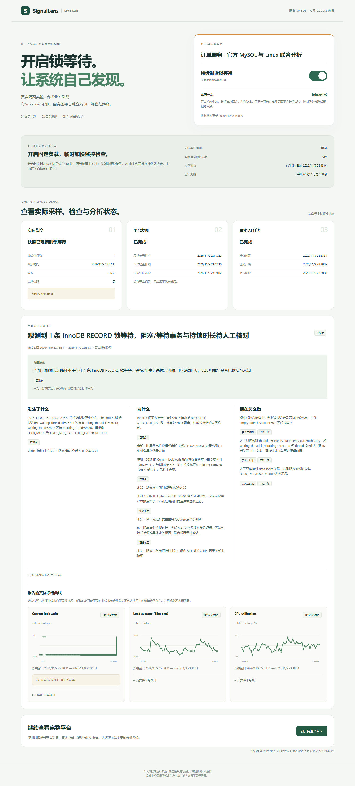
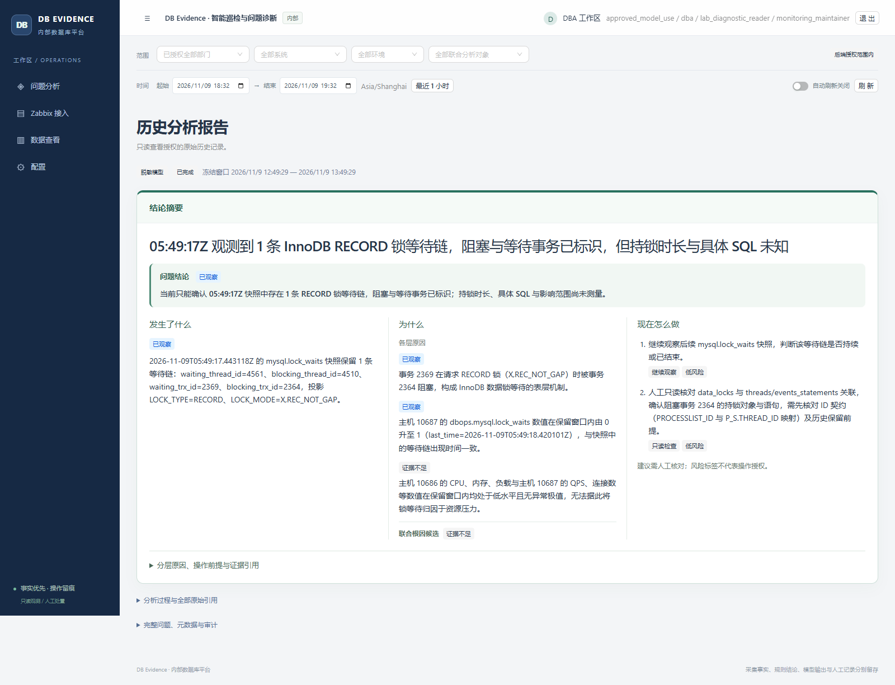
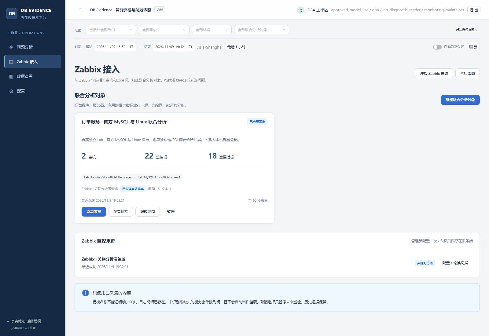

# DB Evidence Platform

**复用 Zabbix 监控，先读问题结论，再按需回查证据。**

An evidence-driven MySQL inspection and investigation platform.

面向内部 DBA 与运维人员：按 host、item 和标签选择已有监控，组成持续巡检的联合对象。打开报告，先了解**发生了什么、为什么、现在怎么做**；需要核实时，再展开分析过程、冻结证据和图表。

[快速演示与完整平台](docs/quick-showcase.md) · [结论优先阅读指南](docs/conclusion-first-guide.md) · [联合对象上手](docs/analysis-groups-guide.md) · [操作指南](docs/user-guide.md) · [安装与运行](docs/platform/07-operations.md)

## 两个演示入口

| 入口 | 直接访问 | 账号 |
| --- | --- | --- |
| **A · 免登录快速功能演示** | **[打开真实锁等待演示](https://premium-prozac-barbara-develop.trycloudflare.com)** | **无需登录** |
| **B · 原有完整运维平台** | **[打开完整只读平台](https://genesis-bomb-lessons-compiler.trycloudflare.com)** | **`demo` / `EvidenceDemo-2026!`** |

A 提供一个固定隔离 MySQL 锁等待开关，同页展示 B 的真实监控、发现状态、AI 报告及冻结曲线。B 保留完整系统，以只读演示身份查看问题、对象、证据和历史；公开身份只有 `data.read`、`event.read`、`knowledge.read` 及固定对象范围，不提供故障控制或配置写入。



上图来自本轮真实锁等待与完成报告，详情见[双入口实际验收](docs/acceptance-quick-showcase.md)：第一轮成功生成报告，第二轮模型返回非法 JSON，失败历史保持可见。两站均为临时隧道，依赖演示电脑在线，地址可能变化，不承诺持续可用。公开密码只属于本部署的只读演示账号，新部署没有默认通用密码。


**先看 A，再进 B。** A 开启后持续制造固定测试行的锁等待，关闭请求回滚；没有次数、冷却、固定时长或等待监控恢复才能再开的门槛。A 开启期间租用 B 的临时周期：实际采集 **10 秒**、信号检查 **5 秒**，关闭或 **45 秒租约**失效后恢复当前演示基线 **60 / 300 秒**。AI 仍由 B 的普通 Zabbix 巡检与队列自主派发，A 不创建报告。官方模板各监控项并非都按 5 秒采样，仅扩展锁诊断采用 5 秒。

共享开关影响所有访客；关闭网页不等于关闭实验。负载是合成业务，采样来自真实运行，不代表生产事故。缺失、过期、失败与历史报告明确标识，不补写结论或数值。操作与接口边界见[快速演示指南](docs/quick-showcase.md)；旧平台内限次演示仅保留[历史指南](docs/demo-guide.md)与[历史验收](docs/acceptance-public-demo.md)，其门槛不适用于当前 A。

## 完整平台界面




**从问题开始阅读。** 报告将现象、各层候选原因、联合根因判断、结论和建议操作放在前面；证据不足与覆盖缺口保持可见。截图的实际窗口、模型模式与核对结果见[本轮验收](docs/acceptance-conclusion-first.md)。



**采集交给已有 Zabbix。** 在同一来源与业务系统内，按 host / item / tags 选择确切范围，保存联合对象后配置巡检。当前主路径无需目标数据库口令，不提供旧直连、自定义采集模板或单 host 独立对象创建入口。


**需要时直接核对数据。** 同一联合对象中的数据库与主机曲线集中查看；文本、日志及结构化历史按监控项下钻。这张图查询当前上游历史，报告中的冻结证据另行保留。

## 完整平台的四个入口

| 入口 | 用来做什么 |
| --- | --- |
| **问题分析** `/` | 看问题、风险、巡检状态与结论优先报告 |
| **Zabbix 接入** `/monitoring` | 连接只读来源，选择监控项，维护联合对象 |
| **数据查看** `/metrics` | 看当前窗口的数值曲线、类型化历史、来源与缺口 |
| **配置** | 设置巡检、模型与外发、必要账号授权和审计 |

入口按授权显示；公开只读账号不显示配置写入与巡检修改入口。

连接来源 → 选择联合范围 → 配置后台巡检 → 阅读结论 → 按需核对证据 → 人工处置与新样本复验。配置完成后，后台运行不依赖浏览器一直打开；正常周期也保留记录，不为展示制造问题。

确定性工具负责采集、计算与验证；AI 辅助关联和解释；重要处置由人员明确控制。日常巡检不自动执行数据库变更；独立快速演示站 A 只在明确开启后执行固定隔离 Lab 事务，并回滚清理。平台不提供任意 SQL、Shell 或邮件发送能力。

## 开始使用

### 已有部署

1. 在“Zabbix 接入”连接只读 API 来源，限定业务系统和允许主机组；凭据仅保存在服务端。
2. 新建联合分析对象，选择同一来源中的 1–32 个具体 items，核对 host、单位、值类型、状态和最近实际采样。可选登记主机关系；登记和同时变化都不证明因果。
3. 在“配置”保存负责人、对象、周期、冷却和预算。默认 `rules_only` 不调用模型；真实模型还需私密供应商配置、当前授权与明确外发许可。
4. 从“问题分析”阅读结果，需要时展开证据或进入“数据查看”。当前查询不会补写旧报告。

联合对象默认每 60 秒读取所选数据，可设 10–3600 秒；轻量规则检查默认 300 秒、最低 5 秒，综合巡检默认 1800 秒，三者独立。范围、类型、稀疏历史与权限见[联合对象指南](docs/analysis-groups-guide.md)。

### 新部署

当前部署工具面向 Windows + PowerShell、Python 3.12、Node 22.12+ 或支持 Vite 8 的兼容版本。使用独立 MySQL 控制库，Zabbix 服务及只读权限由操作者提供。

```powershell
git clone https://github.com/catdogrennie-gt/db-evidence-platform.git
Set-Location db-evidence-platform
python -m venv .venv
.\.venv\Scripts\python.exe -m pip install -r requirements-platform-lock.txt
npm --prefix frontend ci
npm --prefix frontend run build
```

按[安装指南](docs/platform/07-operations.md)完成仓库外私密目录、空控制库初始化、显式迁移、账号与业务授权及服务启动。API 不自动建库或迁移。新部署从零业务数据开始，无仓库通用密码。`collection_mode` 默认 `zabbix_only`；`legacy` 只用于历史兼容与旧测试，不是当前产品的接入方式。

```powershell
$platformConfig = Join-Path $env:LOCALAPPDATA 'DBEvidencePlatform-private\config.json'
.\scripts\platform\manage.ps1 -Action Start -Services mysql,api,worker,ai -ConfigPath $platformConfig
.\scripts\platform\manage.ps1 -Action Status -Services mysql,api,worker,ai -ConfigPath $platformConfig
```

默认入口为 [http://127.0.0.1:18080](http://127.0.0.1:18080)，以私密配置 `public_origin` 为准。根目录 `start.ps1` 属于更早的实验应用。

## 结论与证据的边界

- 报告先列发生的现象、独立表层原因、联合候选解释、当前结论和建议操作。证据不足或不适用是有效回答；候选解释不是已证明根因。
- 分析过程按需展开关键事实、反证、未知、关系、图表及日志 / 文本，不用空图或全量曲线挤占结论。
- 旧报告缺少完整摘要时明确标识，保留原文；不会在读取时用规则补成新的 AI 结论。包含旧 ID 的链接只读历史或提示退役，不跳到当前观测冒充原记录。
- 报告使用不可变冻结清单、组成和时间窗。模型读取的有界摘要与图表保留范围分别说明，省略继续可见。
- 新模型输入上限为 24,000 字节，输出上限可配置到 3,000 tokens；更低显式预算仍生效，不保证所有数据都能入模。DeepSeek 等供应商为私密可选配置，公开源码不绑定默认 Pro 账号、端点或密钥。

业务读取按部门、系统、环境与对象授权，来源管理员不会自动获得业务证据。文本 / 日志原文另需敏感读取权限；读取权不等于模型外发许可。自由说明保留本地，外发只接受受限脱敏数据。

缺数不补零，旧值不代表当前健康。官方模板可能按值变化 / 心跳稀疏保存 history；短窗无记录应核对实际采样和保留语义。SQL 累计值、端点和窗口极值必须区分，缺少真实 counter epoch 时不声称窗口差分已验证。

## 验证与复现

这是个人隔离 Lab 作品，使用真实监控观测和合成业务负载，不代表生产采用、自动修复或通用诊断准确率。实际测量、回放数据、确定性规则与真实模型输出分别标识。

双入口、实际自主发现、切换与异常退出恢复、公开只读权限见[本轮验收](docs/acceptance-quick-showcase.md)；此前结论展示与真实模型语义记录见[结论优先验收](docs/acceptance-conclusion-first.md)。一次 completed 不等于根因正确或每次模型都能成功。

```powershell
.\.venv\Scripts\python.exe -m pytest tests/platform -q
.\.venv\Scripts\python.exe -m pip check
npm --prefix frontend test
npm --prefix frontend run typecheck
node frontend/scripts/check-workflow-contracts.cjs
node frontend/scripts/check-connection-contracts.cjs
npm --prefix frontend run build
```

真实 MySQL / TLS 用例需显式配置，跳过不计通过；真实模型另需供应商、权限与外发许可。公开源码不携带本机账号、控制库、原始私密运行记录或个人材料。长期稳定性、高可用、生产容量与公网部署仍未完成验证。

## 历史与文档

[联合对象验收](docs/acceptance-analysis-groups.md)保留上一轮正常及受控锁周期：锁链引用匹配，但 CPU 首值 3.358 被误作范围下界约 3.4，实际最小值为 2.7538。原输出、早期失败和限定范围保留。该历史报告的 12KB 输入记录不随新 24KB 上限改写。[2026-11-08 验收](docs/acceptance-zabbix.md)另保留当时整组曲线超预算被省略等缺口。两轮结果都不替代本轮模型语义复核。

旧界面截图见历史验收与版本材料；旧直连及单 host 对象只保留授权历史读取和必要管理，不继续调度旧采集。

- [结论优先指南](docs/conclusion-first-guide.md)、[操作指南](docs/user-guide.md)、[联合对象上手](docs/analysis-groups-guide.md)。
- [官方模板与诊断扩展](docs/zabbix-official-setup.md)、[安装与运行](docs/platform/07-operations.md)、[设计与历史](docs/platform/README.md)。
- [结论优先设计](docs/superpowers/specs/2026-11-09-conclusion-first-design.md)、[变更记录](CHANGELOG.md)、[版本索引](docs/releases/README.md)。
- 历史版本 `legacy-platform-2026.11.08`、`analysis-groups-2026.11.09`、`conclusion-first-2026.11.09` 保留；当前源码将免登录快速演示 A 与完整只读平台 B 分开，历史版本与验收保持原样；发布状态以版本索引为准。
- [原平台回溯](docs/releases/legacy-platform-2026.11.08.md)、[更早的独立实验模块](README-legacy-lab.md)。

源码：`platform_app/` 后端与 worker、`frontend/` 界面、`migrations/` 迁移、`tests/platform/` 回归、`scripts/platform/` 部署与验收工具。
