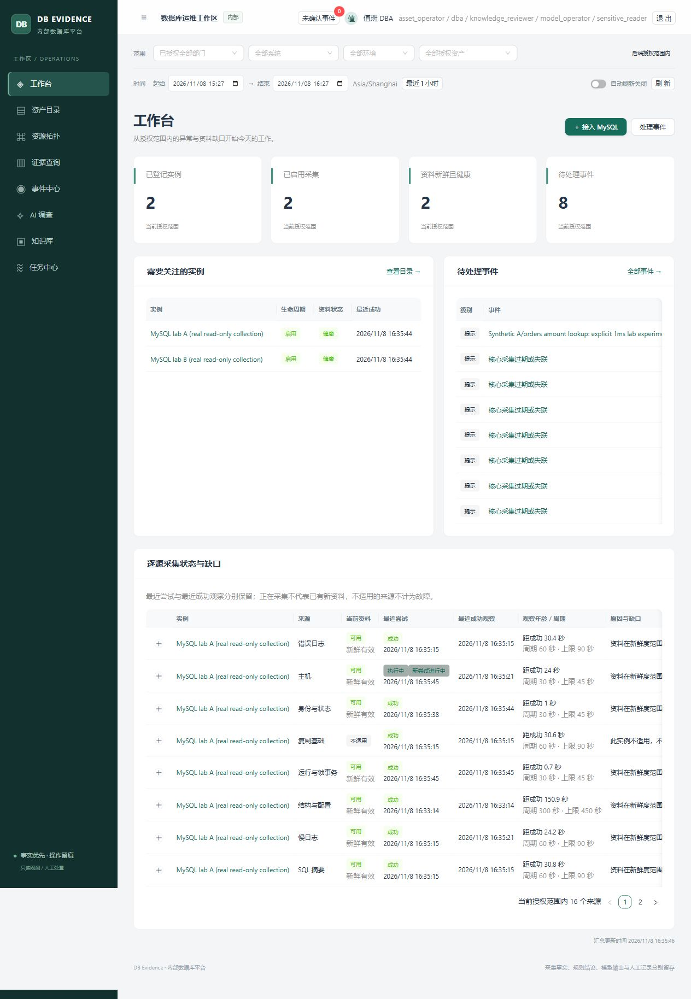
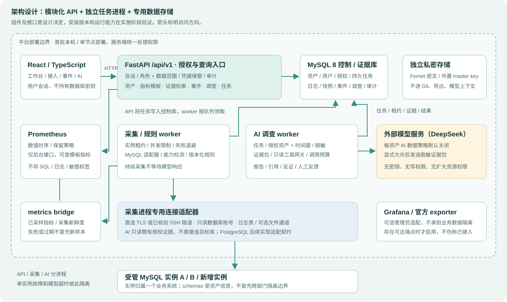
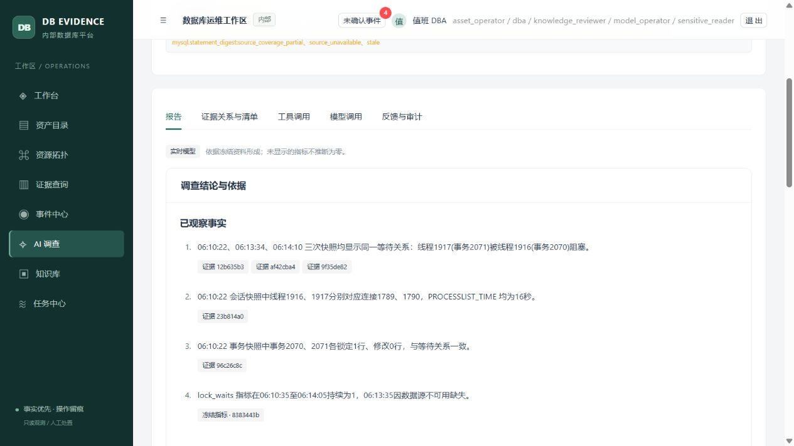

# DB Evidence Platform

**从持续采集到处置复验的内部 MySQL 运维平台。**

Evidence-driven MySQL operations with bounded AI investigation.

将资产、指标、SQL 摘要、锁等待、日志和人员处置记录组织在同一工作区：先确定责任与数据范围，再围绕一个事件冻结证据、开展调查、记录人工操作，最后用新样本复验并沉淀知识。

**确定性工具负责采集、规则与验证；AI 负责证据关联和解释；重要操作由人员明确控制。**

[安装与运行](docs/platform/07-operations.md) · [案例与演示](docs/platform/08-case-and-demo.md) · [实际验收](docs/platform/06-acceptance-status.md) · [设计文档](docs/platform/README.md)

这是个人工程项目，已在三个独立 MySQL 合成目标上完成核心路径验证。当前支持 MySQL；生产部署、十实例容量和高可用尚未验证。公开仓库提供源码、文档与经检查的截图，私密配置、目标凭据及原始运行证据保存在仓库外。

<details>
<summary>查看真实运行截图：工作台</summary>



2026-11-08 本地隔离实验截图。该 DBA 账号可见两个授权实例；页面计数按当前权限计算，不等于全部登记资产数。

</details>

## 能做什么

| 工作环节 | 当前实现 |
| --- | --- |
| 接入与授权 | 六步 MySQL 接入向导、连接预检、UUID 去重、能力确认；本地账号、角色与实例范围授权，管理员默认没有业务证据读取权 |
| 持续观测 | 独立 worker 采集状态、SQL 摘要、事务与锁、结构配置、复制基础状态、数据库日志和主机资料；保留来源、时间与能力缺口 |
| 历史分析 | 指标图、SQL 时间窗差分、证据检索与拓扑；固定单表模板 EXPLAIN，不执行被解释的业务查询 |
| 事件协作 | 版本化规则、事件确认与分派、维护窗口、站内提醒、处置计划审核及外部执行记录 |
| AI 调查 | 显式外发策略、脱敏预览、冻结窗口、受限只读工具、调用预算、引用校验；报告区分事实、假设、反证和未知 |
| 复验与知识 | 比较处置前后有效样本，返回 `improved`、`not_improved` 或 `inconclusive`；保存冻结清单、知识版本与审核记录 |
| 平台运维 | 显式数据库迁移、进程启停与身份核验、worker 心跳、依赖状态、证据保留及限时导出 |

采集失败、来源过期和资料不适用分别展示；缺失值保持未知。采集与模型调用分进程运行，模型故障不会占用采集队列。每次读取、工具调用和导出都在后端重新检查权限。

## 架构



图为[架构设计基线](docs/platform/02-architecture.md)。图中的 Grafana / 官方 exporter 是可选适配设计，当前未集成；PostgreSQL 适配器尚未实现。

- **React / TypeScript + Ant Design / ECharts**：同源工作区、图表与流程页面。
- **FastAPI + 独立 MySQL 控制库**：身份、资产、任务、结构化证据、事件与审计；使用 Alembic 显式迁移。
- **采集 worker + metrics bridge + Prometheus**：白名单只读采集与数值时序；持久任务、实例租约及递增 fence 阻止过期任务覆盖新结果。
- **独立 AI worker**：只读取已授权的冻结历史资料，没有任意 SQL、Shell 或目标写操作工具。凭据加密保存，主密钥位于仓库外。

## 五分钟走读

适用于已完成初始化、接入隔离目标并保留案例的环境。全新部署从空平台开始，需先配置组织、授权和目标；公开源码不附带私密控制库或历史案例数据。走读现有记录无需重新注入故障或调用付费模型。

| 时间 | 页面与动作 | 关注点 |
| --- | --- | --- |
| 0–1 分钟 | 工作台 → 资产目录，查看一个实例及接入向导 | 已登记、已启用和当前授权可见是不同概念；新实例通过向导接入，无需改代码 |
| 1–2 分钟 | 实例详情 → 指标、SQL、锁与日志 | 先选绝对时间窗，再核对来源、新鲜度和缺口；执行计划行数是估计 |
| 2–3 分钟 | 事件中心 → 持续锁等待案例 → AI 调查 | 从报告引用回到冻结证据和指标，检查事实是否有对应观察 |
| 3–4 分钟 | 处置计划 → 执行记录 → 两次复验 | `SELECT 1` 成功仍是 `not_improved`；释放阻塞后，新样本满足条件才得到 `improved` |
| 4–5 分钟 | 知识库 → 案例版本与来源清单 | 查看负向对照、有效处置和证据范围；自动化验收账号审核与用户人工审阅明确区分 |

完整步骤、SQL 索引案例及讲解要点见[案例与十五分钟演示](docs/platform/08-case-and-demo.md)。

## 安装与启动

当前部署流程面向 **Windows + PowerShell**，需要 Python **3.12**、Node **22.12+** 或支持 Vite 8 的兼容版本，以及独立安装的 MySQL 和 Prometheus。参考组件版本与初始化命令见[安装指南](docs/platform/07-operations.md)。

在所选工作目录获取源码并安装锁定依赖：

```powershell
git clone https://github.com/catdogrennie-gt/db-evidence-platform.git
Set-Location db-evidence-platform
python -m venv .venv
.\.venv\Scripts\python.exe -m pip install -r requirements-platform-lock.txt
npm --prefix frontend ci
npm --prefix frontend run build
```

随后按安装指南完成：**生成仓库外私密目录 → 初始化独立控制 MySQL → 执行迁移 → 初始化账号与授权 → 启动服务**。准备入口为 [prepare_local.py](scripts/platform/prepare_local.py)，它仅生成新部署配置，不下载组件或启动服务，拒绝覆盖任何已有目标目录。

账号口令在本地随机生成，由私密初始化文件交付；仓库没有默认口令。默认初始化只有控制面管理员、零业务数据授权，模型为空配置，策略为 `rules_only`。无需模型账号即可启动空平台。目标监控账号、核验过的 SSH/TLS 资料与模型外发许可需明确配置。

**完成首次初始化后**，在克隆仓库根目录使用 Windows 管理脚本；以下私密目录示例由操作者自行选择：

```powershell
$platformConfig = Join-Path $env:LOCALAPPDATA 'DBEvidencePlatform-private\config.json'
.\scripts\platform\manage.ps1 -Action Start -Services mysql,prometheus,api,worker,ai -ConfigPath $platformConfig
.\scripts\platform\manage.ps1 -Action Status -Services mysql,prometheus,api,worker,ai -ConfigPath $platformConfig

# 日常重启或停止应用进程，控制库与时序服务继续运行
.\scripts\platform\manage.ps1 -Action Restart -Services api,worker,ai -ConfigPath $platformConfig
.\scripts\platform\manage.ps1 -Action Stop -Services api,worker,ai -ConfigPath $platformConfig
```

默认浏览器入口为 [http://127.0.0.1:18080](http://127.0.0.1:18080)，以私密配置的 `public_origin` 为准。实际平台入口是 `scripts/platform/manage.ps1`；根目录 `start.ps1` 属于历史实验应用。管理脚本默认只处理 API、采集和 AI，管理控制 MySQL / Prometheus 时需显式列出对应服务。

## 已验证的案例

### 事务阻塞：无效动作也必须如实记录

在隔离目标制造真实锁等待，后台采集形成证据与事件。先执行无效的连通检查，三个后续样本仍有相同等待链，确定性复验返回 `not_improved`；再由外部受控工具回滚阻塞事务，新的三个样本满足选定锁链消失条件，返回 `improved`，随后结案并保存知识版本。

独立的真实 DeepSeek 调查完成 **两次模型调用、两次工具调用**，报告引用五份证据及一个冻结 Prometheus 窗口，引用经过实际读取核查。此前失败尝试保留。该记录支持已知锁案例的证据解释，不代表通用诊断准确率。

<details>
<summary>查看真实运行截图：带证据引用的 AI 报告</summary>



本地隔离案例的报告局部截图，基于冻结实验资料；不是生产诊断结果。

</details>

### SQL 索引：固定负载下比较前后窗口

对三万行合成数据执行固定约 **0.5 QPS** 查询，保留无效动作对照、后台摘要、受限 EXPLAIN 和前后各三份样本。

| 比较阶段 | 实测平均耗时 | 复验结果 |
| --- | --- | --- |
| 基线 → 无效 `SELECT 1` 后窗 | 约 4.979 → 4.053 ms | 未达到预设至少 50% 降低门槛，`not_improved` |
| 无效后窗 → 增加受控索引后窗 | 约 4.053 → 0.451 ms；调用率比约 0.992 | `improved`，仅覆盖该查询、负载和窗口 |

平台保存计划、审核、外部执行记录和复验；索引操作由独立受控实验工具执行。结束后恢复原索引集合，并核对有序数据摘要未变。完整过程保留了窗口不足导致 `inconclusive` 的失败尝试。

两个案例均不证明生产收益、业务恢复或完整因果关系。实际步骤、测量口径及剩余缺口见[案例说明](docs/platform/08-case-and-demo.md)和[验收索引](docs/platform/06-acceptance-status.md)。

## 验证与复现

在已安装依赖的仓库根目录执行：

```powershell
.\.venv\Scripts\python.exe -m pytest tests/platform -q
.\.venv\Scripts\python.exe -m pip check
node frontend/scripts/check-workflow-contracts.cjs
node frontend/scripts/check-connection-contracts.cjs
npm --prefix frontend run build
```

2026-11-08 [本地完整回归记录](docs/platform/06-acceptance-status.md#5-可重现的局部检查)：**414 通过、9 跳过、6 个子检查通过**。跳过项需要显式真实 MySQL / TLS 配置，不计入通过；前端契约检查及生产构建通过，存在非阻断分包体积提示。以上为本地验收快照，完整证据范围以验收索引为准。

真实验收另覆盖第三目标向导接入、单实例故障隔离、采集进程重启、TLS 正反例、多角色 HTTP 权限矩阵、历史窗口与限时导出。模拟提供商故障测试、规则结果、实时模型输出和真实目标测量分别记录；隔离测试数量不替代全部端到端验收。

## 当前边界

| 范围 | 状态与限制 |
| --- | --- |
| MySQL 平台主流程 | 已实现并验证核心路径；不同版本、完整异常组合及部分页面体验仍待补验，逐项状态以 FR / AT 验收表为准 |
| 运行规模 | 真实验证为三个隔离目标、五种本地角色；短测和热缓存结果不能外推十实例容量、长期稳定性或采集开销 |
| 数据保留 | 证据保护与部分清理已实现；业务对象 / 审计 90 天为配置策略，依赖感知物理清理未完整实现，状态页保留警告 |
| 自动执行 | 当前记录人工方案和外部执行，再确定性复验；通用目标变更执行器未实现 |
| 扩展与集成 | PostgreSQL、Grafana、企业 SSO / 工单、深入复制诊断、容量预测及高可用未完成 |
| 备份恢复 | 历史实验模块保留独立验证记录，尚未整合为当前平台的备份作业与恢复验证产品 |

原始邮件、简历、证书、联系方式、凭据和密钥不属于公开交付物。运行目录、控制库、TSDB、日志及私密导出需独立保管；源码克隆后按安装指南配置自己的环境。

## 代码与文档导航

```text
platform_app/         授权 API、采集、规则、调查、复验与知识
frontend/             React / TypeScript 工作区
migrations/           控制库 Alembic 迁移
scripts/platform/     私密部署准备、进程管理与验收工具
tests/platform/       平台隔离回归及显式启用的真实连接测试
docs/platform/        需求、架构、页面流程、安装、验收与案例
```

- [业务与功能需求](docs/platform/01-requirements.md) · [系统架构与数据契约](docs/platform/02-architecture.md) · [页面及工作流](docs/platform/03-pages-and-workflows.md)
- [实施计划](docs/platform/04-delivery-plan.md) · [参考规范](docs/platform/05-skills-and-references.md) · [设计图与可点击原型](docs/platform/index.html)（下载后本地打开；其中示例数据不是实测证据）
- [历史实验说明](README-legacy-lab.md)：固定实例诊断与恢复实验的原始入口，与当前平台分开追溯。
