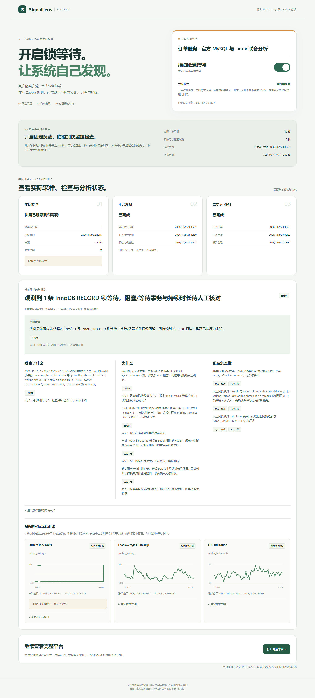
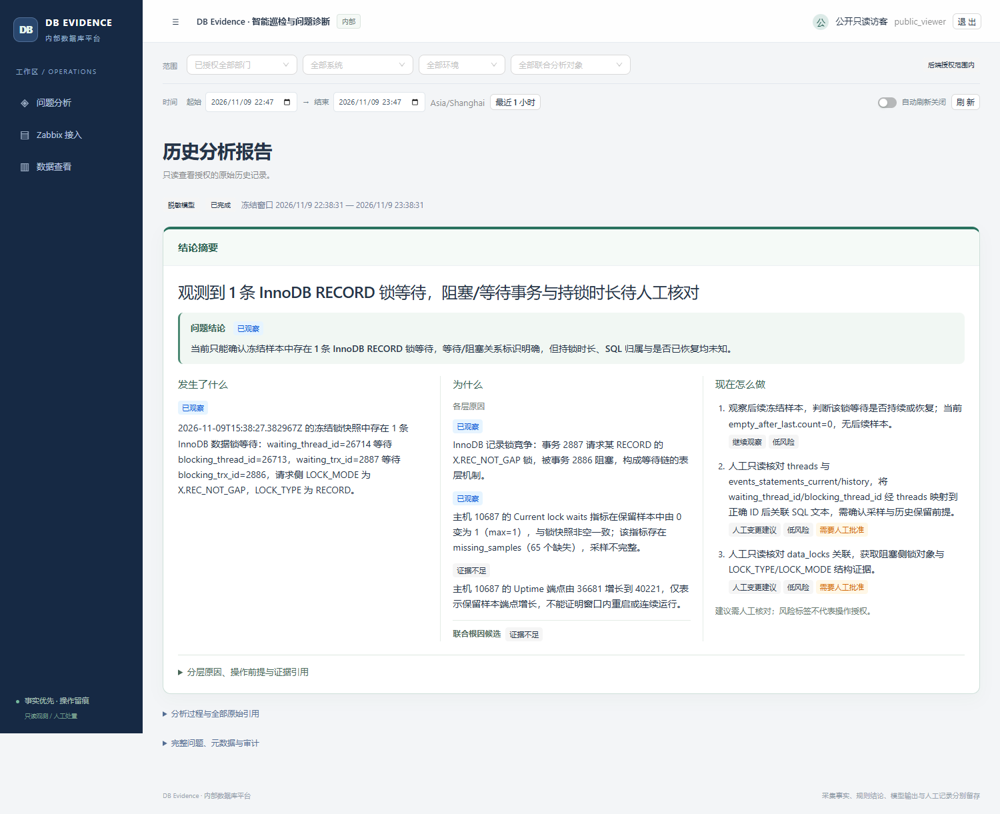

# 双入口快速演示验收 · 2026-11-09

本次使用个人隔离 MySQL Lab 的合成订单负载，观测、任务、图表及模型输出来自真实运行。A 是轻量快速演示站，调用 B 的受限接口；B 是完整平台。两者没有另建第二套采集或分析引擎。

## 实际页面

截图来自第一次成功分析仍处于锁等待期间。图表是报告冻结窗口内的原始保留点，不是当前实时曲线；覆盖缺口没有补零。开关是所有访客共享的单个固定实验。

## 实际链路

以下时间均为 UTC，上海时间加 8 小时。它们是本次测量，不是延迟保证。

| 检查 | 实际结果 |
| --- | --- |
| 公网 A 打开开关 | 实际出现 2 个专用故障会话、1 条锁等待；测试数据摘要未变化 |
| Zabbix 观测 | 15:38:27 的完整结构快照记录锁等待；保留 `history_truncated` 历史覆盖标记 |
| B 自主发现 | 15:38:31 普通 `urgent` 巡检派发任务；不是 A 创建调查或调用模型 |
| 实际 AI | 调查 `1a338cd7-992f-4b70-b901-4fbb30958a28` 完成，任务 `succeeded`，模式 `live_redacted`；A 显示关联报告及 3 张实际冻结曲线 |
| 临时提频 | B 实际采集 10 秒、信号检查 5 秒；基线 60 / 300 秒，租约 45 秒 |
| 重复 ON 与快速 OFF→ON | 重复 ON 不增加修订或连接；快速切换先释放旧事务，再建立一组新会话，仍只有 2 个故障会话和 1 条等待；同一观测异常未重复派发 |
| 正常关闭 | 15:43:30 直接核验故障会话 0、等待 0、数据未变化；实际 Zabbix 已有完整空快照，B 周期恢复 60 / 300 秒；旧报告标为历史 |
| 服务异常退出 | 第二次真实开启后终止 A 的已核对专属进程，保留隧道及 B；15:45:30 直接核验会话归零、等待归零、数据未变化，B 在租约到期后恢复 60 / 300 秒且仍可读取 |
| 无门槛操作 | 开关没有次数、冷却、固定运行时长或监控恢复确认门槛；B 原有模型预算、队列去重和证据判断仍生效 |

上游官方模板的监控项各自采样，未全部改为 5 秒；只将扩展锁诊断项调为 5 秒。结构快照与数值曲线的时刻不同，不向曲线插入快照推导的假数据。

## 模型结果的实际边界

第一轮确认了等待/阻塞线程与事务关系、RECORD 锁及等待侧模式。模型明确保留持锁时长、SQL 归属、业务根因和影响范围未知，未将主机曲线相关性说成已证实根因。它也把只读核对建议分类为 `manual_change` 并要求人工批准，这一动作分类仍偏保守；本次不声称根因诊断或处置建议已达到生产可靠性。

第二次普通巡检调查 `1f99febf-a48e-424c-9c52-f1bcd8d34197` 真实失败，错误 `invalid_model_response`。供应商传输成功且请求已启用 JSON 模式，但模型输出含非法 JSON，未达到输出长度上限。平台拒绝该输出，没有拼修为有效报告、偷偷重调模型或删除失败历史。A 保留失败任务，上一份成功报告只作为历史展示。

因此，本次通过的是**实际开关 → Zabbix → 普通巡检 → 真实模型报告 → 正常/异常退出恢复**的功能链路与失败可见性，不是每次模型必然成功或通用诊断准确率。

## 公网只读与页面

- A 免登录、仅一个固定开关；桌面与 390px 页面无横向溢出或未捕获脚本错误。
- B 公网 Chrome 实登成功，权限准确为 `data.read`、`event.read`、`knowledge.read`，范围仅固定对象；会话 Cookie 为 Secure、HttpOnly、SameSite=Strict。
- B 首页显示本轮报告；默认 3 秒滚动窗口实际前进，手动历史时间不被自动改写。
- 只读账号无故障控制或配置写入导航；普通采集、模型配置 API 均被 403 拒绝。
- B 指定报告及冻结图表实际打开，锁等待图显示 0→1，并保留缺口提示。
- A 浏览器没有 B 服务 token、目标口令、任意 SQL 或通用分析创建接口。

## 自动化与复核

本次最终源码验证：B Python **759 passed、10 skipped、6 subtests passed**；A Python **32 passed**；B 前端 **66 passed**、A 前端 **7 passed**；类型检查、生产构建、23 项工作流/连接契约、`pip check` 通过。跳过用例没有算作通过。

两侧独立复核通过，覆盖快速 OFF→ON 的持久回滚屏障、过期快照显示、实际报告权限范围、多主机锁聚合、异常恢复后的再次发现、租约清理和任务完成态保留。跨策略串行保护经过源码与回归核对，本轮没有以真实多 MySQL worker 并发压力测试替代说明。

仍有既有依赖弃用、测试 HMR 端口占用及前端包体积提示；长期在线、生产容量、高可用和模型成功率没有完成验证。临时公网地址依赖本机与隧道在线。

操作与周期说明见[快速演示指南](quick-showcase.md)，历史验收和旧 Release 保留。
