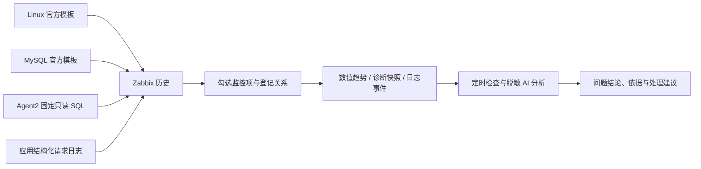

# 诊断数据准备与核对

先确认分析需要的信息已经采到，再运行故障验证。平台只读取 Zabbix；采集器与数据库账号仍由上游维护，AI 不连接数据库或执行查询。

## 数据从哪里来

| 数据 | 采集内容 | 需要注意 |
|---|---|---|
| Linux | 官方模板的 CPU、内存、磁盘、网络及文件系统 | 4 个数据库共用的物理主机只登记一台；短窗口可能因心跳预处理没有新样本 |
| MySQL 指标 | 官方模板的连接、线程、吞吐及 InnoDB 等指标 | 累计计数不能直接当速率，缺失样本不补零 |
| 配置 | 38 个允许的容量、内存、日志等配置项 | 不读取连接口令或所有全局变量；5 分钟一次 |
| 性能视图 | 当前事务、会话、锁等待与双方锁属性；语句摘要、表/文件 IO、索引及表概况 | 固定 SELECT、最多 20/50/100 行；累计 Top N 不是窗口差分，不能据此推算增长率 |
| MySQL 日志 | 最近 10 分钟错误事件元数据、慢查询耗时与扫描行数 | 不发送原始 SQL、错误正文或账号；慢日志需提前启用并授予只读权限 |
| 应用日志 | 真实请求慢/失败事件及每分钟请求摘要 | 当前接入独立 Lab 的 3 个应用，不是任意应用日志自动解析；不导出请求值或原始 SQL |

固定 SQL 与接入约束见 [mysql-diagnostics](../scripts/zabbix/mysql-diagnostics/README.md)。MySQL 诊断通常每 60 秒采样，应用日志每 30 秒抓取；提高平台轮询速度不能弥补上游未采集。

## 如何接入和查看

1. 先安装官方 Linux / MySQL Agent2 模板，确认 Zabbix 最新数据可用。
2. 由上游维护者为数据库创建最小只读监控账号，配置 Agent2 命名连接和固定 SQL 文件。不要开放任意 SQL 或 `system.run`；平台不需要数据库口令。
3. 在 Zabbix 添加带诊断契约标签的监控项，按说明配置预处理。成功的空查询结果与采集错误必须分开。
4. 在平台 **Zabbix 接入** 编辑联合对象，勾选数据库、主机和应用所需监控项，最多 32 项。诊断包包含多个字段，不必逐个占用名额。
5. 在 **数据查看** 核对时间、单位、数据新鲜度和覆盖缺口。普通只读访客可查看允许字段构成的诊断视图；其他日志原文仍需敏感数据权限。
6. 等待自然采集完成，再开启自主巡检。先确认正常基线，再逐个验证异常；不要以“能拿到 JSON”替代发现与分析验收。

## 时间、缺口与权限

- 首页默认最近 **7 天**，保留手动选择；自动刷新默认关闭。页面范围与后台调查窗口分别配置，新接入的数据不会补成过去 7 天的历史。
- 快照时间表示采样时刻；日志还保留实际事件时间。历史分析只使用冻结窗口内的事件；跨越窗口的应用摘要不作为完整窗口计数。
- MySQL 慢日志通常在语句完成后才写入，可能迟到；错误日志来自有限保留的性能视图。空结果不能证明整个历史窗口没有错误，相关覆盖状态会保留缺口。
- 应用在内存中暂存最近事件，Zabbix 保存已抓到的历史。应用重启、环形缓冲淘汰及跨窗口摘要明确标缺口；没有声称不丢日志。
- Top N 截断、采样缺失、无权限、解析错误分别保留；未知不等于健康。新采样不回填旧报告。
- 数据读取仍受业务范围权限约束；只读诊断视图使用字段白名单与对象别名，不开放原始敏感记录或写入能力。

## 数据增多后的分析边界

已采到的信息还要经过授权、冻结、脱敏和有界投影才能送给模型。平台保留原始证据，只在模型输入中省去身份、时刻、查询和可信契约完全一致的重复诊断文本；数值趋势与诊断快照使用分别计算的容量，省略的行和事件保留数量说明。累计统计仍不能冒充窗口差分。

模型配置支持 `context_input_bytes` 与 `total_token_budget`：默认分别为 24000 字节和 32000 token，硬上限为 64000 字节和 128000 token。本轮多源环境显式使用 48000 字节、96000 token，最多 4 轮；输入按实际序列化字节保守预留，累计用量与输出预留逐轮核对。调高容量不是调高诊断可信度，也不允许越权读数据。

最终 JSON 能解析但字段结构错误时，只允许在剩余预算、授权和期限内重新输出一次，不再开放取证工具。引用错误、费用结果未知、超时或第二次结构错误均保留失败，不无限重试。调查准备改为批量关联本次冻结证据，避免逐条读取；排队、准备、模型调用和报告质量分别验收。

## 为什么继续用 Zabbix

现有 Agent2 支持命名连接与固定自定义查询，能复用已有采集、标签及只读访问。Prometheus 的 mysqld_exporter 更适合指标，不独立解决完整日志采集与检索，因此本轮不重复搭建同一套指标管道。后续需要持续全文日志检索时，可评估 Alloy → Loki；**目前未集成这些组件**。

参考：[Zabbix MySQL 插件](https://github.com/zabbix/zabbix/blob/release/7.0/src/go/plugins/mysql/README.md)、[mysqld_exporter](https://github.com/prometheus/mysqld_exporter)、[Alloy 文件日志](https://grafana.com/docs/alloy/latest/reference/components/loki/loki.source.file/)。
