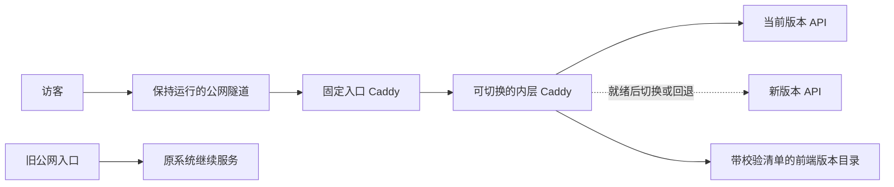

# 不停现有演示的版本更新

当前对外演示与开发验证分开运行。先在独立环境验证，再把经过检查的版本接到新入口；原临时网址继续服务。**首次引入网关需要新地址，不能直接抢占正在运行的端口。**



## 为什么有两层网关

内层通过 Caddy 的 `/load` 在线替换配置，切换前检查新 API 和前端，失败时恢复上一个版本。[Caddy 官方 API 说明](https://caddyserver.com/docs/api#post-load)

实际 Windows 测试发现，整套配置重载时，新建连接可能撞上旧 HTTP listener 的退出窗口。固定入口不随应用版本重载，仅对 **GET / HEAD 的连接失败**做最长 2 秒的短重试，减少只读浏览中断。它不自动重放登录 POST、故障 PUT 或其他写请求，避免一次操作被重复执行。写请求遇到连接错误时应先查询实际状态，再决定是否重新提交；不能把“切换后可访问”解释成任意请求绝对不会失败。

管理接口、应用上游和两个网关都只监听本机。公网隧道只转发固定入口，不能转发管理端口。平台授权、同源验证与 CSRF 继续由应用执行；代理不伪造登录身份或改写 Origin。

## 准备版本

后端从已审核的 Git 提交建立独立版本目录、构建依赖并启动在空闲端口，不能原地修改正在服务的代码或 `frontend/dist`。验证环境使用独立控制数据库 schema、私密目录、任务队列和实验目标。发布工具**不会迁移数据库、复制生产数据、启动分析 worker 或控制隧道**。

### 仅更新 AI 分析时

分析进程与网页 API、取数进程分开运行。只改分析逻辑且报告结构、控制库兼容时，可以保留网页与采集服务，只替换分析进程；新版本仍应从经过校验的不可变目录启动，不能指向持续修改的开发目录。

**同一控制库的 AI 队列没有按版本或对象分流。** 同时启动旧、新两个分析进程会竞争任务；换一个端口或使用 `--once` 也不会形成独立验证环境。需要并行验证时，必须使用独立控制库及调度；同库升级则先让旧进程完成正在处理的任务，再交接唯一消费者。

交接前核对进程启动时间、实际 Python 子进程、完整配置路径、队列租约与运行任务，避免把虚拟环境启动器误认为第二个消费者。停止操作必须防止“检查空闲之后又领取任务”的竞态；无法确认身份、运行状态或暂停后状态时保留或恢复原进程。不得强制终止正在生成的报告来完成更新。

新进程启动后核对递增心跳、实际加载版本和后续新报告，同时持续探测网页。保留旧版本目录与原启动参数；回退也使用相同的空闲交接步骤。历史报告不重写，旧 API 显示的新报告须再次检查只读访问、引用和图表。这里的分析交接不承诺队列零等待，也不改变公网隧道和网页路由。

前端构建完成后创建快照：

```powershell
python scripts/platform/release_gateway.py snapshot `
  --source D:\Build\DBEvidence\frontend\dist `
  --releases D:\Private\DBEvidence\frontend-releases `
  --release-id release-20261112-1
```

每个新目录包含 `frontend/` 和逐文件 SHA-256 清单 `manifest.json`。已有版本不覆盖；缺少入口引用文件、文件被修改、含符号链接或明显私密文件时拒绝使用。文件名检查不能替代发布前的源码与密钥检查。切换与回退会继续保留已经使用过的 `/assets/` 文件，避免已经打开的页面在加载旧资源时出现 404；同一个资源路径对应不同内容时拒绝切换。清理旧版本必须在确认没有使用者后另外安排。

## 启动新网关

先安装经过官方发布校验清单验证的固定 Caddy 版本。当前个人环境使用 **2.11.9**，官方 checksum 清单使用 **SHA-512**；同时保留本地 SHA-256 以便复查。可从 [Caddy 官方 Releases](https://github.com/caddyserver/caddy/releases) 获取其他平台的相应文件。

在仓库外写私密发布说明，例如：

```json
{
  "name": "B",
  "listen": "127.0.0.1:18681",
  "admin": "127.0.0.1:18682",
  "target": {
    "origin": "http://127.0.0.1:18480",
    "ready_path": "/api/v1/health/ready",
    "ready_equals": {"ready": true, "pending_feature_modules": []}
  },
  "gateway_probe": {
    "path": "/api/v1/health/live",
    "equals": {"process": "alive"}
  },
  "frontend": "D:/Private/DBEvidence/frontend-releases/release-20261112-1",
  "retained_frontends": []
}
```

A 可不提供前端快照，使用自身不可变应用目录的静态文件；把两个探测路径改为 `/api/state`，用 `required_keys: ["desired_on", "actual_state"]` 检查结构，`ready_equals` 设置为空对象。A 的故障 controller 必须保持单 owner，不能为发布而启动两个控制器争抢相同目标。

当前 A 的网页与控制器仍在同一服务生命周期中，不能直接套用 B 的双 API 蓝绿方式。网关不会转移控制器租约或证明负载已释放。优先独立发布网页与已验收目录；控制器升级需要先拆分职责，或明确安排旧所有者释放后再交接。未实测前不要声称 A 控制器可以无中断双版本切换。

生成内外两层配置，分别以隐藏后台进程运行，日志及 PID 身份记录留在私密目录：

```powershell
python scripts/platform/release_gateway.py preflight --spec D:\Private\DBEvidence\blue.json
python scripts/platform/release_gateway.py generate --spec D:\Private\DBEvidence\blue.json --output D:\Private\DBEvidence\inner.json
python scripts/platform/release_gateway.py front-door --listen 127.0.0.1:18680 --upstream http://127.0.0.1:18681 --admin 127.0.0.1:18683 --output D:\Private\DBEvidence\front.json
```

先 `caddy validate --config <配置文件>`；通过后启动内层、核对 ready，再启动固定入口。两层使用独立 Caddy 进程，应用版本更新时不要重载或重启固定入口。使用 `adopt` 登记实际已运行的初始配置；工具会核对 Caddy 当前配置与所提供的版本完全一致。

```powershell
python scripts/platform/release_gateway.py adopt --spec D:\Private\DBEvidence\blue.json --runtime D:\Private\DBEvidence\gateway-B --admin http://127.0.0.1:18682 --caddy D:\Tools\Caddy\caddy.exe
```

此时检查登录、只读页面与静态资源后，再创建指向固定入口的新公网隧道。隧道得到新网址后，应用的 `public_origin` 必须与它匹配，A 的允许 Origin 也需匹配；不要靠代理改写 Origin 绕过检查。原网址及原进程保留。

## 切换与回退

新版本发布说明使用相同 `listen` / `admin`，更换目标端口和前端快照；如需验证具体版本，可在 `gateway_probe.equals` 中加入由应用实际提供的版本字段。

```powershell
python scripts/platform/release_gateway.py switch --spec D:\Private\DBEvidence\green.json --runtime D:\Private\DBEvidence\gateway-B --admin http://127.0.0.1:18682 --caddy D:\Tools\Caddy\caddy.exe
python scripts/platform/release_gateway.py rollback --runtime D:\Private\DBEvidence\gateway-B --admin http://127.0.0.1:18682 --caddy D:\Tools\Caddy\caddy.exe
```

工具依次检查前端清单、Caddy 配置、目标 ready，再原子提交配置、回查实际配置并通过网关探测业务响应。目标未就绪不会改变现有路由；切后验证失败会恢复前一版本。配置被其他工具修改时拒绝覆盖，避免误操作。切换不停止旧 API，旧版本保留用于回退。

`state.private.json` 保存当前与上一版本；`pending.private.json` 保存未完成操作的恢复依据。进程意外退出后先检查实际进程与配置，再用 `recover` 显式恢复该记录中的已知旧版本。若锁目录残留，先确认没有发布进程运行，再清理该空锁目录；不要通过删除恢复记录强行继续发布。恢复也会检查旧目标 ready，未知的外部配置不会被覆盖。

```powershell
python scripts/platform/release_gateway.py recover --runtime D:\Private\DBEvidence\gateway-B --admin http://127.0.0.1:18682 --caddy D:\Tools\Caddy\caddy.exe
```

## 验收与边界

- 连续读取固定入口，覆盖切换、回退和旧资源加载；记录失败请求，而非只看最后一次 HTTP 200。
- 验证未就绪目标、切后不符合预期、外部修改配置及中途退出都不会被当成发布成功。
- 验证登录 POST、A 重复开关与真实只读操作；管理工具测试中的假上游结果不能替代产品端到端验收。
- 固定入口的短重试只掩护安全读取，不掩盖模型失败、证据不足或数据库异常，也不重新发起 AI 任务。
- 数据库结构要与旧版本兼容。旧版 readiness 当前严格检查迁移号，不能在两个版本仍运行时直接升级到不兼容迁移。
- 工具不实现数据库高可用，个人电脑断电、网络或临时隧道失效仍会影响公网访问。原始演示继续保留，直到新入口通过验收。

运行发布边界测试：

```powershell
$env:RELEASE_GATEWAY_CADDY='D:\Tools\Caddy\caddy.exe'
python -m pytest tests/platform/test_release_gateway.py -q
```

不提供该环境变量时，只运行基础检查，真实 Caddy 集成项显示 skipped，不能据此声称切换已验证。
