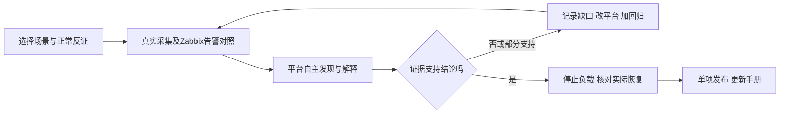

# 平台验证与改进记录

本页记录“通过实际运维场景找到平台缺口、修复后重测”的过程。[项目路线演化](project-evolution.md)说明为什么从自定义采集走向Zabbix接入；[场景清单](validation-scenarios.md)说明当前验证到哪一项。**程序回归通过、直接负载成立、平台自主发现并正确解释，分别记录。**

## 一项场景怎样迭代



1. **定目标：** 明确要判断的业务问题、候选机制和正常反证，先定义实际可采证据与资源上限。
2. **跑原流程：** A只控制固定负载；Zabbix采真实数据；B按自己的策略检查与分析。验收端不提交模型任务、场景名称或预期答案。
3. **找缺口：** 无报告先区分采不到、数据不适合计算、未调度、模型/预算失败；有报告再逐条查原因、反证、引用和展示，不能只看completed。
4. **改平台再重测：** 将缺口变成可失败的回归，修采集契约、调度、分析或界面，再重跑相同场景与正常对照；缺证据时允许结论为未知。
5. **逐项发布：** 记录修改前后证据与实际版本，更新本表、操作手册和场景目录；验证环境通过后切换并复查公网、只读权限和回退路径。只发布已达到相应验收层次的能力。

### 逐场景记录模板

每完成一轮复制以下模板。编号可以使用场景号与轮次，例如 `S09-R01`；未填项直接写“未验证”及原因。

| 记录项 | 本轮应保存的内容 |
|---|---|
| 场景/版本/日期 | 场景号、轮次、代码提交或构建版本、实际验证时间；是否已对外发布 |
| 目标与反证 | 要回答的问题；什么证据会推翻预想原因；对应实际业务影响 |
| 采集与资源契约 | 来源/host/item、单位、采样周期、基线窗口、计数重置处理；CPU/内存/连接/数据量上限和止损条件 |
| 真实执行 | 基线→ON→OFF的时间；直接负载是否成立、是否停止；工作负载证据与诊断预期分开保存 |
| Zabbix对照 | 当时启用的模板/宏/触发器、实际事件；属于未覆盖、尚未触发或已有告警，不人为关告警 |
| B自主发现 | 策略、实际检查/任务/报告标识与时间；自动还是人工；是否有外部模型真实调用，失败原因如实保留 |
| 解释核验 | 现象、原因候选、支持/反对证据、未知、建议；核对同对象/同指标/同窗口，列不正确的具体句子 |
| 缺口与修改 | 采集/发现/解释/展示中哪一层失败；改了什么；对应新增回归及首次失败结果 |
| 同条件重测 | 原问题与正常反证各自结果；直接清理和上游恢复分别记录；未解决项不隐藏 |
| 本轮结论/发布 | 明确“程序防护通过/直接负载通过/平台通过/部分通过/失败”；Release、手册、截图/脱敏证据链接，或不发布理由 |

原始日志和私密配置保存在源码外；公开材料只包含经过检查的脱敏结果。数据缺失不能补零，旧报告不能冒充本轮报告；一次成功不代表通用准确率或生产效果。

## 2026-11-12：指标证据与当前状态防护

**验证层次：程序回归，29个用例通过。** 使用隔离SQLite测试夹具和构造的结构化模型响应，验证后端如何处理引用、状态及摘要；没有用这组测试调用真实模型，也没有据此宣称7–12场景已端到端通过。修复在本轮开发版本中，公开发布状态由实际Release记录确定。

| 发现的缺口 | 本轮修改 | 对应回归（共29个） |
|---|---|---|
| 数值引用只要含数字就可登记模型问题，即使上游数据不可用 | 使用正式证据投影，要求可用采样与合法指标身份；未知、陈旧、不可用引用不能建立该问题 | 不可用/陈旧/未知3个 |
| 原始采样的时间或有效性不足以支持窗口内结论 | 核对冻结窗口、实际观测时间与数值有效性，统一时区表示，错误时间按无效引用处理 | 无效值、时区表示、错误时间、窗口外数据、未来观测5个 |
| 冻结趋势引用可绕过有效性、窗口和采集器检查 | 复用正式趋势投影，只接受窗口内有效数值和正确采集归属 | 无效点、窗口外点、错误采集器3个；有效原始/趋势引用2个正对照 |
| 历史发现仍占据“当前信号”，即使监控选择已换、数据过期或新样本已不支持变化 | 当前投影核对选择、来源、映射/配置版本与新鲜度；基线线索重新只读核对最新样本。保留历史问题，不把无信号解释成业务健康 | 陈旧样本、移除选择、映射版本、配置版本、来源变化、旧观测、counter语义、采样缺口、实际回基线9个 |
| 正确AI事实不能成为新指标问题的摘要，简单取任意事实又会串到同组其他指标 | 按实际来源+host+item匹配事实引用，核对采样与来源身份一致；不相关事实不用于该问题摘要 | 原始/趋势正确匹配2个；来源、host、item及provenance冲突5个 |

实现位置：`platform_app/intelligence.py` 的指标引用校验与问题摘要匹配；`platform_app/showcase.py` 的当前观测投影。这里的“正式投影”指服务端按既有权限和数据契约生成的可读证据，不是模型自己声明引用有效。

可复现的程序检查：

```sh
python -m pytest tests/platform/test_health_observation_guards.py -q
```

本轮结果为 **29 passed**。相关检查另有完整测试运行 **827 passed、17 skipped、6 subtests passed**；随后对最新上下文及相关路径重新运行 **130 passed**。跳过项和未执行的真实Zabbix/模型链路不计为成功，后续版本应记录自己的新结果。

### 下一轮仍要在真实链路核对

- A开启有界负载后，B是否自主发现、正确解释并引用新样本；本页程序测试不能替代这一步。
- 关闭后是否取得真实后续观测；当前状态与旧报告是否在A/B都能分清。
- 对同一业务组的多个不同指标问题，摘要、趋势与证据是否各自对应，是否仍存在互相串用。
- 若未发现或误判，按模板记录缺口、修正和同条件重测；达到门槛后再单项发布，不能仅增加演示菜单。

## 2026-11-12：用真实SQL效率变化改进平台

首轮由A单独开启有界查询负载，B自行发现扫描量和应用数据库调用耗时变化，并产生真实模型报告。扫描行/次由20升至4799，关闭后回到20；这些是隔离环境实测，不能代表生产性能或通用准确率。**当前记录是迭代过程，最终场景通过状态以验证清单为准。**

| 实测暴露的问题 | 平台或环境改进 | 如何复查 |
|---|---|---|
| 逐项API请求重复建立连接，27项取数需要12–19秒 | 同次、同来源请求复用连接，保持超时、返回大小和权限限制 | 真实批次取数降到约0.33–0.98秒；性能样本与程序回归分别记录 |
| 触发变化的数值投影被去重，模型看不到真正触发检查的数据 | 保留实际触发引用，数值保留首点和最后三点 | 核对真实模型请求，不用任务completed代替输入验收 |
| 重复指标元数据占据输入预算，SQL等非数值诊断被挤掉 | 元数据用可逆字典编码；优先保留非重复诊断快照；仍保留原硬预算 | 逐字段解码与原投影一致，原始冻结数据不改写 |
| 模型JSON截断、引用的指标身份不合法，或后续轮次累计预算不足 | 明确输出契约、依实际来源选择提示规则、有效输出上限4096；继续校验引用与累计预算 | 失败报告不修成成功，新增回归后调用真实模型重测 |
| 故障持续较久后，滑动窗口把异常当参考，恢复反而产生反向变化 | 首个有效稳定实测参考按来源、监控项、映射和配置版本保存，不被后来窗口覆盖 | 先确认故障前确有参考，再跑长时间变化和返回；没有稳定参考时保持未知 |
| 演示读取约6.23秒，超过桥接超时 | 用索引定位每个已选项的最新证据，只取需要展示的冻结曲线 | 同一真实对象读取约0.77–1.06秒；旧或无效新样本不回退成旧正常值 |
| 最新例行报告遮住已绑定本次异常的报告 | 优先展示与当前异常阶段真正绑定的报告，明确对应的监控项和阶段 | 不相关报告、旧阶段和越权报告不能冒充本次结果 |
| 部分官方MySQL采样停更，自定义项仍在更新 | 专用Agent改为独立服务托管；修复重建后目标地址和监控账号并发额度 | 四个新库的15个已选官方项取得真实新样本；缺失历史保留，不补算正常 |

保存的参考只是**实测对照，不是健康认证**。若第一次观察就处于异常状态，或正常时数据一直不满足稳定性条件，平台不能凭空得到正常基线。长期业务漂移需要维护者明确刷新配置后重新学习，历史报告仍保留。

本轮也将演示阅读体验纳入验收：自动读取改为60秒，保留浏览位置、展开状态与图表交互；查看场景不修改全局开关。每个场景先解释业务影响、实际Zabbix告警对照及平台发现路径，再展示实时证据。预设场景说明只用于页面讲解，不进入模型请求。

## 2026-11-12 首批真实场景：价值与未通过项

以下均为隔离测试的实际测量。A 只切换有界负载并临时加快检查，未提交分析任务、未向模型传入场景答案；B 经普通 Zabbix 取数与调度自行发现。用开启前、问题期间与关闭后的独立采样核对，原报告与失败记录保留。

| 场景 | 具体问题与测量 | 本次实际 Zabbix 告警对照 | 平台结果与下一步改进 |
| --- | --- | --- | --- |
| SQL 效率退化，第 3 轮 | 扫描/执行 20→4,799→20；SQL 窗口均耗时约 0.37→15.47→0.35ms；请求 p95 约 2.31→22.58→1.35ms | 对应窗口官方慢查询速率九个实际样本均为 0，启用的慢查询速率规则未触发；不是 Zabbix 无此能力 | 自主发现持续变化、给出扫描代价与耗时关联的候选解释；未定位具体 SQL/执行计划。报告存在个别引用不完整、假设用“导致”、末值与整窗混写的质量问题；须在新报告中改进，不能美化旧报告 |
| 应用连接池紧张，第 1 轮 | 池占用 0→6→0，获取连接 p95 约 0.011→600→0.011ms，错误率 0→1→0；数据库连接约 9/40 | MySQL 全局连接仍有余量，无本次连接耗尽事件；应用池故障发生在数据库接收请求之前。可以另配应用规则，不能说 Zabbix 无法告警 | 自主发现池等待与业务错误同步变化；模型输入缺池容量及 DB 最大连接数，另行实测的 9/40 不能当成模型已利用的反证。报告误读样本数及投影省略，诊断待改进。需改善跨层证据的保留与引用 |
| 报表临时表，第 1 轮 | 磁盘临时表速率 0→约 4→0 张/秒，扫描/执行 20→1,350→20，请求 p95 约 1.48→44.19→1.20ms；错误率仍为 0 | 当前临时表规则为速率超过 10 张/秒并持续 5 分钟，本次不足 2 分钟、约 4 张/秒，未出现对应事件。官方模板已有这类阈值告警 | 自主发现与恢复成立，但报告只概括延迟和查询负载，**未解释临时表机制，诊断不通过**。实际输入保留不足，唯一已提供的官方临时表数值也被忽略；须优化通用上下文预算与模型取证，再跑新的同条件报告 |

“期间”取验证器实际观察的最大变化值，各项采样时刻不同，不能当成同一个瞬间或因果证明。每项均明确关闭负载、独立确认清理，再取得两次新鲜且不同的上游近基线观测；该结果不保证业务整体健康。

本轮改进同时处理了阅读体验和查询成本：页面改为 60 秒更新内容，保留展开、焦点与阅读位置；总览采用批量摘要查询，详情再读取完整证据。一次 25 条问题实测约 22 次 SQL、0.02–0.06 秒，原接口曾超过 45 秒；这是本机这一数据规模的测量，不是容量承诺。整份关联报告仍必须通过权限校验，隐藏报告时也不展示其派生模型描述。
