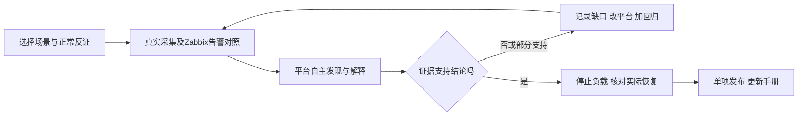

# 平台验证与改进记录

本页记录“通过实际运维场景找到平台缺口、修复后重测”的过程。[项目路线演化](project-evolution.md)说明为什么从自定义采集走向Zabbix接入；[场景清单](validation-scenarios.md)说明当前验证到哪一项。**程序回归通过、直接负载成立、平台自主发现并正确解释，分别记录。**

## 一项场景怎样迭代



1. **定目标：** 明确要判断的业务问题、候选机制和正常反证，先定义实际可采证据与资源上限。
2. **跑原流程：** A只控制固定负载；Zabbix采真实数据；B按自己的策略检查与分析。验收端不提交模型任务、场景名称或预期答案。
3. **找缺口：** 无报告先区分采不到、数据不适合计算、未调度、模型/预算失败；有报告再逐条查原因、反证、引用和展示，不能只看completed。
4. **改平台再重测：** 将缺口变成可失败的回归，修采集契约、调度、分析或界面，再重跑相同场景与正常对照；缺证据时允许结论为未知。
5. **逐项发布：** 记录修改前后证据与实际版本，更新本表、操作手册和场景目录；验证环境通过后切换并复查公网、只读权限和回退路径。只发布已达到相应验收层次的能力。

### 逐场景记录模板

每完成一轮复制以下模板。编号可以使用场景号与轮次，例如 `S09-R01`；未填项直接写“未验证”及原因。

| 记录项 | 本轮应保存的内容 |
|---|---|
| 场景/版本/日期 | 场景号、轮次、代码提交或构建版本、实际验证时间；是否已对外发布 |
| 目标与反证 | 要回答的问题；什么证据会推翻预想原因；对应实际业务影响 |
| 采集与资源契约 | 来源/host/item、单位、采样周期、基线窗口、计数重置处理；CPU/内存/连接/数据量上限和止损条件 |
| 真实执行 | 基线→ON→OFF的时间；直接负载是否成立、是否停止；工作负载证据与诊断预期分开保存 |
| Zabbix对照 | 当时启用的模板/宏/触发器、实际事件；属于未覆盖、尚未触发或已有告警，不人为关告警 |
| B自主发现 | 策略、实际检查/任务/报告标识与时间；自动还是人工；是否有外部模型真实调用，失败原因如实保留 |
| 解释核验 | 现象、原因候选、支持/反对证据、未知、建议；核对同对象/同指标/同窗口，列不正确的具体句子 |
| 缺口与修改 | 采集/发现/解释/展示中哪一层失败；改了什么；对应新增回归及首次失败结果 |
| 同条件重测 | 原问题与正常反证各自结果；直接清理和上游恢复分别记录；未解决项不隐藏 |
| 本轮结论/发布 | 明确“程序防护通过/直接负载通过/平台通过/部分通过/失败”；Release、手册、截图/脱敏证据链接，或不发布理由 |

原始日志和私密配置保存在源码外；公开材料只包含经过检查的脱敏结果。数据缺失不能补零，旧报告不能冒充本轮报告；一次成功不代表通用准确率或生产效果。

## 2026-11-12：指标证据与当前状态防护

**验证层次：程序回归，29个用例通过。** 使用隔离SQLite测试夹具和构造的结构化模型响应，验证后端如何处理引用、状态及摘要；没有用这组测试调用真实模型，也没有据此宣称7–12场景已端到端通过。修复在本轮开发版本中，公开发布状态由实际Release记录确定。

| 发现的缺口 | 本轮修改 | 对应回归（共29个） |
|---|---|---|
| 数值引用只要含数字就可登记模型问题，即使上游数据不可用 | 使用正式证据投影，要求可用采样与合法指标身份；未知、陈旧、不可用引用不能建立该问题 | 不可用/陈旧/未知3个 |
| 原始采样的时间或有效性不足以支持窗口内结论 | 核对冻结窗口、实际观测时间与数值有效性，统一时区表示，错误时间按无效引用处理 | 无效值、时区表示、错误时间、窗口外数据、未来观测5个 |
| 冻结趋势引用可绕过有效性、窗口和采集器检查 | 复用正式趋势投影，只接受窗口内有效数值和正确采集归属 | 无效点、窗口外点、错误采集器3个；有效原始/趋势引用2个正对照 |
| 历史发现仍占据“当前信号”，即使监控选择已换、数据过期或新样本已不支持变化 | 当前投影核对选择、来源、映射/配置版本与新鲜度；基线线索重新只读核对最新样本。保留历史问题，不把无信号解释成业务健康 | 陈旧样本、移除选择、映射版本、配置版本、来源变化、旧观测、counter语义、采样缺口、实际回基线9个 |
| 正确AI事实不能成为新指标问题的摘要，简单取任意事实又会串到同组其他指标 | 按实际来源+host+item匹配事实引用，核对采样与来源身份一致；不相关事实不用于该问题摘要 | 原始/趋势正确匹配2个；来源、host、item及provenance冲突5个 |

实现位置：`platform_app/intelligence.py` 的指标引用校验与问题摘要匹配；`platform_app/showcase.py` 的当前观测投影。这里的“正式投影”指服务端按既有权限和数据契约生成的可读证据，不是模型自己声明引用有效。

可复现的程序检查：

```sh
python -m pytest tests/platform/test_health_observation_guards.py -q
```

本轮结果为 **29 passed**。相关检查另有完整测试运行 **827 passed、17 skipped、6 subtests passed**；随后对最新上下文及相关路径重新运行 **130 passed**。跳过项和未执行的真实Zabbix/模型链路不计为成功，后续版本应记录自己的新结果。

### 下一轮仍要在真实链路核对

- A开启有界负载后，B是否自主发现、正确解释并引用新样本；本页程序测试不能替代这一步。
- 关闭后是否取得真实后续观测；当前状态与旧报告是否在A/B都能分清。
- 对同一业务组的多个不同指标问题，摘要、趋势与证据是否各自对应，是否仍存在互相串用。
- 若未发现或误判，按模板记录缺口、修正和同条件重测；达到门槛后再单项发布，不能仅增加演示菜单。

## 2026-11-12：用真实SQL效率变化改进平台

首轮由A单独开启有界查询负载，B自行发现扫描量和应用数据库调用耗时变化，并产生真实模型报告。扫描行/次由20升至4799，关闭后回到20；这些是隔离环境实测，不能代表生产性能或通用准确率。**当前记录是迭代过程，最终场景通过状态以验证清单为准。**

| 实测暴露的问题 | 平台或环境改进 | 如何复查 |
|---|---|---|
| 逐项API请求重复建立连接，27项取数需要12–19秒 | 同次、同来源请求复用连接，保持超时、返回大小和权限限制 | 真实批次取数降到约0.33–0.98秒；性能样本与程序回归分别记录 |
| 触发变化的数值投影被去重，模型看不到真正触发检查的数据 | 保留实际触发引用，数值保留首点和最后三点 | 核对真实模型请求，不用任务completed代替输入验收 |
| 重复指标元数据占据输入预算，SQL等非数值诊断被挤掉 | 元数据用可逆字典编码；优先保留非重复诊断快照；仍保留原硬预算 | 逐字段解码与原投影一致，原始冻结数据不改写 |
| 模型JSON截断、引用的指标身份不合法，或后续轮次累计预算不足 | 明确输出契约、依实际来源选择提示规则、有效输出上限4096；继续校验引用与累计预算 | 失败报告不修成成功，新增回归后调用真实模型重测 |
| 故障持续较久后，滑动窗口把异常当参考，恢复反而产生反向变化 | 首个有效稳定实测参考按来源、监控项、映射和配置版本保存，不被后来窗口覆盖 | 先确认故障前确有参考，再跑长时间变化和返回；没有稳定参考时保持未知 |
| 演示读取约6.23秒，超过桥接超时 | 用索引定位每个已选项的最新证据，只取需要展示的冻结曲线 | 同一真实对象读取约0.77–1.06秒；旧或无效新样本不回退成旧正常值 |
| 最新例行报告遮住已绑定本次异常的报告 | 优先展示与当前异常阶段真正绑定的报告，明确对应的监控项和阶段 | 不相关报告、旧阶段和越权报告不能冒充本次结果 |
| 部分官方MySQL采样停更，自定义项仍在更新 | 专用Agent改为独立服务托管；修复重建后目标地址和监控账号并发额度 | 四个新库的15个已选官方项取得真实新样本；缺失历史保留，不补算正常 |

保存的参考只是**实测对照，不是健康认证**。若第一次观察就处于异常状态，或正常时数据一直不满足稳定性条件，平台不能凭空得到正常基线。长期业务漂移需要维护者明确刷新配置后重新学习，历史报告仍保留。

本轮也将演示阅读体验纳入验收：自动读取改为60秒，保留浏览位置、展开状态与图表交互；查看场景不修改全局开关。每个场景先解释业务影响、实际Zabbix告警对照及平台发现路径，再展示实时证据。预设场景说明只用于页面讲解，不进入模型请求。

## 2026-11-12 首批真实场景：价值与未通过项

以下均为隔离测试的实际测量。A 只切换有界负载并临时加快检查，未提交分析任务、未向模型传入场景答案；B 经普通 Zabbix 取数与调度自行发现。用开启前、问题期间与关闭后的独立采样核对，原报告与失败记录保留。

| 场景 | 具体问题与测量 | 本次实际 Zabbix 告警对照 | 平台结果与下一步改进 |
| --- | --- | --- | --- |
| SQL 效率退化，第 3 轮 | 扫描/执行 20→4,799→20；SQL 窗口均耗时约 0.37→15.47→0.35ms；请求 p95 约 2.31→22.58→1.35ms | 对应窗口官方慢查询速率九个实际样本均为 0，启用的慢查询速率规则未触发；不是 Zabbix 无此能力 | 自主发现持续变化、给出扫描代价与耗时关联的候选解释；未定位具体 SQL/执行计划。报告存在个别引用不完整、假设用“导致”、末值与整窗混写的质量问题；须在新报告中改进，不能美化旧报告 |
| 应用连接池紧张，第 1 轮 | 池占用 0→6→0，获取连接 p95 约 0.011→600→0.011ms，错误率 0→1→0；数据库连接约 9/40 | MySQL 全局连接仍有余量，无本次连接耗尽事件；应用池故障发生在数据库接收请求之前。可以另配应用规则，不能说 Zabbix 无法告警 | 自主发现池等待与业务错误同步变化；模型输入缺池容量及 DB 最大连接数，另行实测的 9/40 不能当成模型已利用的反证。报告误读样本数及投影省略，诊断待改进。需改善跨层证据的保留与引用 |
| 报表临时表，第 1 轮 | 磁盘临时表速率 0→约 4→0 张/秒，扫描/执行 20→1,350→20，请求 p95 约 1.48→44.19→1.20ms；错误率仍为 0 | 当前临时表规则为速率超过 10 张/秒并持续 5 分钟，本次不足 2 分钟、约 4 张/秒，未出现对应事件。官方模板已有这类阈值告警 | 自主发现与恢复成立，但报告只概括延迟和查询负载，**未解释临时表机制，诊断不通过**。实际输入保留不足，唯一已提供的官方临时表数值也被忽略；须优化通用上下文预算与模型取证，再跑新的同条件报告 |

“期间”取验证器实际观察的最大变化值，各项采样时刻不同，不能当成同一个瞬间或因果证明。每项均明确关闭负载、独立确认清理，再取得两次新鲜且不同的上游近基线观测；该结果不保证业务整体健康。

本轮改进同时处理了阅读体验和查询成本：页面改为 60 秒更新内容，保留展开、焦点与阅读位置；总览采用批量摘要查询，详情再读取完整证据。一次 25 条问题实测约 22 次 SQL、0.02–0.06 秒，原接口曾超过 45 秒；这是本机这一数据规模的测量，不是容量承诺。整份关联报告仍必须通过权限校验，隐藏报告时也不展示其派生模型描述。

## 2026-11-12：保留联合判断需要的指标与正常反证

连接池与临时表场景暴露了同一类缺口：数据已经采到并冻结，但模型输入预算优先容纳了重复的指标说明，容量、临时表与正常反证被省略。模型因此只能概括耗时、错误或查询量的变化。改进应发生在通用证据组织层，不能把某个演示的预期答案写进提示词。

本轮候选 `evidence-investigation-v3.8` 的改动：

- 数值历史共用元数据，按实际来源、主机和监控项区分身份；压缩重复字段，优先覆盖不同指标。
- 保留触发变化的真实引用、样本数、首末采样时间，并明确中间点是展示省略还是上游缺采；数值曲线不再被当成锁快照。
- 保留正常指标用于反证，例如应用池紧张时的数据库连接余量。跨指标相关仍只是候选机制，不能直接写成已证明的因果。
- 每轮输入、累计输入、输出和工具权限的硬上限保持不变，不增加模型的执行能力。

**截至本节记录时，验证层次仍是程序检查与历史输入重投影。** 六个候选文件的封存校验一致，完整程序检查为 901 passed、17 skipped、6 subtests；恢复迭代后另跑相关检查 57 passed。对两份真实历史冻结输入只读重投影，均覆盖 26 个指标维度，原输入仅保留 1 条数值摘要。该比较未调用模型、未生成新报告，不能证明诊断已经改善。

接下来按相同条件重跑连接池、临时表及应用排队反例，分别核对自主发现、实际模型输入、解释与引用、关闭清理及后续监控恢复。每项的新结果单独追加，原失败报告与本节候选状态保留。演示网页和采集服务保持运行；同一队列只使用一个分析消费进程，避免不同候选抢占任务。

### 连接池重测：发现有效，报告因引用错误被拒绝

2026-11-12 11:16:29–11:22:18 UTC，实际运行 v3.8 分析候选。A 仅开启负载；B 在约 12 秒后自主发现新线索，本轮共观察到 8 个新变化信号。请求 p95 约 1.72→7,797→1.67ms，池占用 0→6→0、容量固定 6，队列 0→24→0，获取连接等待 p95 约 0.01→600→0.01ms。这些是全轮实际采样的前值、期间最大值和后值，指标时刻不完全同步，不是模型某个子窗口的精确读数。

| 验证层次 | 结果 |
| --- | --- |
| Zabbix 对照 | 本轮目标有 11 条启用触发器，ON 至恢复窗口没有新增触发器事件；前后规则定义未变。应用扩展没有对应池等待规则，数据库全局连接规则不能直接表示小应用池状态 |
| 模型输入 | 本轮实际请求覆盖 26 个指标维度，保留池容量、占用、队列及数据库反证，比旧版仅 1 条数值摘要完整；个别趋势窗为空仍需保留其未知状态 |
| 解释与引用 | 模型提出应用连接池瓶颈的候选解释，但将两个真实 `manifest:` 引用写成裸 UUID，校验正确拒绝。300 秒内未取得关联本轮问题的有效报告，**本轮诊断未通过**；没有自动修补引用或放宽校验 |
| 关闭与恢复 | 11:21:29 UTC 关闭，约 4 秒后直接控制清理确认；随后两次不同的新鲜上游观测支持本轮 8 个变化维度回近开关前值，不据此声称全库健康 |
| 下一项改进 | 明确引用编号必须原样复制；修正“空趋势摘要挤掉真实采样”的去重缺口，并在压缩前限定冻结时间窗。保留本轮失败后重测，不把输入覆盖改善直接当成诊断成功 |

同轮临时表复测因 `PermissionError` 提前停止，条件 OFF 和后续监控回落均已核实；它不计为平台分析通过。随后用 Windows 读锁复现了私有记录替换时的同类错误，原异常没有完整堆栈，不能认定具体锁持有者。验收工具仅对替换操作的该类错误进行有界重试，超限仍报错并执行原有清理。网页和故障控制器不因这项验收工具修复重启。

### v3.9：先修证据表达，再验证诊断效果

上一轮失败促成了以下通用改进，没有将演示场景或预期原因写入模型输入：

| 真实验证或复查定位的不足 | 本轮改进 |
| --- | --- |
| 模型省略证据编号前缀，或把动作前提、复验步骤写成不符合格式的字符串 | 明确编号逐字复制、列表字段的结构；原校验继续拒绝错误输出，不自动补编号或放宽格式 |
| 空趋势摘要可能挤掉同来源的真实采样 | 仅有效非空趋势参与去重；缺失仍是未知，保留实际观测及来源身份 |
| 历史快照的采集时刻在调查窗内，内部采样点却可能超出该窗；较窄的工具查询也有同类路径 | 先按实际时间窗裁剪数值点，再计算样本数、首末时间和展示点；冻结原始证据保持不变 |
| 工具结果再次压缩时可能混淆真实样本数与展示点数，并丢失单位 | 保留真实计数、时间范围、单位及数值语义，累计展示省略；超预算仍可省略整项，不能补成正常值 |

**程序验证与真实诊断分别记录。** 核心上下文改动曾运行完整检查 919 passed、17 skipped、6 subtests；最后的引用措辞澄清和工具路径修正后，相关检查为 167 passed，独立风险检查 13 passed。完整检查不是最后工具改动后的全量结果。这些检查使用隔离夹具，不能代替真实模型解释质量。

2026-11-12 约 12:00 UTC，已将独立审查后的 `evidence-investigation-v3.9` 封存版本交接给唯一分析消费进程。网页、采集、网关及故障控制进程保持；交接期间 10 次公网读取没有错误，切换后四个新旧入口均返回 200。队列共享时先确认没有运行中的分析，再交接，避免新旧模型协议同时抢任务。

### v3.9 真实重测：引用修复，联合解释仍未通过

两项均由 A 开启有界负载，B 自主检查并调用真实模型，没有人工提交分析或提供答案。独立清理和两次新鲜监控回落均完成；这一次也取得了真正关联本轮变化的有效报告。**工作流通过，诊断质量仍未通过。**

| 场景及实际时间（2026-11-12 UTC） | 本轮观察 | 报告表现与改进方向 |
| --- | --- | --- |
| 连接池：12:00:56 开启，约 20 秒出现新线索；12:03:36 关闭，12:04:31 完成恢复观察 | 请求 p95 约 1.25→7,788→1.42ms；池占用 0→6→0、容量 6；队列 0→24→0；数据库连接 9/40 | 有效报告 `6824b0f6-617a-466a-ab08-3fad29d56804` 引用通过，但最后一轮将 26 维/6 条线索裁成 16 维/2 条，丢掉占用、队列等关联证据。容量和 DB 余量仍提供，模型也未充分利用；没有解释完整的候选瓶颈机制 |
| 临时表：12:05:34 开启，约 13 秒出现新线索；12:07:48 关闭，12:08:40 完成恢复观察 | 请求 p95 约 1.18→74.76→1.45ms，DB 调用 p95 约 1.04→68.67→1.24ms；扫描/次 20→810→20，语句磁盘临时表 0→约 4.01→0 张/秒；请求速率仍约 4/s | 有效报告 `da13f613-0b6b-4c8d-be36-db95e50334cf` 引用通过，但最后一轮仅保留 16 维/2 条线索，并丢失请求速率反证。模型把累计请求数正常增长误当成流量增加，还忽略已提供的 DB 调用、SQL 耗时和临时表关联，错误偏向应用侧解释 |

数值取开关前实际观测、开启期间最大观测与关闭后末次样本，发生时刻不完全相同；不能与模型某个冻结子窗口的读数混写。公开记录另列开关前样本的范围及首末值，见 Lab 的 [连接池记录](https://github.com/catdogrennie-gt/SignalLens-Lab/blob/main/docs/validation/pool-pressure-context-v39.json)和[临时表记录](https://github.com/catdogrennie-gt/SignalLens-Lab/blob/main/docs/validation/temporary-work-context-v39.json)。

本轮实际 Zabbix 对照中，两项目标各有 11 条启用规则，开启至恢复窗口没有新增事件，相关性能规则及阈值前后未变。其中版本变更规则缺少第二个样本，不能称全部规则正常求值；“0 事件”也不能解释成 Zabbix 无法配置相应告警。

下一轮针对两个通用不足继续改：**最终输入先保住不同变化维度和正常反证，避免固定只留两份证据；分析中区分累计计数、速率、候选瓶颈与具体根因。** 旧报告和失败记录保持原样，新的程序检查及离线重放也不能代替下一次真实诊断验收。

### v4.0：保留异常线索后，继续检查结论是否有用

本轮先修最终输入固定只保留两份异常证据的问题：压缩展示细节，再平衡不同来源的普通指标；所有本轮变化引用均受保护，装不下则明确失败。提示规则区分累计计数与速率、局部正常与整体健康、已观察到的影响与尚未确认的具体根因。这些是通用约束，不含演示答案。

完整后端检查为 **940 passed、17 skipped、6 subtests**，并独立核对最终实际请求的大小计算、完整工具消息和授权边界。封存版本只交接唯一 AI 消费进程，网页和采集进程未重启。程序检查通过不代表下面的诊断通过。

| 2026-11-12 UTC 实测 | 已验证的改进 | 仍需优化 |
| --- | --- | --- |
| 连接池：12:57:36 开启，12:59:05 关闭 | 自主发现、关联本轮的新模型报告及关闭后监控回落完成；最后输入保留全部 6 条变化线索。报告已将连接池等待、排队与请求变慢联系起来 | 最后一轮仍省略池容量及数据库连接余量，建议偏向泛查 SQL/主机；候选解释改善，**完整诊断仍未通过** |
| 临时表：13:00:37 开启，13:01:40 关闭 | 自主发现、新报告及关闭后监控回落完成；最后输入保留全部 5 条线索及请求速率反证 | 请求 p95 约 1.39→37.86ms、数据库调用约 1.27→37.74ms，与 SQL 耗时及临时表同时增加；报告却否认延迟恶化，并混淆展示省略与缺采、较早点与末点，**诊断未通过** |

表中临时表读数来自该报告实际冻结子窗口的保留采样，不是整次负载期间的最大值。两场实际启用规则各 11 条，开启至恢复没有新增 Zabbix 触发器事件；规则定义未改，不能据此概括 Zabbix 的能力边界。公开原始结果见 [v4.0 验证说明](https://github.com/catdogrennie-gt/SignalLens-Lab/blob/main/docs/validation/context-v40-review.md)。

这轮进一步定位出三个通用改进方向，**尚未作为已完成能力发布**：

- 输入虽保住变化线索，正常反证仍可能被累计预算裁掉。对两份真实请求只读重投影，保留全部 26 维所需输入约 22–23KB，仍低于单轮 24KB；实际主要受累计预留限制。这个测量不是新模型结果，也不代表可以取消预算。
- 数值编码和过度裁剪使模型难以正确读取参考值、近期值与时点；应给出易读、带引用和时间的比较事实，再由 AI 解释关联，不能把预设原因写入输入。
- 当前调用显式关闭模型思考模式。下一轮先做同一冻结输入的有界对照，再决定推理配置；单次离线比较不算平台自主发现或场景验收。

另有独立复现的阶段状态缺口：持续变化暂时不成立、但尚未回到原参考带时，旧活动阶段没有更新；随后变化可能沿用旧阶段并匹配旧报告。应分别表示“变化未持续”和“恢复已验证”，保留旧历史并为新变化建立新阶段。该问题涉及检查调度与展示，**本次 AI 进程更新尚未修复**。

对应 FR-022～025：本轮输入、引用和预算防护已做程序验证；报告质量仍待改进。真实隔离场景是 AT-013 的补充验证，不能据此勾选全部 AI、注入与故障验收项。


### 2026-11-13：先验证信息条件，再制造故障

基础锁等待复测准备时，收窄对象选择后仍有旧未选项可能进入新分析。于是没有再开故障，先修平台的数据边界：服务端在自主任务排队时保存所选项及版本，冻结前过滤，后续每次模型和工具访问继续校验；改变选择就停止旧任务。仍选中的兼容历史保留，已有报告不按现在的选择改写。

实际控制库只读对照中，698 条候选证据排除了 98 条已移除项，所选项旧、新版本各保留 300 条；原报告及清单内容不变。新增 12 项范围与任务回归通过，完整后端 1084 项通过、10 项跳过、6 个子检查通过；其中较晚落盘的 5 项另由 95 项相关批次覆盖。

修复以同一不可变版本更新 AI、采集调度和 API，后台依次交接并恢复原排期，网页保留旧版回退。公开入口 52 项检查（含 7 项拒写）通过。以上证明的是数据边界及部署，不是新的故障诊断通过。部分通用旧诊断来源的发现/调度残留另列待核查，不因输入范围修复就宣布全部覆盖。

后续每个场景先列必需信息、核实实际接入/时间/单位/权限，预演自主发现、分析和恢复路径；缺关键前提且无法补齐就跳过。准备清单见[验证说明](validation-scenarios.md#每轮开始前先准备)，操作流程见[手册](operator-manual.md#10-按场景持续验证和发布)。
