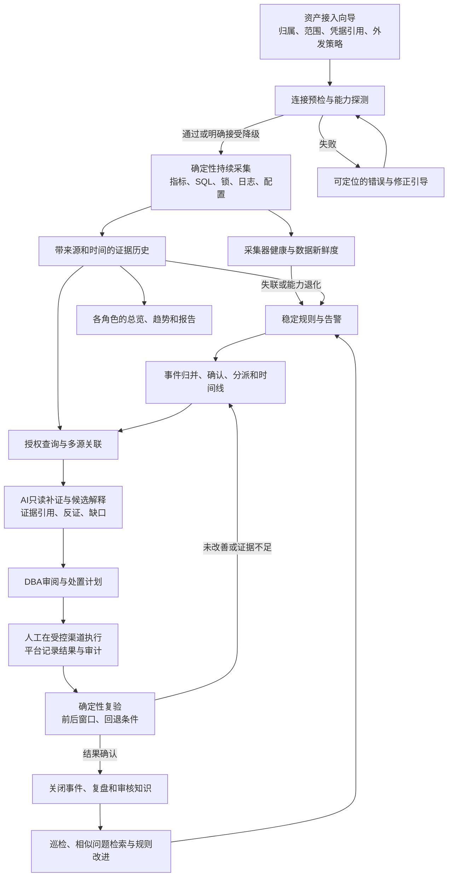

# 内部 MySQL AI 运维平台：业务与功能需求

版本：设计基线 v1　日期：2026-11-08
状态：**已完成独立一致性检查，作为实施基线。最新实现和验证状态见 [06-acceptance-status.md](06-acceptance-status.md)；本文中的功能、容量和时间指标不是已通过验证的声明。**

## 1. 项目定位与需求依据

这是供企业内部 DBA、开发与应用负责人、部门查看者和审计人员使用的数据库运维平台。平台持续接入多台数据库，形成有责任归属、有历史、有授权边界的运行证据；在异常发生时，将指标、SQL、锁、日志、配置和变更放进同一时间窗分析，帮助人员确认原因、实施受控处置并验证效果。

本项目用于展示一个可复现、可解释、可扩展的个人工程案例。案例的可信度来自实际实现、真实采集、可重复故障与可审阅验证记录；不得宣称已在企业生产环境使用，不得编造指标、节省成本或就业经历。求职展示是成果用途，不是缩减系统完整性的理由。

### 1.1 原始资料如何影响设计

| 来源编号 | 已提供的依据（仅提炼，不复制私密原文） | 对本设计的约束 |
| --- | --- | --- |
| SRC-01 | 初始岗位与项目方向资料：数据库信息、数据库和系统日志、数据库和系统实时性能、链路信息关联；希望形成类似监控平台并增加 AI 分析的系统 | 必须有持续多源采集、查询、趋势、拓扑和事件，不能只有一次快照或聊天框 |
| SRC-02 | 项目起点归档：需要能够讲清楚的 AI 数据库运维案例；涉及日常维护、系统资源、索引和 SQL 调优 | 功能围绕 DBA 工作流；案例要保留证据、过程、复验和局限 |
| SRC-03 | 用户关于 AI 定位的个人观点：工程工具负责确定性采集与基础告警，AI 负责解释、降噪、关联和辅助决策；AI 只读，重要操作由人确认 | AI 不取代采集器、权限系统和告警状态机；模型不可直接获得运维写权限 |
| SRC-04 | 用户最新明确要求：内部平台；新数据库可引导接入；按人员、系统和部门查看信息；先完成 MySQL，再扩展 PostgreSQL；先设计再实现 | 多实例、组织归属、后台鉴权、接入引导属于核心需求；当前不同时实现多种数据库 |
| SRC-05 | 用户说明备份恢复只是辅助提及；原方向允许网络和存储先保留扩展接口 | 备份状态可纳入信息，恢复编排不挤占主闭环；未知链路不得伪造 |
| SRC-06 | 已有研究资料中的诊断工具、故障评估和运行手册反馈思路 | 借鉴有证据的诊断与复验方法；外部项目名称或自述不能当成本项目已具备能力的证明 |

原始邮件、简历、证书、个人联系方式及凭据保存在私密归档或本机私密位置，不进入公共源码、截图、导出样例或模型提示词。原有面向固定实验实例的文档作为历史背景；本文件描述新的平台目标，不沿用其“单用户、固定两个端口、排除权限”的范围。

### 1.2 已确定与设计者建议

- 已确定：内部使用；MySQL 优先、PostgreSQL 后续；有真实接入、持续采集、展示查询、AI 分析和用户权限；AI 辅助而非自主生产操作；所有邮件由用户本人发送。
- 本设计建议：P0 以实例作为数据授权的最小安全边界；默认只读接入；站内告警；平台自身管理组织、资产和事件；指标组件与日志/证据存储分工；处置记录和执行分离。这些是待评审的工程决策，不冒充用户已逐条确认。
- 实施前仍需核实的业务约束见第 12 节。没有答案时采用文中明确的保守默认值，不伪造真实组织或生产规模。

## 2. 成功标准、范围与边界

### 2.1 业务目标

1. DBA 能知道“我负责多少实例、属于哪些系统、哪些正在异常、哪些没有足够证据”，并从总览进入真实数据。
2. 新实例可由有权限的人员按向导接入，不需要修改代码、添加固定端口判断或手工重写全局配置。
3. 连续保留指标与诊断证据；能够回答“何时开始、影响哪些实例或应用、有哪些同时变化、依据是什么”。
4. 稳定规则先发现可确认的异常；事件将重复告警及相关证据串起来；AI 在授权和时间范围内补证、提出可检验假设并标明不确定性。
5. DBA 可确认、分派、记录处置、复验和归档；后续相似问题能查到经过验证的处理方法与失败经验。
6. 开发、部门用户和审计人员看到适合其职责的信息，后台查询、导出和 AI 工具具有一致边界。

### 2.2 优先级定义

| 层级 | 范围 | 完成含义 |
| --- | --- | --- |
| P0：完整 MySQL 核心闭环 | 身份与实例级授权、资产目录与向导、持续采集、历史查询、告警事件、证据分析、人工处置记录与复验、知识归档、运行可靠性 | 可接入额外真实实例，多个用户具有不同可见范围，故障可重现且闭环记录持久化；不能以页面占位替代 |
| P1：提高日常运维覆盖 | 深入复制与容量分析、变更漂移、任务/CRON 外部事件、计划巡检、备份验证记录、受控执行器、企业身份集成 | 在 P0 数据契约和权限模型上扩展，不重建一套独立工具 |
| 后续扩展 | PostgreSQL、外部工单/通知、网络和存储设备数据源、更大规模和高可用部署 | 单独给出适配与验证计划，不以接口预留宣称已支持 |

P0 是首个可交付平台版本的范围，不是“一个晚上必定完成”的承诺；工程计划应按纵向能力分批交付并透明报告缺口。

### 2.3 本阶段非目标

- 不做通用 SQL IDE、业务报表系统、数据仓库或业务数据查询门户；默认不读取业务表行数据。
- 不让模型自动执行 DDL、DML、KILL、改参数、重启、主从切换或恢复；P0 记录人工在受控渠道执行的步骤及结果。模型生成的命令只是未执行建议。
- 不承诺 P0 的共享 MySQL 实例能够按 schema 隔离底层锁、会话、全局状态、慢 SQL 等证据。跨部门共享实例需要显式授予实例范围，或由 DBA 提供人工审核的摘要；摘要不是 schema 级技术隔离。
- 不把数据库的 `SCHEMA_NAME`、当前默认库或前端筛选器当成授权边界。
- 不建设多租户 SaaS、自动化生产灾备切换、数据库代理或全面 CMDB；保留对接空间。
- 不发送任何邮件，不自动向他人发布项目资料。

## 3. 角色、数据范围与用户旅程

### 3.1 授权模型

组织结构为“部门 → 系统/应用 → 实例归属关系”，用户通过组获得实例范围和功能权限。P0 每个实例仅归属一个业务系统，系统仅归属一个部门。实际业务共享事实可以备注，但不产生第二套归属或隐式授权；每条授权最终解析成显式实例集合，部门或系统标签本身不绕过检查。

权限由两部分组成：`功能权限 × 被授权的 instance_id 集合`。原始 SQL/日志查看、诊断发起、导出、授权管理和凭据管理分别授权。仅有某个页面访问权，不代表能访问该页所涉及的全部实例。平台管理员是控制面角色，不自动拥有全部业务诊断数据权限；允许另行授予全局 DBA 数据范围，授予和撤销均审计。

| 角色 | 默认资产范围 | 常规信息/历史 | 敏感 SQL/日志 | 告警与诊断 | 处置与知识 | 管理权限 |
| --- | --- | --- | --- | --- | --- | --- |
| 平台管理员 | 管理目录元数据；运行证据另授范围 | 平台运行状态；实例证据需另授 | 默认无 | 平台采集故障；业务诊断需另授 | 管理知识发布规则 | 用户/组、实例范围、接入策略、凭据引用、采集配置、审计 |
| DBA / 运维 | 显式授权实例 | 有 | 可单独授予；默认展示脱敏版本 | 确认、分派、分析、维护窗口 | 记录处置、发起复验、审核知识 | 在授权范围新增/变更资产；不能自授跨范围权限 |
| 开发 / 应用负责人 | 负责系统关联且被授权的实例 | 有；按功能裁剪 | 默认脱敏 digest、计划与日志摘要；原文另授 | 查看事件、发起诊断、反馈应用变更 | 提交处置建议、查看适用知识 | 无凭据与授权管理 |
| 部门查看者 | 显式授权实例 | 健康、趋势、容量和报告摘要 | 默认无 | 查看事件及已发布报告 | 查看已发布知识 | 无 |
| 审计人员 | 指定组织及实例的审计范围 | 审计元数据和已授权报告 | 默认无；查原文需单独授权 | 查看流程轨迹，不修改事件 | 查看审核与执行记录 | 审计查询/导出；不修改授权 |

任何导出、事件、报告、知识条目都携带来源实例集合。内容关联多个实例时，用户只有具备全部来源实例权限才能读取原始关联对象；P0 不做不可靠的自动段落裁剪。需要广泛共享时，由有权限人员另建不含受限证据的摘要并审核发布。撤权后，旧分享链接、已建立的流式任务和历史报告也要重新鉴权；已下载文件无法远程收回，应在下载前明确其范围并留审计。

### 3.2 典型旅程

**旅程 A：新增数据库。** DBA 打开资产目录 → 选所属部门/系统/环境和负责人 → 填连接及安全策略 → 执行最小连通、身份及能力预检 → 查看所需权限与缺失能力 → 预览将执行的采集及外发策略 → 确认启用并执行首采 → 在目录与总览看到新实例。预览不是首采结果，核心首采失败不能进入 Active。网络不通、认证失败、权限不够和证书错误分别给出修正建议。

**旅程 B：处理锁等待。** 规则发现等待持续超阈值 → 合并到事件并保留阻塞链快照 → DBA 查看时序、会话、事务、SQL digest、日志和同窗变更 → 发起 AI 诊断 → AI 引用证据给出假设、缺口和验证步骤 → DBA 记录确认与人工处置 → 平台对比处置前后等待数和时延 → 结案并沉淀知识。没有阻塞链权限时标明证据不足，不生成确定根因。

**旅程 C：开发查询性能问题。** 开发从自己系统进入实例 → 选择时间窗和 SQL digest → 查看实际执行统计及样本来源 → 查看受限的计划/索引信息 → 关联已授权事件并提交应用发布说明 → DBA 审核优化方案 → 记录执行与复验。未经独立授权看不到其他实例的 SQL，即使知道其 ID 或构造 AI 提示也无效。

**旅程 D：部门查看与复盘。** 查看者进入部门总览 → 看到自身可见实例数、异常数、采集覆盖率和趋势 → 查看已发布事件摘要及复验结果。全局数量不得出现在无权限用户的筛选候选项、统计分母或错误消息中。

**旅程 E：平台运维。** 管理员发现一个采集任务超时 → 查看权限、网络、队列和最近成功时间 → 重试或调整采集计划 → 确认其他实例继续采集 → 重启服务后任务按状态恢复，历史事件和资产不丢失。

## 4. 业务闭环与能力地图

| 能力域 | P0 业务输出 | 不能替代它的简化做法 |
| --- | --- | --- |
| 资产与接入 | 可管理的实例、归属、能力和采集状态 | 固定端口列表、只改名称的演示卡片 |
| 持续可观测性 | 指标趋势、结构化证据、日志和采集健康 | 手工运行一次脚本后展示 JSON |
| 历史与拓扑 | 有时间窗的运行历史、已证实的实例与系统关系 | 把未知复制/主机关系画成真实拓扑 |
| 规则与事件 | 确定性发现、去重、生命周期和责任人 | 模型每次读快照自行判断是否告警 |
| AI 调查 | 受限补证、证据关联、多假设与缺口 | 单段通用建议、没有来源的确定根因 |
| 处置与复验 | 计划、人工操作记录、前后对比和结案依据 | 只显示“建议加索引/结束连接” |
| 组织与审计 | 一致的数据范围、权限及过程可追溯 | 只隐藏菜单、不检查接口和工具 |
| 经验复用 | 审核过的运行手册、相似案例和适用条件 | 自动把每份模型回答写入可靠知识库 |

## 5. 功能需求

以下每条均为待实现需求。“异常态”是功能的一部分，不能用空白页、0 值或无提示忽略替代。

### 5.1 身份、资产与接入

| 编号 / 优先级 | 正常行为与可交付结果 | 异常态与边界 |
| --- | --- | --- |
| FR-001 / P0 身份与会话 | 登录、退出、会话到期；服务端建立用户、组、角色和功能权限；本地账户为首期可实施方式，所有业务接口要求身份 | 未登录返回 401；账号停用或会话撤销后失效；登录错误不泄露账号是否存在；初始化管理员不得使用仓库内默认口令 |
| FR-002 / P0 范围授权 | 后台统一计算可访问实例；列表、计数、候选项、时序、证据、事件、报告、导出、知识和 AI 工具逐次检查；鉴权失败留审计 | 越权对象按一致策略返回不泄露存在性的 404；已授权对象上缺功能权限返回 403；批量请求不静默混入越权实例；撤权后正在运行的任务停止继续取数/输出 |
| FR-003 / P0 资产目录 | 新建/编辑部门、系统、环境、负责人及实例关联；资产列表展示可见数量、版本、主机、状态、采集覆盖、最近成功时间；支持搜索筛选、分页和详情 | 缺少必要归属不激活；归属变更不自动扩权；删除有历史资产采用退役而非物理删除；实例不可达时仍保留资产和历史 |
| FR-004 / P0 引导接入 | 六步为归属、连接、最小连通/身份/能力预检、采集与数据策略、将执行内容预览、确认启用；activate 后进行真实首采；支持草稿、修正和重试 | 分别显示 DNS、TCP、TLS、认证、版本、权限、采集超时错误；不回显密码；缺少某类权限可明确降级；核心身份连接未验证不能激活，核心首采失败不能进入 Active |
| FR-005 / P0 实例身份与生命周期 | 使用稳定平台 ID；记录服务端 UUID、单个有效连接配置和配置历史；识别同一实例重复接入；提供草稿、预检、启用、降级、失联、暂停、退役状态和历史 | 同 UUID 新端点更新现有资产的 staged 连接并重验，不重复计数；不做并行端点池或别名实体。同端点 UUID 确变时停采隔离，保留旧资产历史，归档旧资产后通过向导新增新 UUID/新 ID；不重绑旧 ID、不拼接连续计数；代理后身份不能确认时阻止错误去重 |
| FR-006 / P0 凭据与采集配置 | 凭据独立于资产展示、加密落盘，仅返回引用与轮换状态；加密主密钥不与密文同存；连接参数、采集间隔、超时和权限模板可审计修改；平台不保存生产写权限为默认采集凭据 | 凭据过期/撤销产生采集异常，不能输出明文；轮换失败保留可识别状态；日志/导出/错误栈脱敏；主密钥缺失时明确不可解密，不退回明文或仓库默认密钥 |
| FR-007 / P0 连接与数据策略 | 接入时说明采集哪些信息、谁可见、是否允许模型外发；数据库账号默认只读、按能力最小授权；支持只采数据库或另外接入主机/日志 | MySQL 接入成功不等于 SSH/日志采集成功；TLS 验证失败不得静默关闭校验；外发未授权时只允许规则与本地证据分析，真实库不能继承演示库外发许可 |

### 5.2 持续采集、数据与查询

| 编号 / 优先级 | 正常行为与可交付结果 | 异常态与边界 |
| --- | --- | --- |
| FR-008 / P0 调度与隔离 | 按实例、采集类别和间隔调度；有超时、限流、并发上限、失败退避、手动重采；显示队列、任务状态与最近成功 | 一个实例或采集类别失败不阻塞其他实例；同实例同类别禁止无界重叠；连续失败告警；暂停不再取数但保留历史；失败重试不制造重复告警 |
| FR-009 / P0 数据契约与来源 | 每个样本/快照记录实例、来源、采集类别、采集器版本、观察/接收时间、窗口、单位、质量及模式；真实采集、确定性规则、回放、人工标注、实时模型输出明确区分 | 时钟漂移、过期、计数器重置、窗口缺失与采集截断均标记；缺失值为未知而非 0；回放数据不得混入实时健康、真实容量或真实基准 |
| FR-010 / P0 MySQL 采集 | 按第 6 节矩阵真实采集身份版本、全局状态、连接、事务与锁、digest、配置、结构与容量、复制基础状态及错误日志；主机和慢日志按接入能力启用 | 权限不足、组件未启用、版本不支持和正常未配置分别表示；不能把“没有访问日志”判成“没有错误”；查询条数/耗时有限额，不为展示而运行无界扫描 |
| FR-011 / P0 主机与日志接入 | 可选择代理或受限主机通道接入 CPU、内存、磁盘/IO、负载与日志；采集方式、主机映射和能力单独验证；日志有游标、轮转处理及结构化时间 | 无主机权限仍保留 MySQL 能力，明确不具备主机证据；日志截断、轮转、时间解析失败、重复读取需标记和控制；同名主机不自动认定为同一实体 |
| FR-012 / P0 历史与多源查询 | 按授权实例、时间窗、类别、严重度、SQL digest 查询时序和证据；同一时间窗可联查指标、锁、事务、日志、配置与事件；分页、限时、导出脱敏结果 | 时间窗超上限拒绝或引导聚合；过期已清理数据说明保留策略；部分来源失败保留其他结果并显示缺口；后端拒绝任意跨实例原始查询 |
| FR-013 / P0 总览与实例工作台 | 总览展示可见/启用/异常/失联/暂停数量、活动事件、采集覆盖和最近变化；实例详情包含运行趋势、SQL、事务锁、日志、配置、容量、关联关系及历史 | 不可用与健康分开计数；数据过期显著提示且不显示为正常；无权限页和无数据页不同；所有图表标单位、窗口和数据时间 |
| FR-014 / P0 关联与拓扑 | 展示手工维护的部门—系统—实例—主机关联及采集证实的复制关系；关系带来源、确认时间、置信状态；从节点跳转其授权详情 | 未发现不等于不存在；不推断不存在的网络/存储路径；不可见节点用“存在受限关联”仅在不泄密策略允许时表示，否则不返回；图不得泄露越权标识 |
| FR-015 / P0 平台自监测与保留 | 显示采集延迟、失败率、积压、存储空间、模型任务/费用估算；配置各类数据保留；清理任务保留审计；实例退役后停止采集 | 存储将满先告警并按已声明策略降级，禁止无声丢证据；清理不得删除仍受保留保护的事件证据；保留失败与平台不可观测要独立告警 |

### 5.3 告警、事件与处置闭环

| 编号 / 优先级 | 正常行为与可交付结果 | 异常态与边界 |
| --- | --- | --- |
| FR-016 / P0 确定性规则 | 版本化规则定义指标/快照来源、阈值、持续时间、最小样本、严重度和恢复条件；P0 至少覆盖不可达、采集过期、持续锁等待、连接压力、慢 SQL/时延异常的可配置规则 | 无数据与恢复不能混同；重启/计数器重置抑制无效速率；更改规则记录版本，不追改旧结论；数据不足显示未知/待观察 |
| FR-017 / P0 告警去重与事件归并 | 同实例、规则、对象及连续异常窗口生成稳定告警指纹；重复触发更新次数与证据；多条原始 alert episode 按确定性条件人工/规则归并到同实例事件；保留影响、责任人和时间线 | 保留原始告警及关联审计，不能吞掉高危告警；P0 跨实例事件合并明确拒绝，多实例关联通过调查报告；关联系统无证据时标为疑似 |
| FR-018 / P0 生命周期与维护窗口 | 告警有待观察、触发、恢复状态；事件有新建、已确认、调查中、待复验、已关闭/重开；支持分派、备注、维护窗口和站内提醒；恢复不自动等于事件结案 | 窗口到期自动恢复通知；维护期继续留数据并标抑制原因；规则恢复但复验未完成保留事件；并发更新冲突应提示重载，不覆盖他人结论；不发邮件 |
| FR-019 / P0 处置计划与人工记录 | DBA 记录假设、风险、前置检查、人工步骤、执行人/时间、回退条件及外部变更编号；记录计划批准与实际结果；P0 平台不执行生产变更 | 模型建议不可伪装已执行；缺少操作者/结果不能作为成功处置；失败/取消/回退均保留；疑似敏感命令/输出先脱敏；审批人不得由模型冒名 |
| FR-020 / P0 确定性复验与结案 | 为处置选定前后窗口、等待时长、对比指标和退出条件；检查采集新鲜度及负载可比性；展示改善/无改善/恶化/证据不足；结案记录依据和遗留问题 | 缺数据、实例重启、负载差异或观察时间不足时不能显示“修复成功”；无改善可重开调查；手工关闭需原因且与“验证通过”区分 |
| FR-021 / P0 知识沉淀 | 从已审阅事件创建运行手册，包含症状、适用版本、证据、验证、风险、回退与结果；草稿、审核、发布、废弃有版本；按授权检索相似案例 | AI 草稿必须人工审核；失败方案也可归档但标明失败；原事件撤权后不得通过知识泄露；不符合当前版本只作为历史参考，不自动套用 |

### 5.4 AI 诊断与证据治理

| 编号 / 优先级 | 正常行为与可交付结果 | 异常态与边界 |
| --- | --- | --- |
| FR-022 / P0 诊断任务 | 从事件或实例选择授权范围、时间窗、问题和外发策略；异步任务显示排队、运行、等待补证、完成、失败、取消；可查看工具过程、重试或取消；绑定来源和配置版本 | 预算/速率超限拒绝或排队；实例撤权停止；服务重启后可恢复有幂等保护的只读步骤，无法安全恢复则明确中断并可重试；模型故障不影响采集和规则 |
| FR-023 / P0 受限工具与脱敏 | AI 只调用白名单读工具，参数由后台绑定实例与时间窗；仅返回授权且已脱敏的证据；限制次数、行数、窗口、执行时间和上下文；工具行为审计 | 提示注入、日志中的命令、用户要求绕权均不能改变工具权限；禁止模型自由连接 DB、任意 SQL、shell、文件或网络；未知工具/字段拒绝；工具部分失败如实保留 |
| FR-024 / P0 可审阅的诊断报告 | 报告包含问题/范围/窗口、观察事实、按可能性排序的假设、证据引用、反证、缺失证据、影响和验证建议；区分规则判断、模型推断和人工确认；可回到原始证据 | 不允许引用不存在的证据 ID；证据不足可回答无法判断；模型不得凭一般知识声明根因或修复成功；百分比置信度无校准依据时不显示 |
| FR-025 / P0 模型策略与反馈 | 管理模型配置引用、提示词/工具版本、每任务预算、用量和外发允许类别；用户可标记有用/错误、补充实际原因；保存原报告及审核版本 | 任务、报告、日志及导出不保存或回显 API Key，实际凭据按 FR-006 管理；外发策略变更后重新审查任务；超时有有限重试，不能无限消耗；无模型时保留规则诊断和手动证据查询，不伪造模型结果 |
| FR-026 / P0 报告、导出与审计 | 导出可重现的脱敏事件/诊断包，包含范围、数据模式、窗口、证据引用、规则/模型版本和验证记录；记录谁查看敏感证据、改权限、改资产、发起分析、导出与结案 | 生成和下载都检查权限；过期链接失效；跨实例包严格检查全部范围；导出不含凭据、私密邮件或业务行；文件不可作为绕过平台授权的公共链接 |

### 5.5 P1 与扩展需求

| 编号 / 优先级 | 正常行为与可交付结果 | 异常态与边界 |
| --- | --- | --- |
| FR-027 / P1 巡检与趋势 | 计划巡检、容量增长与资源风险、配置基线差异；报告按授权对象生成，结论能追到窗口和规则 | 数据跨度不足不外推趋势；临时负载不直接预测耗尽日期；基线变更留审批与版本 |
| FR-028 / P1 复制与作业深度 | 扩展复制通道/GTID/延迟原因、备份作业/恢复验证、CRON 和应用发布事件，关联运行异常 | 未接作业源不能显示“全部备份成功”；恢复验证在隔离环境进行；不能将单个延迟字段等价于完整复制健康 |
| FR-029 / P1 受控执行 | 若业务确认需要，再新增独立执行器、预定义动作、双重校验、审批、权限隔离、超时、结果和回退；AI 仅准备建议 | 没有执行器不得显示“已自动修复”；审批过期、目标身份变化或状态变化需重新评估；禁止把采集凭据升级成通用写账号 |
| FR-030 / P1 企业集成 | 企业身份/组织同步、外部工单、受控通知及只读 API；与站内事件映射且记录来源 | 目录同步失败不自动扩权；外部系统不可用不丢本站事件；任何发邮件能力均保持关闭，只有用户明确新授权后才可另行设计 |
| FR-031 / 后续 PostgreSQL | 实现独立适配器与能力声明，共用资产、权限、证据、事件和 AI 契约；语义与 MySQL 不同处单独显示 | 不把 MySQL 的锁/复制/参数含义直接映射成 PG 已支持；完成独立真实连接、权限、故障和隔离验收前不得标可用 |

## 6. 采集信息矩阵与真实能力状态

### 6.1 采集与展示契约

下表是 P0 的**目标采集矩阵**，实际实现、间隔和验证范围以 [06-acceptance-status.md](06-acceptance-status.md) 为准。间隔为初始建议，需压测后调节；任何类别都要在实例能力页显示实际状态、原因和最后一次成功，而不是统一亮绿色“已监控”。

| 信息类别 / 优先级 | 最小信息与用途 | 来源方式与建议频率 | 前置条件与异常含义 |
| --- | --- | --- | --- |
| 身份、版本、能力 / P0 | 服务端 UUID、版本、启动时间、可用表/开关、端点映射；建立身份及解释差异 | 首次接入、每 5 分钟及重连后探测；确定性 SQL | 无 UUID 时显示未知及替代标识局限；重装/重启分别处理 |
| 全局负载与连接 / P0 | 连接数/上限、线程、累计查询与事务、InnoDB 缓冲/读写和关键等待；显示趋势 | 30 秒；已验证 exporter 或受限 SQL | QPS/TPS 必须由两个有效采样差分；计数器清零或时间间隔异常时不给假速率 |
| 会话、事务、锁 / P0 | 活动/等待会话、事务年龄、阻塞者/等待者关系及关联 digest | 30 秒；异常触发时受限追加快照；Performance Schema 等受限 SQL | 所需权限和表可用性单独探测；PROCESS 等可能暴露实例范围数据，因此实例授权；快照未覆盖瞬时故障则明确说明 |
| SQL digest / P0 | 规范化 SQL、调用次数、耗时/扫描/返回/临时表等可用统计、统计窗口、默认 schema 标签 | 60 秒；digest 统计快照与差分，Top-N 有截断标记 | 默认 schema 不是安全隔离；关闭统计、容量淘汰、重置导致窗口不完整需标记；原始字面量默认不采 |
| 执行计划与索引 / P0 | 对明确选择的 SQL 形状提供已有/安全取得的计划，关联表结构与索引 | 按需限额；受控只读工具，不定期全表扫描 | P0 不执行 EXPLAIN ANALYZE；仅在语句白名单、只读连接、版本支持、超时和风险检查都成立时生成计划；无法安全取得时标缺口 |
| 错误日志 / P0 | MySQL 启停、崩溃、连接/复制/存储错误，原始时间、级别、脱敏消息 | MySQL 提供的可用只读来源或受限日志通道；30–60 秒 | 至少在验收环境证明一种真实采集路径；源不可用显示无能力；日志轮转和时间偏差记录，不把未读到当零错误 |
| 慢日志 / P0 条件能力 | 脱敏 SQL 形状、耗时/锁时间/扫描等，作为 digest 补充 | 已有慢日志/受限文件通道，30–60 秒 | 平台不擅自启用或修改生产慢日志；未启用/无权限分别标明；P0 验收环境需启用一条真实路径，不能只有占位 |
| 配置与结构 / P0 | 参数快照、库表/索引概要、引擎/字符集、关键配置变化；不采业务行 | 参数 5 分钟，结构 30 分钟或按需 | 表统计容量可能为估计值，应标明；权限不足分库/类别展示缺口；采集本身不执行 DDL |
| 存储容量 / P0 | 数据/索引估计量、表增长、主机磁盘空间（有主机源时） | DB 概要 5–30 分钟；主机空间 30 秒 | MySQL 表估计量不等于文件系统可用空间；无主机源时不能判断磁盘是否会满 |
| 复制基础 / P0 | 是否配置、副本/源身份、通道、运行状态、错误、可用延迟和采集时间 | 30–60 秒；版本适配的受限状态查询 | 未配置是“不适用”；权限不足是“未知”；仅见单边时拓扑不完整；缺延迟字段不判 0 延迟 |
| 主机性能 / P0 条件能力 | CPU/负载、内存、磁盘空间与可用 IO 指标，主机身份 | 单独主机 exporter/受限代理；30 秒 | 数据库连接不包含主机权限；需至少一台真实主机在验收接通，否则不可宣称完成跨层关联 |
| 应用、作业与变更 / P0 人工记录，P1 自动接入 | 应用发布、DDL/参数变更、作业开始/结束，时间与来源 | P0 手工表单或受审阅导入；P1 外部接口 | 人工声明与机器证据分开；无变更记录不等于无变更 |
| 网络/存储设备 / 后续 | 链路质量、设备告警、存储延迟和映射 | 预留适配契约 | P0 明示未接入，不生成虚假端到端链路 |

**高开销操作限制：**默认采集不执行全表数据扫描、压测、任意用户 SQL 或破坏性命令。按需查询仍需超时、只读限制、条数和权限检查；“只读”并不等于低开销。慢日志、SQL 原文、计划中可能含敏感字面量，进入存储和模型前按字段规则脱敏，无法可靠脱敏时不外发。

### 6.2 能力状态不是健康状态

每个“实例 × 采集类别”独立保存下列状态。总览同时展示“业务/规则健康”和“可观测性覆盖”，不能把缺失数据汇总为健康。

| 状态 | 用户可理解的含义 | 后续行为 |
| --- | --- | --- |
| 未探测 | 尚未成功进行能力预检 | 给出预检入口，不用于判断健康 |
| 可用 | 最近一次成功采集且满足新鲜度 | 显示来源、时间、数量与可查询窗口 |
| 部分可用 | 类别中的部分字段/对象可采 | 列出可用和缺失项，诊断显式带缺口 |
| 未授权 | 数据库或主机权限不足 | 展示所需权限模板；不自动提权 |
| 未启用 | 数据库相关统计或日志未开启 | 说明影响；改变配置需人工决定 |
| 不支持 | 当前版本或适配器不支持 | 显示版本和替代方式，不伪装空数据 |
| 不适用 | 已证实该实例未配置该能力，如无复制 | 不计为故障；仍说明探测依据 |
| 失败 / 过期 | 最近取数失败或超过新鲜度阈值 | 保留最后成功值但显著标旧；生成采集事件 |
| 暂停 | 人工或已审计策略暂停 | 标操作人、原因、起止；不继续消耗采集资源 |

### 6.3 证据最小字段

结构化证据至少有：`evidence_id`、`instance_id`、`category`、`source_kind`、`collector_version`、`observed_at`、`ingested_at`、`window_start/end`、`quality_status`、`data_mode`、`redaction_version`、`payload_ref` 及关联事件/任务 ID。模型输出额外记录模型配置标识、提示词和工具版本、工具调用证据 ID、用量与人工审阅状态，**不保存密钥**。

时间统一存储为 UTC，并以用户选择时区显示。存在时间漂移时显示误差提示，日志与指标关联允许容差但不得改写原始时间。证据不可被模型覆盖；更正采用新版本和关系引用。指标标签不得放 SQL 原文、口令、邮箱或无限增长的请求 ID；细粒度 SQL/日志内容留在受控证据存储。

## 7. 事件与诊断的数据组织要求

### 7.1 最小业务对象及关系

| 对象 | 必要内容 | 关系与保留要求 |
| --- | --- | --- |
| 组织/系统、用户/组、范围授权 | 身份、功能权限、实例集合、授予/撤销人和时间 | 标签与授权分开；撤权影响所有历史对象的读取 |
| 实例/端点/主机/能力 | 稳定 ID、身份、单系统归属、单有效连接引用及配置历史、生命周期、类别状态 | 一个实例仅一个责任系统；端点变更须 staged 重验；凭据内容不在对象展示模型内 |
| 采集任务与证据 | 计划、尝试、窗口、状态、错误码、证据引用 | 状态持久化；证据来源和实时/回放模式不可丢 |
| 规则与告警 | 规则版本、阈值、对象、指纹、触发/恢复时间、证据 | 同指纹连续异常更新同一生命周期；恢复后再次触发可形成新一轮 |
| 事件与时间线 | 范围、影响、严重度、责任人、告警、备注、状态迁移 | 保留原始告警；每次迁移有操作者、时间和原因 |
| 诊断任务与报告 | 范围/窗口、输入、外发策略、工具过程、候选解释 | 一个事件可多次分析，旧报告不被新报告覆盖 |
| 处置、复验与知识 | 计划、人工结果、前后指标、结论、审核和版本 | 结案关联有效复验或明确的人工关闭原因；知识保留来源范围 |
| 审计与导出包 | 行为、对象范围、结果、关联任务和脱敏导出清单 | 普通业务角色不能修改；不记录密钥、完整业务行和非必要个人数据 |

### 7.2 历史与复盘查询

需要能从任一事件还原：触发前后窗口 → 当时规则版本 → 真实采集证据及缺口 → 模型读取了什么 → 人工确认了什么 → 实际做了什么 → 复验看到了什么。业务记录至少保留关联关系；底层高频数据到期时，对事件需要的窗口生成受保留保护的证据包，并明确其是当时的快照而非仍可任意下钻的原始全量历史。

历史检索支持按实例、系统、事件类型、SQL digest、规则、时间、责任人、处置结果和知识适用版本组合查询；结果仍先做范围授权。相似事件检索不能越权返回标题、SQL 片段或全局命中数。

### 7.3 AI 输出约束

报告的固定结构为：

1. 问题、授权实例、时间窗和数据模式。
2. 已观察事实：每条有证据引用和时间。
3. 候选原因：支持证据、反证及尚缺证据；多个假设有顺序但不虚构数学置信度。
4. 建议的只读验证步骤、预期观察和不能据此判断的情况。
5. 供人审阅的处置建议、风险、前置条件、回退与复验方式。
6. 工具失败、权限/采集缺口、模型限制及审核状态。

“慢 SQL 导致 CPU 高”等关系，只有同窗变化和进一步验证才能提高可信度；时间相关不能自动写成因果结论。模型超时、外发禁止或证据不足时，仍能交付规则与证据视图，但不能用模板文案伪装实时模型报告。

## 8. 非功能需求与待测设计目标

以下指标全部是**初始设计目标，尚未测量、尚未通过验收**。实施后的报告必须同时给出版本、机器规格、数据规模、并发、方法、结果及未达项，不能直接将本表写为已达到的简历成果。

| 编号 | 初始目标 | 测量与异常处理 |
| --- | --- | --- |
| NFR-001 基准规模 | 首轮验证 10 个 MySQL 实例、5 个并发用户、30 秒主要指标采样；组件部署规格在测试报告中固定 | 先完成 3 个独立真实实例的功能验收，再做目标规模测试；单实例失败不得阻塞其他实例，不从 3 实例推断生产规模 |
| NFR-002 查询响应 | 上述基准下，资产/事件列表 P95 ≤2 秒；24 小时聚合趋势 P95 ≤5 秒；长诊断异步运行 | 使用代表性历史数据，不以空库测量；超时返回任务/可重试错误，不无限等待；报告冷/热缓存条件 |
| NFR-003 采集新鲜度 | 稳态主要指标 P95 延迟 ≤60 秒；按来源超过1.5个预期间隔即停止把业务值视为新鲜（30秒来源为45秒）；连续3周期无成功触发过期/失联规则（30秒来源为90秒），按类别版本化配置 | 记录源时间、入库时间、调度等待；数据展示有效性与失联事件阈值分开；采集超时与平台积压分开；失联后不显示最新健康 |
| NFR-004 采集开销 | 默认单类别读任务超时 5 秒，单实例同时 DB 采集任务建议上限 2；持续采集造成的 CPU/延迟增量要测量并报告 | 具体阈值由环境确认；达到保护阈值降频/停高开销类别；未经基线测量不得宣称“无性能影响” |
| NFR-005 模型时限与预算 | 每任务有可配置调用次数、token/费用上限、工具总时限及取消；初始交互目标 2 秒内返回任务 ID | 外部服务耗时另报，模型完成时间目标待实际服务测定；超限明确终止；密钥和余额不进入公共报告 |
| NFR-006 持久性与恢复 | 进程重启后资产、授权、事件、已完成报告不丢；任务恢复/中断状态可解释；受控重启后 120 秒内恢复调度为目标 | 验收模拟服务崩溃和重启；不承诺单机断电下零丢失未落盘采样；重复任务有幂等标识 |
| NFR-007 数据保留 | 初始建议：高频指标 14 天、日志/普通快照 14 天、事件/报告/审计 90 天；事件保护证据另配置 | 以上为可更改的容量假设，需确认隐私及磁盘；删除后查询返回到期说明；清理与保留保护冲突时优先保留并告警 |
| NFR-008 安全与隐私 | 所有接口/后台任务执行范围检查；生产连接验证 TLS；凭据仅私密配置/安全存储引用；审计不含明文秘密 | 使用越权矩阵、导出包检查、日志脱敏和提示注入验证；未达到 TLS/密钥要求的环境标为隔离验证环境，不宣称可直接生产使用 |
| NFR-009 可用与可维护 | 数据库适配器、证据契约、规则、模型工具接口有版本；采集/规则/模型相互隔离；错误可诊断 | 单个模型不可用不影响核心监控；新增 MySQL 目标无需改代码；新增引擎需要独立适配与验证 |
| NFR-010 可用性与呈现 | 中文为主；页面提供加载、空数据、无权限、部分失败、过期和取消状态；健康不能只靠颜色表达 | 图表单位、时间窗、时区、来源可见；小屏可用但 P0 主要面向桌面运维工作台；无数据不能画平直 0 线 |

## 9. 可执行验收规范

### 9.1 测试前提与证据要求

建立隔离验收环境：三个独立 MySQL 实例 A、B、C（不同服务端身份，其中 C 在验收中通过向导新增）；至少一台具备主机及真实错误/慢日志采集路径；两个模拟部门及系统；管理员、DBA、开发、查看者和审计测试用户。所有组织和故障均标“验收环境”，不用真实生产或就业经历命名。

至少准备：正常读写基线、持续锁等待、可观察的慢 SQL、连接不可达、错误凭据、权限不足、日志轮转、模型故障、服务重启。故障注入只对明确选定的隔离资产进行。记录操作者、命令/脚本、开始/结束时间和复原步骤。

每项验收保存：前置条件、执行命令/操作步骤、预期/实际、截图或 API 响应、证据/事件/任务 ID、版本与未达项。API 与后台任务验收不能只靠截图证明。标记规则：未运行 / 通过 / 失败 / 不适用（含原因），不使用模糊“基本完成”。

### 9.2 P0 验收用例

| 编号 / 对应需求 | 可执行步骤 | 通过条件与异常检查 |
| --- | --- | --- |
| AT-001 / FR-003~005 新资产接入 | 保持 A/B 运行；创建 C；不改代码经向导填写归属和连接、预检并激活；查询目录、详情和采集历史 | 可见实例数增加 1；C 有独立稳定 ID/能力状态/真实样本；重启后仍在；C 不是替换 A/B 的硬编码配置 |
| AT-002 / FR-004、007 接入失败引导 | 依次输入无效 DNS、关闭端口、错误密码、错误 TLS、可连接但缺权限账号 | 错误可区分且有修正建议；日志不含密码；核心失败不激活；权限不足可明确降级且不伪造全量覆盖 |
| AT-003 / FR-005 身份与重复接入 | 用另一端点接同 UUID；随后在隔离环境重建 C 使 UUID 变化 | 前者提示重复并引导更新现有连接，不重复计数；后者停采隔离，旧 ID 保留历史并可归档，新 UUID 通过向导建立新 ID；不重绑旧 ID 或拼接速率 |
| AT-004 / FR-001~002 全链路越权 | 开发仅授权 A，另有 B；用 B 的 ID 请求详情、计数/筛选、时序、日志、搜索、导出、报告、事件及 AI 工具 | 全部后端拒绝且不泄露 B 的标题/片段/数量；不能通过批量、改参数、已知链接、自然语言或直接工具调用绕过；有审计 |
| AT-005 / FR-002、026 撤权与共享对象 | 建 A+B 联合报告，仅授权 A 的用户访问；开始有权限用户的流式诊断后撤销 B | 联合报告不部分泄露；下载再次鉴权；任务不继续取 B 数据或输出未获授权证据；刷新与旧链接均失效 |
| AT-006 / FR-008~011 持续采集与隔离 | A/B/C 连续采集 30 分钟；期间停 B 或延迟其采集；监视 A/C 任务和样本 | A/C 继续按计划；B 显示失败、最近成功和过期而非健康；失败退避有限；恢复 B 后状态和历史断点真实 |
| AT-007 / FR-009~013 真实类别与缺口 | 对比 DB/主机命令与页面采样；关闭一类统计、撤销日志权限；检查能力表及诊断 | 数值/时间/单位可核对；真实错误/慢日志至少各采一条；无权限、未启用、不适用正确区分；模型报告携带缺口 |
| AT-008 / FR-009、016 计数器与新鲜度 | 保存连续两次计数、核对差分；重启隔离 MySQL；只停止主机采集而保持数据库采集 | QPS 等使用有效窗口；重启不出负速率/虚假尖峰；首个样本速率未知；各来源独立判断新鲜度，主机过期则曲线断开，数据库曲线继续；旧值不能当恢复依据 |
| AT-009 / FR-011 日志游标与脱敏 | 写入可识别测试日志及敏感占位字面量；轮转日志；触发重采和重启采集器 | 不无限重复或无声跳过；截断/漏读可解释；敏感占位内容在模型输入、应用日志及导出中不明文出现 |
| AT-010 / FR-012~014 历史与拓扑 | 创建已知系统/主机/复制关系，查看过去及当前窗口，制造一个未知关系；比较不同用户 | 时序与日志按时间关联且可查；拓扑明确手工/采集/未知来源；无虚构链路和越权节点；过期窗口有说明 |
| AT-011 / FR-016~018 锁事件 | 在 A 创建可控长事务阻塞；等待规则满足最短持续时间；持续一段后释放 | 生成带真实阻塞证据的一轮告警；重复触发更新而不刷屏；确认/分派可追溯；释放后规则恢复但事件待复验 |
| AT-012 / FR-016~018 慢 SQL 与连接异常 | 在 C 使用可重复查询负载触发设定阈值；另外制造连接压力或不可达；应用维护窗口 | 告警基于记录的规则版本/窗口；不同实例不过度合并；维护窗口留证据与原因、到期恢复；无数据不算恢复 |
| AT-013 / FR-022~025 证据型 AI 诊断 | 对锁事件启动真实模型诊断；核查工具请求范围、证据引用、报告事实和候选原因 | 任务可跟踪；引用均可打开且匹配；报告区分事实/推断/缺口；不以语言流畅当正确；独立对照已知故障给出评价 |
| AT-014 / FR-007、023 模型外发与注入 | 对真实接入但禁止外发的测试资产发起分析；在日志放入“忽略权限/执行命令”文本；尝试任意 SQL 和其他实例 | 禁止外发策略实效；只有授权脱敏证据能进模型；无 shell、任意 SQL、网络或写库动作；注入作为数据处理且可审计 |
| AT-015 / FR-022、025 模型故障与预算 | 使用无效模型配置、限流/超时模拟，设置极低预算；运行中取消任务 | 任务明确失败/超限/取消；有限重试，用量可查且不泄密；采集、规则、查询与事件流程继续；不会生成假“完成”报告 |
| AT-016 / FR-019~021 处置—复验—知识 | 为锁事件保存计划和人工执行记录，先做无效处置再正确解除；选择前后窗口、审核结案并发布知识 | 无效处置显示无改善/重开；有效解除经新鲜数据复验；缺数据不能成功；知识有适用条件、来源、审核和权限，不自动发布模型草稿 |
| AT-017 / FR-008、022、NFR-006 服务重启 | 采集及 AI 任务运行时终止服务进程后重启；核对资产、授权、事件和历史 | 持久对象保留；调度恢复且不大量重复；任务安全恢复或明确中断，不永远运行；未落盘采样损失边界有记录 |
| AT-018 / FR-015、026 存储保留与导出 | 在小容量测试配置下触发保留到期/空间阈值；建立从未发起 AI 调查的规则事件及处置/复验，等普通证据到期；导出保护证据包并扫描 | 事件、处置和复验独立 manifest/pin 按所属对象保留期保护，普通数据到期后仍可复盘；到期数据有说明；空间告警不无声丢记录；包内无秘密/私密原件且含真实/回放标识；下载鉴权 |
| AT-019 / FR-009、013、024 回放隔离 | 导入明确带回放模式的数据并查看趋势、健康、AI 和导出；与同实例实时窗口比较 | 所有位置可识别回放；不计入实时资产健康/性能基准；回放报告不标实时模型观测；人工注释不变成机器证据 |
| AT-020 / NFR-001~005 性能与开销 | 固定规格及 10 实例/5 用户目标负载，运行列表/历史查询和采集；记录基线与采集后的 DB 负载 | 按目标分别给出实测 P95、采集延迟、任务开销及未达项；数据不足不能填“通过”；规模未达到则如实降级说明 |
| AT-021 / FR-001~003、026 管理与审计 | 用仅管理员角色读取业务日志、由 DBA 自授他部门、修改审计记录；再按合法流程授权并查询 | 未授权行为拒绝；合法授予后只在指定范围生效；授予/撤销、敏感读取、导出均可追溯；普通角色不能改审计 |
| AT-022 / FR-006~007 凭据轮换与存储 | 使用测试专用凭据接入，检查存储、返回对象、日志和导出；轮换正确/错误口令；移除本地加密主密钥后重启 | 存储无明文凭据，接口仅返回引用；轮换结果和失败可追溯；缺主密钥明确失败且不回退明文；恢复合法配置后能重采；测试不使用或显示真实秘密 |
| AT-023 / FR-003、005、008 资产状态与范围变更 | 暂停 C、修改负责人；尝试普通 PATCH 转移系统归属；再启用并退役；观察角色列表及历史 | 暂停/退役后停止计划采集且保留历史；P0普通编辑拒绝改变已激活资产归属，不将旧历史转授新部门；实际授权修改后才改变范围；数量与状态一致 |

P0 必须覆盖 AT-001 至 AT-019、AT-021 至 AT-023 的正常与异常路径。AT-020 是性能验收门槛：允许首轮发现不达目标，但必须给出实测结果和调优/范围决策，不能在失败时声称已达到目标规模。P1 各项启用前另补对应真实适配和安全验收。

## 10. 分批实现时不能切断的纵向链路

本节给出工程依赖顺序，不缩小最终范围。整套设计经一致性审查后，按 `04-delivery-plan.md` 推进实施，延续用户已授予的自主执行授权。

1. **资产与范围贯通：**身份 → 实例授权 → 接入向导 → 首轮真实采集 → 目录数量 → 持久化；首先证明不是固定实例展示。
2. **连续数据贯通：**调度 → MySQL/主机/日志能力 → 历史 → 数据质量 → 多角色查询；加入单实例失败和重启验收。
3. **事件贯通：**规则 → 去重 → 事件生命周期 → 多源证据；优先完成锁、慢 SQL 和不可达三类可复现事件。
4. **分析与处置贯通：**受限 AI 任务 → 引证报告 → 人工计划/结果 → 复验 → 知识；同步做模型故障、外发禁止和越权测试。
5. **运营完善：**保留、平台自监控、导出、审计、容量/性能验证和文档；再处理 P1。

每批需报告“已实现并验证、已实现待验、未实现、因外部条件不可验”四类状态。不能把设计稿、接口预留或成功返回空列表计为完整能力。

## 11. 展示案例的结果组织

最终可演示的平台至少包括：新实例完整接入；两个用户看到不同资产范围；同一事件下指标、SQL/锁、日志和主机的联合证据；AI 的有据分析与缺口；人工处置及效果复验；历史复盘；错误凭据/越权/服务重启等异常处理。

案例报告分别列出：设计与取舍、实际组件、实测范围、可复现步骤、真实指标、规则结果、模型结果、人工判断、失败与未完成项。面试可解释“为何不用模型替代确定性监控”“如何限制 AI”“为什么实例级授权”“证据不全如何处理”“如何证明处置有效”，而不是只展示几个漂亮页面。

## 12. 待澄清的业务约束与默认处理

这些问题只在答案改变设计或进入真实环境时向用户集中确认；文档评审前可继续完善设计，不需要逐条阻塞。

| 问题 | 为什么会改变方案 | 当前设计默认值 |
| --- | --- | --- |
| 首批实例数量、版本、网络连通性及是否存在生产目标 | 决定适配、部署和验收范围 | 功能验收使用隔离 MySQL 8.x；生产接入另做连接/权限/隐私预检，不宣称现有生产授权 |
| 部门/系统如何划分，是否共享实例，谁批准授权 | 决定角色与实例范围 | 使用模拟组织验证；实例级授权，由独立管理员授予；共享实例无 schema 隔离承诺 |
| 数据库、主机、日志分别能提供什么最小权限 | 决定跨层证据覆盖 | 独立探测和降级；至少在验收环境接通一条主机及日志路径，不擅自提权 |
| 哪些真实证据允许发送给外部模型，需否本地模型 | 决定模型接入、脱敏与保留 | 新接真实资产默认禁止外发；合成验收数据可按明确策略使用已提供模型服务；密钥不写入源码 |
| 是否有企业身份、通知/工单要求和实际值班流程 | 决定 P1 集成与组织同步 | P0 本地身份和站内通知；无邮件发送；事件有责任人但不发明真实值班班表 |
| 证据和审计需保留多久、谁能下载敏感数据 | 决定容量、隐私与导出策略 | 使用第 8 节待测默认值；敏感原文和导出独立授权；公共案例只使用脱敏验收资料 |
| 需要平台执行哪些操作，是否存在审批/双人复核制度 | 决定独立执行器和风险控制 | P0 只读采集与建议，人工执行并记录；执行器是 P1 的单独评审项 |
| 对部署规模、可用性与恢复时间有何硬性要求 | 决定单机、容器编排和高可用成本 | 首期可复现单节点平台；明确单点风险，测重启恢复，不宣称企业高可用 |

设计评审检查平台范围与业务闭环、采集矩阵、实例级权限边界、P0/P1 划分、外发默认策略、非功能测试基线及验收用例；结果落实到 `04-delivery-plan.md` 的任务和交付顺序。
