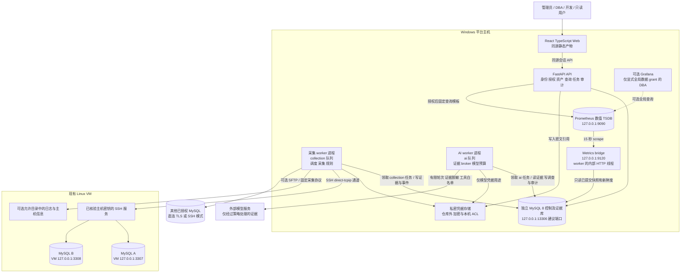
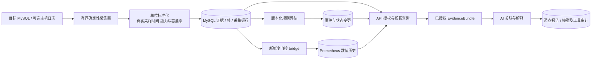
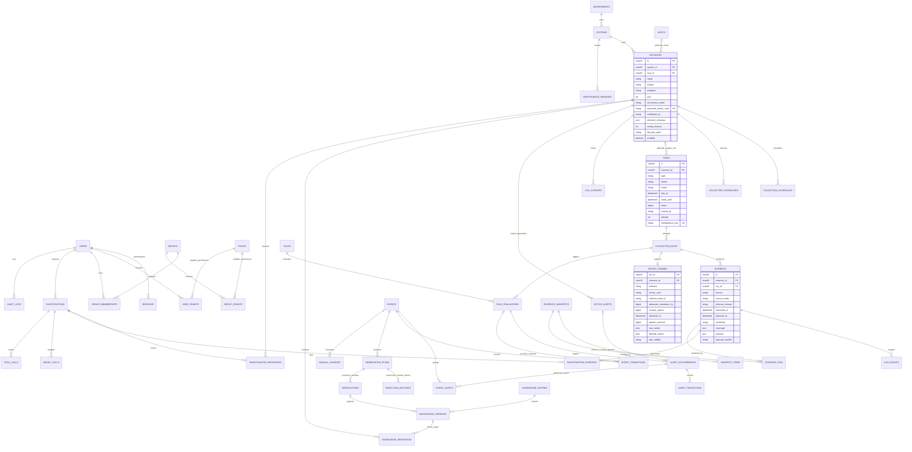
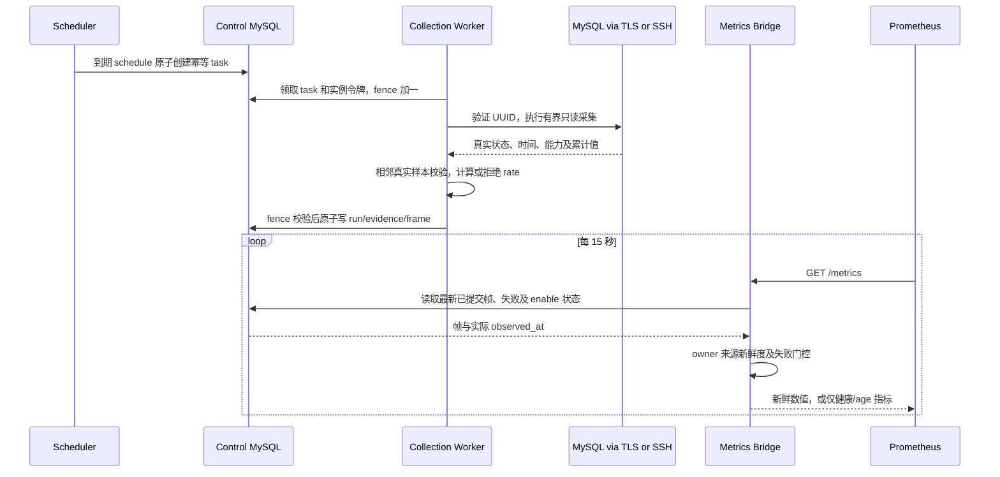
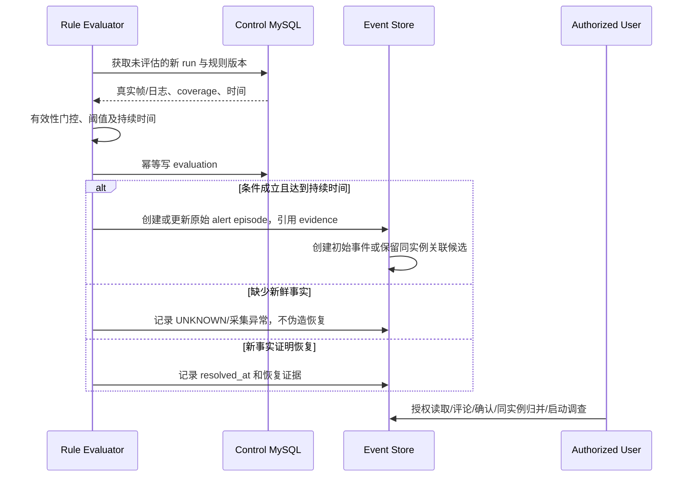
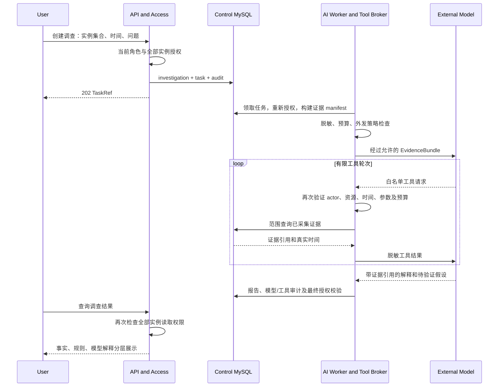
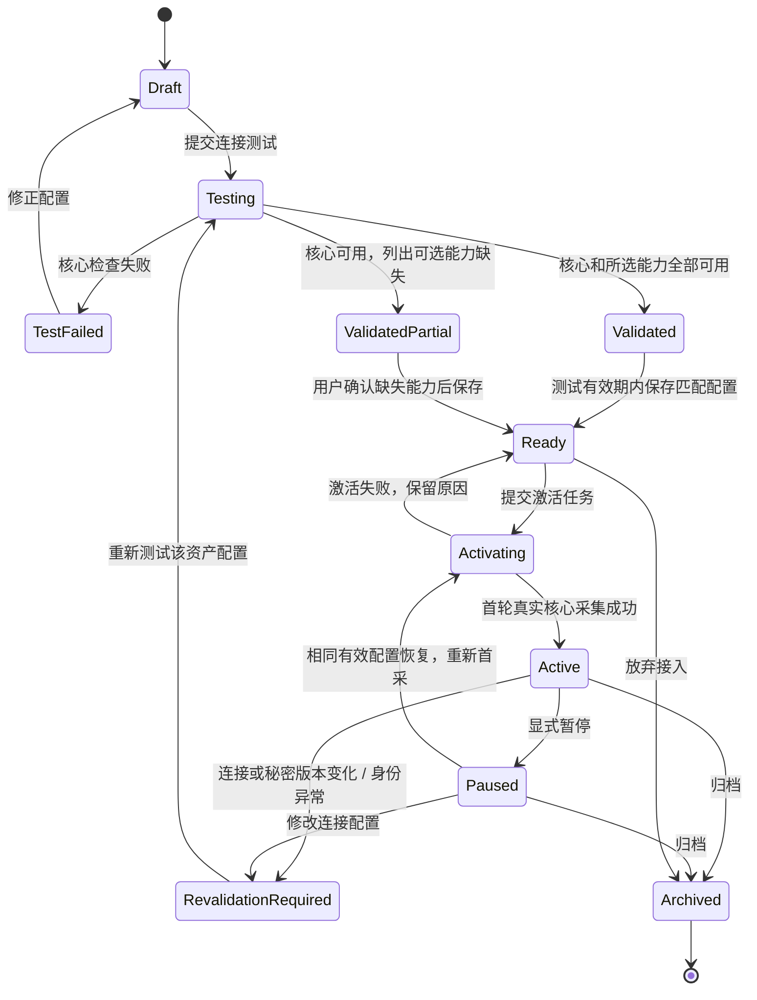
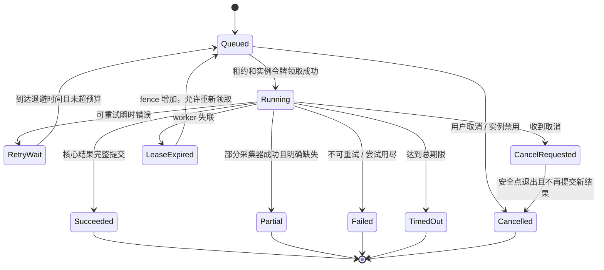
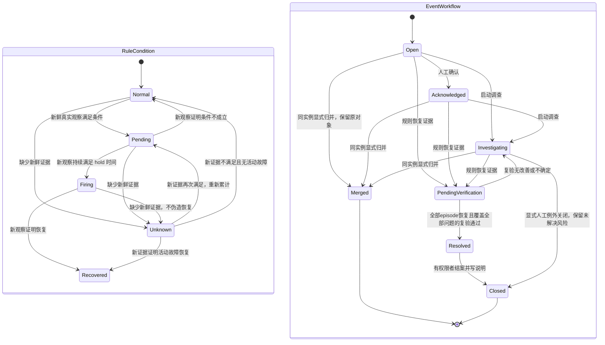
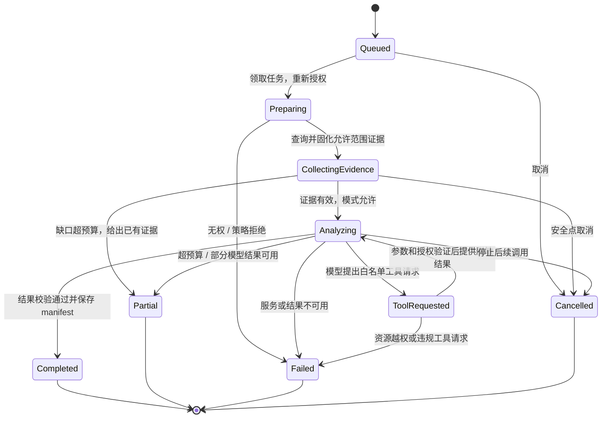

# 数据库运维信息平台架构设计

版本：设计草案 v0.1；资料核实日期：2026-11-08。

**版本范围：本文保留原直采 / Prometheus 方案的设计基线。** 当前 Zabbix 路线复用其授权、控制库、任务和调查域，原始外部时序仍在 Zabbix；当前入口见[本轮设计](../superpowers/specs/2026-11-08-zabbix-intelligence-design.md)、[当前架构图](../../README.md#系统如何组成)及[实际验收](../acceptance-zabbix.md)。本次按当前版本收尾，时序预算缺口仍保留；设计描述不能代替验收。

本文描述拟建设系统及其实现契约，不代表功能已经实现、依赖已经安装、性能已经验证。它取代旧 `docs/02-architecture.txt` 中固定 source/restore 实验拓扑作为平台架构的地位；原实验设计保留为受控案例资料。需求及页面设计以本目录相应文档为准，若出现接口冲突，应先同步设计再实现。

## 1. 目标、约束与明确选择

目标是可持续纳管新 MySQL 实例的运维信息平台：接入引导、资产归属和数量、持续采集、历史查询、确定性告警、证据关联、AI 调查、部门/系统范围授权及审计构成完整流程。实验场景用来验证平台处理真实问题的能力。

本设计的决定如下。

| 编号 | 决定 | 原因与边界 |
|---|---|---|
| AD-01 | FastAPI 模块化单体 API + 采集 worker / AI worker 两个独立进程 | 两个 worker 复用同一代码包，分别领取 collection/ai 队列；API 响应不承担长任务，模型阻塞不占用采集主循环；暂不引入微服务、Kafka、Kubernetes |
| AD-02 | 独立 MySQL 8 控制/证据库，目标采用 8.4 LTS 的核实补丁版本 | 存资产、权限、任务、证据、事件、审计；SQLAlchemy + Alembic 管理模型与迁移；不能把被监控实验数据库同时当唯一控制库 |
| AD-03 | Prometheus 为明确的数值时序组件 | 负责趋势存储和模板查询；SQL 摘要、日志、配置、锁图等进入 MySQL 结构化证据库 |
| AD-04 | P0 自有扩展采集器 + 本机 metrics bridge | worker 通过直连/TLS 或 SSH 通道采集；兼容现有仅 VM 回环可达的 3307/3308；不要求每个新资产预装代理 |
| AD-05 | 官方 mysqld_exporter 为可选采集适配器，不是 P0 已使用组件 | 只有 exporter 到目标数据库、Prometheus 到 exporter 两段可达且凭据配置已验证时才能启用；不能写成已经集成 |
| AD-06 | React + TypeScript + Vite，管理界面采用 Ant Design，图表采用 ECharts | 资产/向导/详情/事件/调查/权限页面复用成熟表单、表格、反馈组件并共享类型和查询状态；兼容组合与具体补丁版本见私密组件 manifest，元数据核实不等于安装、类型检查和构建通过；静态产物由 API 同源托管 |
| AD-07 | Grafana 作为显式拥有全局数据范围的 DBA 可选视图 | 局部范围 DBA 及业务用户通过平台后端模板查询 Prometheus；控制面管理员无数据 grant 时也不能访问此全局视图 |
| AD-08 | P0 每个实例仅归属一个业务系统，系统仅归属一个部门 | 授权范围清晰且可验收；schema 选择仅控制采集范围，不构成安全边界；跨系统共享实例不纳入 P0 隔离承诺 |
| AD-09 | 确定性采集与规则执行，AI 关联和解释 | AI 不改变指标、告警事实或授权范围；不直接执行 DDL、KILL、恢复或任意 SQL |
| AD-10 | Windows 原生进程为当前部署基线 | 不以安装 Docker、启用 WSL、重启宿主机或重建虚拟机为前提；后续可提供容器配置但不作为唯一交付物 |

P0 的“支持 MySQL”指完成通用接入与版本能力检查，不代表所有 MySQL 兼容产品和历史版本均通过兼容验证。首批验收矩阵为现有 MySQL 8.4 实例；其他版本显示已探测能力，未验证的能力明确标识。

## 2. 方案比较与公开资料核实

### 2.1 三种可行路线

| 路线 | 已有能力/价值 | 本项目需承担的工作 | 当前取舍 |
|---|---|---|---|
| 完整采用 Percona PMM 3，再扩展平台 | 成熟的 inventory、时序、Query Analytics、告警、仪表盘；PMM 3 已有标签访问控制，可限制指标和 QAN 数据 | 部署 PMM Server/Client、核实当前 VM 系统兼容性；统一本项目的接入向导、身份、证据、日志、调查及审计；处理两套控制面 | 作为对照和后续适配对象；本轮不以部署整套 PMM 为基础 |
| Prometheus + 自有结构化采集/控制面 + 平台 UI | 复用成熟 TSDB；自有模型表达部门/系统、证据时间、日志覆盖率和 AI 权限；Windows 可运行原生 Prometheus | 仍要认真实现采集、任务、规则、授权及页面；不能把“用了 Prometheus”当作完整平台 | **选择此路线**，边界和契约见下文 |
| 全部自建，包括数值存储、图表查询和告警 | 组件少、现有实验代码容易延续 | 自建时序压缩、保留、窗口计算、查询性能及运维；容易继续停留在固定 JSON 快照演示 | 不选择；只复用旧代码中已经验证的连接、单位换算、实验和证据检查 |

PMM 官方架构区分控制状态、数值和查询分析存储，包含 VictoriaMetrics、ClickHouse、PostgreSQL 及客户端采集器；其 LBAC 文档明确覆盖指标与 Query Analytics。不能以“PMM 没有权限隔离”作为否定理由。本项目选择组件组合，是部署约束和自有证据流程的取舍，不是对 PMM 能力的否认。[PMM 架构](https://docs.percona.com/percona-monitoring-and-management/3/reference/index.html)、[PMM LBAC](https://docs.percona.com/percona-monitoring-and-management/3/admin/roles/access-control/intro.html)

PMM 3 官方 Server 部署选项列出 Docker、Podman、Helm 和 AWS Marketplace；客户端另有包管理器及二进制方式。本轮不把这些部署路径等同于 Windows 原生免容器安装。[PMM 安装概览](https://docs.percona.com/percona-monitoring-and-management/3/install-pmm/index.html)

Grafana OSS 同组织内 Viewer 默认可以查询该组织的数据源；文件夹/看板权限不能替代数据隔离，细粒度数据源权限属于 Enterprise/Cloud。平台的部门授权必须在 API 和数据查询层执行。[Grafana 数据源权限说明](https://grafana.com/docs/grafana/latest/administration/data-source-management/)

### 2.2 用户提供的项目参考

| 公开参考 | 本次核实内容 | 可吸收内容 | 不据此宣称的内容 |
|---|---|---|---|
| Bond-DBCheck / DeepLens V26ai1.0 | 发布说明描述数据库连接、Linux 纳管、巡检模板、任务、报告、AI 与三级角色 | 资源→模板→任务→报告的导航、逐步连接、能力状态、可阅读报告 | 未运行其发布包、未验证权限实现或所有引擎；角色名称不证明部门级数据隔离；不照搬任意 SQL/脚本执行能力 |
| Zhh9126/backup-platform | 公共仓库说明定位为灾备/迁移/恢复及相关运维管理平台，仓库显示 MIT 许可证 | 任务历史、预检、事件、验证证据、操作审计的设计思路 | 未执行其代码、未验证 README 中效果；备份恢复不是本平台 P0 主线；不自动移植高权限执行路径 |

参考来源：[DeepLens 公开发布说明](https://github.com/jeameshf/Bond-DBCheck/releases/tag/V26ai1.0)、[backup-platform 公共仓库](https://github.com/Zhh9126/backup-platform)。这里只研究公开内容，不登录参考站点，不使用任何参考账号。若后续复用代码，需单独记录确切提交、许可证与归属；本文件未复用其代码。

### 2.3 决定与待测假设分开

以上 AD-01～AD-10 是本设计提出的选择。以下为待测假设，必须以结果记录核实，不能在验收前改写为事实。

| 假设 | 验证方法 | 未成立时的处理 |
|---|---|---|
| Windows 可原生运行选定 Prometheus 包 | 官方下载页取 windows-amd64 包，核 SHA256，执行版本和就绪检查 | 换核实可运行的官方版本；保留同一 TSDB API，不以安装 Docker 解围 |
| 可在 Windows 增设独立 MySQL 控制实例 | 检查端口、数据目录、依赖及官方 Windows 发行包，启动后验证 InnoDB/事务/UTC | 放入独立受支持 Linux 环境；不挪用 source/restore 数据目录；先报告具体环境差异 |
| 当前 VM SSH 与 MySQL 能承受首批采集预算 | 以 2 实例、各 30 秒采样运行 30 分钟，记录耗时和连接峰值 | 降低非核心采集频率/并发，不伪造采集成功或隐藏缺口 |
| 日志表可读且实际有数据 | 版本、配置、SELECT 权限、空表与游标覆盖检查分别记录 | 按能力矩阵显示；选择显式配置的文件源，或显示未配置/无权限 |
| 选定依赖支持当前 Python/Windows | 在隔离 venv 安装锁文件、构建前端、执行兼容检查 | 锁定经验证版本；不把 main/latest 当作可复现版本 |

Prometheus 官方提供 Windows 包，也以 `prometheus.exe` 说明 Windows 启动方式；具体下载版本及校验值在实施时记录，不把本页核实等同于已经安装。[官方下载](https://prometheus.io/download/)、[官方入门](https://prometheus.io/docs/introduction/first_steps/)

## 3. C4 容器与数据流

### 3.1 容器视图



图中 FILE 通道实际经过已授权 SSH/SFTP 会话；它不是从 Windows 直接读取 VM 文件。3307/3308 是相对于 VM 的地址。当前模式下 Prometheus 不连接这些数据库，也不把 Windows 的 `127.0.0.1:3307` 当成 VM 服务。

### 3.2 数据流及事实归属



采集运行和原始证据是事实来源；规则结论标记为 `rule`，模型结果标记为 `live_model`，回放材料标记为 `replay`。模型不能把推测写回为采集值。事件记录规则版本和证据 ID；调查记录输入清单及工具结果，支持从报告回到当时数据。

## 4. 模块职责与内部接口

建议新模块放入 `platform_app/`，避免标准库 `platform` 命名冲突。旧 `lab.py` 与实验路由逐步隔离，不能仅把固定端口替换成用户输入后开放旧操作能力。

| 模块 | 职责 | 对外稳定接口 |
|---|---|---|
| identity | 密码散列、会话、CSRF、失效 | `authenticate(session) -> ActorContext` |
| access | 角色能力、部门/系统/实例范围 | `authorize(actor, action, instance_ids) -> AuthorizedScope`；默认拒绝 |
| inventory | 系统/资产、测试绑定、配置版本、启停 | `get_instance(scope, id) -> InstanceProfile` |
| secrets | 密文存取、版本和清理 | `put_secret(value) -> SecretRef`；`resolve(ref, purpose) -> SecretHandle`；无明文读取 API |
| connectors | TLS/SSH、UUID 核对、连接生命周期 | `open_mysql(profile, secret_handle, deadline) -> MySQLSession` |
| collectors | 固定 SQL/协议、能力探测、单位转换 | `collect(context, profile_name) -> CollectionBatch` |
| scheduling | 持久任务、队列、租约、限流、取消 | `claim(worker_id, queue) -> LeasedTask`；`complete(task_id, fence, result)` |
| evidence | 封套、索引、查询、保留策略 | `append(batch, fence) -> EvidenceRefs`；`query(scope, filters) -> Page` |
| metrics | 真实窗口 rate、bridge、Prom 查询模板 | `derive(previous, current) -> DerivedMetrics`；`query_template(scope, query) -> MetricSeries` |
| events | 确定性规则、去重、事件流转 | `evaluate(run_id, rule_version) -> EvaluationResult` |
| investigations | 授权 bundle、工具 broker、模型预算、报告 | `run(actor_ref, authorized_scope, time_range, question) -> Investigation` |
| remediation | 人工计划、执行记录、确定性复验、知识审核 | `verify(scope, verification_spec) -> VerificationResult`；不执行计划中的命令 |
| audit | 追加操作、外发和授权拒绝记录 | `append_audit(actor, action, target, outcome, request_id)` |

`ActorContext` 包含 `user_id, session_id, permission_version, permissions`；`AuthorizedScope` 包含已经解析出的 `instance_ids`，不能由浏览器或模型自报“已授权”。worker 从控制库重建 actor 当前权限，不信任排队时的权限快照作为永久授权。

`CollectionContext` 包含 `task_id, run_id, instance_id, expected_server_uuid, config_revision, fence, deadline_at`。`CollectionBatch` 包含一次真实连接观察的 `observed_at, server_observed_at, server_uuid, uptime_seconds, source_version, capability_results, evidence_items, metric_frame`；内部只传 `SecretHandle`，不把凭据附入结果。

## 5. 逻辑数据模型

### 5.1 ER 模型



`USER_GRANTS` 的范围采用 `scope_type=department|system|instance` 与 `scope_id`，通过服务层验证引用存在及授权委派边界；该多态引用不声称由单个外键保证。P0 不增加 schema 级授权。角色是能力集合，范围是另一个维度；“DBA”名称本身不授予全局数据权限。

### 5.2 关键字段、约束和索引

所有核心表使用 InnoDB、utf8mb4、UTC `DATETIME(6)`；公开 ID 为随机 UUID 字符串，权限依然由后端检查。数据库主键类型与 API 保持一致。`created_at/updated_at` 不代替事实采样时间。

| 表 | 必需字段/语义 | 必需索引/约束 |
|---|---|---|
| systems | `department_id, name, environment, active` | `(department_id, active, id)`；同部门系统名唯一 |
| users/sessions | `password_hash, active, permission_version`；会话只存 token hash、失效与吊销时间 | username 唯一；token_hash 唯一；`(user_id, expires_at)` |
| user_grants | `user_id, role_id, scope_type, scope_id` | 四元组唯一；`(scope_type,scope_id,user_id)` |
| groups/memberships/group_grants | 组、成员、与 user_grants 同形的组授权；计算直接授权和组授权并集，不因部门标签隐式扩权 | `(group_id,user_id)`、`(group_id,role_id,scope_type,scope_id)` 唯一 |
| instances | 连接/SSH/TLS 配置引用、预期 UUID、schema 采集选择、版本、enabled、归属 | `(system_id,enabled,id)`；有效资产 UUID 唯一；归档 UUID 转移需专门流程，P0 不支持同 UUID 重复创建 |
| connection_drafts/tests | 草稿仅存非敏感配置/secret_ref、发起人、系统、revision；测试存配置指纹、凭据引用版本、分步结果、过期时间 | 草稿 `(created_by,updated_at,id)`；测试 `(created_by,expires_at)`；test_id 唯一；成功测试与保存配置必须一致 |
| collector_capabilities | `instance_id, collector, availability, reason_code, checked_at` | `(instance_id,collector)` 唯一；能力状态与运行健康分开 |
| collection_schedules | `instance_id, collector, interval_seconds, next_due_at, enabled, config_revision` | `(instance_id,collector)` 唯一；`(enabled,next_due_at,id)` |
| tasks | `type, queue, actor_id, instance_id, input_ref, status, due_at, deadline_at, attempt, lease_until, fence, leased_by, cancel_requested`；调查多实例通过 investigation_resources 关联，instance_id 可空 | idempotency_key 唯一；`(queue,status,due_at,id)`、`(queue,status,lease_until,id)`、`(instance_id,status)` |
| collection_runs | task、attempt、collector、实例、配置版本、开始/结束、耗时、状态、结构化错误、行数/截断；同一有界任务可复用连接执行多个来源，各来源单独计时和存帧 | `(task_id,attempt,collector)` 唯一；`(instance_id,collector,started_at,id)` |
| evidence | ER 字段及 `server_uuid, collector_version, truncated, expires_at`；payload 不含秘密 | `(instance_id,source,observed_at,id)`、`(run_id,id)`、`(expires_at,id)` |
| metric_frames | collector、原始累计值、派生值、epoch、collector_boot_id、observed_monotonic_ns、UTC 窗口起止、rate 无效原因；相邻帧必须先按 collector 分组 | `(instance_id,collector,observed_at,run_id)`；run_id 唯一 |
| digest_snapshots | instance、epoch、schema、digest、累计耗时/次数、实际窗口增量 | `(instance_id,schema_name,digest,observed_at)`；结构化列支持 Top SQL，不靠扫描 JSON |
| log_events | source、source_epoch、event_time、ingested_at、级别/代码、脱敏文本、指纹、evidence_id | `(instance_id,event_time,id)`、`(instance_id,severity,event_time,id)`；来源去重键见日志策略 |
| log_cursors | source、游标版本、表水位/文件身份及偏移、缺口状态 | `(instance_id,source)` 唯一；保存进度与对应日志插入同事务 |
| rules/evaluations | 不可变 rule_version、输入来源、阈值、持续时间；`evaluation_kind=observation|clock_tick`、run_id 可空、evaluation_key | evaluation_key 唯一：真实 run 或 15s tick 桶分别生成；`(instance_id,evaluated_at)` |
| active_alerts/alert_occurrences/transitions | active_alerts 为 `(instance_id,rule_version,dimension_fingerprint)` 当前状态行；occurrence 是每轮 firing episode，保留开始/恢复和原始规则证据；状态变化追加 transition | active fingerprint 唯一；`(instance_id,status,first_seen_at,id)`；episode/evaluation 来源保留，不因事件归并删除 |
| events/event_alerts/transitions | event 仅一个 instance_id、责任人、人工流程、manifest；event_alerts 关联该实例多个原始 alert episode；merged_into_event_id 保留原事件跳转及审计 | `(instance_id,status,last_seen_at,id)`；`(event_id,alert_occurrence_id)` 唯一；服务层事务验证同实例，不改写原始告警 |
| investigations | 发起人、范围、时间、策略版本、状态、结论类型、报告、证据 manifest/hash | `(created_by,created_at,id)`；资源关联表 `(investigation_id,instance_id)` 唯一 |
| remediation_plans/execution_records | event_id、计划版本、前置/风险/回退、状态、人工执行人/时间/实际结果、来源标记 | `(event_id,created_at,id)`、`(plan_id,executed_at,id)`；只追加新版本，不执行 command 字段 |
| verifications | plan/event、实例范围、before/after 窗口、指标模板/成功条件、证据 manifest、结果与缺口 | `(event_id,created_at,id)`；`(plan_id,status,id)`；结果为 improved/not_improved/inconclusive |
| knowledge_entries/versions/resources | 标题、适用 engine/version、症状/digest/tag、已审核版本、来源事件/复验、实例范围、reviewer 与状态 | `(status,updated_at,id)`；`(entry_id,version)` 唯一；`(instance_id,version_id)` |
| evidence_manifests/items/pins | owner_type/id、实例范围、冻结窗口、来源清单/hash、retain_until；items 引用 evidence/metric_frame 或物化指标窗口；pins 保留到底层证据 | `(owner_type,owner_id,version)` 唯一；`(manifest_id,evidence_id)`、`(evidence_id,retain_until)`；不依赖创建 AI 调查 |
| maintenance_windows/manual_changes | 系统/实例范围、时间、人工来源、原因、owner；维护只抑制可配置的呈现/提醒，不删除事实 | `(system_id,starts_at,ends_at)`；变更 `(instance_id,event_at,id)` |
| model_calls/tool_calls | 序号、授权范围引用、脱敏输入散列、模型名称、token/cost 可得值、状态、工具参数与结果引用 | `(investigation_id,sequence)` 唯一；原始外发内容仅按私密审计保留策略保存 |
| audit_logs | actor、action、target、result、request_id、时间，追加写入 | `(actor_id,occurred_at,id)`、`(target_type,target_id,occurred_at,id)` |

实例激活后 `system_id`、其系统部门归属和 `expected_server_uuid` 在 P0 不允许普通 PATCH 修改。系统转移会改变历史访问语义，留待具有显式预检和审计的迁移流程。改名称、描述、频率或暂停不改变资产身份。UUID 变化后，恢复原 UUID 可重验旧实例；如果确为新实例，则归档旧 ID 并按新接入创建新 instance_id，不在旧 ID 上替换 UUID 或续接历史。

P0 每实例仅有一个有效连接配置，不建 endpoint 池或 aliases。相同 UUID 的新端点不能另建资产计数；由有管理范围的用户对已有 instance_id 作 staged 连接更新、测试并重验提交，保留旧配置 revision 的非敏感历史。新端点测试失败则不生效，旧配置是否恢复需显式审计操作。

数量契约为：registered_count=授权范围内未归档实例数；enabled_count=Active 且 enabled 的实例数；各健康计数在 enabled 子集中按互斥健康枚举统计；Ready/Paused 单列，不把它们算数据库故障。logical_schema_count 只计算已选择且确实可见的非系统 schema，附 coverage，不冒充底层不可见总数；host_count 只按已核验 host_id 去重，未知主机关系另列。

## 6. 接入、能力与采集契约

### 6.1 连接测试

向导预检依次检查 `input_validation → network → ssh_host_key/tls_identity → authentication → server_identity → capabilities`。只读取身份、最小只读连通性和能力条件，不执行完整指标/锁/SQL/日志首采，不写 live metric_frame。向导末步预览将采集的类别、预算、范围及外发策略；用户提交 activate 后才执行完整首采。直连省略 SSH 阶段，SSH 模式仍可在数据库协议层启用 TLS。每一步返回 `passed|warning|failed|skipped`、稳定 `reason_code` 和可执行的修正说明；错误信息去除密码、DSN 与敏感栈。

SSH 主机指纹未知时，显示待核验值，需管理员根据可信渠道确认后才建立信任，不自动接受未知主机密钥。普通接入测试只探测和读取，不自动 CREATE USER、GRANT、打开日志、修改 Performance Schema 或调整数据库参数。

成功测试的 `test_id` 有效 30 分钟，绑定 actor、system_id、配置指纹、凭据版本和 server_uuid；保存时校验这些字段，失败则要求重测。配置指纹针对规范连接字段与 secret_ref/version，不将密码明文或其可字典攻击的独立散列作为返回字段。测试结果可返回仅发起人可用的 pending_credential_ref，保存资产无需回读或重复提交秘密。`validated_partial` 可保存为 Ready，必须列出缺失能力；身份或最小只读访问无法验证则不得保存为可激活 Ready。完整首采由 activation task 执行，失败留 Ready 并返回明确原因，不进入 Active。

### 6.2 采集档位

| 采集器 | 默认周期 / 单次总期限 | 来源及限制 |
|---|---|---|
| identity_status | 30s / 20s | UUID、版本、Uptime、连接/线程、累计查询和 InnoDB 状态；核心采集 |
| runtime | 30s / 20s | 当前事务、锁等待、会话摘要；最多 200 会话/锁关系，超出标记截断 |
| statement_digest | 60s / 20s | Performance Schema 摘要，最多 200 行；保留 schema/digest/累计值与真实窗口；自身采集语句单独归类 |
| schema_config | 300s / 45s | schema/table/index、估计大小、允许的变量白名单；最多 2,000 对象，分页续采并标覆盖率；不采业务表内容 |
| replication | 60s / 20s | 版本适配的副本状态/通道、源 UUID、线程状态、错误与可用延迟；未配置为不适用，权限不足为未知 |
| error_log | 30s / 20s | 优先 `performance_schema.error_log`；每次最多 1,000 事件/1MiB；无 SSH 也可用 |
| slow_log | 60s / 20s | 已启用 TABLE 时读 `mysql.slow_log`；或显式 SSH 文件源；最多 1,000 事件/1MiB |
| host | 30s / 15s，可选 | 固定 Linux 主机协议或后续 node_exporter；没有 SSH/host profile 时为未配置；不因此判定 DB 离线 |

单个数据库连接默认 connect timeout 3s、read timeout 8s；整个采集器还受总期限约束。DB 连接每轮关闭；每实例最多一个 SQL 采集任务执行，数据库连接上限 2（采集 + 独立连接测试/受限调查）。全局采集并发默认 4；测试池 2；AI 池 1；参数是初始预算，需压测后调整。

采集 schema 选择只减少元数据/摘要范围。实例级指标、锁、错误日志可能天然覆盖整个实例，所以 P0 要求实例完全归属单个系统。不能宣称勾选 schema 后就完成共享实例租户隔离。

### 6.3 能力矩阵

每个采集器分别记录 `unknown|available|unsupported|permission_denied|not_configured|not_applicable|unreachable|degraded`。表可读但没有事件是 `available` 且 `row_count=0`，不是“没有日志能力”；配置缺失、权限拒绝、版本不支持不能都合并成一个空列表。尚未探测用 unknown；探测证明没有复制配置等情形用 not_applicable，不计作故障。

| 能力 | 仅数据库连接 | 需要额外条件 | 缺失时呈现 |
|---|---|---|---|
| 版本/UUID/基础状态 | 是 | 基础只读访问 | 核心失败则不能激活 |
| schema/index/估计大小 | 是 | 对应元数据可见权限 | 部分覆盖、列出不可见范围 |
| 全局会话/事务/锁 | 是 | 对应 PROCESS / Performance Schema 权限与消费者配置 | 无权限或未配置，不显示为零等待 |
| SQL digest | 是 | Performance Schema 对应表及消费者 | 无权限/未配置；不能叫作慢日志 |
| error_log 表 | 是 | 版本、日志配置、该表 SELECT 权限 | 分别显示不支持/未配置/无权限；空表显示零条 |
| slow_log TABLE | 是 | `slow_query_log=ON`、`log_output` 含 TABLE、表 SELECT 权限 | 日志关闭与表不可读分别标识 |
| slow/error FILE | 否 | 显式 SSH/SFTP、允许路径、可读文件和解析器 | 未配置或不可读；不尝试 sudo/改权限 |
| 主机 CPU/内存/IO | 否 | 主机 profile 或可达主机 exporter | 未配置；不会补造主机指标 |

MySQL 官方确认 error_log 表可通过 SELECT 提供日志访问而不授予文件系统权限，同时它是有界内存环形缓冲，不等于完整持久日志。[error_log 表](https://dev.mysql.com/doc/refman/8.4/en/performance-schema-error-log-table.html)

慢日志 TABLE/FILE 的配置与日志启用是不同条件；TABLE 日志可远程通过数据库权限读取，不需要 SSH。平台不会为了获得数据自动修改这些设置。[MySQL 日志输出目的地](https://dev.mysql.com/doc/refman/8.4/en/log-destinations.html)

## 7. 任务、调度与故障隔离

### 7.1 持久调度和租约

P0 使用 MySQL 任务表，不引入 Redis/Celery。同一代码包以不同启动参数运行两个独立进程：`worker --queue collection` 负责调度、采集、连接测试、规则和低优先级导出；`worker --queue ai` 只执行调查、模型与证据工具任务。claim 必须包含 queue 条件，两个进程不能互相领取任务。collection 进程每 1 秒检查 Active 且 enabled 实例的到期 schedule，以 `(instance_id,collector,due_bucket,config_revision)` 生成幂等键，并在同一事务中创建任务、推进 `next_due_at`；Activating 仅由显式 activation task 执行首采，不同时进入周期调度。停机期间错过的周期合并为一次当前采集，不补跑整夜积压，也不生成缺失时段的伪样本。

collection 内核心采集池 4、连接测试池 2、导出/复验池 1，规则和调度使用独立有界循环；ai 进程默认 1 个调查槽位。历史调查工具只查询冻结 `[from,to)` 内已经存在的证据；P0 不自动补采当前数据。需要当前补证时，用户另行触发 collect，并创建包含新时间的新调查或显式新窗口；不能将 to 之后的观察填入历史缺口。两个 worker 分别写 heartbeat(queue,worker_id,last_seen_at)，页面分别显示健康；AI 卡住 180 秒不阻止采集、规则或 bridge 响应。

worker 以短事务和 `SELECT ... FOR UPDATE SKIP LOCKED` 领取任务；该能力适合队列式竞争，不用于业务证据查询的一致性语义。[MySQL 锁定读说明](https://dev.mysql.com/doc/refman/8.4/en/innodb-locking-reads.html)

每次领取增加 `fence`，写 `leased_by`、`lease_until=DB_UTC_NOW+60s`；每 10 秒续租。取数据库时钟判断租约，不用各进程自己的时钟竞争。先按固定次序获取实例执行令牌，再领取相应 SQL 任务，避免同实例并行；任务和实例令牌均带 fencing version。只在任务仍为 running、任务和实例令牌的 fence 均匹配、二者 lease_until 均未过期、配置版本匹配且未取消时提交证据。旧 worker 即使晚到，也不能覆写新任务或推进日志游标。

网络 IO、模型调用不能在持有数据库行锁的事务中进行。执行结果、证据、metric_frame、cursor 和最终状态在短事务提交；bridge 只看到已提交完整帧。永久性 schema 迁移使用单独进程，API/worker 启动不自动执行未审阅迁移。

采集任务最大尝试 3 次，瞬时错误退避 5s、15s，并有 0～20% 抖动；一个周期内不无限重试。之后按实例状态降频至 60s、120s、最高 300s，恢复成功后回到配置周期。认证错误、主机密钥变化、UUID 不匹配不自动重试轰炸：暂停相关连接，要求重新验证。日志权限不足只关闭该日志能力，不能阻止基础指标采集。

### 7.2 重启和依赖失效

| 情况 | 规定行为 |
|---|---|
| API 重启 | 不影响独立 worker；会话和任务从控制库恢复；浏览器重新读取 task，而不是丢掉页面内进度 |
| worker 重启 | 到期租约回收、fence 增长；只恢复仍允许的任务；首次采样不计算 rate；不重放采集副作用 |
| 控制库不可用 | API readiness 失败；worker 停止领取及外部工具/模型调用；不能续租的任务不提交结果；bridge 返回错误，不能持续返回内存旧值 |
| Prometheus 不可用 | 历史图表返回明确依赖错误；MySQL 采集、结构化证据及规则继续；不把 MySQL 帧临时绘图包装成 Prometheus 历史 |
| 一个目标不可用 | 记录该实例失败、最后成功和退避；释放连接与令牌；其他实例继续 |
| AI 服务超时/余额/格式错误 | 调查失败或部分完成，保留确定性证据与规则结果；采集池不受阻塞 |
| 实例被禁用/配置被编辑 | 停止生成新采集任务；取消排队任务；运行任务在提交前校验 revision；旧历史保留，秘密不出现在历史 payload 中 |
| 进程过期后仍返回 | fence 检查拒绝结果；审计 stale_completion；不能把它当成新一轮成功 |

`at-least-once` 领取、幂等提交是承诺；不宣称网络调用 exactly-once。外部模型请求在“服务已响应但本地提交前崩溃”窗口可能已计费，因此模型 attempt 标记 `outcome_unknown`，不自动重发未知结果的调用；由调查任务决定结束为部分完成或显式重试。

### 7.3 采集时序



## 8. 数值、历史与时间语义

### 8.1 指标桥接明确契约

`GET http://127.0.0.1:9120/metrics` 为 collection 进程内的独立 HTTP 线程，只绑定回环，不接受用户、SQL、instance_id 或 PromQL 参数。它从控制库读取受限的最新帧和状态；一次数据库读失败返回 HTTP 503，不以缓存掩盖控制库故障。Prometheus 固定 scrape 该端点，周期 15s、scrape timeout 5s；新增资产通过 worker 和库中资产自动进入导出，无需重新生成 Prometheus 配置。

数据库实际 identity_status 采样为 30s。bridge 的重复 scrape 是对同一观察的重采样，**不构成新的数据库采集**。只使用固定且有界的 `instance_id` 标签；collector、engine、environment 如使用则为受控小集合。系统/部门名称从资产库关联，避免改名、归属变化重写时序。禁止 SQL、schema/table 全量名称、用户、错误文本、run_id、时间戳进入 label。[Prometheus 标签实践](https://prometheus.io/docs/practices/naming/)

版本化 metric registry 为每个指标固定 `metric_id,owner_collector,source_field,unit,metric_type,interval_source,freshness_multiplier,derivation_version,query_template`。一个指标只能有一个当前 owner；不能在 host 失败时拿 DB 或 replay 数值替代。默认 freshness_multiplier=1.5，因此 status/runtime/host 的 30s 周期对应 45s，replication/digest 的 60s 对应 90s，schema_config 的 300s 对应 450s。interval 取该实例该来源实际配置 revision，不套统一 45s；重置/rate 窗口同样按 owner 周期计算。

内部指标至少包括：

下列 `tdx_collector_*` 指标统一带 `instance_id,collector` 标签，时间戳、age 和 freshness 均针对该 owner 来源；`tdx_db_*` 为 registry 中明确绑定 identity_status/runtime 等来源的业务数值。

| 指标 | 语义 |
|---|---|
| `tdx_instance_enabled` | 当前是否启用采集；禁用不等于数据库故障 |
| `tdx_collector_last_attempt_timestamp_seconds` | 最近真实尝试时间 |
| `tdx_collector_last_success_timestamp_seconds` | 最近真实成功时间；不能由 scrape 时间更新 |
| `tdx_collector_sample_age_seconds` | bridge 当前时间减实际 observed_at |
| `tdx_collector_up{instance_id,collector}` | 该来源最新尝试成功且处于自身 freshness 内；不能由其他来源更新 |
| `tdx_collector_freshness_limit_seconds{instance_id,collector}` | 该来源当前配置的有效期；历史图表用同一时点值门控 |
| `tdx_db_up` | 核心 identity_status 采集成功且在自身 freshness 内时为 1（默认≤45s）；最新尝试失败立即为 0 |
| `tdx_collector_rate_valid` | 本帧 rate 是否成立；原因在结构化帧中 |
| `tdx_db_connections`、`tdx_db_threads_running` 等 | 只有当前启用、最新 owner 采集成功且在其 freshness 内才导出 |
| `tdx_db_questions_per_second` 等 | 只有相邻真实采样窗口成立才导出；它是已计算的 gauge |

某来源最新采集超时、失败、禁用或超过自身 freshness 时，停止导出该来源所有业务数值，保留其 enable/up/最后成功/age 等诊断指标；其他来源继续独立导出。`tdx_db_up` 仅是 identity_status 的核心别名；host 单独失败应令 host 曲线断开而 DB 继续，DB 不通也不能掩盖仍正常的主机证据。Prometheus 自带 `up{job="platform_bridge"}` 只代表 bridge 可抓取，绝不代替目标/来源健康。

即使桥接停止导出，Prometheus 查询的 lookback 行为仍可能在一段时间内返回此前值。API 根据 registry 找到 owner，对每个图表点使用同一时刻该来源 `tdx_collector_up`、last_success、age 与 freshness_limit 做有效性掩码；无效点返回 null 并产生 gap，不把旧值延伸成健康曲线。图例注明“Prometheus 重采样趋势”、该来源实际采集周期和最后实际采集时间；一张多来源图逐 series 展示时间/缺口，不能只显示数据库最后成功。

### 8.2 速率计算与计数器重置

权威计算使用同来源两个真实帧的实际观察，不对重复 scrape 使用 `rate()`。窗口要求：同 instance_id、同 server_uuid、同源 epoch、同 collector boot、Uptime 不减、相关累计值不减、`0.5×该来源配置周期≤真实间隔≤2×该来源配置周期`，且无失败/时钟跳变。默认 identity_status 为 15～60s；60s 的 statement_digest 为 30～120s，留出调度抖动余量。公式为 `delta(counter)/delta(actual observation time)`。分母使用同一 worker boot 下单调时钟；持久保存 UTC 起止用于展示和关联。digest_snapshots 同样记录 boot/monotonic/source_epoch；不能把其 60s 周期套入 status 的 60s 间隔上限。

首次采样、数据库重启、worker 重启、`FLUSH STATUS`/摘要计数清零、采样间隔过长、负差、身份变化均不产生 rate；`derived_values` 对应值为 null，`rate_validity` 给出原因。状态及摘要来源分别维护 epoch，避免摘要表清零被误认为整台数据库重启。UUID 变化暂停接入，不能悄悄拼接新旧实例历史。

QPS 明确为 Questions 增量/真实秒数，包含监控自身查询开销；不冒充业务请求数。`Com_commit+Com_rollback` 只显示为“显式提交/回滚语句率”，不能叫包含自动提交的业务 TPS。缓存命中率使用有效窗口增量且分母大于零；表大小标明 metadata estimate。零、未采到、不支持和无权限四者在 API 中不同。

Prometheus 原生 `rate()` 可以处理单调计数器下降，但对缓存重复样本求 rate 会混淆采样语义。因此 P0 使用上述来源窗口计算，Prometheus 负责已派生数值的趋势存储；可选官方 exporter 接入后需单独证明其原生采样语义，不与桥接 gauge 套用同一模板。[Prometheus rate 文档](https://prometheus.io/docs/prometheus/latest/querying/functions/#rate)

### 8.3 时间与保留

事实至少保留 `observed_at`（采集实际观察）、`server_event_at`（日志本身时间，如有）、`ingested_at`（平台入库）、`started_at/finished_at`（运行边界）；不能统一用任务结束时间替代。数据库连接设置 session time_zone 为 `+00:00`，API 使用 ISO 8601 `Z`，页面默认 Asia/Shanghai 并标时区。查询范围为 `[from,to)`；图表 step 是展示重采样粒度，不是新采集周期。

接入测试以一次请求往返估计服务器时间偏移，记录 RTT 和 offset；偏移绝对值>5s 显示时钟风险。运行速率不使用数据库墙钟。日志时间按来源配置转换，时区未知或出现倒退则标 `time_quality=uncertain`，不强行精确对齐因果关系。

P0 初始策略：Prometheus 数值 14 天；metric_frames 原始数值溯源 7 天；结构化 SQL/锁/日志/配置证据 14 天；告警 episode、事件、处置/复验、调查及知识版本默认 90 天；审计 90 天。均为拟定默认值，容量检查可调整，但不得删除仍被未到期对象引用的证据。证据保全不以创建 AI 调查为前提。

alert episode 触发、事件创建/合并和关键状态变化时创建独立 evidence manifest，固定必要窗口（默认触发前 5 分钟至该次观察）及关键锁/SQL/日志/配置证据；恢复、人工执行记录及复验提交继续生成新的 manifest 版本，记录真实时间，不承诺尚未发生的未来窗口。复验固定 before/after、模板/规则版本及成功条件。调查创建时 materialize 其冻结授权窗口的指标响应；知识版本继承来源 manifest 引用。每类对象即使从未调用模型，也拥有自己的证据及时间清单。

manifest 包含必要指标窗口的物化 JSON/hash 和 evidence/metric_frame 引用，按 owner 的 retain_until 生成 pins；底层清理排除所有未过期 pin，合并事件将原 manifest 引用关联到目标并延长到目标保留期。Prometheus 本体不会被逐事件 pin，因此必须在窗口仍可查询时物化；依赖不可用则标 materialization_partial，先 pin 已有原始帧，不能将其伪称完整 Prometheus 历史。90 天对象续存需显式更新保留版本；清理前检查所有 owner 引用，不仅检查 investigation_evidence。

保留作业每次按索引删除最多 1,000 条并让出执行，不持有全库长事务。查询已过期数据返回 coverage/expired 范围，不显示为零。replay 单独查询和标识，不导出到 live bridge、不触发 live 事件、不计入真实接入成功率。[Prometheus 存储与保留机制](https://prometheus.io/docs/prometheus/latest/storage/)

## 9. 日志真实采集策略

### 9.1 error_log 表

探测表及 SELECT 权限，读取允许的日志配置与缓冲区计数，按 `LOGGED` 水位带 5s 重叠查询，取 `LOGGED,THREAD_ID,PRIO,ERROR_CODE,SUBSYSTEM,DATA`。UTC 会话保证时间转换。去重键为来源 epoch、时间、线程、错误码、正文 hash 和同批相同事件的 occurrence 序号；避免仅凭正文去重吞掉反复报错。

该表没有全局递增事件 ID，也不承诺持久完整性。记录 earliest/latest、缓冲区 expired_events、重叠区和批次截断；发现旧水位早于可用范围、缓冲区淘汰、重启或无法确定边界，产生 `coverage_gap`。空表不是“无错误”的审计证明，页面注明当前可用缓冲区范围。

### 9.2 slow_log TABLE

先区分 slow_query_log 是否开启、log_output 是否含 TABLE、表是否存在和是否有 SELECT 权限，再获取 start_time、query_time、lock_time、rows_sent、rows_examined、db、thread_id、sql_text 等实际存在列；列差异通过能力探测，不依赖固定版本猜测。TABLE 记录在语句结束后才出现，不能以 max(start_time) 向前推进游标：这会遗漏长 SQL 的迟到记录。P0 TABLE 模式采用管理员限定的 1 小时 start_time 回看窗口、重叠去重及每 15 分钟一次可取消的有界重新核对；每次仍受 1,000 行/1MiB/2s 单查询预算约束。窗口可缩短以保护负载，但必须展示实际值。

任何超过回看窗口才完成的语句仍可能漏读，因此 TABLE 模式始终标 `coverage.complete=false,late_arrival_possible=true`，不提供精确全量日志计数。对完整迟到语句捕获有要求时，明确选择经过验证的 FILE 追加读取路径；P0 验收环境至少验证一个实际文件路径并让执行时间跨越多个采样周期的语句在完成后被读到。不能仅以 start_time+query_time 推导绝对完成水位，因为初始锁等待等语义也会影响日志时序。MySQL 官方明确日志写入发生于语句结束和释放锁后，日志顺序可能与执行顺序不同。[MySQL 慢日志时序](https://dev.mysql.com/doc/refman/8.4/en/slow-query-log.html)

TABLE 日志缺少可靠全局序号，且常见日志表不具备适合此查询的索引。必须限制查询时间、返回行数和字节，记录截断，优先在允许的负载环境验证开销。高吞吐导致一个时间水位内事件超出批限、重复事件无法稳定编号或持续追不上时，将能力降为 degraded 并标明可能缺口，不把采集计数当精确执行次数。经管理员选择后改用文件源，不擅自修改日志表引擎或日志输出配置。

SQL digest 是累计摘要，不等于单次慢日志；二者独立 tab、独立 source 和 coverage。没有慢日志时，可显示“摘要中的高耗时 SQL”，不能伪称已经取得慢日志。

### 9.3 可选 SSH/SFTP 文件源

只读取实例 profile 显式允许并经测试的规范日志路径。使用固定文件读取协议/SFTP，禁止用户输入变成任意 shell 命令；不执行 sudo、不修改文件权限。首次接入默认从文件尾部开始，可选择受限最近 1MiB 回看并标记 imported，不扫描整块磁盘。

游标记录规范路径、可取得的 device/inode 或文件身份指纹、size、offset、前缀 hash、parser_version、source_epoch。轮转/替换开启新 epoch；copytruncate 时 size<offset 记缺口并从新文件起点恢复；旧轮转文件不可读时不宣称无损。SFTP 无法取得稳定 inode 时降低 identity confidence，并记录具体依据。批次中不完整的多行日志保留最多 64KiB 的尾缓冲，下次继续；超限和解析失败作为独立 ingest error 保留计数及截断样本。

日志记录保留原来源时间、入库时间、来源文件/表、游标区间、哈希、脱敏策略和覆盖率。原始 SQL/日志默认受限，不对业务只读用户或外部模型直接开放。收集失败是采集事件，不伪造成数据库错误日志。

## 10. 告警与 AI 调查时序

### 10.1 确定性规则与事件

P0 collection worker 每 15 秒检查尚未评估的真实 run，使用不可变规则版本及结构化字段评估，唯一键阻止同一帧被重复判定。数值事实来自已提交的 metric_frame，日志事实来自已提交 log_events，因此 Prometheus 临时失效不阻断规则。规则可包括核心采集失败/过期、连接使用率、长事务、锁等待、高 examined/returned 比例和选定错误码；阈值是可审阅配置，不作为通用最佳实践硬编码。

告警与事件是独立实体：`active_alerts` 维护 fingerprint 当前状态，进入 firing 创建一轮 `alert_occurrence`，后续同轮观察和恢复追加 transition；原始 rule/evaluation/evidence 保留。事件通过 `event_alerts` 关联多个原始 episode，不把合并后的摘要替代原始告警。P0 一 event 只属于一 instance；同实例多规则/多 episode 可人工归并，跨实例合并拒绝，多实例关联使用 investigation。自动创建的初始事件可以先含一个 episode，但数据模型与命令必须支持多告警归并。

显式 merge 在一个事务校验目标/来源事件与 episode 的同一 instance_id、当前版本、actor 的 event.merge 能力及该实例数据范围，再将来源关联和 manifest 汇入目标。源事件标 merged 并保留 merged_into_event_id、原时间线与审计，不删除原告警、证据或源关联历史；活动事件数量排除 merged。资源范围根据所有源告警/人工来源求并集并校验，本阶段必须仍是同一实例，不能仅信任请求中自报的 instance_id。每次读取、评论、导出及调查仍检查全部来源范围。

同事件有多个告警 episode 时，只有全部纳入处理范围的 active episode 均由其来源新鲜证据证明恢复，事件才进入 pending_verification；只有复验覆盖所有纳入问题，才可 resolved 或以 verified_recovery 结案。一个 episode 恢复不能带整件恢复；UNKNOWN、缺证据或仍触发的 episode 均阻止成功，只能走显式 manual_exception 并保留风险。merge 后递增 coverage_revision，使旧 verification 失效，必须基于新的 episode 集合复验。

另有独立 15s clock_tick 检查 enabled 实例各来源的 last_success、next_due、运行租约和队列延迟，即使没有任何新 run 也执行。evaluation_kind=clock_tick 时 run_id 可空，evaluation_key 为 `rule_version+instance_id+collector+15s_tick_bucket`；输入证据是调度/最后成功状态快照，明确 source=platform_clock，不冒充目标 MySQL 观测。核心默认 45s 是数值新鲜度门槛，90s（默认 3×30s）连续无核心成功才触发失联事件；其他来源按 registry 周期，阈值在该来源缺新鲜样本时立即 UNKNOWN，不能等失联阈值仍显示健康。worker 自身完全停止由 API 对 collection heartbeat 的独立检查呈现平台故障，重启后规则补记观测到的缺口区间，不伪造停机期间评估。

持续时间只能由新的有效观察推进；重复 scrape 不累积独立证据。无数据转 UNKNOWN 并记录采集事件，不当成阈值恢复。告警 fingerprint 管理单轮 episode，事件负责人工关联多个 episode，两者不混为同一计数。人工确认只是流程状态，不消除仍成立的触发条件。P0 仅平台内事件，不发送邮件或其他对外消息。



### 10.2 AI 调查

调查始终明确 `instance_ids,time_range,question,mode`。API 先验证所有资产范围和 `investigation.create` 能力，再排队；worker 开始、每次工具调用、结果提交及报告读取再次检查当前权限。多资产报告要求读者有报告全部实例权限；P0 不尝试自动删去段落后展示可能泄露其他实例的混合结论。

固定只读工具为 `get_metric_window`、`get_evidence`、`get_lock_graph`、`get_statement_digests`、`get_schema_metadata`、`search_log_events`；参数经过 JSON schema、资源集合、冻结 `[from,to)` 和行数限制。只查询该窗口内已经存在的平台证据，不直接打开任意数据库连接。证据不足时返回 gap 和下一步采集建议；P0 用户另行 collect 并创建显式新窗口/新调查，禁止把 to 之后的实时样本补作历史事实。P0 不提供模型任意 SQL、任意 SSH、网页访问、DDL、KILL、GRANT 或恢复工具。

默认预算为 4 轮、6 次工具调用、180s 总期限、单模型请求 60s、单轮输入最多 12k token、输出最多 2k token；实际 token 以服务商返回为准，不可得则标未知。独立 AI 池和每用户排队限制防止拖住采集。规则模式无需模型；live 模式明确展示 provider/model、调用时间、费用可得性、证据覆盖和失败原因。



### 10.3 人工处置、复验和知识闭环

P0 包含完整流程记录，而非执行器：事件可人工创建、确认、分派、追加脱敏备注和人工变更；所有记录携带 instance_ids、操作者和来源。人工记录标 `human_assertion`，不会被当成数据库机器证据。维护窗口绑定系统/实例和起止时间，保留规则事实及 suppressed_reason，只抑制经配置的提醒/呈现，不停止采集或删除事件。

处置计划为版本化 `remediation_plan`，包含假设、前置条件、拟操作、风险、回退条件、复验模板。审核/批准只是允许人依据计划在平台之外操作，平台不会执行 command 字段。`execution_record` 记录实际执行人、时间、步骤、结果及附件清洗后的引用；它证明有人提交了执行记录，不自动证明操作已经成功。

复验 `verification` 引用事件/计划、该实例、before/after 窗口及版本化模板，作为 collection 队列的独立低并发任务。通用门槛为每窗至少 3 个新鲜观察、同服务端身份、单位/模板一致；缺基线、身份变化、来源缺失或样本不足给 inconclusive，而非 improved。每份结果固化 before/after、模板及规则版本、成功条件、负载声明、有效样本数和缺口，不改写旧结果。

锁模板仅比较选定等待链在有效观察中是否仍存在；after 连续观察无该链可判所选条件 improved，表述只能为“所观测等待链消失”。负载上下文必须填写 measured/human_assertion/unknown 及来源，负载降低或未知会显著限制结论，不能自动证明根因消除、事务处理恢复或业务恢复。SQL 模板要求同 schema/digest、相同可比 counter epoch，默认每窗至少 10 次执行，after/before 调用率比在 0.5～2 之间；门槛可版本化配置。无执行、计数重置、Top-N 淘汰、调用量不可比或缺少样本均为 inconclusive，不能把无数据/零执行当零耗时改善。通过模板仅证明所选条件改善，不自动认定根因修复或全业务恢复。

状态为 `draft → queued → running → improved|not_improved|inconclusive|failed`；未改善或不确定可返回调查。规则恢复先令事件 pending_verification；有效复验后才 resolved，再由有权限人结案。特殊人工关闭需显式 `closure_type=manual_exception`、原因、未解决风险及审计，不能把它显示为已验证恢复。

知识条目为 `draft → in_review → published|rejected → superseded`，每次修改产生新版本，记录作者/审核者、症状、适用引擎/版本、前置条件、已验证步骤、回退、失败经验和来源事件/复验。默认继承全部来源实例范围；发布不自动扩大范围。若要广泛共享，由有源数据权限者另建经过人工清洗的摘要版本，明确 `sanitized_summary` 并审核其不含受限证据，再授予发布范围；禁止从原对象自动剪裁段落扩大访问。

P0 相似检索使用授权后 engine/version、rule、digest、tag 及有界关键词查询，不要求向量数据库。全局命中数、标题和片段均按范围计算。模型报告不能直接变成 published 知识；用户反馈作为报告旁的独立 review 版本保存，不改写原模型输出。

按需执行计划为单独只读 task。P0 仅支持服务端结构化重建的 `single_table_lookup` 模板：已授权且已采到的单表、列投影、等值谓词与绑定常量、可选受限排序/LIMIT；禁函数、子查询、JOIN、UNION、CTE、用户 SQL 片段、存储程序和 ANALYZE。使用数据库库函数绑定常量、仅从已核实元数据引用标识符，执行 `EXPLAIN FORMAT=JSON`，不运行被解释查询。权限、版本或模板不满足时返回 unsupported_shape/permission_denied，不回退任意 SQL；人工导入已有计划标 imported。复杂 SQL 计划支持属于后续扩展，不因此把任意模型文本交给连接器。

拓扑由手工系统/实例/主机关联和采集验证的复制边组成，边携带 `source,observed_at,confidence`。源 UUID 未纳管时显示受限“未纳管上游”占位，不探测/注册未知地址；上游实例无权限时不返回其名称、ID 或端点。复制缺少权限是 unknown，确认未配置是 not_applicable，缺延迟字段是 null。应用发布/DDL/参数说明的人工记录与机器发现配置变化分别存储，不把“没有人工记录”解释成“没有变更”。

## 11. 四类状态机

### 11.1 连接配置与资产生命周期



Draft/Testing/Validated/ValidatedPartial 是向导与 `connection_tests` 状态；创建资产后持久生命周期为 Ready/Activating/Active/Paused/RevalidationRequired/Archived。重新测试既有实例不创建新资产，只绑定同一 id 的新 config_revision。Active 时一次连接失败只改变运行健康，不自动删除资产；主机身份/UUID 不匹配会暂停并要求重验。归档保留历史，P0 不提供无痕硬删除。

### 11.2 采集任务及运行健康



任务状态与实例当前健康不同。健康由最近核心运行和采样年龄派生为 `never_collected|healthy|degraded|failed|stale|disabled`；采集正在 Running 不抹去最后成功时间。Partial 不代表未采到的字段为零；健康字段带计算时间和依据 run_id。

### 11.3 告警事实与人工事件流程



RuleCondition 与 EventWorkflow 是两个维度；确认/调查不会改变阈值事实。事件 canonical 状态为 `open|acknowledged|investigating|pending_verification|resolved|closed|merged`。Closed 事件不被覆盖，故障再次发生创建新 episode 并关联前次事件。人工判断与自动恢复不同，人工可追加说明，不能删除触发证据或伪造数据库已恢复；manual_exception 与 verified_recovery 的结案类型分别统计。merged 是流程归并，不是恢复证明。

### 11.4 调查状态



Completed 只表示调查流程完成，不代表根因已经被实验证明。报告区分事实、规则、AI 解释、置信限制和建议验证步骤；建议不会自动执行。取消不能撤回已外发内容或已产生的模型费用，审计保留实际完成的调用。

## 12. API 契约

### 12.1 共通约定

API 前缀 `/api/v1`；JSON 使用 snake_case，时间为 UTC ISO 8601，ID 为 UUID。普通 CRUD 同步返回 200/201/204；采集、连接测试、激活、调查、导出等长任务返回 202 `TaskRef`，禁止 API 请求线程等完整任务结束。列表默认 limit=50、最大 100，使用 `(time,id)` 或 `(name,id)` 游标，返回的 total 为授权范围内准确计数。

除登录/匿名 CSRF 初始化外，所有写操作需会话及 CSRF 头；登录也需可信 Origin 与匿名 CSRF nonce。可重试的长任务创建接受 `Idempotency-Key`，同 actor+route+key+payload 返回同任务，不同 payload 同键返回 409。资产编辑带 `If-Match: config_revision`，冲突 409。资源无权限读取统一 404，避免通过差异猜存在；操作自身能力不足返回 403。内部审计保留真实拒绝原因。

错误格式：`{error:{code,message,details,request_id}}`，details 只包含允许面向当前 actor 的信息。验证错误 422、状态冲突 409、速率限制 429、依赖不可用 503。分页和下载不能绕开授权。

核心响应类型：

```typescript
type TaskRef = {
  id: string; type: string; status: string;
  created_at: string; poll_url: string;
};
type Capability = {
  collector: string;
  availability: "unknown" | "available" | "unsupported" | "permission_denied" |
    "not_configured" | "not_applicable" | "unreachable" | "degraded";
  reason_code: string | null; checked_at: string;
};
type EvidenceRef = {
  id: string; instance_id: string; run_id: string;
  source: string; source_mode: "live" | "replay" | "imported";
  observed_at: string; ingested_at: string;
  schema_version: string; sensitivity: string;
  coverage: { complete: boolean; truncated: boolean; gaps: string[] };
};
```

`rule` 与 `live_model` 是结论类型，不能作为 EvidenceRef 的 live 采集来源混入。运行 `result_ref` 返回经过授权的资源路径，不把秘密、完整内部异常或任意文件路径当任务结果。

### 12.2 路由清单

| 方法与路径 | 输入/输出与授权 |
|---|---|
| `GET /auth/csrf` | 登录前生成短期、绑定匿名会话的 nonce；响应不含用户或组织信息 |
| `POST /auth/login` | username/password；返回当前角色能力和可见范围摘要；设置 HttpOnly 会话；不返回密码散列 |
| `GET /auth/me`、`POST /auth/logout` | 当前身份、permission_version、CSRF token；登出吊销会话 |
| `GET/POST /departments`、`GET/POST /systems` | 查询仅返回可见组织；写入需管理权限；system.department_id 受范围约束 |
| `GET/POST /users`、`PATCH /users/{id}` | 用户与角色范围管理；仅 grant.manage 可授予其管理范围与明确可委派能力；控制面可管理授权不等于自身默认可读业务数据；修改提升 permission_version |
| `GET/POST /groups`、`PUT /groups/{id}/members`、`PUT /groups/{id}/grants` | 组成员及能力×范围；明确的 grant.manage 权限；拒绝越管理范围授权，撤销提升相关成员 permission_version |
| `GET /overview`、`GET /topology` | 当前 actor 的资产/健康/事件汇总和可见关系；控制面管理员默认只见目录/采集平台元数据，不返回业务 SQL/告警内容 |
| `GET/POST /connection-drafts`、`GET/PATCH /connection-drafts/{id}` | 仅发起人/有对应管理权限者；非敏感配置与私密凭据引用，绝无明文秘密；7天到期；可恢复向导，改配置使旧测试失效 |
| `POST /connections/test` | system_id、可选现有 instance_id/config_revision、连接配置、只写 credentials 或现有 credential_ref；202 test task；actor 必须能在该系统接入；仅预检不执行完整首采 |
| `GET /connections/tests/{test_id}` | 仅发起人/有对应管理能力者可读；分步状态、UUID、版本、能力、expires_at、配置指纹；秘密不返回 |
| `POST /instances` | test_id、匹配配置、name、system_id、selected_schemas、collection_profile；201 Ready 资产；不能跳过有效测试 |
| `GET /instances` | system_id/department_id/environment/health/q；scope 过滤先于分页及 total；含注册/启用/健康数量 |
| `GET /instances/{id}` | 资产信息、能力、健康、最后采集时间；连接地址按权限裁剪；仅有 has_secret/credential_version |
| `PATCH /instances/{id}` | 名称、说明、采集档位、允许的连接变更；乐观版本检查；连接变更进入重验，禁止直接换 UUID/归属 |
| `POST /instances/{id}/revalidate` | 携匹配该实例/新 config_revision 的 test_id；提交 staged 连接及 secret_ref，清除重验门槛但不自动扩权；返回 Ready/Paused，随后 activate；测试 UUID 必须等于原预期 UUID |
| `POST /instances/{id}/credentials/rotate` | 只写新 credentials，生成 staged secret version 并进入重验；202 测试任务；失败不让新秘密生效，现有连接先暂停，用户可审计回退至仍有效旧配置 |
| `POST /instances/{id}/capabilities/recheck` | 当前只读配置重新探测，202 task；不能借此 GRANT、开启日志或改变 engine |
| `POST /instances/{id}/activate` | config_revision；202 activation task；成功首采后 Active |
| `POST /instances/{id}/pause` | 200 当前生命周期和 cancel_requested 任务数；不等待所有连接超时 |
| `POST /instances/{id}/archive` | 确认目标 ID 与原因；200 归档结果；停止新采集，保留范围内历史 |
| `POST /instances/{id}/collect` | 允许的 collector 枚举；202 task；不接收 SQL/命令文本 |
| `GET /instances/{id}/overview` | 最新真实帧、各来源采集时间、能力、采样 age、采集失败/缺口和事件摘要 |
| `GET /instances/{id}/metrics` | template、from、to、step；模板及范围验证后查询 Prometheus，返回 points/null/gaps/coverage |
| `GET /instances/{id}/schemas` | schema/table/index 元数据与估计大小；读取最新已采证据，标采集时间 |
| `GET /instances/{id}/queries` | from/to、排序枚举、digest、schema；累计值与窗口值分开；敏感内容按能力裁剪 |
| `GET /instances/{id}/locks` | as_of 或有限范围；瞬时图与历史事件分开，不编造未采时刻锁图 |
| `GET /instances/{id}/logs` | from/to、source/severity/code/q；授权后结构化过滤、分页；含 source coverage |
| `GET /instances/{id}/replication`、`GET /instances/{id}/config` | 已采复制状态、来源及配置白名单/差异；未知、未配置和权限不足不同 |
| `GET /instances/{id}/collection-runs` | 各采集器运行、耗时、质量、最近成功/错误；按范围裁剪内部网络信息 |
| `POST /instances/{id}/explain` | 已核实元数据及 single_table_lookup 结构化输入/绑定常量；202 只读 task；拒绝任意SQL/ANALYZE，返回计划证据引用 |
| `GET /evidence`、`GET /evidence/{id}` | 实例、source、时间范围；通过 evidence.instance_id 逐项授权；内容按敏感级别裁剪 |
| `GET /alerts`、`GET /alerts/{id}` | 原始 episode、规则版本、触发/恢复及证据，含事件关联；按 episode 来源实例授权，不因合并丢失 |
| `GET/POST /events`、`GET /events/{id}` | P0 每事件一个 instance_id，可关联同实例多个 alert episode；人工创建来源为 human_assertion；规则事实与人工状态分别返回 |
| `POST /events/{id}/acknowledge`、`POST /events/{id}/assign`、`POST /events/{id}/comments` | 当前版本、说明/责任人；分别需要 event.acknowledge、event.assign、event.comment；目标责任人须有事件来源实例的 event.read 范围 |
| `POST /events/merge` | target_event_id、source_event_ids/alert_occurrence_ids、expected_versions、reason；需 event.merge；只同实例，原始告警与源事件保留、pin 延长，跨实例 409 |
| `POST /events/{id}/close` | 当前版本、closure_type、verification_id 或人工例外原因；verified_recovery 要覆盖当前 coverage_revision 的全部 episode IDs、对应规则版本及新鲜恢复证据；UNKNOWN/仍触发/覆盖缺失拒绝，merge 后旧复验失效；manual_exception 不伪称恢复 |
| `GET/POST /maintenance-windows`、`POST /maintenance-windows/{id}/cancel` | 允许范围、起止、原因和受限抑制项；到期自动失效；不删除规则/采集事实 |
| `GET/POST /manual-changes` | 允许实例、时间、发布/DDL/配置分类、脱敏说明；不执行提交的文本，不当机器证据 |
| `GET/POST /events/{id}/remediation-plans`、`POST /remediation-plans/{id}/review` | 计划版本、风险/回退/成功条件及审核；审批不是平台执行授权 |
| `POST /remediation-plans/{id}/execution-records` | 人工执行时间、实际步骤和结果、受限附件引用；不启动数据库写操作 |
| `POST /events/{id}/verifications`、`GET /verifications/{id}` | 计划/执行记录、前后窗口、模板和条件；202 collection task，结果 improved/not_improved/inconclusive |
| `POST /investigations` | instance_ids（最多 5）、from/to、question、mode；202 TaskRef；全部实例授权及外发策略校验 |
| `GET /investigations`、`GET /investigations/{id}` | 作者/角色能力及全部资源范围验证；显示事实、规则、模型、证据 manifest；详情含有序 tool_calls/model_calls 脱敏审计摘要，较大结果通过受授权 evidence_ref 打开 |
| `POST /investigations/{id}/reviews` | useful/incorrect/inconclusive 反馈、实际原因和证据；追加版本，不改写原报告 |
| `GET /tasks`、`GET /tasks/{id}`、`POST /tasks/{id}/cancel`、`POST /tasks/{id}/retry` | 作者或有管理范围者；cancel 返回取消请求状态；retry 生成新attempt/任务关联，重新授权与策略检查；未知计费结果不自动重发模型请求 |
| `GET/POST /knowledge`、`GET /knowledge/{id}`、`POST /knowledge/{id}/versions` | 有范围的版本化知识、相似检索；默认继承来源实例范围，不泄露全局命中数 |
| `POST /knowledge/{id}/submit-review`、`POST /knowledge/{id}/reviews` | 发布/拒绝/替代及 reviewer；需 knowledge.review；扩大范围仅独立脱敏摘要审阅流程，不剪裁原报告 |
| `POST /exports`、`GET /exports/{id}/download` | 受限资源、时间和格式；202 导出任务；生成时及下载时均再次鉴权，短期文件不公开直链 |
| `GET /audit-logs` | 管理范围内操作；默认不返回模型原始输入或秘密 |
| `GET/PATCH /settings/model-policies`、`GET/POST /model-profiles` | 管理范围内外发 allowlist/预算和只写模型凭据引用；策略版本变化影响排队/运行任务 |
| `GET/POST /collection-profiles`、`GET/POST /rules` | 版本化周期/超时/固定采集器及规则模板参数；无任意脚本/SQL/eval；变更明确作用范围 |
| `GET/PATCH /settings/retention`、`GET /platform-status` | 管理范围内保留配置、容量与依赖/worker heartbeat；收紧保留先给受保护证据影响预览，不立即误删 |
| `GET /health/live`、`GET /health/ready` | live 只代表进程；ready 验证控制库/迁移版本；依赖组件状态分开，不统一伪称正常 |

### 12.3 关键请求和图表响应

连接测试输入样例仅描述类型，不放可复用密码：

```json
{
  "system_id": "<uuid>",
  "engine": "mysql",
  "connection": {
    "mode": "ssh",
    "db_host": "127.0.0.1",
    "db_port": 3307,
    "tls_profile_ref": null,
    "ssh_profile_ref": "<private-profile-ref>"
  },
  "credentials": {"username": "<readonly-user>", "password": "<write-only-input>"},
  "requested_collectors": ["identity_status", "runtime", "statement_digest", "error_log"]
}
```

SSH 模式中的 db_host 是相对于 SSH 服务端，不由 API 擅自替换成 Windows 回环。secret/password 字段在请求日志、错误、追踪和审计中统一剔除。pending 凭据若测试后未保存，24 小时内按引用计数清理。

metrics query 只允许服务端 registry 的 template，如 `connections`、`threads_running`、`questions_per_second`、`buffer_pool_hit_ratio`；服务端根据已授权实例生成 selector。from/to 最大 14 天，默认最近 1 小时；step 最小 15s，响应每个 series 最多 2,000 点，超出则明确调整步长并返回 effective_step，不能悄悄截掉尾部。Prometheus 的 query_range API 仅由后端调用。[Prometheus HTTP API](https://prometheus.io/docs/prometheus/latest/querying/api/)

```json
{
  "instance_id": "<uuid>",
  "template": "questions_per_second",
  "unit": "questions/s",
  "source": "prometheus_resampled",
  "collection_interval_seconds": 30,
  "effective_step_seconds": 30,
  "last_observed_at": "2026-11-08T02:30:00Z",
  "points": [
    {"time": "2026-11-08T02:29:30Z", "value": null, "validity": "first_sample"},
    {"time": "2026-11-08T02:30:00Z", "value": 12.4, "validity": "valid"}
  ],
  "gaps": [],
  "coverage": {"complete": false, "reason_codes": ["first_sample"]}
}
```

以上数值仅是 API 类型样例，不能作为真实验收指标、图表种子或案例效果。历史每点的 rate 无效原因若已不在 Prometheus 中，应通过窗口内 metric_frame/采集运行映射；映射已过期则使用 `unknown_gap`，不能猜测具体原因。

## 13. 凭据、授权与模型外发边界

### 13.1 凭据和传输

P0 选择 `cryptography.Fernet` 进行认证加密。用库的安全生成器创建随机 master key，独立存放在仓库外 `<private-runtime>/keys/master.key`；密文放另一文件区域 `<private-runtime>/secrets/`，控制库仅存随机 ref、key_id、version 和状态。主密钥不放在控制库、密文对象、源码、配置样例、日志或导出中；不从登录密码推导，也不自创加密算法。Windows ACL 限制当前运行账号，Linux 备选使用仅运行账号可读的文件权限。API 只返回 has_secret、ref、version、updated_at，无明文回读端点。[Fernet 官方文档](https://cryptography.io/en/latest/fernet/)

此边界保护静态秘密，不抵御已控制同一操作系统账号的进程，也不把 API/worker 的用途限制宣传成 OS 强隔离。启动时缺主密钥、key_id 不匹配或密文验证失败须明确不可解密并禁用相关连接，绝不重新生成密钥覆盖、回退明文或用仓库默认值。主密钥与受限秘密备份需独立保管；恢复控制库本身不能恢复连接能力。后续多节点部署通过相同 SecretStore 接口接外部 Vault，密钥轮换需显式 key_id 和迁移审计，另行评审。

会话 token 使用安全随机数，仅散列持久化；Cookie 为 HttpOnly、SameSite=Strict，HTTPS 下设置 Secure；本机 HTTP 开发配置明确限定回环。密码固定采用 `argon2-cffi` 的 Argon2id，参数及库版本锁定并进行本机开销测试；不存可逆密码、不设公开共享默认密码。依赖不可用时先解决兼容问题，不静默换算法。登录限速，写入使用 CSRF token 及 Origin 校验；现有 Host/Origin 限制不能替代认证。[argon2-cffi 官方文档](https://argon2-cffi.readthedocs.io/en/stable/)

远端数据库默认验证 TLS CA/主机身份；SSH pin 主机指纹。接入只能由有权限的管理者进行，限制允许的网段/端口和内部地址用途，防止向导变成任意 SSRF/端口扫描器；普通业务用户不能指定 exporter URL、代理 URL、任意协议或外部回调。

### 13.2 后端授权

| 角色/能力方案 | 默认数据与操作 |
|---|---|
| platform_admin | 控制面组织、用户/组、资产、配置和审计；默认无业务诊断数据权限，需显式另授数据范围/能力；秘密仍只写不可读；可限定仅管理一个部门 |
| dba | 被授权范围内运维证据及调查；原始 SQL/日志需单独敏感读取能力；默认数据库连接仍只读 |
| developer | 被授权系统的指标、schema、SQL 摘要及脱敏解释；默认无跨会话原文、原始日志、连接凭据和高风险操作 |
| viewer | 被授权范围的概览、趋势、允许报告；无接入、调查外发和事件管理 |
| auditor | 指定范围的审计与已授权报告；原文需单独授权，不修改事件/授权/审计 |
| lab_operator（附加能力） | 仅显式 lab 资产的受控实验；不自动扩展到新接入实例 |

RBAC 决定“做什么”，scope 决定“对哪些实例做”。列表、卡片数量、搜索建议、事件、图表、记录 ID、任务、导出、报告引用和 AI 工具全部联接当前授权。查询缓存键包含 user/scope/permission_version，权限变化使缓存失效。不能只隐藏页面按钮，也不能给 developer 一个可随意改 instance_id 的通用 PromQL 代理。

P0 的 action registry 至少固定以下事件动作，服务端逐动作检查，不使用一个模糊 event.manage 放开所有写操作：

| action | 默认角色能力 | 额外范围/状态检查 |
|---|---|---|
| event.read | dba、developer、viewer；auditor 需报告/事件读取授权 | 事件全部来源实例 data.read，敏感证据另需 evidence.read_sensitive |
| event.comment | dba、developer | 全部来源可读，追加不可改原事实；开发不能借评论转状态 |
| event.create | dba | 明确单实例范围，人工来源，不假冒机器告警 |
| event.acknowledge | dba | 当前版本和全部来源权限；开发默认没有 |
| event.assign | dba | actor 全部来源权限，目标用户具有该实例 event.read；不能借分派授予权限 |
| event.close | dba | 当前版本及有效 verification 或明确 manual_exception 理由；开发默认没有 |
| event.merge | dba | 全部源事件/告警权限、版本、相同 instance_id，保留原对象；跨实例拒绝 |

角色只是默认能力模板；data.read、evidence.read_sensitive、investigation.create、model.external_use、export.create、knowledge.review、asset.onboard、grant.manage 均为可分别授予的动作。仅有控制面角色不会获得 event.read；仅有 data.read 也不会自动得到事件写操作。

授权自举采用独立委派策略：初始化管理员获得全局控制面管理和 grant.manage，以及可授予内置业务角色 dba/developer/viewer/auditor 的 allowlist；**不自动获得 business data.read 或敏感证据权限**。grant.manage 的 delegated_scope 限定它能为哪些部门/系统/实例授权，delegatable_roles 限定能授哪些模板；授予不要求管理员先拥有这些业务读取能力，也不意味着管理员因此自动获得它们。控制面管理者若需要读取，必须另建显式数据 grant 并留审计。

被限定部门的管理者不能授出 delegated_scope 以外范围或 allowlist 外角色；DBA 默认没有 grant.manage，不能从“自己能读数据”推导“自己能授权”，不能自授其他部门。修改组成员、角色模板或作用域均按同一委派规则检查并记录谁向谁授予了什么；相关用户 permission_version 立即失效。初始化管理员口令与 bootstrap 命令只留本机私密交接，不放公共 seed。

只允许平台服务访问 9090/9120/13306；本机不同用户/进程可访问回环端口的风险不属于强多租户主机隔离，部署到共享服务器时需进程账户、网络和 TLS 加固。Prometheus 官方安全模型本身不提供本项目的部门数据隔离保证。[Prometheus 安全模型](https://prometheus.io/docs/operating/security/)

### 13.3 AI 外发与提示注入

实例/系统策略为 `disabled|rules_only|live_redacted`，默认 rules_only；本项目已获授权使用的模型服务也必须遵守该系统策略。P0 不设置 live_full 原文外发模式。外发仅包含授权实例的聚合指标、脱敏 digest、允许的 schema 元信息和选定日志摘要；密码、token、完整 DSN、邮件、简历、证书、业务表行和原始日志不进入模型。

SQL literal 脱敏不等于无敏感信息：表列名、注释和错误文本也可能敏感，应按字段 allowlist 构造 bundle，而非对全局 JSON 做一次正则替换。外发前记录资源清单、时间范围、策略版本、字段类型、脱敏输入 hash；审计敏感原文遵循私密保留策略，公开报告只含清洗后的摘要。

日志、SQL 注释和模型文本都是不可信数据。系统提示明确它们不能覆盖工具和授权规则；真正约束由 broker 执行。工具无任意 SQL/命令/网络权限，模型不能请求其他实例或更宽时间，HTML/Markdown 输出安全渲染，下载文件名/链接不由模型决定。模型引用不存在 evidence_id 时标为未证实并拒绝把它列为事实。

用户不授予平台发送邮件的能力。系统不创建邮件发送接口，不调用邮箱发送功能；事件与报告留在平台及本机，用户自行决定如何发出。

## 14. 部署、版本核实与迁移

### 14.1 当前拓扑的可执行部署形态

建议目录职责（仅设计，本文不创建运行目录）：

```text
db-evidence-lab/
  platform_app/       API 和共享领域模块
  worker/             进程入口；复用领域服务，不复制规则
  frontend/           React/TypeScript 源码和锁文件
  migrations/         Alembic 版本迁移
  deploy/windows/     start/stop/status、配置模板、Prometheus 模板
  docs/platform/      已评审需求/架构/页面/验收与实施计划
<private-runtime>/    凭据、会话初始化说明、模型审计、导出暂存
<platform-data>/      独立控制 MySQL datadir 和 Prometheus TSDB
```

Windows 进程顺序：核实并启动独立控制 MySQL → 显式 Alembic migrate → 启动 API → 启动 collection worker/bridge → 启动 ai worker → 启动 Prometheus → 执行 health/ready 检查。API、collection、ai 是三个独立 Python 进程，两个 worker 入口复用同一领域代码、通过 queue 配置分工，不各自复制采集/授权规则。前端构建后由 API 托管；开发 Vite 代理仅用于开发，不作为最终依赖。启动脚本应检测端口和自身 PID，停止时仅处理自己保存且验证过命令行的进程，不按进程名误杀用户其他 Python/MySQL。

建议端口为 API 18080、控制 MySQL 13306、bridge 9120、Prometheus 9090，Grafana 可选 3000；这是拟定值，实施前检查冲突。均默认回环。VM SSH host/port 和各数据库回环目标来自经验证的资产配置，不写死在产品代码；Paramiko direct-tcpip 通道直接交给数据库 connector，避免依赖持久随机本地端口转发。每轮结束释放通道。

P0 bridge 是 collection worker 内部线程，但只读控制库，与采集线程隔离；采集 pool 忙不应阻止 HTTP 服务。collection 可读目标连接秘密，ai 仅按模型凭据用途解析秘密，API 可写密文/组织数据，bridge 使用最小只读数据库账号。这是应用内用途约束；同一 OS 账号可读取 Fernet master key，不能将其宣传成操作系统强隔离。后续需要高可用时可将 bridge 单独拆成进程，保持 `/metrics` 契约。

### 14.2 官方 exporter 可选适配路径

未来若选择官方 mysqld_exporter，应先验证目标网络路径：

1. VM 内原生 exporter 连接 VM 回环 MySQL；平台以经固定配置的 SSH 转发访问其 HTTP 端点，或在允许的私网中由 Prometheus 直接访问 exporter。
2. 直连数据库可由可达位置的 exporter 采集；多目标 `/probe` 使用私密配置段 `auth_module`，不能将账号密码写在 URL、Prometheus labels 或公开配置中。
3. registry 记录 `metrics_adapter=official_exporter` 与已验证端点，切换后停止同一资产相同数值的 bridge 导出；查询模板及采样单位需完成适配测试，不能双计。
4. file_sd 可更新目标列表，但 exporter 凭据热加载/重启和 SSH 转发生命周期须按锁定版本验证；不能因 file_sd 支持动态目标就推断凭据也自动重载。

官方 exporter README 确认多目标 `/probe`、配置段凭据方式和每 scrape 连接池限制；它不能替平台解决资产授权、SSH 可达性、日志证据和调查任务。[mysqld_exporter](https://github.com/prometheus/mysqld_exporter)。Prometheus file_sd 可动态更新目标，无需重启实例。[官方 file_sd 指南](https://prometheus.io/docs/guides/file-sd/)

### 14.3 版本与可复现核实清单

不写“安装最新版”作为命令。实施前形成版本 manifest，记录选择日期、精确版本、官方下载 URL、SHA256、依赖锁、操作系统/架构及验证结果。当前 Python 3.12、VM MySQL 8.4.5 等来自已有项目记录，需再次执行命令核实，不把记录当当前实时状态。

| 对象 | 核实方式 | 产物 |
|---|---|---|
| Python/API | `python --version`、锁文件安装、包版本清单、FastAPI OpenAPI 检查 | 精确依赖 lock；不含环境秘密 |
| 控制 MySQL | `mysqld --version`、`SELECT VERSION(),@@server_uuid,@@time_zone`，事务/租约测试 | 独立 datadir/端口/版本与迁移 revision |
| 被监控 MySQL | 接入测试记录版本、UUID、能力和权限结果 | 每实例兼容矩阵，不靠统一 engine 字符串推断 |
| Prometheus | 官方包与 SHA256；`prometheus --version`、`promtool check config`、`/-/ready`、真实 query_range | 二进制/配置校验、bridge 新鲜度验收记录 |
| React/TS/Vite | Node 版本和官方支持范围；精确 lock；`npm ci`、类型检查、构建 | 前端锁文件与构建清单 |
| exporter（若启用） | 精确 release、平台包、`--version`、对一台真实 MySQL probe | 适配器版本及网络/凭据/计数器验收 |
| 模型 | API 响应的 provider/model、调用时间、token 可得值与策略版本 | live 调查审计；不声称套餐等于无限 API 配额 |

### 14.4 现有代码和历史材料的迁移

现有全局 `/api/state`、`/api/record/{id}` 不能继续作为多用户入口；旧实验接口移到显式 lab 入口，新增资产不会自动获得其操作能力。`lab.config()` 的固定 source/restore 连接抽取为私密 lab profile，通用 connector 不继承其 operator 权限和固定业务 schema。

平台正式启动阶段必须先核实旧 8765 实验服务的 PID 与命令行，仅停止已确认属于本项目的旧无鉴权进程；随后验证旧全局 API 已不可访问，避免成为新平台授权的旁路。新 API 对未知 `/api/*` 路径返回 404 JSON，不得由 SPA 回退返回前端页面；lab 入口也必须经过新授权边界，不能继续独立暴露旧无鉴权服务。本设计阶段不停止当前进程。

旧 records 无 instance_id，先管理员私密归档；可按 UUID/来源可验证地映射至实验资产，不能猜测归属。来源不明的数据保留 legacy 标签并仅管理员可见。历史邮件、简历、证书和密钥从不导入公共 seed、前端静态资源、镜像或示例报告。

迁移需验证新旧记录数量、来源映射、payload hash 和访问范围；不覆盖原始资料。旧实验自动化可继续对隔离 lab profile 验证锁/索引/恢复，但它们不能替代“页面新增未知实例 + 跨部门权限 + 持续采集 + 故障隔离”的平台验收。

## 15. 设计验收门槛与生产边界

设计进入实施前应能回答：新实例从向导如何成为 schedule；每条证据如何绑定资产和时间；一个采集失败如何不阻塞别人；跨部门 ID 如何被拒绝；每个图表缺口如何出现；模型到底收到了什么；重启后哪些任务恢复。无法回答时补设计，不直接写 UI 假数据掩盖。

P0 验收纵向路径为：两个已有真实实例 A/B，加上通过向导新增的独立真实实例 C → 不改代码启动连续采集 → 数量/详情/历史可查询 → 两个部门/系统的数据和计数隔离 → 一实例故障而其他继续 → 确定性事件 → 授权 AI 调查及证据回溯 → 人工处置/复验/知识 → API/worker 重启恢复。新增资产必须来自接入流程，不能仅靠预置 lab 记录充数；控制库不充当 C 进行高风险故障注入。

关键工程测试必须覆盖：控制库租约过期和旧 fence 提交；任务崩溃恢复；真实采样首次/重置/缺口/时钟跳变无 rate；过期 bridge 不导出旧数值；Prometheus 图表有效性掩码；日志无权限/关闭/空表/轮转/截断；跨范围实例/证据/报告/任务/导出/模型工具读取；权限撤销后排队任务及缓存失效；秘密不出现在响应、日志和导出中。验证使用真实测量、受控故障和单独标识的回放，不制造生产效果。

P0 单机部署可以是完整功能平台，但不因此称生产高可用。尚未承诺：SSO/MFA、外部 Vault、跨机隔离、分布式 worker HA、长周期容量验证、其他数据库引擎、共享实例 schema 租户隔离、可自动执行的运维闭环、完整无损日志归档和灾备平台。这些后续项不得替代本轮应完成的资产、采集、查询、授权和调查闭环。
