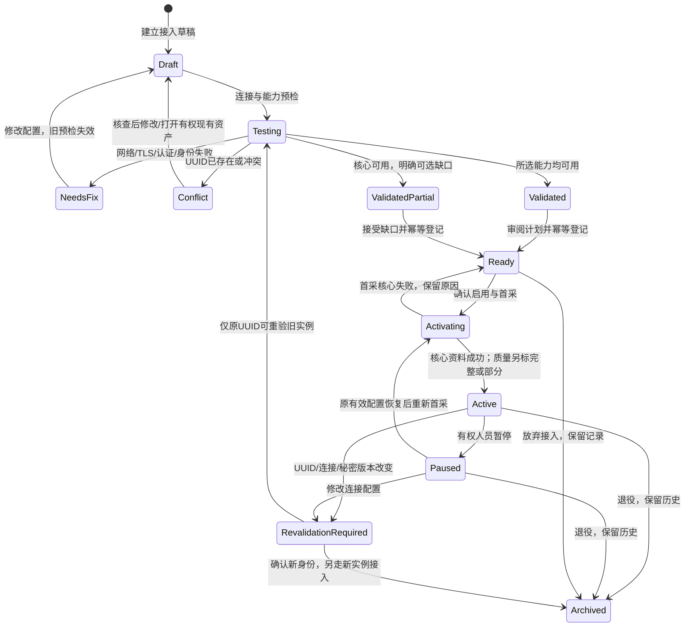
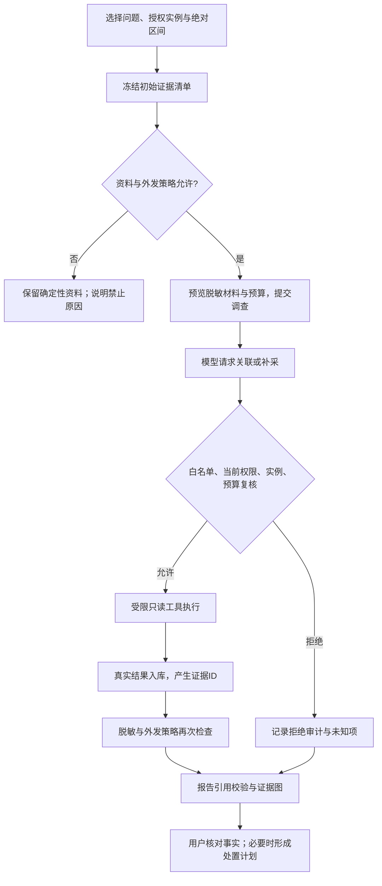

# 内部 AI DBA 平台：页面、交互与工作流设计

版本：2026-11-08，设计基线 v1。**状态：已完成独立一致性检查及代表性原型点击复验；实际平台已实施，逐项验证和剩余范围见 [06-acceptance-status.md](06-acceptance-status.md)。本文是页面设计要求，不是完成清单。**

本文是需求文档 `01-requirements.md` 的页面契约，供后续接口设计、可点击原型和实现验收使用。本文中的路由、接口、字段、状态和角色均为拟议平台能力；存在于原实验室中的锁等待、索引诊断与 AI 调用只是可复用素材，不代表这些平台页面已经实现。原型必须常驻“交互原型／示例数据”标识，不能把示例数字显示为实时测量。

## 1. 产品边界与设计决定

目标是供内部 DBA、开发人员和业务系统负责人使用的信息收集与诊断平台：新增实例后，持续获得可追溯的状态、SQL 摘要、锁事务、结构配置和能力允许的复制／日志证据；从同一时间窗调查问题，分派事件，记录人工处置并复验；AI 在明确的资料范围内关联证据和解释未知项。

页面采用“工作台 → 实例 → 事件／调查 → 复验”的主线。资产目录是可接入、可管理的真实资源入口，实验案例只作为隔离验证环境和知识案例，不占据业务主导航。首版每个实例归属一个业务系统、每个系统归属一个部门；角色和显式实例范围决定实际访问权，修改归属不能自动扩大权限。同一实例跨部门共享 schema 的精细数据隔离不作为已实现承诺；真实共享实例需人工明确授予整个实例范围或提供独立审核摘要。

本设计选择平台自己提供业务页面和鉴权查询接口，Prometheus／Grafana 可以承担采集存储或管理员深度诊断组件。单独堆叠监控面板难以表达接入向导、事件闭环、证据权限和 AI 审计；首版也不引入企业级审批引擎和任意 SQL 控制台。这是设计建议，不是用户已经验收的实现。

P0 为本机内部部署、多账号、多个 MySQL 实例的平台闭环。其他数据库引擎、生产自动修复、任意远程文件访问、任意 Shell、向量知识库、SSO 和复杂审批属于另行设计范围。P0 的“处置”指形成计划、由人执行并记录、再由只读采集复验；页面不提供一键 KILL／DDL／重启按钮。

### 1.1 显示真实能力的规则

- 每个导航入口对应本文件定义的服务端查询／命令契约及验收条件。没有完成服务端实现的入口在产品发布时不出现；原型可以出现，但必须标明设计状态。
- 某个实例不支持某项能力时，能力页保留解释卡片，写明 `unsupported`、`not_configured`、`denied` 或 `not_applicable`、探测时间和补齐步骤；不能绘制虚假零值或“正常”曲线。
- 版本、权限、配置都满足但窗口内没有记录，才是 `empty`。接口错误不是“暂无数据”；未采集不是“没有故障”；未接入副本不是“复制延迟 0”。
- 数据页同时呈现业务严重度、采集完整度、资料敏感级别和数据来源；这些维度互不替代。
- P0 不展示没有后端来源的“节省工时”“根因准确率”“健康分”“生产覆盖率”等数字。

## 2. 页面骨架与全局上下文

### 2.1 持久页面布局

```text
┌ 平台标识  工作区：内部数据库平台                 当前用户·角色  帮助  退出 ┐
├ 左侧导航 ┬ 部门 [已授权全部 ▾] 系统 [全部 ▾] 环境 [全部 ▾] 资产 [全部 ▾] ┤
│ 工作台   │ 2026-11-08 09:00:00 +08:00 → 10:00:00 +08:00  自动刷新：关闭 │
│ 资产目录 │ 面包屑 / 页面名称                   [页面主操作] [次操作]      │
│ 资源拓扑 │ 授权范围说明 · 数据最新成功时间 · 缺失/过期资料提示             │
│ 证据查询 │                                                            │
│ 事件中心 │ 页面内容；详情抽屉保留原列表与上下文                           │
│ AI调查   │                                                            │
│ 知识库   │                                                            │
│ 任务中心 │                                                            │
│ 管理     │ 页脚：服务版本、当前时区；帮助链接不包含用户私密信息             │
└──────────┴────────────────────────────────────────────────────────────┘
```

窄屏将导航收起、范围控件折叠为可展开摘要；表格可以横向滚动，保留资产名称与状态列。禁止把关键状态只编码为颜色，使用图标、文字和可访问的标签。原始 JSON 是有权限的辅助入口，不能取代可读的指标、时间线和证据关系。

### 2.2 全局范围

| 控件 | 内容与默认值 | 联动、授权与 URL 行为 |
|---|---|---|
| 部门 | 用户可访问部门；默认“已授权全部” | “全部”仅指服务端授权集合。选项、数量和搜索提示不能透露其他部门。无跨部门权限时显示固定值。 |
| 业务系统 | 名称、系统编码、所属部门；默认授权范围内全部 | 修改部门后清除不属于新范围的系统与资产。系统是归属关系，不能仅靠自由标签承担授权。 |
| 环境 | production／staging／test／lab；默认全部 | 环境是筛选维度，角色还可限制可访问环境；选择 test 不产生权限。lab 标签由管理员控制。 |
| 资产 | 名称、engine、环境、连接状态；默认全部 | 可多选有权实例；详情页固定单实例。没有访问权的链接统一返回不可访问，不展示名称、UUID 或存在性提示。 |
| 绝对时间窗 | 明确起止时间、时区；默认最近 1 小时解析后的绝对时间 | URL 使用 `from`、`to` 的 UTC ISO 8601；页面显示本地时间和 `+08:00`。比较、调查和导出保存解析后的时间，不保存模糊的“最近一小时”。 |
| 刷新 | 默认关闭；实时工作台可手动开启 | 历史详情／报告时间冻结。开启滚动窗口要显示“滚动窗口／每 30 秒刷新”，调查创建时立即冻结为绝对区间。 |

公共页面查询参数：`department_id`、`system_id`、`environment`、`instance_id`（可重复）、`from`、`to`、`timezone`。列表各自追加筛选、排序、游标；用户切换范围后，页码／游标清空。服务端重新计算授权，不能相信 URL、隐藏菜单或浏览器保存的角色。时间窗按 `[from,to)` 查询，避免相邻区间边界重复计数。

默认最大指标交互查询窗口 14 天，与架构查询上限一致；较长区间先提示聚合粒度与保留边界。这是待容量验证的初始限制，可由管理员降低；单个证据源的实际保留时间可能更短。所有页返回 `effective_window`、`effective_step`、`coverage`，不能悄悄截断后仍显示用户请求的完整时间。资源目录、组织管理等当前配置页标记“配置状态按现在显示”，不假装能回到历史时间。

### 2.3 上下文继承

从指标峰值打开 SQL、事件或 AI 调查，继承实例和绝对时间窗；从事件打开调查，还继承事件 ID 与选择的证据 ID。用户可以扩大时间窗，但扩大范围不自动外发 AI。跨范围链接中的某些资产失去权限时，不静默生成一份缺少来源的旧报告：显示报告不可访问或经明确重新生成的受限版本。

## 3. 角色任务入口与授权表达

角色用于定义动作，部门／系统／实例授权用于定义资源。页面可隐藏无权动作，后端仍需逐请求验证。平台管理员默认只有控制面权限，读取业务运行证据需另授实例范围；敏感证据读取、导出与外发 AI 是独立能力，具体授权以 `permissions` 为准。

| 用户入口 | 首屏任务 | 常见允许动作 | 受限或不提供的动作 |
|---|---|---|---|
| 平台管理员 | 接入失败、采集积压、账号／策略配置 | 管理组织、用户、连接策略、采集计划、凭据轮换和审计；有资源权时查看证据 | 不在浏览器读回密码；不自动取得所有原始 SQL；不能通过管理页绕开外发策略。 |
| 授权范围内 DBA | 待处理事件、异常实例、过期采集 | 接入／修改授权系统实例，补采、分派、建立处置计划、只读复验、创建 AI 调查 | 无权访问其他系统，不能让模型执行任意 SQL／Shell，不能在 P0 自动修复生产。 |
| 开发人员／应用负责人 | 自己系统的事件、SQL 摘要、发布前后对比 | 查看允许的指标、归一化 SQL／结构证据，评论事件、登记应用变更，按独立授权创建调查 | 默认只有 event.read＋event.comment，没有认领／分派／关闭；也无凭据管理、跨系统证据、原始语句／日志、全实例会话明文权限。 |
| 部门只读查看者 | 授权系统的运行概览和事件进展 | 查看聚合指标、脱敏报告、处置结果 | 默认无补采、分派、修改配置、原始证据导出和模型调用。 |
| 审计人员 | 授权范围的审计轨迹与已授权报告 | 查询流程、审核／执行记录，经授权导出审计 | 无事件修改、处置、采集配置、授权管理；业务原文资料需另外授权。 |

按钮附近说明“需要 DBA 的事件分派权限”等可操作原因。整页没有资源读取权使用统一无权状态，不显示该资源的内部详情。权限发生变化后刷新菜单，未完成的命令仍由后端重新授权；已生成报告和异步下载同样受当前权限约束。

授权管理页区分“本人可读数据范围”和“可委派管理范围／可授角色 allowlist”。具有 grant.manage 的管理员只能在可委派范围内授予允许角色；初始化管理员可授内置业务角色，但不会因可授权而自动具有业务 data.read。DBA 不提供自授或扩大自己范围的入口。

## 4. 导航、路由、需求与后端能力对照

以下全部为**待实现契约**，路径统一以 `/api/v1` 为业务 API 前缀。API 的数据库资源名称统一为 `instances`，字段统一为 `instance_id`；界面称“资产”，前端 `/assets` 路由不意味着另建一套资产 API。设计阶段可以调整接口形状，但不能删掉权限、来源、分页、状态和审计语义。FR 编号来自 `01-requirements.md`，不是旧实验室 `FR01` 编号；接口规范以 `02-architecture.md` 第 12 节为准。

| 页面／路径 | P0 展示条件与真实后端能力 | FR 对照 |
|---|---|---|
| 登录 `/login`；首次初始化 `/setup` | 会话登录／退出／失效，单次本机初始化；`/auth/csrf`、`/auth/login`、`/auth/me`、`/auth/logout`，初始化仅走本机引导 | FR-001 |
| 工作台 `/overview` | 授权资产计数、采集覆盖、指标聚合、事件队列；`/overview` | FR-002、003、009、013、015 |
| 资产目录 `/assets` | 持久资产、授权计数、筛选排序、生命周期；`/instances`、`/instances/:id/{pause,archive,activate}` | FR-002～006 |
| 接入向导 `/assets/new`、草稿 `/onboarding/:id` | 非敏感草稿、异步连接与能力预检、身份冲突、计划校验、登记与激活；`/connection-drafts`、`/connections/test`、`/connections/tests/:id`、`POST /instances`、`/instances/:id/activate` | FR-004～008 |
| 实例详情 `/assets/:id/{overview,metrics,sql,locks,structure,replication,logs,collection}` | 对应证据类型查询、指标序列、能力矩阵、补采和配置；`/instances/:id/{overview,metrics,queries,locks,schemas,config,replication,logs,collection-runs}`、`/instances/:id/{collect,revalidate,credentials/rotate,capabilities/recheck,explain}` | FR-005～012、015 |
| 资源拓扑 `/topology` | 登记归属、已观察复制关系和关系证据；`/topology` | FR-002、009、014 |
| 历史证据查询 `/evidence`；证据 `/evidence/:id` | 分页、类型化过滤、绝对区间、源记录、比较和允许的导出；`/evidence`、`/evidence/:id`、`/exports` | FR-009、012、026 |
| 事件中心 `/events`；事件 `/events/:id`；原始告警 `/events?view=alerts`、`/alerts/:id` | 独立原始告警、告警→事件归并、人工事件、分派、备注、维护窗、计划和复验；`/alerts`、`/events`、`/events/merge`、`/events/:id/{acknowledge,assign,comments,close,remediation-plans,verifications}`、`/remediation-plans/:id/{review,execution-records}`、`/verifications/:id`、`/maintenance-windows`、`/manual-changes` | FR-016～020 |
| AI 调查 `/investigations`；调查 `/investigations/:id` | 异步调查、冻结资料清单、外发策略、白名单工具、引证报告和工具审计；`/investigations`、`/investigations/:id`（含结构化工具审计）、`/investigations/:id/reviews` | FR-007、022～025 |
| 知识库 `/knowledge`；知识 `/knowledge/:id` | 人工审核手册／案例、来源链接、版本、适用条件、访问范围；`/knowledge`、`/knowledge/:id/{versions,submit-review,reviews}` | FR-021、024 |
| 任务中心 `/tasks`；任务 `/tasks/:id` | 采集、预检、AI、复验、导出的持久状态、取消与受控重试；`/tasks`、`/tasks/:id/{cancel,retry}` | FR-008、015、020、022、026 |
| 组织与用户 `/admin/organization`、`/admin/users` | 部门／系统／成员／角色与授权、账号禁用、会话撤销；`/departments`、`/systems`、`/users`、`/groups/:id/{members,grants}` | FR-001、002 |
| 采集与规则 `/admin/collection`、`/admin/rules` | 计划模板、调度健康、规则版本／静默窗口；`/collection-profiles`、`/rules`、`/maintenance-windows` | FR-008、015～018 |
| 模型与外发 `/admin/ai-policy` | 提供商引用、脱敏策略、资料类别、额度、作用域和启用记录；`/settings/model-policies`、`/model-profiles` | FR-007、023、025 |
| 平台状态 `/admin/platform` | 调度／队列／存储／保留覆盖、备份状态标记；`/platform-status`、`/settings/retention` | FR-015 |
| 审计 `/admin/audit` | 过滤后的管理、凭据使用、工具、导出与登录审计；`/audit-logs` | FR-002、023、026 |

P0 主导航只含上述已有服务端能力的页面；管理组按权限出现。FR-027～031 的深度巡检、备份作业、受控执行、企业集成、PostgreSQL 不提前创建空菜单。复制／日志能力页仍是 P0 的真实能力反馈入口，不能借其页面存在声称已完成 FR-028 的深度作业能力。

## 5. 共用数据与页面状态契约

### 5.1 每条证据可见的来源信息

证据卡片与详情至少包含：`evidence_id`、`instance_id`／显示名、观测 `server_uuid`、证据类型、源系统、采集方法／采集器版本、观测开始和结束时间、入库时间、来源模式（`live`／`replay`／`imported`）、敏感级别、采集结果、采样／截断、权限／配置缺失、原始记录引用与内容校验标识。合成资料另标 synthetic，不混入实时模式；确定性规则／实时模型是结论类型，不能伪装成采集来源。指标另含单位、聚合方法、粒度和覆盖率；模型内容另含模型标识、提示版本、生成时间、证据引用及是否外发。

“实时”标签只给真实实时来源；历史导入、回放与实验注入单独标识。规则命中显示规则与版本，不能放进“模型判断”标签；模型推断不渲染为已验证事实。示例原型的每组值均显示示例标志。

### 5.2 九类通用状态

以下为每页必实现的状态基线，后续各页补充各自语义。接口返回结构化状态码、可公开的原因、最近成功时间与 `request_id`；不把栈追踪、数据库密码、SSH 私钥或原始连接字符串显示给用户。

| 状态 | 显示和允许操作 | 不允许的行为 |
|---|---|---|
| `loading` 加载中 | 保留当前范围与表头，用骨架及可取消的读取提示；首次加载不出现数值 | 先显示 0 后跳到真实值；让上一个实例的数据在新实例标题下出现。 |
| `empty` 无记录 | 说明“此授权范围／绝对时间窗没有记录”；提供调整时间、清除筛选或有权的接入按钮 | 把异常、无权限、未采集归为空；无证据即宣称正常。 |
| `no-access` 无权限 | 隐去数据，提示联系管理员或更换授权范围；对象不存在与不可访问采用一致响应 | 显示目标部门名、UUID、总数、敏感字段占位或越权资产提示。 |
| `stale` 过期 | 保留历史值，醒目标出 `last_success_at`、预期周期、超时阈值，提供查看采集任务 | 旧快照继续使用绿色“在线”；仅刷新页面就更新时间。 |
| `partial` 部分可用 | 有效数据正常呈现，逐源列出缺口、覆盖时间、截断和权限差异 | 一个成功源掩盖其他失败源；以 0 填补缺失点或插值伪造证据。 |
| `failed` 失败 | 明确失败阶段、公开错误类别、最近一次成功资料与重试权限；展示 request_id | 把错误全文直接回显；不加说明沿用旧结果；自动反复提交命令。 |
| `running` 进行中 | 任务 ID、当前阶段、已完成步骤／数量、开始／最近心跳、取消条件；链接任务页 | 没有分母却写精确百分比；刷新重复创建任务；假称取消已中止数据库执行。 |
| `ready` 可用 | 展示采集时间、来源和覆盖；业务异常仍可存在 | 用“可用”代替“无风险”。 |
| `not-applicable` 不适用／能力不可用 | 显示原因码、当前探测值与如何补齐；细分 unsupported／not_configured／denied | 与 `empty` 混淆，或让无权用户看到完整权限错误中的其他资源。 |

读取页面允许重试，变更命令使用幂等键。请求成功但前端断线后，按命令 ID 查询结果，不能自动再次接入或重复启动 AI。全站 401 跳登录，成功后保留非敏感路径和范围；密码、凭据字段与未提交的原始 SQL 不进入 URL 或持久浏览器草稿。命令 409 显示状态或版本冲突并刷新差异；429 显示队列／额度提示；503 标记服务不可用。

## 6. 身份入口

### 登录 `/login` 与首次初始化 `/setup`

- 字段：用户名、密码、登录错误、会话过期原因；初始化说明只在未创建管理员时展示，管理员建立通过本机 CLI 引导，不提供远程开放注册。禁止硬编码演示密码。
- 主操作“登录”；次操作“查看本机初始化说明”。无公开自行注册入口，用户由管理员建立／邀请。登录错误不区分用户名存在与否。
- 数据来自会话服务；登录后 `/auth/me` 返回允许动作与授权范围摘要，页面不能自行推导管理员身份。认证使用服务端会话，密码存储采用 Argon2id；退出／禁用／权限撤销立即影响后续请求。该算法选择属于后端设计，不增加用户的登录步骤。
- 状态：loading 为登录请求中且按钮防重；empty 仅用于首次未初始化；no-access 为初始化已关闭；failed 使用统一认证失败提示；running 不开启长期任务。stale 为表单引导已失效，partial 不适用于认证成功，不能半登录。
- 登录页不显示资产数量、数据库名称或管理员邮箱；密码不写日志、查询参数和审计详情。

## 7. 工作台 `/overview`

**任务**：回答“我有多少实例、哪些资料不完整、哪些事件先处理”。

- 字段：授权资产数／启用采集数／最近可连数／资料过期数／能力部分可用数；按严重度和持续时间的事件列表；指标趋势（连接利用率、语句吞吐、锁等待数量等已实现指标）；采集覆盖与待办任务；最近变更。每个统计给出时间口径与分母，不显示一个无法解释的健康分。
- 默认按严重度降序、未分派优先、首次发生时间升序排列事件；资产风险列表按“连接失败／身份变化 → 资料过期 → 活跃事件”展示。默认当前用户授权范围、最近一小时；“我的待办”使用真实 assignee，不用最近点击记录冒充。
- 主操作“查看待处理事件”；有接入权时给“接入数据库”。次操作为查看采集缺口、展开指标、创建调查（需先选择明确实例／区间）。数字卡片能打开带同口径筛选的列表。
- 数据源：资产注册表、范围内最近连接结果、指标查询、采集运行、事件索引；聚合在服务端完成。资产总数与时间窗内数据量分开表达。
- 授权：FR-002 的范围约束适用于所有计数、排名、趋势、搜索建议和最近操作，不能先取全量再在浏览器隐藏。
- 状态：loading 使用卡片骨架；empty 为尚无授权资产并给接入／联系管理员；stale 明确哪组卡片过期；partial 对每个指标源给覆盖率；failed 允许单卡重试而不是整屏消失；running 只显示后台任务摘要。no-access 回通用态。

```text
工作台                                           [查看待处理事件] [接入数据库]
范围与绝对时间窗
[授权资产 12] [采集中 10] [过期 2] [未处理事件 4]  ← 均为原型示例值
[需要处理的事件：严重度｜系统｜实例｜持续时间｜负责人｜状态]
[运行趋势（各图时间轴一致）]              [采集缺口／任务异常]
[我的待办／最近变更，均可追溯到来源]
```

## 8. 资产目录与接入向导

### 8.1 资产目录 `/assets`

- 字段：资产名称、内部 ID、所属部门／系统、环境、引擎版本、脱敏端点、UUID 简写、登记生命周期、连接结果、采集状态、能力覆盖、最近成功采集、活跃事件数、责任人／标签。只有允许读取端点的用户可展开主机地址。
- 筛选：归属、环境、引擎、生命周期、连接结果、采集新鲜度、能力缺口、事件严重度、名称／授权内 ID。默认“已登记、未退役”；默认排序先身份异常／连接失败／过期，再名称升序。显示服务端授权总数和筛选命中数。
- 主操作“接入数据库”；行主操作“打开详情”。次操作为查看能力、暂停／恢复采集、编辑归属内资料、轮换凭据、退役。批量操作 P0 仅对同一授权动作的暂停／恢复提供，逐项回报成功与失败；不批量修改归属或删除历史。
- 数据来自资产注册表、最近预检与采集运行、事件计数。退役保留历史并停止未来任务；需要独立删除／保留策略才能清理资料。
- 授权：接入必须具有目标系统 `asset.create`；编辑／暂停／退役分别校验权限；凭据状态仅显示“已配置／更新时间／使用者”，不读回密码。P0 不开放跨部门资产移动，避免将整段历史意外转交；后续需单独设计历史资料迁移规则。
- 状态：empty 分为“无资产”和“筛选无结果”；partial 为部分资产的状态源失败；stale 保留最近值与日期；running 的接入草稿／首采任务有独立状态，不计作成功采集中。failed 不丢失已有资产列表。

### 8.2 接入向导 `/assets/new`、`/onboarding/:id`

草稿可以保存非敏感字段并继续，凭据由后端私密存储引用，前端刷新不读回。向导采用与可点击原型一致的六个外层步骤；预检内含能力探测，确认启用后进入首采结果页，结果不是额外的第七个表单步骤。向导必须从归属走到首采验证；仅 TCP 端口可通不能显示“接入成功”。各次预检记录自己的目标配置版本，修改主机／端口／TLS／账号后立即使旧预检失效。

| 步骤 | 可见字段与判断 | 主／次操作 | 对应后端能力与安全约束 |
|---|---|---|---|
| 1. 归属与目的 | 部门、系统、环境、资产名、责任人、用途、标签；只显示有接入权的系统；P0 引擎只选择已支持的 MySQL 版本族 | “下一步”；“保存草稿” | 校验系统权限、名称规则及 engine adapter。未知引擎不能通过改一个下拉选项接入。 |
| 2. 连接与身份凭据 | 结构化 DB host／port、监控用户名、密码新输入；直连／SSH 通道；TLS verify-CA／verify-identity、CA 引用／主机名；SSH host／port／用户、凭据引用、已知指纹；显示网络策略 | “连接预检”；“返回” | 校验允许目标与地址解析，拒绝不支持协议／元数据端点／危险地址；凭据入私密存储，不进 URL、事件、LLM 或日志。SSH 首见指纹需要有权人员明确确认，不能自动信任。 |
| 3. 预检与能力 | 分阶段显示网络、TLS／SSH、认证、MySQL 版本、只读连通查询、server_uuid、server_id、hostname、read_only；每源能力、权限／配置、敏感级别、可采字段、负载和授权指引 | “确认身份与能力”；“重试失败步骤／修改连接／复制权限指引” | 异步预检，不执行 DDL／GRANT、不创建账号、不注入实验。结果带配置版本和有效期；经确认冻结预期 UUID。指引交 DBA 审核，权限不足可明确降级，基础身份不可验证时不能激活。 |
| 4. 采集与数据策略 | 选择计划模板、各源间隔／超时／条数上限、保留期、元数据 schema 白名单、原始语句策略；实例级外发 AI 默认关闭；资料完整度预览 | “预览首采”；“保存草稿” | 服务端校验调度预算、源互斥／并发、保留范围。schema 白名单只限制采集目标，不承诺共享实例跨部门授权隔离。AI 启用另需策略权限，不能随着勾选采集自动打开。 |
| 5. 首采预览 | 即将采集的类别、预计来源与最小字段、能力缺口、预算与预期结果类型、外发 off；此时不展示伪造样本或成功数量 | “审阅并确认”；“返回修改计划” | 根据已确认能力与计划做确定性校验，标明“尚未执行首采”。预览读取不启动数据库任务；真实样本只能在确认启用之后产生。 |
| 6. 确认启用 | 归属、脱敏连接、确认的 UUID、能力缺口、敏感资料类别、采集预算、保留期、AI 外发 off、预计首采项目 | “接入并启动首采”；“返回修改” | 幂等登记 Ready 实例，再调用激活命令返回任务 ID；再次验证权限、配置版本、重复身份、凭据引用和策略。不修改数据库业务内容。 |

**完成页：首采与结果。** 展示真实首采任务阶段、各源样本数／覆盖／错误、绑定的 `instance_id` 和最近成功时间；生命周期与资料质量分别显示。主操作“打开实例详情”，次操作“查看失败项／重新预检”。资产登记成功和首采成功分开；核心资料成功后 Active，可选源失败为质量 partial；核心失败回到 Ready 并显示“已登记，尚未取得有效资料”，不计作健康。

**连接错误与修复路径**：`network_unreachable` 提示检查网络／防火墙和已允许目标；`authentication_failed` 提示轮换监控凭据，不显示密码；`tls_verification_failed` 提示 CA／主机名；`ssh_host_key_unknown` 显示指纹并要求确认权限；`ssh_host_key_changed` 阻止继续并核查；`unsupported_version` 回到引擎／版本选择；`capability_denied` 进入能力矩阵。用户可取消尚未启动的后续探测；已执行的只读调用在超时后结束，前端不能保证瞬时终止。

**主机／日志可选分支**：连接步骤明确选择“仅数据库”或“另接主机／文件日志”。选后者才显示独立 host profile、受限通道／采集器、预期主机身份和允许的规范日志路径；资料策略步骤选择 CPU／内存／磁盘等类别、日志解析器／时区／起始位置／上限。预检分别报告数据库、主机绑定和日志读取／解析结果，不能因数据库可连就勾选主机成功。文件路径不能扩展到通用浏览器；日志源首次默认从尾部开始，有限回看必须明确显示 imported。主机／慢日志属于 P0 条件能力，验收必须接通真实路径，未配置页面不是完成该能力的证明。

#### 能力矩阵与权限指导

| 能力 | 页面显示的真实探测项 | 降级语义／敏感边界 |
|---|---|---|
| 基本状态与计数 | 身份、版本、uptime、连接数、允许的 GLOBAL STATUS／变量、计数器采样可用性 | 必须有身份与最小连通资料；重启／计数器重置后显示不可比较。 |
| SQL 摘要与计划 | Performance Schema 开关、digest 可读、统计保留／重置点、已审阅计划工具 | 默认归一化 SQL；digest 样本语句、EXPLAIN 参数也可能含敏感信息。无权限不退回全表业务查询。 |
| 锁、事务与会话 | 对应 Performance Schema／information_schema 源和版本兼容；PROCESS 的影响范围 | 会话 SQL 与用户可能涉及全实例，默认 DBA 敏感权限；开发者仅看获准的聚合／脱敏证据。 |
| 结构、配置与容量 | 允许 schema 的表／索引元数据、变量白名单、估算容量、采集范围 | 容量估算与精确值区分；不采业务表行内容。配置不任意全量读取，禁止把秘密变量当普通证据。 |
| 复制基础 | 角色探测、已配置复制通道、基础状态字段可读性与 REPLICATION CLIENT 等版本对应条件 | 未配置复制为 not_applicable；延迟 NULL／未知不能解释为零；复制凭据不展示。 |
| 数据库日志 | 可用数据库视图／接口、日志是否启用、权限、可见时间范围、截断规则 | P0 不提供任意路径文件读取。FILE／主机日志路径需要独立采集器能力；未配置显示缺口，不能假装已接入。 |
| 主机资料 | 是否有明确绑定的主机采集器／受限通道，CPU／内存／磁盘采集与实例关联证据 | 未配置主机采集时标“仅数据库视角”，不能用控制端 Windows 指标冒充数据库主机。 |

授权指引按版本和已选能力生成，区分“必需、可选、敏感”，并注明最小权限仍需对实际版本验证。系统不能统一声称“一条 GRANT 可安全服务所有部门”。

#### 重复 UUID、身份变化与端点变更

1. 内部 `instance_id` 是平台资源身份，`server_uuid` 是数据库观测身份，端点是连接配置；三者都显示在有权限的 DBA 详情中，不混用。
2. 新草稿发现已登记 UUID：若用户有现有实例的访问权，显示“该实例已接入”，允许打开现有资产或由具有配置权限者发起端点更新；普通接入不能复制出第二份资产。若无现有实例访问权，返回统一冲突提示并联系管理员，不暴露归属、名称、UUID 全文。
3. 克隆数据库产生重复 UUID 时，阻止作为第二个实例激活，提示先人工核查并按数据库规范解决身份；不替用户执行 UUID 更改。
4. 已登记端点观测到 UUID 改变：生命周期进入 `RevalidationRequired`（API `revalidation_required`），原因 `identity_mismatch`，停止该连接的后续采集／AI 补采并保留历史。详情页顶部固定警示，要求 DBA 核对恢复、重建、代理路由等原因。恢复原身份后可以重验旧实例；确为新的数据库身份则由有权管理员归档旧实例、重新接入并建立新 `instance_id`，不能在旧 ID 上覆盖 UUID 或拼接时序。
5. 同一 UUID 的正常端点变更仍需重新预检和凭据验证；未确认前保留旧配置版本。身份确认、忽略冲突与跨范围合并不是普通开发者按钮。

P0 每个实例只有一个有效连接配置。同 UUID 的新端点走既有实例 staged 配置更新，不创建端点池或多别名轮询；旧端点保留在配置历史，重验通过前不能当新配置已经生效。



上图的 Draft／Testing／Validated 是向导状态，Ready／Activating／Active／Paused／RevalidationRequired／Archived 是资产生命周期；连接失败、stale 和 partial 是另行派生的运行／资料质量，不成为互相排斥的生命周期。向导状态补充：loading 使用逐步骤探测骨架；empty 是未探测而非未发现问题；no-access 立即阻止提交并保留可安全显示的草稿；stale 指预检过期／配置版本已变化；partial 每能力给结果；failed 定位失败步骤；running 展示当前探测与实际耗时，无虚假百分比。取消或离开页面后任务可查询，不能在浏览器刷新后重新从零启动。

## 9. 实例详情

所有实例页共享名称／归属／环境、连接与采集状态、身份确认状态、源类别、最近成功时间及能力摘要。本节定义八个逻辑视图，不要求八个并列 tab：可点击原型采用六个外层 tab，映射如下。具体资料是否显示由用户可读取的类型决定；实例本身支持但未启用的能力页显示解释与补齐入口。用户没有敏感类型权限时，显示“当前角色未获该类资料权限”，不展示隐藏行数或细节。

| 逻辑视图／深链接 | 可点击原型外层入口 |
|---|---|
| 概览 `/overview` | 实例页头部与首屏摘要，始终保留 |
| 指标 `/metrics` | 指标 |
| SQL `/sql` | SQL |
| 锁事务 `/locks` | 锁 |
| 结构 `/structure` 的库表索引与容量 | 库表索引 |
| 配置与复制 `/structure?view=config`、`/replication` | 配置复制，内部子视图明确区分 |
| 日志与主机 `/logs`、`/metrics?source=host` | 日志主机，日志与主机来源分别显示 |
| 采集 `/collection` | 页头“采集配置”抽屉与任务中心；保留可分享深链接 |

这是信息分组映射，不引入另一套数据契约；正式实现可在可用性验证后采用相同六 tab 或八个逻辑视图布局。

### 9.1 概览 `/assets/:id/overview`

- 字段：版本／UUID 简写／角色、uptime／重启时间、允许的端点资料、采集能力矩阵、基本运行指标、活跃事件、最近采集／调查／配置变更，当前窗口的覆盖条。
- 默认按最近一小时；事件按严重度、持续时间排序。主操作“调查此实例”，次操作“补采”“查看接入配置”（分别校验动作权限）。补采弹窗列出资料类型、预计范围与负载，提交后关联任务，不等于 AI 调用。
- 数据源：注册表、基础状态证据、指标与事件服务。身份异常横幅优先于所有健康展示。
- 状态：partial 会把缺失资料放在首屏；stale 的状态和历史曲线可共存；failed 区分连接失败与页面请求失败；无首采资料时保留资产配置与能力状态。running 在头部展示补采任务，不锁死历史浏览。

### 9.2 指标 `/assets/:id/metrics`

- 字段：连接数／连接利用率、计数器差分的语句吞吐、已支持的缓存／I/O／锁等待指标、主机资料（有绑定时），指标名称、单位、聚合口径、时间序列、采样覆盖／断点。主机未接入则明确“缺少主机资料”。
- 默认固定图组，不提供面向业务用户的任意 PromQL；图表时间轴一致，排序按连接→吞吐→资源→等待。筛选指标组、源、粒度；对比窗口由用户明确选择，展示两个绝对区间。
- 主操作“选定区间调查”；次操作为查看原始采样、对比、创建人工事件。图上框选必须有真实样本，缺口以断线呈现。
- 数据源：按已授权实例过滤的时序查询与采样完整度。速率必须检验 UUID、uptime、重置、差分和足够样本；不可计算时说明原因。百分比展示分子／分母来源和时间。
- 权限：只读指标不等于数据库控制权限；不把 Prometheus 原始查询端点／凭据直接暴露给浏览器。
- 状态：empty 为选定窗口无样本；stale 为最新样本晚于新鲜度阈值；partial 显示有效覆盖和断点；failed 允许单图重试；running 只用于异步较大查询，不伪造中间曲线。

### 9.3 SQL `/assets/:id/sql`

- 字段：digest、归一化 SQL／允许 schema、窗口执行次数、总耗时、平均耗时、受影响／扫描行数、首次／最后观察、统计是否重置、相关事件；只有来源支持才显示 P95，不能用平均值替代百分位。
- 默认按窗口总耗时降序，次序为 digest；可切换次数／平均耗时／扫描行数，筛选 schema、digest、归一化文本、指标阈值。说明 MySQL digest 的默认 schema 不能等同所有被访问表，也不能用于授权。
- 行主操作“查看 SQL 证据”，次操作“比较窗口”“关联索引／计划”“加入调查”。详情抽屉含窗口差分口径、计划版本／采集时间、允许的结构证据和来源 ID。EXPLAIN 是显式白名单只读工具，不支持浏览器提交任意 SQL；不自动执行 EXPLAIN ANALYZE 或真实业务查询。
- 数据源：digest 摘要采样、经权限与策略允许的 SQL 证据、结构与计划工具；累积快照与窗口差分分开标记。无法可靠计算差分就显示累积口径，不能冒充窗口指标。
- 权限：默认只给归一化文本；样本原始 SQL／参数独立授权，且即便脱敏也承认可能残留敏感信息。一个共享实例给开发者开放 SQL 前需明确实例范围与字段策略。
- 状态：not_configured 为 digest 未启用，denied 为不可读；empty 为确实无摘要记录；partial 为容量淘汰／重置／截断／不完整窗口；stale 展示最后样本；failed 不降级到业务表扫描；running 的计划补采链接任务。

### 9.4 锁事务 `/assets/:id/locks`

- 字段：等待方／阻塞方线程／事务 ID、等待持续时间、锁对象／模式、事务年龄、连接用户脱敏值、允许的归一化语句、采集时间、证据 ID；图与表双视图，共享选中节点。
- 默认选定窗口最新有效快照，按等待时长降序；历史快照按时间倒序，筛选持续时间、锁类型、对象、事件。图明确“快照于何时”，不是持续存在的实时拓扑。
- 主操作“创建／打开关联事件”；次操作“补采锁快照”“加入调查”“查看事务证据”。不出现 KILL／回滚执行按钮。人工处置记录可以写执行步骤，但不通过本页运行。
- 数据源：版本适配的锁等待、事务、会话资料。没有完整会话权限时图仍可呈现允许部分并标缺口，不补造阻塞语句。
- 权限：完整会话 SQL、用户名、主机和跨 schema 对象可能敏感，敏感字段逐级展示。无法证明共享实例资料隔离时不能向部门用户声称只见自己 schema 的会话。
- 状态：empty 说明“此快照未观察到锁等待”，不代表窗口全程无锁；partial 显示缺失节点／会话；stale 灰显旧图并标时间；failed 无假空图；running 展示补采过程。

### 9.5 结构配置 `/assets/:id/structure`

- 子视图“结构／索引”“配置”“容量”。字段：schema／表／索引元数据、列定义、约束、允许变量当前值／采集时间、估算表／索引大小；变化视图必须有两个实际版本及其采集时间。
- 默认结构按 schema／表名，配置按允许变量名，容量按总估算大小降序；支持元数据白名单内对象搜索与当前／历史版本选择。明确统计估算的来源与误差，不把 information_schema 估算行数写成精确业务量。
- 主操作“查看对象证据”，次操作“比较历史版本”“加入调查”“补采结构”。不提供编辑变量／建索引／表数据浏览按钮。
- 数据源：元数据采集器、变量白名单、容量证据；不读取业务行。含注释／默认表达式的元数据也可能敏感，按资料分类展示。
- 状态：empty 说明采集白名单内无对象；partial 标注未授权 schema／超限截断，但不得向无权者泄漏其他 schema 名；stale 保留历史版本；failed 保留已取得的其他子视图；running 是元数据补采。

### 9.6 复制 `/assets/:id/replication`

- 字段：观察角色、通道脱敏标识、上游登记关系／观测地址（按权限）、I/O／SQL 线程状态、可解释的延迟字段与 NULL 原因、GTID／位点摘要、最近错误脱敏摘要、观测时间、相关事件。
- 默认按通道名，异常通道优先；历史筛选通道、状态、时间。主操作“查看复制事件”，次操作“补采”“查看关系证据”。P0 不提供切主、跳事务、修改复制配置或声称备份恢复闭环。
- 数据源：复制基础采集与资产关系；不能从 `read_only=true` 单独断定完整拓扑。上游不在登记目录时只显示允许的外部节点，不能伪造为已接入资产。
- 状态：not_applicable 为未配置复制，unsupported／denied 为版本／权限缺口；partial 为部分通道失败；stale 给时间；failed 不渲染延迟 0；running 为明确补采任务。

### 9.7 日志 `/assets/:id/logs`

- 字段：时间、等级、日志类别、来源、脱敏内容／摘要、实例、关联错误码、采集批次、截断／采样、保留边界。主机日志与数据库视图日志显式区分。
- 默认时间倒序，筛选等级／类型／允许文本／关联事件，服务端分页。主操作“查看日志证据”，次操作“关联事件”“加入调查”；下载需要独立导出权限，不能默认下载原始日志。
- 数据源：已配置的受限日志采集器或数据库可读日志源，记录实际可见时间区间。P0 无任意文件路径输入、无通用文件浏览器、无任意命令读取。
- 权限：日志可能包含 SQL、账号、IP 和客户数据；前端隐藏字段不是脱敏，服务端需按资料策略返回；用户外发模型前还要再次检查策略。
- 状态：not_configured 显示“尚未启用日志采集”及配置说明；empty 仅对已成功采集且窗口无日志；partial 为采样／截断／轮转缺口；stale 显示最后日志与最后采集两个时间；failed 不展示未经处理的错误全文。

### 9.8 采集 `/assets/:id/collection`

- 字段：每源启用状态、实际周期／超时／上限、能力状态、最近开始／成功／失败、下次调度、最近错误码、计划版本、凭据是否配置／更新时间、连接配置版本与已确认身份。
- 默认按“必需源→失败源→可选源”显示，运行历史按开始时间倒序；筛选源／结果／触发者。主操作“补采”，次操作“编辑计划”“重新探测能力”“轮换凭据”“暂停／恢复”；编辑需显示差异、变更影响与保存者。
- 数据源：计划、能力探测、持久采集任务与审计。手工补采不绕过并发和预算；暂停不删除证据。空密码字段意为不修改，轮换使用独立动作。
- 状态：running 逐源显示执行／排队，取消只影响可取消阶段；stale 表示心跳或最近成功过期；partial 逐源呈现；failed 可以有其他源继续采集；no-access 不显示凭据存在性以外的机密字段。

## 10. 资源拓扑 `/topology`

- 字段：部门→系统→实例归属树、实例状态、已观察复制边、主机绑定边、边类型、来源证据／采集时间／有效性。图例区分“配置归属”“观测关系”“人工登记”，虚线不能暗示未证实的依赖已经验证。
- 默认当前授权范围，层级布局，异常／过期节点可筛选；默认不加载业务调用链。主操作“打开节点详情”，次操作“查看关系证据”“从选中节点创建调查”；没有证据的上游只显示明确标记的外部节点。
- 数据源：资产归属和已验证关系记录，查询响应已按资源权限裁剪。无权节点不能显示真实名称、UUID、数量或跳转链接；必要时仅给“存在范围外依赖，需联系管理员”的一般说明，是否允许这种提示由策略决定。
- 状态：empty 为未登记关系，不能自动创建“单主双从”图；partial 展示有效边与范围／新鲜度限制；stale 按边标时间；failed 可切换已授权关系表；running 是关系查询／刷新，不是自动发现全网。

## 11. 历史证据查询 `/evidence`、`/evidence/:id`

这是一套对已采集资料的查询界面，不能把任意数据库 SQL 控制台藏在“查询”二字下面。

- 查询字段：全局范围／绝对时间窗、证据类型、源类别、资料完整度、采集任务、事件 ID、digest／对象／错误码等类型专用条件、允许的关键词。默认时间倒序、次序 ID，游标分页；跨源结果不支持的条件置灰并解释，不能静默忽略。
- 结果列：观测时间、资产、类型、摘要、来源、完整度、敏感级别、相关事件／调查、证据 ID。点击打开详情抽屉，含来源元信息、结构化内容、允许的原始 JSON、关联资料、实际查询条件。
- 主操作“查询”；结果选中后的主操作“加入调查”。次操作“比较两组证据”“创建事件”“导出授权资料”。比较必须显示两侧实例／UUID／绝对区间，身份变化和资料缺口醒目提示；不能把同名表当同一对象自动合并。
- 数据源：类型化证据索引与不可变记录，时序查询返回对应样本／采集引用。结果中的内容和总数在服务端授权后计算。
- 权限：每条证据按实例和资料类别校验，直接证据 ID 访问同样检查；搜索、原始 JSON、比较与导出独立校验。导出在创建和下载时都重查权限，带区间、来源、脱敏说明与生成时间，不能嵌入密码或用户私人材料。
- 状态：empty 保留条件并解释无命中；partial 显示保留期外区间、源未接入、截断与缺口；stale 只描述资料，不把历史查询本身标成失败；failed 保留查询条件；running 为大查询／导出任务且可离页查看；no-access 不回显证据存在性。

```text
历史证据查询                      [查询] [重置] [复制不含敏感内容的查询链接]
范围／绝对时间窗／类型／来源／完整度／类型专用条件
覆盖：有效 09:05–09:58；09:00–09:05 未采集；相关数据保留至……
[ ] 时间｜实例｜类型｜摘要｜来源｜完整度｜ID｜操作
选中 3 条（全部有权）                       [加入调查] [创建事件] [导出]
右侧抽屉：内容 ｜ 来源与原始记录 ｜ 关联事件 ｜ 引证位置
```

查询链接只保存非敏感筛选与时间条件，不包含结果或秘密；访问者仍须重新鉴权，链接本身不授予资料访问权。保存查询模板的独立管理能力不列入 P0。

## 12. 事件中心与人工处置闭环

### 12.1 事件列表 `/events`

- 事件中心包含“事件”和“原始告警”两个子入口，原始告警持久对象独立于事件。告警含规则／版本、指纹、instance_id、触发／恢复时间、条件状态、观察窗口和证据；告警发生次数／采样命中不能冒充事件数量。
- 字段：严重度、标题、系统／实例、状态、首次／最近发生、持续时间、命中次数、规则版本／人工来源、负责人、维护窗状态、关联调查、最近复验结果。告警重复归并给事件，但原始命中可追溯。
- 筛选：我的待办／未分派、状态、严重度、规则、资产、维护窗、发生时间。默认未关闭，严重度降序、未分派优先、首次发生升序；“发生时间”与“更新时间”筛选有明确标签。
- 主操作“处理事件”；次操作“人工创建”“分派”“设置维护窗”（按权限）。维护窗只影响通知／分派策略，不删除证据，也不能让异常指标变成正常。
- 数据源：规则计算结果与版本、事件归并器、分派和状态记录。没有配置规则时显示可操作说明；不能凭前端阈值临时拼出不可追溯事件。
- 原始告警子页默认按严重度降序、最近触发倒序，筛选 firing／recovered／unknown、规则、实例、维护窗和是否关联事件；主操作“打开关联事件”，次操作“查看告警证据”。告警详情显示原始状态变化与关联事件历史，不允许通过人工“关闭事件”篡改告警已经恢复。
- 有独立 event.merge 权限的 DBA 可以归并同一实例的事件及其多个原始告警：弹窗显示目标事件、保留的原告警／原事件 ID、合并原因、负责人和权限影响，命令带版本检查。P0 事件只包含一个 `instance_id`，跨实例归并整体拒绝；跨实例问题通过关联调查处理。原事件标 `merged` 并保留 `merged_into_event_id`，不删除原事件或更改规则事实；归并后原复验失效，必须覆盖新范围重新复验。包含不可访问对象的请求整体拒绝，开发者默认不能归并。
- 状态：empty 可以是当前窗口无事件，不等于实例健康；partial 标记规则资料不足；stale 提醒命中依据过期；running 显示复验／AI 任务但事件仍可阅读；failed 不自动关闭事件。

### 12.2 事件详情 `/events/:id`

```text
事件 EVT-…  锁等待持续升高   严重度：高  状态：待处理  负责人：未分派
实例／归属／绝对故障窗口／规则与版本／采集完整度
[认领或分派] [建立AI调查] [添加处置计划] [发起只读复验]
概况 | 证据时间线 | 调查与解释 | 处置计划/记录 | 复验 | 审计
左：事实、影响边界、缺失资料              右：负责人、状态、维护窗
时间线：规则命中 → 分派 → 补采 → 人工执行记录 → 复验结果 → 关闭理由
```

- 字段：事件基本信息、原始告警与归并键、事实／假设分栏、不可变证据引用、来源／时间线、参与人、讨论、关联变更、调查、处置计划版本、执行记录、复验标准与结果。
- 主操作随状态变化：新事件为“认领／分派”，已处理但未验证为“发起复验”，验证满足为“关闭并记录理由”。次操作为补证据、AI 调查、备注、标误报、重开。按钮可见不代表有权操作，命令再次验证资源与动作。
- 处置计划字段：目标、适用条件、人工步骤、风险／影响、回退方法、执行窗口、责任人、批准／确认记录、拟验证的指标／规则和窗口。P0 仅存储计划和人工执行记录；“已执行”必须由人明确录入执行者、实际时间与结果，不能由 AI 回答直接改变。
- “应用与人工变更”表单记录实例、实际发生绝对时间、类型（应用发布／DDL／配置／作业）、脱敏说明、记录人、来源与关联事件；只写资料记录，不执行文本。时间线把 human_assertion 与采集观察分开，开发者可在独立授权范围补充发布说明，不能因此执行／关闭处置。
- 复验字段：选定基准证据、前／后绝对窗口、确定性检查项、容差、最小覆盖、实际只读检查、结果与未知项。canonical 结论为 `improved`（已达到所选复验条件）、`not_improved`、`inconclusive`；取消是任务状态，不伪装复验结论。页面可用“通过／未通过／资料不足”解释三值，但同时展示实际判定标准；无新资料／采集失败是 inconclusive，不能自动通过。
- 恢复结案门槛：全部纳入事件范围的告警 episodes 均有新鲜恢复证据，复验覆盖全部问题，才可 verified_recovery。一条锁告警恢复但另一条告警仍 firing／unknown，不能将整个事件标恢复；人工例外结案保留风险与未恢复标识。事件、处置与复验自身固化 manifest／保护引用证据，不依赖是否运行过 AI。
- 复验不证明因果：锁页面只能说所观测等待链消失并声明负载条件，不等于业务恢复；SQL 比较需同 digest、有效可比窗口、每窗至少 10 次执行、调用率比在 0.5～2 之间（阈值版本化可配置），否则 inconclusive。结论写“所选条件改善”，不能写“AI 已修复”或据此归因某条措施。
- canonical 状态流：`open → acknowledged → investigating → pending_verification → resolved → closed`；分派是独立字段，不混成状态。规则恢复只进入待复验，复验满足条件后才是 resolved，关闭由人确认。复验失败或资料不足回到处理中／待复验。误报、重复、接受风险采用 `manual_exception` 关闭类型及理由，显著显示“未证明恢复”；不得把它改成 verified_recovery。复发生成新事件并关联已关闭事件，保留旧记录。
- 数据源：事件服务、人工动作日志、关联证据、调查与复验运行。P0 所有状态转换有操作者、时间、前后值与理由；版本冲突返回 409，不能覆盖另一位 DBA 的新分派。
- 权限：只读角色可看授权的事件摘要；分派、修改、执行记录、复验和关闭分别授权。事件跨多个实例时，详情与报告需要满足相关资源读取要求；不靠去掉两个标题就假装已安全脱敏。
- 状态：loading 不显示旧事件操作；empty 为某子页没有计划／记录，给有权创建入口；partial 为缺失源与待补证据；stale 展示事件和资料的新鲜度分别；running 为复验／调查任务，有阶段与结果链接；failed 记录失败而非跳过；no-access 不显示受限讨论或敏感附件。


## 13. AI 调查、证据图与工具审计

### 13.1 调查列表 `/investigations` 与创建抽屉

历史调查冻结绝对时间窗，不自动把 `to` 之后的补采放进历史原因分析。工具只能查询原窗内已存在的资料；缺少当时锁／日志等快照时列为未知项。确需现在补采，必须明确创建新窗口／新调查并与旧调查关联，报告不能把现时状态冒充故障当时状态。

- 字段：问题标题、创建人、关联事件／实例、冻结区间、模型与提供商、状态、资料来源、工具次数、开始／完成时间、预算／实际用量（仅服务商确实返回时）、外发状态、有效引用数、反馈。默认创建时间倒序；筛选本人／状态／实例／模型／来源／事件。
- 主操作“新建调查”。创建分三段：①问题、实例与绝对区间；②选择已有证据、白名单补采范围与工具／时间／额度预算；③资料预览、缺口、敏感类别和外发策略确认。默认不预选所有历史，也不把用户整个目录／邮箱内容作为模型上下文。
- 外发 AI 默认 off。未启用时仍能浏览确定性资料与规则，调查按钮解释“当前范围禁止模型外发”；有策略管理权者跳到具体范围策略页，普通用户不能一次勾选绕过。没有本地模型能力时，不用“本地分析”冒充 AI 已运行。
- 有效策略取平台、系统、实例与资料类型限制的共同许可；跨实例调查不得因其中一个允许就外发全部。策略 canonical 模式为 `disabled`／`rules_only`／`live_redacted`，新资产默认 rules_only，即外发 off；P0 没有 live_full 原文外发选项。提交前展示提供商、资料种类、脱敏／剩余风险、明确清单及预算；模型密钥从不出现在浏览器。
- 数据源：授权证据服务、策略校验、模型提供商引用、异步调查调度。提交时冻结参数与初始证据清单，后续补采形成新的带时间证据节点，不改写旧快照。
- 状态：empty 为尚无调查；no-access 包括禁止模型调用／资料读取；partial 表示证据不足但可以有条件开始，明确报告局限；stale 表示创建预览与最新策略／权限不一致，需重新预览；running 导向持久任务；failed 保留输入和已完成审计，不自动无限重试收费请求。

### 13.2 调查详情 `/investigations/:id`

```text
调查 INV-…   关联 EVT-…   状态：进行中／部分完成   [取消后续步骤] [查看任务]
问题｜实例与绝对窗口｜模型/提示版本｜来源与外发策略快照｜预算/已用
[报告] [证据关系图] [工具调用] [原始材料清单] [反馈与审计]
报告：已观察事实 → 候选原因 → 引用证据 → 未知/反证 → 下一步只读建议
图：问题 → 假设 → E-xxx证据；规则/模型/工具/人工确认用不同节点样式
工具表：序号｜工具/版本｜脱敏参数｜授权结果｜开始/结束｜结果｜证据ID
```

- 报告字段：现象、影响边界、候选原因、支持／反驳证据、未知项、下一步建议、是否经人工确认。每个引用可点开当时的证据；过期证据、失败工具与缺少来源不能隐藏。模型无有效证据时显示“证据不足”，不强制给唯一根因。
- 证据图节点：问题、假设、规则命中、原始证据、补采工具、模型结论、人工确认；边的类型是支持／反驳／产生／引用。每条边来自结构化引用或人工标注，不能仅为视觉丰富捏造因果。布局默认从左到右，可切换可访问表格视图。
- 工具审计字段：调用序号／ID、模型请求时间、工具白名单名／版本、归属实例、脱敏参数、授权／策略判断、开始／结束、超时／截断、结果状态、证据 ID、内容摘要／校验标识、拒绝原因。拒绝／重复调用也保留，不只呈现成功记录。
- 主操作运行中为“取消后续步骤”，完成后为“关联事件／加入处置计划草稿”。次操作“反馈结论”“导出允许报告”“从相同区间新建调查”。不提供“执行修复”按钮；相同问题重跑生成新调查与费用提示，不能覆盖原报告。
- 数据源：冻结调查记录、实时任务状态、持久工具审计、引用校验结果和人工反馈。后端对每次工具调用重新核验当前用户、实例、动作、资料类别、预算和外发策略；模型不能改调用者身份或自行扩大实例范围。
- 权限：查看报告需要当前用户能读取全部所含资源及对应资料等级；敏感报告不能因发布到事件就变成开发者可见。另行生成脱敏摘要应有独立版本与来源清单，不能前端简单隐藏段落。
- 状态：running 显示真实阶段与已完成次数；partial 包括模型超时／预算终止但部分证据成功，报告明确不完整；failed 显示阶段与已付调用记录；stale 针对证据时间而非把旧报告刷新为新结论；empty 子页说明未调用工具；no-access 不泄漏被撤权报告的资源名。



AI 不能获取数据库／SSH／模型凭据。数据库文本、日志、注释和知识正文都是不可信输入，包含“忽略先前指令”等内容时也不能改变工具权限或外发策略；页面可显示“该资料被作为证据文本处理”，不假称提示词已经消除所有风险。

## 14. 知识库 `/knowledge`、`/knowledge/:id`

- 字段：标题、类型（运行手册／已验证案例／参考资料）、适用引擎版本／条件、问题与确定性检查、风险／回退、证据与事件来源、作者／审核者、版本、最近复核、归属／可见范围、有效／待复核／撤回状态。
- 默认只显示当前授权的有效内容，按最近复核倒序；筛选引擎／主题／系统／案例来源／状态，服务端关键词搜索。P0 是人工审核的结构化文档与关键词检索，不能声称已实现向量检索或自主学习。
- 主操作“查看手册／案例”，有编辑权时“新增草稿”；次操作“从事件生成草稿”“提交审核”“复核／撤回”。模型可以起草，发布必须人工确认；正文保存引用而非自动复制原始敏感 SQL。
- 数据源：版本化知识记录、审核动作、允许的关联资料引用。原始知识条目要求读者有全部来源实例及资料类别权限；缺少任一来源权限时整条不可读，P0 不自动裁剪段落。发布知识不能扩大原始资料权限；跨部门共享需另建不含受限材料的摘要并独立脱敏审阅，不沿用原对象链接。
- 状态：empty 给有权的新增草稿／从事件沉淀路径；stale 为超过复核日期，不默认推荐执行；partial 为仍有访问权但部分源证据已过保留期，显示资料缺口；任一来源撤权则整条进入 no-access，不用 partial 绕开。failed 保留上次保存的版本；running 仅用于草稿生成任务；no-access 不显示知识内容和其他部门检索命中数量。

## 15. 任务中心 `/tasks`、`/tasks/:id`

- 字段：任务 ID、类型（连接预检／能力探测／定时与手工采集／AI／复验／导出）、实例／关联事件、触发者、排队／开始／心跳／结束、状态、当前阶段、源数／实际完成数、尝试次数、配置版本、结果链接、公开错误摘要、取消结果。
- 默认开始／创建时间倒序，运行中置顶；筛选我的任务／类型／实例／状态／触发方式／时间。主操作“查看结果”，有权时次操作“取消后续步骤”“受控重试”。重试创建可追溯新尝试，先检查源、身份与权限；不能因重试外发旧的已撤权资料。
- 数据源：持久任务运行与子步骤，不读取浏览器内存计时作为执行事实。服务重启后失联任务标为 interrupted／待核查，不能恢复成成功。一个实例失败不能将其他实例任务一起标失败。
- 状态语义：queued／running／succeeded／partial／failed／cancel_requested／cancelled／interrupted。cancel_requested 不是 cancelled；工具超时后产生的实际结果必须记录。只有可测量步骤才显示分子／分母；无总量显示阶段与经过时间。
- 权限：后台系统采集运行只向有资料访问权且有运行查看权的用户呈现；其他任务默认只限创建者及授权管理者。无权者不见任务总数、错误中的端点或导出路径。
- 页面状态：empty 区分无任务与无筛选命中；stale 为任务心跳过期；partial 为部分子源成功；failed 任务本身是内容、页面请求失败另有横幅；running 不阻塞切页；no-access 不能借任务结果链接越权。

## 16. 管理页面

管理组按动作权限显示；仅有资产编辑权的 DBA 使用实例采集页，不因此得到全局账号／策略管理权。所有写入有差异预览、作用范围、版本冲突处理和审计。

数据库、SSH 与模型凭据均按架构统一采用 Fernet 加密；主密钥文件在仓库外的私密位置，以操作系统 ACL 限制运行身份读取，不与密文一起保存。主密钥不可用时，配置页明确显示不可解密并停止使用相应凭据，不能回退明文。用户只看到状态／引用／版本／更新时间和独立轮换入口，页面不提供读取主密钥或密码的动作。

| 页面 | 字段、默认筛选／排序 | 主／次操作、数据来源与授权 |
|---|---|---|
| `/admin/organization` 组织与系统 | 部门／系统编码、名称、责任人、状态、资产数、成员数；默认启用，编码升序；数量按管理权允许范围 | 新增／编辑组织与系统；停用、查看成员。来自组织注册表。停用不删除资产与历史；系统跨部门迁移 P0 不开放；组织管理不自动赋予敏感资料读取权。 |
| `/admin/users` 用户与授权 | 用户名、显示名、启用状态、角色、本人数据范围、可委派管理范围／可授角色 allowlist、敏感资料／导出／外发动作、最后登录、有效会话数；默认启用、用户名升序 | 建立账号、在可委派范围内授予／撤销；禁用、重置本地凭据、撤销会话。来自身份与授权服务。授权管理与 data.read 分开显示，角色下拉仅显示可授角色；禁止删除最后一个可用管理员，密码不读回。 |
| `/admin/collection` 采集模板与连接策略 | 模板版本、适用版本／能力、各源周期／上限、并发预算、目标网络允许规则、TLS／SSH策略、实例使用数；默认生效版本、更新时间倒序 | 创建／修改草稿并校验；发布到明确实例、回滚配置版本。来自计划／策略与调度器。发布前显示范围与预算，不批量放宽所有实例权限；主机访问策略单独校验。 |
| `/admin/rules` 规则与维护窗 | 规则 ID／版本、确定性表达式／参数、资料依赖、严重度、持续与去重窗口、启用范围、最近有效计算、资料不足状态；默认启用、严重度降序 | 创建／修改规则模板、启停、维护窗；查看历史命中。P0 采用已支持的规则类型与参数，不开放任意代码执行。维护窗显示绝对时间／时区及通知影响，证据仍采集。 |
| `/admin/ai-policy` 模型与外发 | 提供商／模型引用、是否配置密钥、作用域、默认关闭、允许资料类别、脱敏策略、工具白名单、预算、启用理由／时间；默认按作用域、策略名升序 | 配置密钥引用、修改策略并校验；测试连接、停用。密钥新输入后仅显示已配置／更新时间；测试不发送真实业务材料。范围策略不能比上级约束宽，策略更新使旧预览失效。 |
| `/admin/platform` 平台状态与保留 | 调度器心跳、队列长度／最老等待、逐源成功率／时延、存储占用、最早可查资料、保留任务、平台数据库备份的真实最近结果；默认当前状态，异常优先 | 查看故障任务、修改允许的保留策略；触发已实现的维护任务。后端自监测与保留任务提供数据；没有真实备份检查就显示未配置，不用磁盘存在推断可恢复。 |
| `/admin/audit` 审计 | 时间、操作者、动作、对象类型／授权内标识、授权结果、公开摘要、关联任务／请求 ID、前后配置版本；默认最近 24 小时、时间倒序 | 查询、查看详情；经授权导出。来自追加审计记录，常规管理员无修改／删除单条入口。敏感字段不进入审计正文；记录登录、范围变更、凭据使用／轮换、接入、工具、模型外发、导出及取消。 |

管理页状态一致要求：loading 骨架；empty 提供有权的建立入口，禁止塞入假模板；no-access 不返回敏感配置；stale 显示配置版本已改变并要求重新加载差异；partial 逐实例／逐模板发布回报；failed 保留未提交的非敏感编辑并显示校验项；running 指向持久发布／测试／维护任务。密码等新输入失败后不在浏览器永久保存，服务端返回是否已保存的明确结果，避免反复盲目重输。

## 17. 可点击原型所需交互与页面样本

原型至少覆盖以下任务路径。使用固定、清晰标识的静态场景：模拟订单／库存系统，DBA／开发／查看者三个可切换角色视图，以及正常／降级／失联／停采四种可选择状态。管理员和审计人员的权限在设计说明中列出，不伪造真实登录；状态选择不是检测结果，原型不代表已经接入用户的真实资产或已实现后端权限。

1. **DBA 接入**：工作台→资产目录→六步向导→认证失败→修改凭据→能力部分可用→审阅 off 的 AI 策略→确认启用→首采结果 partial→实例详情的缺口与任务。另一路演示重复 UUID 的受限冲突提示和 identity_mismatch 停采横幅。
2. **开发者调查 SQL**：只见授权系统→SQL 总耗时排序→打开 digest 与历史窗口→选择证据→外发 off 时看到禁用原因→有策略授权的示例中创建调查→看到报告／工具审计→关联事件。开发者切换原始 SQL 应显示资料权限说明，不能显示明文样例。
3. **DBA 处理事件**：工作台未分派事件→分派→补采／调查→填写人工处置记录→第一次复验 inconclusive→补齐资料→复验 improved→人工关闭→形成待审核知识草稿。
4. **权限与平台故障**：只读用户没有接入／编辑按钮；直接打开无权资产用统一状态；采集器失败时指标断线、任务 failed、事件依据 partial，不能出现满屏正常。

原型控件可以本地切换这些场景，但每个按钮的目的地、弹窗和状态必须有本文件对应的后端契约。删除、保存、外发与补采类按钮写“原型操作，未执行”，不伪装真的写入平台或数据库。

## 18. 页面与接口验收门槛（后续实现必须验证）

1. **范围闭包**：五类角色访问列表、计数、详情、趋势、拓扑、证据 ID、事件、报告、工具、任务与导出；服务端逐项拒绝跨范围请求。截图中隐藏菜单不构成通过。
2. **接入闭环**：连接失败、TLS／SSH 指纹错误、版本不支持、基础身份无权、可选能力无权、重复 UUID、同端点 UUID 变化、首采 partial／failed 都有独立页面状态，刷新不能重复接入。
3. **时间与来源**：每次跳转、调查、比较和导出保留绝对区间、时区、实例身份、来源；历史报告不能自动替换为最新快照；回放／合成／实时示例区分可见。
4. **不完整资料**：缺样本、重启重置、权限不足、日志未启用、复制 NULL、部分源失败、保留期外窗口，必须显示 unknown／partial／not_applicable，不补零、不假正常。
5. **敏感资料**：凭据不回读；原始 SQL／会话／日志资料有服务端字段规则；默认不采业务行；共享 schema 不能被演示成已完成强隔离。外发 off 时既不能从 UI 创建，也不能直调 API 创建或从旧任务继续外发。
6. **AI 可核对**：每个报告引用可回到当时证据，工具包括拒绝和失败审计；额度／超时／未知工具／权限撤销后结束为相应真实状态，不能显示完整成功。模型输出不改变事件为已修复。
7. **事件闭环**：人工动作、计划、执行记录与复验分开；inconclusive 不能自动关闭；并发分派和修改出现版本冲突；维护窗不删除原命中。
8. **导航完整**：每个 P0 菜单有可调用且有权的后端契约及 loading／empty／no-access／stale／partial／failed／running 情景。实现没完成的功能不进入已发布主导航。原型与实际系统验收分开记录。

以上均是验收设计，本文没有执行这些测试，也不声明现有实验室通过平台验收。

## 19. 设计依据与约束来源

- [OWASP 授权指南](https://cheatsheetseries.owasp.org/cheatsheets/Authorization_Cheat_Sheet.html)：默认拒绝、每次请求验证；用于全局计数、对象详情、异步结果及导出的权限设计。
- [MySQL PROCESSLIST 访问规则](https://dev.mysql.com/doc/refman/8.4/en/processlist-access.html)：PROCESS 等权限影响可见会话范围；用于锁／会话页的敏感边界，不能仅按默认 schema 假定部门隔离。
- [Prometheus 安全模型](https://prometheus.io/docs/operating/security/)：直接访问 HTTP 的用户可访问时序数据；用于规定业务页面通过已授权后端查询，不能以隐藏面板替代资料授权。
- [Grafana 数据源管理](https://grafana.com/docs/grafana/latest/datasources/)：数据源访问与仪表盘展示权限需要独立处理；用于规定 Grafana 可作为组件但不自动承担本平台的部门资料隔离。

本文的周期、初始最大窗口、表格默认排序和界面布局是可审阅的设计建议，后续需要结合采集压测与可用性验证调整；不能把这些建议写成当前系统已有的承诺。
