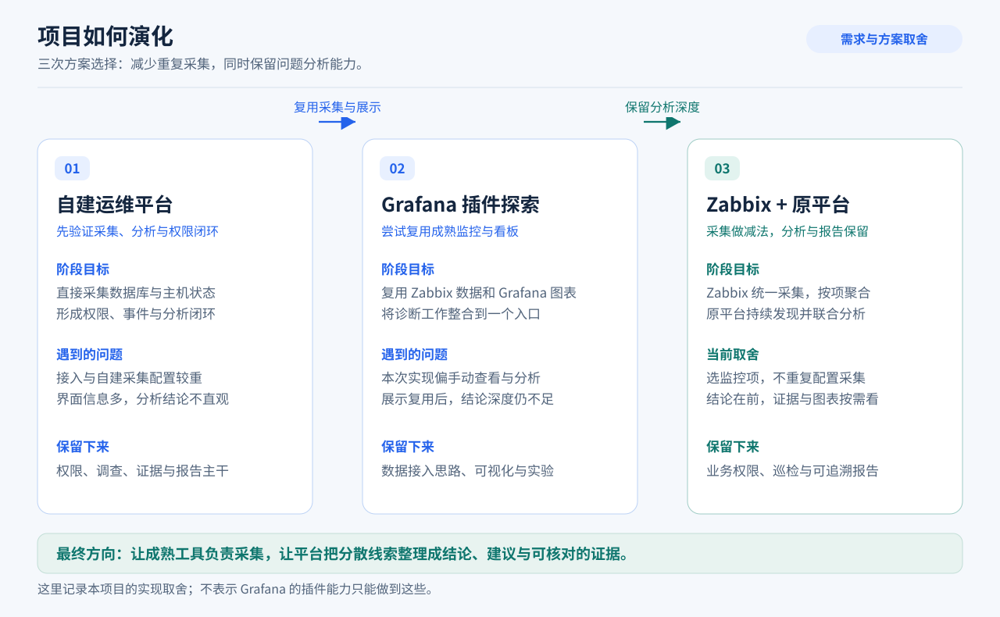
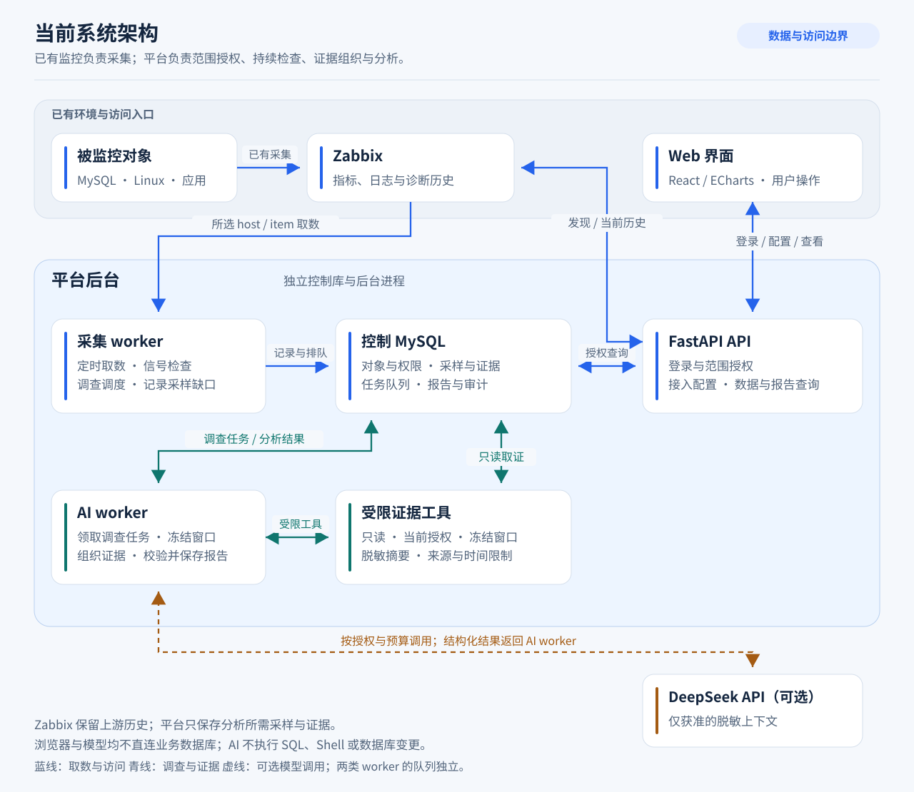
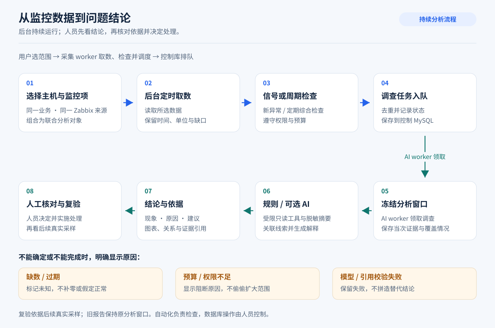

# 项目演化：简化采集，保留分析深度

这个项目从可复现的 MySQL 运维案例开始，逐步调整为基于已有监控数据的问题分析平台。经历了三个阶段的探索：**自定义独立平台 → Grafana 插件 → Zabbix + 原独立平台**。

核心目标一直是让运维人员更快知道：发生了什么、为什么、接下来怎么做。变化主要在于采集方式、产品入口和分析结果如何表达。

以上按方案演进归纳，部分探索和改造交错进行；并不表示三个阶段各自持续了固定天数。规划始于 2026 年 11 月 7 日，主要方案调整集中在 11 月 8–9 日，之后继续验证与完善。

## 第一阶段：自定义独立运维平台

**最初想做什么。** 从 MySQL 接入、数据库与主机信息采集开始，建立异常、AI 调查、证据、报告和人工复验的完整链路，用隔离环境中的真实问题验证。

**遇到的问题。** 自己实现采集、接入和配置，需要维护许多成熟监控工具已经解决的细节。页面和功能增加了，但使用者仍不容易一眼看出问题是什么；报告中的原因与数据也缺少直观联系。

**如何调整。** 尝试把监控采集和图表交给已有组件，减少接入成本。将原平台已实现的权限、事件、调查、报告及证据保存能力保留为后续可复用基础。

历史实现保留在[原平台版本说明](releases/legacy-platform-2026.11.08.md)和[历史 Release](https://github.com/catdogrennie-gt/db-evidence-platform/releases/tag/legacy-platform-2026.11.08)。

## 第二阶段：Grafana 插件——SignalLens

**为什么尝试。** Grafana 有成熟的数据源与图表能力。这个方向尝试把数据库、主机等监控放在同一时间窗口，再用独立分析服务读取证据、调用模型，形成一个图表与分析结合的工作台。

**实际使用暴露了什么。** 当时的流程偏向“选对象 → 选时间窗 → 冻结证据 → 手动分析”。使用者仍需主动找到问题、确定调查范围，才得到解释；原平台已有的调查和报告能力也需要在另一套服务中重新组织。界面简化了，分析工作流却随之变薄。

**如何取舍。** 持续主动检查、先展示问题结果才是项目的重点。继续扩展 Grafana App 技术上可行，但直接复用原平台的调查、权限和证据模型，更适合当时的实现基础。因此将原独立平台重新作为主应用，保留 Zabbix 接入思路。

当时的实现与设计可查看 [SignalLens](https://github.com/catdogrennie-gt/SignalLens) 和[产品流程](https://github.com/catdogrennie-gt/SignalLens/blob/main/docs/01-product-design.md)。回到原平台的选型依据保存在[自动巡检改造设计](superpowers/specs/2026-11-08-zabbix-intelligence-design.md)中。

## 第三阶段：Zabbix + 原独立平台

**职责重新划分。** Zabbix 负责监控采集与上游历史；平台读取用户选择的数据，进行异常检查、AI 联合分析和报告展示。当前图表可以查询 Zabbix 历史，报告保留分析当时的有限证据窗口，无需再复制一整套监控历史库。

**复用了什么。** 原平台的身份与权限、事件、调查队列、证据保存、报告和人工核对链路继续使用。在这些能力上增加只读 Zabbix 接入与定期巡检，前端采用 React、Ant Design 和 ECharts 展示。

进入这一方向后，又根据实际使用做了几次收敛：

| 遇到的问题 | 做出的调整 | 带来的变化 |
| --- | --- | --- |
| 自定义采集和配置仍然较多 | 改用官方 MySQL / Linux 模板，必要诊断由 Zabbix 扩展采集 | 平台主路径只需 Zabbix 只读权限，无需业务数据库口令 |
| “一个 host 就是一个对象”无法表达业务关联 | 按 host、item、标签选择确切监控项，组成联合分析对象 | 可把同一业务的数据库与主机放在一起核对 |
| 报告像事实列表，读完仍不清楚要做什么 | 顶部先呈现现象、原因判断、结论与建议，证据和图表按需展开 | 阅读顺序从“自己拼原因”改为“先读结论，再核对依据” |
| 旧入口和新入口并存，操作路径复杂 | 收敛为问题分析、Zabbix 接入、数据查看、配置 | 日常流程围绕聚合与分析，历史功能保留在版本资料中 |

原有实验监控项曾记录真实 Lab 采样；切换时备份并替换的是旧实验采集路径，不是把伪造数据换成真实数据。官方采集与本轮模型结果见[结论优先验收](acceptance-conclusion-first.md)。

## 怎样验证调整有效

验证使用隔离 MySQL 中的真实锁等待：先正常采样，再制造固定阻塞，观察 Zabbix 数据、平台检查和 AI 报告，最后解除故障、核对后续采样。独立的 [SignalLens Lab](https://github.com/catdogrennie-gt/SignalLens-Lab) 提供快捷开关和结果展示，完整平台保留自己的采集、检查与分析流程。

开发中也发现过模型误读数值区间、字段单位和快照时序，以及模型返回格式不合法的问题。应对包括补充确定性统计、单位和时间说明，约束可读证据，核对引用并校验结构；失败与未知继续保留。结构校验通过仍需要核对结论语义，相关记录见[联合对象验收](acceptance-analysis-groups.md)与[完整流程验收](acceptance-quick-showcase.md)。

## 这次演化留下的原则

- **简化的是接入成本**：成熟监控负责采集，平台专注跨数据分析与结果表达。
- **保留的是分析深度**：复用已有调查、权限、报告和证据能力，避免反复建立同类后端。
- **从使用者需要的结果倒推流程**：后台自动检查，首屏解释问题，细节在需要时再展开。
- **图表、证据与建议相互对应**：数据缺失、候选原因和模型失败保持可见，实际处理由人员控制。

这些是个人项目中的方案与验证记录。后续仍需检验长期运行、接入规模和生产环境边界。

三张图用于说明方案、模块职责和流程，源文件由 `python scripts/docs/generate_explainer_diagrams.py` 生成，可随设计更新。
