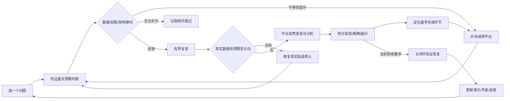

# 单问题持续演进规范

## 目标与授权

按用户 2026-11-13 的要求，每 30 分钟继续检查和推进一次平台演进。目标是让平台越来越能从已采监控信息中发现、解释数据库健康风险，而非增加报告数量。基础数据接入已可用，但每个问题仍需单独证明证据充分。

这是开发与验证流程：工程代理根据真实失败修改代码、配置与验证；平台内 AI 继续仅读授权脱敏证据，不获得任意 SQL、Shell、写库或自主修复权限。仅登记的隔离 Lab 目标允许可控故障，公开访问与数据权限继续有效。

## 采用的方式

采用当前聊天的每 30 分钟周期任务，读取本规范、[进度状态](../../evolution-status.md)及私密工作区 CHECKPOINT 后续做，避免每次从头开始。沿用现有 Lab 和封存发布，不另造调度平台。相比并行批量跑故障，这样更容易定位改动效果；相比每轮重新选题，这样能保留失败与执行上下文。

周期是检查与推进频率，不要求每 30 分钟完成一个场景。已有任务未结束时继续同一阶段，不创建并行复现，不接管别人的故障，不重复提交未知费用的模型调用。

## 每个场景的闭环

无论通过或失败，每次实际 ON 都必须在有界期限内清理，并核对后续真实采样。图中的成功路径不替代失败分支的清理；不能为等待报告而无限维持故障。

### 1. 选题与证据设计

每次只指定一个场景，先写现象、要判断的范围、最低可接受结论、需要排除的相似正常情况。区分必需证据和辅助证据；记录实际 Zabbix 模板、宏、触发器和事件，标明本项验证的是基础工作流、已有告警解释增强、当前配置的告警缺口，还是更早的风险线索。不能泛称 Zabbix 无法发现。

### 2. 数据与架构准备门槛

| 层 | 必须查清 | 不满足时的处理 |
|---|---|---|
| 来源与采集 | 数据已选择且实际有样本，单位/计数语义/epoch/采样时间/保留期/缺口明确；日志和快照包含本项必需字段 | 可补则先通过 Zabbix 补接并自然采入；不能补则缩小判断范围或 SKIP |
| 关联与时间 | 应用、实例、共用主机身份及关系有据；数值能同窗对齐，累计统计不伪造差分 | 修复身份/窗口/字段契约；不得把共用主机 CPU 直接归为某实例消耗 |
| 发现能力 | 现有规则或周期检查确有识别该现象的路径；业务影响和异常线索没有被选择/权限过滤误丢 | 定位缺失的通用检查或语义适配，补回归后实现；不把场景答案写成专用判题规则 |
| 调度与取证 | 上游采样、平台采集、信号检查、AI 周期和冻结窗口匹配；队列、超时、准备耗时可观测 | 修最早阻塞点，按实测选择有限加速租约；期限、额度与安全护栏不整体放开 |
| 模型输入 | 实际冻结证据已脱敏进入输入，关键触发与正常反证没有被预算/截断挤掉 | 检查实际组装请求与省略记录；先改数据结构/投影，不无限加提示词或预算 |
| 报告与页面 | 标题、现象、原因、建议、引用和当前/历史状态一致；只读访客能看到允许数据，不能改配置 | 修展示或契约，旧模型输出保留；任务 completed 不自动等于诊断通过 |

只有存在真实失败证据才作架构改动，优先最小改动并说明受影响的其他场景。不能借“架构优化”无边界重写平台。

### 场景卡：开始前写清，收尾后补实测

每个场景沿用一个编号和累计计时，按[场景卡模板](../../evolution-case-template.md)记录，不为同一问题每轮另建案例。最小内容包括：

- **问题与价值：** 用户会遇到什么影响；现有 Zabbix 配置能否告警，平台预期增加的是解释、覆盖还是提前量。预期提前量必须有实际时间对照才能成立。
- **证据清单：** 每项必需证据对应实际对象/监控项、字段、单位、正常值或基线、采样周期、允许时差和权限；分别核实“上游有 → 对象已选 → 自然入库 → 冻结保留 → 模型实际收到”。缺一环就先补，不把数据总量当场景覆盖。
- **预演与验收：** 正常和故障各自预期的数据变化、发现路径、最低可接受结论、不能推断的内容；复现上限、独立清理和恢复判据预先写定。
- **单一改进：** 最早失败点、一个可证伪的修复假设、失败回归、改动范围、同条件重测和正常反例。分析成功也要检查误报、重复报告及旧场景回归。

### 架构改进如何积累

将案例特有的环境条件和可复用的平台缺口分开记录。后者登记为“缺失能力 → 失败证据 → 受影响场景 → 最小修复 → 回归入口 → 实测状态”；例如选择遗漏、身份关联、计数差分、上下文保留、调度阻塞及报告边界。不同案例重复出现同一缺口时合并处理，不为每个故障复制一套专用逻辑。

修复须同时回答：此前为什么失败、改后哪些输入得到保留或判断得到改善、正常输入是否仍被正确处理、公开环境如何回退。代码与测试通过、部署生效、实际诊断通过分别记录，不能互相替代。“不断优化”指有证据的工程迭代，平台 AI 的只读权限不随之扩大。

### 3. 先确认复现有效，再评价平台

ON 前保存正常采样及目标资源上限、单控制器所有权、独立清理护栏、最大持续时间和原巡检周期。ON 后由独立验收读取真实上游样本，确认事先定义的可观察变化，例如跨越已配置容量水位、出现实际等待关系，或相对基线有明确且持续的耗时差异。未产生预期变化记为“复现未成立”，不指责平台漏报，也不事后降低验收线。

验收端可知道控制状态，但故障标签、预期答案和验收判定不得进入 B 模型输入。A 只制造故障；发现与分析必须由 B 自己的 Zabbix 数据和巡检触发，不能用手动提交报告代替自主发现。

### 4. 分层判定，优化后重测

分别记录：采集是否成立、复现是否成立、自主发现是否成立、解释是否成立、只读展示是否成立、清理和监控恢复是否成立。各阶段状态为 PASS / FAIL / WAIT / SKIP，附版本、时间和可复查证据。

报告需说清发生什么、影响、已证实的直接机制、根因候选与未知、操作建议及证据。相关性不写成因果，空快照不外推全窗口健康，当前恢复不覆盖历史风险。正常负载变化也是必要反例：允许正确结论为未见明确故障，不为了页面有内容制造问题。

失败后定位最早失效层，形成一个明确改进假设，补有意义的失败回归，最小修复后运行相关测试；用相同条件及正常反例重测。历史回放、人工复核和新自主发现分别标注。不能反复调用模型碰运气，也不能只修改报告文字让旧案例变成通过。

## 从易到难的队列

| 层级 | 优先问题 | 通过后才增加的复杂度 |
|---|---|---|
| L1 基础闭环 | 连接用量越过明确关注水位；普通行锁等待；确有明显耗时影响的慢查询 | 单实例、字段齐全、有正常对照；Zabbix 也可能告警，先证明流程可信 |
| L2 同层联合 | SQL 扫描代价与业务耗时；长事务与历史链增长 | 对齐配置、性能统计、会话/事务、实际日志和业务影响 |
| L3 跨层与反证 | 应用池紧张但 DB 余量足；应用排队但 DB 耗时正常；副本业务新鲜度 | 需要跨应用/数据库证据，同时保留正常反证与替代解释 |
| L4 环境相关 | 专用 IO 限速、固定代理抖动、工作集变化、空间增长趋势 | 先过隔离、资源、采样与长窗门槛；硬件/多机房条件不具备则跳过 |

历史失败作为基线保留。当前 SQL 效率候选先做冻结输入的离线定位；不因这张队列重复开启同一故障。遇到卡点可优先修通用缺口，若条件仍不具备则移到阻碍清单，返回可验证的 L1 项。

## 每 30 分钟如何执行

每轮先写一句执行承诺：`当前问题 / 最早未通过环节 / 本轮唯一改进假设 / 可检查产物 / 停止条件`。缺数据就只补该项并验证自然采入，发现失败就检查发现路径，解释失败就检查实际模型输入与推理边界，不将所有层一起重写。

连续两轮未推进最早未通过环节，必须调整假设、缩小可验证目标或暂停换题；不能用重复全量测试、重复准备、新建包装器或新增文档算作进展。真正补齐必需数据、失败回归转通过、实际发现或解释改善，以及证据证明应跳过，才是可检查的推进。此规则与累计约60分钟无进展的止损同时适用，不能重置场景计时。

1. 读取最新状态、CHECKPOINT 与实际部署/任务/故障所有权，确认没有另一轮正在运行。保留正在进行的工作，不覆盖旧记录或重复开关。
2. 检查公开 B 的首页与静态资源、只读登录、问题/真实报告、退出及写入拒绝；A 下线时应为维护页且公网控制拒写。HTTP 通过与浏览器视觉通过分开。失败先恢复可用性，不继续施压；连接异常先有限诊断，不盲目重启。
3. 对当前问题复查上述六层，选择一个本轮能验证的改进，并继续执行当前阶段。开始新故障前必须有 GO 记录及完成清理的时间余量；否则只做准备/离线修复。
4. 每 30 分钟记录实际进展、阻碍、时间花在哪里、计划是否偏离和下一步。单场景累计约 60 分钟仍无有效进展就暂停并说明原因，换可验证问题；不能每次调度重置计时。接近完成、值得延长时写具体证据、一次延长时限，不无限延期。
5. 收尾核对负载和巡检租约、更新[进度状态](../../evolution-status.md)、验证清单、操作手册及 CHECKPOINT。只有清理状态和恢复证据齐全才写恢复通过，未完成任务保持 WAIT。
6. 发布仅已验证改动：封存候选、健康检查、按既有约定提前 1 分钟通知、切换与失败回退；不覆盖正在运行代码，不同时启动两位控制器。源码只推已审阅范围，保留旧版，不携带私密文件或私有历史。

周期开始不等于每次发版。场景发现、解释、恢复及展示全部通过，才可单独开放 A 的对应项目；A 只展示有效场景。没有新通过项时维持维护页，不把开发中项目填进公开演示。

每轮开始和收尾检查公开环境；切换后增加一次检查。A 已有通过项时保留这些入口，仅隐藏未通过项；不能因没有新通过项撤掉已有可用演示。收到下一次周期时，尚未完成的工作续接，不能生成第二个执行者或重放调用。

有实际数据时记录“上游首次变化 → 平台入库 → 自主发现 → 报告可读”的时间，以及关闭到恢复采样的时间；没有对应观测就标未知。每轮至少留下一个可检查的产物：缺项证据、失败测试、最小修复、重测结果或明确的跳过理由。不能用新增文档数量或模型调用次数代替进展。

## 每轮必须留下的最小记录

`时间 / 场景及累计用时 / 当前阶段 / 数据与复现门槛 / 各层 PASS-FAIL-WAIT-SKIP / 最早失效点 / 本轮修复与回归 / 模型调用及未知费用状态 / 清理与周期还原 / 公网检查 / 发布版本 / 下一步`。

对用户的本轮简报聚焦：实物变化、验证结论及未通过处、公开演示可用性、下一动作。30分钟是检查节拍，不是强制开新故障或强制发版；自动工程迭代也不赋予平台内AI修改自身或执行修复的权限。

公开文档只保存脱敏事实与相对证据索引，原始请求、凭据、口令、私密配置和敏感采样留在仓库外。进度不是成功率，不编造指标或已具备能力。
