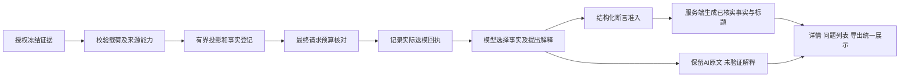

# 报告事实准入设计：时点证据不能证明连续过程

11月14日13:17实现说明：新增服务端 `report_presentation` 供列表/概览/详情/导出共同表达报告来源和权威范围。轻量列表不求解全部私密证据，明确 `fact_assessment=not_evaluated`；详情/导出使用完整准入结果，无过期核实缓存。模型解释原文与已核实时点分开，规则结果不被误标成 AI 失败。

模型可选 `fact_selections:[{fact_id,facet,assertion}]`，仅引用已提供证据；facet为snapshot_point或时长/次数/解除/当前状态，assertion为selected或unknown。结构最多12项，提示建议8项；不接受自填数值和服务器核实字段。服务端独立来源事实与模型选择是两层：来源点可证明该采样中观察到什么，不等于模型已使用它；模型选择仅在同一确切请求及来源准入后取得时点资格。unsupported selected维度保留原报告但明确不准入，不为取得有利答案重试。旧输出/空选择标not_provided，未完成来源验证标not_evaluated。

最终完整后端1507项、前端113项通过，构建通过；预算与示例失败保留并修正，未提高上限、未裁掉两份原实际输入的上下文。尚未部署或实际模型验收，A只读适配及完整封存发布待完成。以下旧轮次状态作为历史保留。
 
11月14日12:44最新进度：来源合格的时点准入消费者、真实历史/问题详情接口及两个前端宿主已本地实现。授权、冻结哈希、哈希内来源/配置/采样能力、确切输出请求回执及候选报告绑定必须同时满足。未送入模型的冻结点只能否决冲突，不能补足事实。旧报告无回执/来源证明保持未核实，原文不改；两项缺口测试真实通过后移除预期失败。总览/卡片/列表/导出一致权威路径及模型受约束选择仍待完成，未部署、未新增故障或模型调用，原时序FAIL不升级。以下早期结果保留作历史。

11月14日12:07实施进度：实际请求回执及候选报告生成请求绑定已实现、本地验证，尚未部署。完整来源/配置/能力校验、事实准入及用户可见标题链路仍未实现；下文的“本轮”指11:35设计轮次，不能把回执基础算作整套方案完成。25项新回归及完整测试1450项通过，另有25跳过、2项未实现接收条件保留严格预期失败。回执复用现有投影、不新增模型输入；两份原请求离线核验保持原大小与原审计，不构成新模型验证或旧回执回填。

状态：设计与缺口回归；尚未实现或部署。关联 FR-022～024、AT-013，不代表完整验收通过。沿用 LOCK-03 的失败记录及约86分钟既有累计时间，本轮限定30分钟完成设计和回归，不重开故障、不调用模型。

## 实际问题及选择

历史复核83ac在实际收到最近后续空快照后，仍写“短暂、一次、随后自行解除”。现有 `validate_report` 只检查结构、大小及引用集合，无法证明引文支持自由文案。当前页面已经有AI标注和观测边界提示，单纯再加提示不足以改变这个结果。

| 方案 | 判定 |
|---|---|
| 加提示词或换措辞重跑 | 已有失败实证，不继续碰运气 |
| 匹配“短暂、恢复”等词并删改 | 不能处理否定、同义词和其他语言，也可能误伤有真实证明的事实；不采用 |
| 确定性事实准入，AI自由解释另列 | 采用；能校验结构化事实，不声称能验证任意自然语言 |

这里只定义报告证据权威边界，不重写采集平台。正常接入仍复用Zabbix，未知类型可继续做授权AI解释，不因此获得“已核实事实”资格。

## 一次完整交付的边界

后端从**实际进入模型请求的授权冻结投影**生成事实登记；模型选择事实引用及声明时序维度，服务端按证据能力准入。已核实事实和标题由服务端模板产生。AI原文、实际请求和旧报告全部保留，AI自由文案始终是未独立验证的解释，不作为已核实标题、恢复状态或已证实问题的登记依据。AI仍可自动发现并登记“待核实线索”，按原权限展示与人工复核；不能因本设计丢掉平台发现新问题的核心用途，也不能把线索冒充确证。



不单独部署登记器或只加字段就宣布成功；后端、持久化和实际标题展示链路均须完成。已有 `observation_bounds` 表示完整冻结清单中的可核实时点，继续保留，但不能冒充实际送模清单。

## 事实登记与实际送模回执

### 前瞻来源契约：12:14实现增量，尚未部署

旧诊断把生产者契约和单份完整性结果只留在`coverage`，来源ID及映射/配置版本也未随载荷哈希冻结；`CollectionRun.config_revision`可交叉核对，但不能替代其余字段。新规范化诊断在载荷内保留`diagnostic_origin.version=diagnostic-origin-v1`及严格校验后的生产者契约、查询名、返回条数、快照条数、完整/截断标记和范围。采集器在已有fence内补入来源ID、host/item、映射/配置版本、实例、source、source_mode和采样时间，随后沿现有载荷哈希与清单根绑定，无需修改清单格式或自哈希。

准入消费者仍待实现，必须重验这些哈希内字段与监控项定义、实例/来源/时间、规范化锁行及CollectionRun一致；不能由可变coverage补足能力。无origin、未知版本或冲突保持未准入。旧行和旧清单不回填；若以后仅冻结旧coverage，必须标明是冻结时元数据，不能冒充原始采集证明。日志producer.snapshot_row_count表示转换前条数，首版锁适配器不能将此语义泛用于日志的规范化rows。上游传来的同名origin被忽略，不获得服务器来源身份。

只有“当前有权读取 ∩ 冻结清单成员及载荷哈希匹配 ∩ 来源适配器可解释 ∩ 实际请求包含”的交集可进入本次模型解释对应的事实登记。首版仅支持已识别MySQL锁快照的时点及样本顺序，其他类别不自动升级。

每项绑定调查/清单版本、实例、source_id、hostid、itemid、映射/配置版本、来源能力版本、证据ID/哈希、采样时间、投影行数及完整性范围。事实ID由后端生成，模型不能自造事实、数值或验证状态。实际请求哈希、轮次及请求包含的事实ID集合写入服务器生成的回执；回执属于ModelCall元数据，不是模型返回值。发起前为prepared，只有成功响应与请求审计匹配后才可确认为本次调用提供过；网络结果未知不冒充已送达。回执证明请求提供了什么，不证明模型理解或使用了它。

预算裁剪后再次核对登记与请求中的事实一致；被省略项不能留作可引用的已送达事实。工具结果和最终压缩遵循同一规则。准入只依据**产生该输出的确切请求及其中实际保留的上下文**，并绑定该请求哈希与轮次。早期调用曾提供、最终生成报告的请求已省略的事实不得准入；不能使用调查级历史回执或引用集合的并集来补足。保留在该确切请求的工具消息等上下文中的事实，仍须核对必要字段确实存在、值相符且当前授权有效。上下文或回执不可证明时降为未验证，不增加预算、扩大窗口或补取新观测。

不能直接信任 `snapshot_chronology` 的未知身份分组。未知身份不配对；实例/来源/主机/监控项/配置版本不同不构成连续过程。同刻冲突不选择有利值。原始文本历史8条不是8条诊断行；空历史、解析失败和不可用项也不是空诊断快照。

## 首版能力与断言准入

| 维度 | 可准入内容 | 不得推导 |
|---|---|---|
| 时点事实 | 经核验投影在某时点含N行；有效完整空快照为该时点未见等待 | 全窗口健康、目前健康 |
| 同来源顺序 | 某非空时点之后存在另一空时点；两者相隔N秒 | 等待持续N秒、在空样本时刻解除 |
| 连续时长 | 首版无证明能力，未知 | 从间隔、事务年龄或会话时长推导 |
| 发生次数 | 首版无证明能力，未知 | 非空快照数量等于事件数量 |
| 解除机制 | 首版无证明能力，未知 | 后续空快照说明自动解除/人工结束 |

窗口历史不完整与单份快照不完整分别保留。已观察到的有效非空投影可说明看到至少这些行；“完整空快照”必须有对应生产者能力及单份采样完整性证明，不能因窗口覆盖有缺口而伪造零，也不能把历史截断误当每份采样都无效。数值序列属于另一总体，不混入快照行数或次数。

新模型契约只允许选择后端事实ID，并对上述维度声明受约束值；无对应能力的已证实断言拒绝准入，保留原因与原模型输出，不通过重试挑选有利答案。不把未知改成零，不因此否定其他已核实事实。

**这不是自由文案语义验证。** 即使模型结构化维度写unknown、文案仍写“自行恢复”，该文案也不能进入已核实层。对任何自由文案都不因合法引用或 `status=observed` 赋予机器核实身份；正反措辞均适用，不依赖关键词。

## 保存与展示契约

### 实测预算约束（11月14日11:40）

对两份既有实际请求做离线复制式简化登记样例探测，未发请求、未改原审计或服务。原输入上限48000、总预算96000不变：历史失败请求有42份锁快照，上界47549，追加所选复制式简化登记样例后60643，已经超限；自然正常请求有两份锁快照，47118增至47780。数值仅适用于该序列化布局，不是理论最小值，也不证明其他紧凑编码均超限。样例尚未包含完整身份、版本和回执字段，因此后一项也不构成完整实现可容纳的证明。

实现不得在预算核对后追加登记。优先评估复用既有投影、短事实引用与共享类型说明，完整身份/哈希留服务器登记；必要事实字段必须仍在实际请求中。候选编码须先按真实序列化路径测试，再参与原预算裁剪并保护关键正反时点；装不下就说明未准入/缺口，不能加预算、静默删关键反证或把省略内容认作已送模。编码尚未实现或验收，不能据此称整套设计已通过运行验证。

拟新增只读响应 `report_grounding`。当前验收固定最小字段如下，其余登记/回执字段实现时另作版本化定义：

```json
{
  "version": "report-grounding-v1",
  "status": "unverified",
  "reason_codes": ["actual_delivery_receipt_missing"],
  "admitted_facts": [],
  "verified_headline": null,
  "model_narrative_verification": "unverified"
}
```

首版status只允许unverified或point_facts_only，后者也不表示连续过程或整份AI解释正确。模型不得写入服务器名字空间。主标题和主事实从准入的类型/值模板生成，不复制模型自由标题；时间范围必须显式。没有可准入事实时显示未验证边界，不给出“已核实健康/恢复”。混合来源和多实例分开列出，不能从一个锁快照替整个调查作全局结论；没有合适的整体事实标题时verified_headline仍为空，分组显示事实与独立的未验证AI线索。

报告详情、问题卡、报告列表、引用回查和导出使用同一权威规则；事件/问题登记不得由未验证时序文案推进恢复状态。AI原因候选与建议仍可阅读，必须与已核实事实分开。建议不自动执行，权限和预算边界不变。

旧报告不补造送模回执。无可靠实际回执时，`report_grounding` 为unverified、原因 `actual_delivery_receipt_missing`，原报告及审计字节不变；已有冻结观测仍可另看，但不算该模型实际收到。禁止用界面安全标题反称旧AI时序解释通过。

## 验收及停止条件

1. 保留实际失败；证明旧schema/citation校验确实接受不受证据支持的文案，同时拒绝伪引用。
2. 同来源非空→空，仅准入时点事实/间隔；没有连续性、次数、机制或当前状态资格。
3. 模型全部写unknown但自由文案有过度断言，文案仍不能成为已核实标题；正常的否定文案也不靠关键词获得验证。
4. 省略/未送模、早轮已提供但最终请求裁掉、哈希错误、越窗、撤权、未知身份、跨来源/对象/配置、同刻冲突及文本历史计数均有反例；不能泄露未授权字段。
5. 穿透持久化、实际详情与问题展示；核对原报告/审计未改、预算未增，旧无回执保持未验证。
6. 后端与前端整体相关回归及封存候选验收后再部署；先正常反例，再在原策略合法额度内核验一次有明确标签的历史复核。离线结果不代替新模型请求，历史复核不冒充自然发现。

本轮只有设计与缺口回归。完整时序解释仍FAIL、实现/部署/实际模型改善WAIT；不能新增A入口或升级AT-013。若下一轮无法把权威标题和事实准入贯通，不发布只有新字段的半成品；记录具体未完成边界，不反复开故障或加提示词。

## 本轮缺口回归（不是修复）

`tests/platform/test_report_grounding_gap.py`的三个控制项确认：旧结构及引用校验接受失败措辞；伪引用仍拒绝；真实授权冻结详情包含非空/空两个时点，且持久化模型原文未改。两个待实现接收条件分别使用过度断言和否定措辞，要求没有送模回执时不得获得已验证事实/标题。

`--runxfail`实际得到2失败、3通过，均失败在真实详情缺少report_grounding，而非导入、数据库或伪引用错误。默认严格XFAIL仅标识尚未实现，不能说这些断言已经受控；后续真正实现后必须移除标记，XPASS阻止悄悄把未完成项算作成功。此回归没有验证任意自由文案的语义，也不是把旧AI报告改成通过。
## Prospective compatibility correction — 2026-11-14

Round52 runtime evidence identified two actual producer paths: the strict diagnostic pack stores hashed origin, while the selected original `dbops.mysql.lock_snapshot` still uses `db-evidence-lock-snapshot-v2` and loses producer proof before hashing. This is a collection/consumer contract gap, not evidence that the old report is now correct.

Within the existing authorized single-issue repair, support that exact legacy producer prospectively. Require a recognized lock item key and enhancement, nonconflicting contract tags, matching producer contract, strictly typed complete/nontruncated flags, dictionary rows and exact integer total count within50. Build origin from validated values, then bind the collector's actual collection/observation identity inside the future payload. The report consumer recognizes this distinct complete-snapshot protocol explicitly; it cannot borrow the newer protocol's truncated capability. Missing, conflicting, malformed or historical proof remains unverified. No history rewrite, mapping/identity change, new SQL execution, increased budget or AI permission.

Alternatives rejected: reconstructing old proof from mutable coverage cannot authenticate historical source capability; replacing the selected item or object would unnecessarily change configuration/history. Preserve the existing source and immutable evidence, with a small forward-only adapter. Code tests, deployed collection and real model results remain separate acceptance stages.

