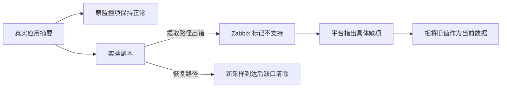

# DATA-QUALITY01：采集失败不能被旧正常值掩盖

## 范围与价值

对应FR-008调度隔离、FR-009数据时效及FR-013过期提示；独立心跳分支是AT-006持续采集隔离的局部前提验证，不把两分钟正常预演计为完整30分钟多对象异常验收通过。AI诊断AT-013和服务重启AT-017未在该分支执行。

数据库是否健康，首先取决于监控依据是否仍可用。本轮验证的是**采集项提取失败**时，平台能否指出具体缺项、阻止旧值被当作当前依据，并在新鲜采样恢复后清除缺口。

最初的“采样真正停更”候选没有现成、可独立暂停的实验心跳源，早期未执行；随后补齐来源与独立期限，23:00完成一次真实停更与自动恢复，见下方连续记录。采集错误是另一个明确分支，不能用它代替停更或稀疏采样验收。Zabbix 本身也能识别不支持项或配置无数据告警；这里验证平台是否保留数据质量状态，不声称新增了Zabbix无法发现的数据库故障。

## 如何安全复现

在已登记的实验应用主机上，新建一个依赖于现有请求摘要的监控副本，正常提取真实连接池容量。原监控项、上游主项、应用和 MySQL 均不修改；不增加数据库查询。平台通过正常接入建立仅含原项与副本的两项验证对象，默认规则模式，无 AI 巡检策略。

正常采样和权限核对后，只将副本的 JSONPath 改为不存在的字段。独立护栏先启动并通过正常状态无操作预演，最长 180 秒后只恢复这个固定副本；主流程亦有 finally 恢复。恢复操作使用当前配置核对，不宣称提供 Zabbix API 原子比较交换。

## 实际结果（2026-11-13，Asia/Shanghai）

| 阶段 | 实际观察 | 结果 |
|---|---|---|
| 正常反例 | 原项与副本采样可用，该对象没有当前缺项 | PASS；不表示数据库全面健康 |
| 独立上游复现 | 16:25:01 修改副本；Zabbix 实际变为不支持，原项不变 | PASS |
| 平台自然发现 | 16:25:23 公网只读接口显示 1 项缺口，包含对象、主机、副本和 `item_unsupported` | PASS；距配置变更约 22 秒，不是承诺时限 |
| 阻止误用旧值 | 对应历史读取返回空行和 `item_unavailable`，没有把旧容量值当作当前可用值 | PASS |
| 恢复 | 16:25:24 恢复提取路径；上游随后有 5 次新鲜正常采样，16:25:55 平台当前缺口清除 | PASS；无缺口仍显示未知，不改称健康 |
| 护栏与原项 | 16:28 独立护栏读回已正常，只作无操作确认；原项配置前后一致 | PASS |
| AI 根因分析、真正停更、浏览器视觉 | 本轮没有执行 | 未验证，不计入通过 |

复现与恢复均来自实际 Zabbix 和平台自然采集，没有手工灌入平台结论或提交 AI 报告。这个分支现有逻辑已正确处理，因此不为通过案例增加专用规则。验证对象随后暂停、仅新增的监控副本停用；正常提取路径与历史保留，不在公开 A 增加一个数据库故障开关。

## 前检带来的适配修复

检查中还发现：`apiinfo.version` 被多带的认证头拒绝，适配器将其概括成上游不可用。实际匿名请求可以返回 7.0.32。按[官方约束](https://www.zabbix.com/documentation/7.0/en/manual/api/reference/apiinfo/version)，仅为版本方法省去认证头，其他来源读取保持 token 认证。

新回归在修复前两项失败；修后相关运输和覆盖 21 项通过，独立审查的版本/运输 12 项通过。真实只读复核确认：匿名版本可读、正常来源主机/历史可读，错误数据 token 仍不能读取主机。源码修复、完整回归与运行部署状态分别见[进度](../evolution-status.md)，不能把命令检查写成已替换运行服务。

## 独立心跳分支：正常基线准备

**2026-11-13 21:46起准备；21:58:55—22:00:37实际发送，累计准备约15分钟。** 缺失的可独立停止来源通过既有Zabbix `history.push`补齐，不安装新采集系统，不修改现有数据库项。仅在登记Lab主机新增两个带实验标记的trapper项；其数值1表示测试发送活动，不能表示数据库健康。实际API接受后还独立读取历史，避免把“接受处理”当成“已经保存”。依据：[官方history.push](https://www.zabbix.com/documentation/7.0/en/manual/api/reference/history/push)、[trapper与允许发送来源](https://www.zabbix.com/documentation/7.0/en/manual/config/items/itemtypes/trapper)。

| 核验层 | 实测 | 状态 |
|---|---|---|
| 上游正常来源 | 约5秒一次向两个固定项推送，20次请求；值始终为1，无数据库查询 | PASS |
| 密集历史反例 | 独立读回19条，实际间隔5—6秒；不能因值未变化判停更 | PASS |
| 合法稀疏反例 | 30秒保存心跳，独立读回4条，实际间隔31/30/31秒；不是只按配置推断 | PASS |
| 选择与自然入库 | 通过既有授权接口创建一个两项对象；运行后台自然完成3次采集、6份证据，当前缺项0 | PASS；无缺口仍为未知，不称数据库健康 |
| 权限与模型 | 同一业务范围只读访客授权核对；无AI策略、模型调用0，未审计新模型输入 | 授权核对PASS；模型分析未执行 |
| 收尾 | 对象暂停到配置版本2，仅两个新增项停用，身份和历史保留；原项和公共服务未改动 | PASS |
| 真正停更、恢复与公开演示 | 未暂停任何数据源，未产生故障报告、未增加A开关 | WAIT |

独立审查先发现基线验收只统计历史条数会漏掉“稀疏保存实际没有生效”；首次执行前已增加实际时间间隔及主/对照数量比较。此为验证设计修正，并非声称生产发现能力新增。配置采集周期10秒，实际本段仅观测到3次后台采集；尚未确认派发、轮询或队列各自耗时，不能按配置宣称10秒发现。

**下一步（仍沿用本卡及原身份）：** 准备一个保持对照发送、可独立暂停主发送的有限时长控制器，先预演独立自动恢复；再取得新正常基线与GO记录。停更后应仅主项出现实际样本时效缺口，不能推断MySQL宕机；恢复须独立读回至少两次新鲜主项采样及平台缺口清除。Zabbix也可配置`nodata()`，本项价值是避免平台拿旧正常值继续作健康判断，不宣称产品固有告警能力不足。AI冻结输入及解释留待实际需要时另验，不新建策略或身份绕过日额度。

私密证据索引：部署目录`heartbeat-01/normal-baseline.private.json`，准备脚本SHA256 `99ac80b22d47226e5cf4c3b2331949523ca881ed6578b6449a062ca44a774a0a`。一次性创建脚本已经执行，禁止重放；后续工程应读取固定身份与现状，不能重新制造同名项。原始保存样本及发送来源地址留在仓库外。

## 独立发送器：驱动退出与到期收尾预演

**2026-11-13 22:16续做，22:23:24—22:25:24现场预演；累计准备及预演约25分钟。** 沿用原监控项和原对象，平台服务及AI策略不变。工程发送器使用一个共享排他锁与一次性意图，固定原项/对象/配置版本；未知旧锁不自动抢占。内部单调时钟限定发送期限，受控暂停的纯逻辑只允许一次且重复命令不能续期，缺失或无效命令恢复正常发送。5项有意义的期限回归先失败后通过；现场本次**拒绝所有暂停命令**，因此这些替身检查不代表实际停更自动恢复已验证。

| 阶段 | 实测 | 状态 |
|---|---|---|
| 独立运行 | 短命驱动就绪后正常退出；22:24:09现场进程检查确认驱动已不存在，独立发送进程仍存活 | PASS；不是硬终止/断网/关机试验 |
| 上游与自然采集 | 驱动退出后22条主样本、4条对照；24次正常推送，原后台6次新成功采集；活动阶段当前缺项0 | PASS；不表示数据库全面健康 |
| 实际期限与清理 | 发送器到期自行暂停原对象、采集计划停用、仅原两个实验项停用；版本2→3→4，清理读回并释放自己的锁 | PASS |
| 冻结范围与费用 | 无故障ON、无AI策略/调用，无人工派发；沿用身份和历史 | PASS；未验证新模型输入或分析 |
| 真正停更与恢复 | 本次未允许暂停命令，主项一直发送 | WAIT，不算新增公开场景 |

本步补齐的是复现实验的独立生命周期，不是平台新增故障判定规则，也不是通用Windows服务恢复。发送开始的总期限与具体上游请求、收尾耗时分开记录；现场到期后约0.5秒完成清理，不承诺其他异常下也有相同时延。发送器自身被硬终止、网络不可达或主机断电仍需独立核查；没有声称它们会自动恢复。

下一步仍是同一场景：把已验期限限制接入一次固定、不能续期的主项暂停，先预演恢复护栏，再取得新正常基线及GO。对照必须持续采样；平台应报告具体主项的`sample_stale`，不能推断数据库宕机。实际恢复须至少两次新主项采样及平台缺口清除。若最早失效在平台发现或调度，就据真实失败做通用最小修复和反例回归；不能只增加实验包装而不验证发现。

私密证据位于`heartbeat-01/sender-rehearsal-01/`：`contract.private.json`、`driver-exit.private.json`、`process-observation.private.json`、`result.private.json`及带时间戳的两次`verification-*`读回。启动器已经执行一次，不能重放；下次应从当前版本4及固定身份续接，不新建对象或重置额度。

## 真实停更与自动恢复验证

**2026-11-13 22:47续做，23:00闭环。** 沿用同一主/对照项与对象，从当前版本4开始。补齐实际发送集合的失败回归后，固定发送器仅接受一次100秒主项暂停；对照持续发送、重复命令不续期，内部期限独立于驱动。正常基线、自然采集、原所有者锁及公网访问通过后才写GO；故障标签、控制文件和预期答案没有传给平台或模型。整个过程未手工采集、派发调查或报告。

| 阶段 | 实际观察（Asia/Shanghai） | 结果 |
|---|---|---|
| 本次正常基线 | 22:58:35两项均有本次新样本、至少两次新自然采集，证据available，公网当前缺项0 | PASS；不是全历史窗口完整的证明 |
| Zabbix规则对照 | 两个专用实验项未配置触发器；仅验证平台数据时效，不声称Zabbix不能配置`nodata()` | 配置对照已记录 |
| 独立真实停更 | 22:58:35.403接受主项暂停；Zabbix主项最后采样时间不再推进，对照仍有新采样 | PASS；MySQL/Zabbix/原业务项不停止 |
| 平台自然发现 | 22:59:50同时核验公网主项`sample_stale`与新自然stale证据，对照证据仍available | PASS；这是联合核验时点，不冒充首次发现或承诺时延 |
| 自动恢复 | 23:00:15.548自动恢复，实测暂停100.141秒，期间没有恢复命令 | PASS |
| 活动状态复验 | 23:00:29取得3条恢复后的新主样本、活动版本5的新available证据及公网缺口清除 | PASS；并非暂停后退出覆盖统计 |
| 收尾独立读回 | 原对象/计划暂停到版本6，原两个测试项停用、共享锁释放，异常及恢复证据保留 | PASS；无公共服务切换 |
| AI、视觉及公开开关 | 模型调用0；未进行浏览器视觉验收、未开放新A场景 | 未执行，不升级为AI诊断通过 |

发送集合6项回归最初4失败/2通过，修后与期限回归共11通过。独立审查发现验收器会将“暂停对象不再出现在当前统计”误作恢复，新增5项恢复门槛回归先2失败/3通过，修后相关16通过。现场必须仍为活动版本5、拥有自动恢复后的新证据及至少两个不同的新采样时刻；采集和采样恢复与工程收尾分开判定。这个修正改进的是验收可信度，没有为测试硬编码数据库故障结论。

平台现有时效检查本次正确工作，没有新增专用发现规则。其价值是阻止“最后一次看起来正常的数值”在来源停更后继续被当成当前健康依据；数据过期只说明监控依据不足，不能单凭它判断数据库宕机。正常对照在当前时点新鲜，也不意味着此前十分钟等历史窗口已经完整；本次不以当前freshness替代历史证据覆盖验收。

私密证据：`heartbeat-01/stale-run-01/GO.private.json`、`validation.private.json`、固定发送器`result.private.json`和时间戳`cleanup-readback-*`。一次性启动器及实际停更已经执行，禁止重放；当前版本6是收尾状态。此前提取错误副本保持归档，原始失败和旧报告不改写。完整AT-006多对象30分钟异常路径、AT-013AI诊断及AT-017服务重启仍未因此通过。

该数据时效分支完成，后续转清单中的长事务/历史版本回收候选，先核验已有数据及通用发现路径；本分支不再反复开关或追加模型调用。
