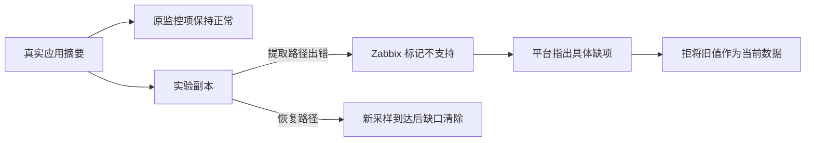

# DATA-QUALITY01：采集失败不能被旧正常值掩盖

## 范围与价值

数据库是否健康，首先取决于监控依据是否仍可用。本轮验证的是**采集项提取失败**时，平台能否指出具体缺项、阻止旧值被当作当前依据，并在新鲜采样恢复后清除缺口。

原候选“采样真正停更”没有找到现成、可独立暂停的实验心跳源，本轮未执行。采集错误是另一个明确分支，不能用它代替停更或稀疏采样验收。Zabbix 本身也能识别不支持项；这里验证平台是否保留该状态，不声称新增了 Zabbix 无法发现的数据库问题。

## 如何安全复现

在已登记的实验应用主机上，新建一个依赖于现有请求摘要的监控副本，正常提取真实连接池容量。原监控项、上游主项、应用和 MySQL 均不修改；不增加数据库查询。平台通过正常接入建立仅含原项与副本的两项验证对象，默认规则模式，无 AI 巡检策略。

正常采样和权限核对后，只将副本的 JSONPath 改为不存在的字段。独立护栏先启动并通过正常状态无操作预演，最长 180 秒后只恢复这个固定副本；主流程亦有 finally 恢复。恢复操作使用当前配置核对，不宣称提供 Zabbix API 原子比较交换。

## 实际结果（2026-11-13，Asia/Shanghai）

| 阶段 | 实际观察 | 结果 |
|---|---|---|
| 正常反例 | 原项与副本采样可用，该对象没有当前缺项 | PASS；不表示数据库全面健康 |
| 独立上游复现 | 16:25:01 修改副本；Zabbix 实际变为不支持，原项不变 | PASS |
| 平台自然发现 | 16:25:23 公网只读接口显示 1 项缺口，包含对象、主机、副本和 `item_unsupported` | PASS；距配置变更约 22 秒，不是承诺时限 |
| 阻止误用旧值 | 对应历史读取返回空行和 `item_unavailable`，没有把旧容量值当作当前可用值 | PASS |
| 恢复 | 16:25:24 恢复提取路径；上游随后有 5 次新鲜正常采样，16:25:55 平台当前缺口清除 | PASS；无缺口仍显示未知，不改称健康 |
| 护栏与原项 | 16:28 独立护栏读回已正常，只作无操作确认；原项配置前后一致 | PASS |
| AI 根因分析、真正停更、浏览器视觉 | 本轮没有执行 | 未验证，不计入通过 |

复现与恢复均来自实际 Zabbix 和平台自然采集，没有手工灌入平台结论或提交 AI 报告。这个分支现有逻辑已正确处理，因此不为通过案例增加专用规则。验证对象随后暂停、仅新增的监控副本停用；正常提取路径与历史保留，不在公开 A 增加一个数据库故障开关。

## 前检带来的适配修复

检查中还发现：`apiinfo.version` 被多带的认证头拒绝，适配器将其概括成上游不可用。实际匿名请求可以返回 7.0.32。按[官方约束](https://www.zabbix.com/documentation/7.0/en/manual/api/reference/apiinfo/version)，仅为版本方法省去认证头，其他来源读取保持 token 认证。

新回归在修复前两项失败；修后相关运输和覆盖 21 项通过，独立审查的版本/运输 12 项通过。真实只读复核确认：匿名版本可读、正常来源主机/历史可读，错误数据 token 仍不能读取主机。源码修复、完整回归与运行部署状态分别见[进度](../evolution-status.md)，不能把命令检查写成已替换运行服务。
